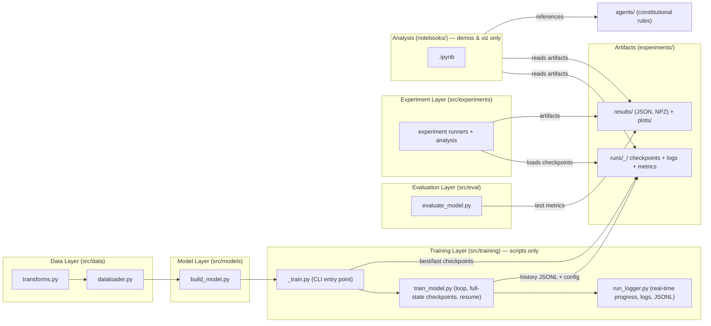

# Data-Science-Major-Project

- **Motivation/Background**: Data-Science-Major-Project implements a modular, reproducible deep-learning pipeline designed for robust research, high-performance training, and AI-assisted engineering.
- **Purpose**: Serve as the central portfolio entry point, architecture map, installation guide, and execution manual.
- **Overview Pipeline**: Follows strict Separation of Concerns (SoC) where all training runs as logged, resumable Python scripts, while notebooks are reserved for exploration, testing, and visualization.
- **Detailed Plan**: §1 Architecture; §2 Repository Layout; §3 Setup & Models; §4 Running Simulation & ASR; §5 Testing & Verification; §6 Governance.
- **References**: `agents/rules/`, `docs/`, `pyproject.toml`, `requirements.txt`.
- **Created**: 2026-07-25T00:00:00+07:00
- **Last Updated**: 2026-10-21T21:40:00+07:00


---

## 🏗️ Architecture Overview

Layered deep learning pipeline; each layer is a maintained `src/` package:



Key engineering guarantees:
- **Script-Only Training:** All training loops live in `src/training/*.py` or `src/experiments/*.py`. Notebooks never train.
- **Full-State Resumability:** Runs persist model, optimizer, scheduler, RNG state, config, and metrics per [agents/rules/LOGGING_CHECKPOINT_RULES.md](agents/rules/LOGGING_CHECKPOINT_RULES.md).
- **5W1H Empirical Context:** Every reported metric carries full 5W1H context per [agents/rules/RESULTS_REPORTING.md](agents/rules/RESULTS_REPORTING.md).
- **Strict Separation of Governance vs Memory:** Immutable constitutional rules live in [`agents/`](agents/), while evolving research notes, phase specifications, and experiment logs live in [`docs/`](docs/).

---

## 📁 Repository Structure

The template supports both **Single-Track** (default monolithic layout shown below) and **Multi-Track / Feature-Modular** layouts (for multi-lab coursework or modular research tracks). See [agents/rules/CREATE_FOLDER_STRUCTURE_TEMPLATE.md](agents/rules/CREATE_FOLDER_STRUCTURE_TEMPLATE.md) for full principles and placement rules.

```text
Data-Science-Major-Project/
├── agents/                    # Constitutional AI Governance (Immutable rules & templates)
│   ├── README.md              # Governance navigation guide
│   ├── rules/                 # Binding standards (AGENT_AI, FOLDER_STRUCTURE, MD, etc.)
│   └── templates/             # Reusable skeletons (BUG, AUDIT, EXP, PHASE, PROGRESS)
│
├── docs/                      # Evolving Project Research & Memory (Global)
│   ├── README.md              # Master research index
│   ├── PURPOSE.md             # Project brief & locked success criteria
│   ├── OVERVIEW.md            # Living roadmap indexing all tracks/phases
│   ├── shared/                # Universal SOPs (HOW_TO_SETUP_AI_AGENT, HANDOFF_TEMPLATE)
│   ├── phases/                # Pipeline phase technical specifications
│   ├── progress/              # Live phase status tracking (*_STATUS.md)
│   ├── experiments/           # Experiment plans and comparative writeups
│   ├── bugs/                  # Resolved and active bug reports
│   └── references/            # Reusable technical guides (Git, Optuna, etc.)
│
├── configs/                   # Configuration files (YAML)
│   └── config.yaml.example    # Configuration skeleton
│
├── data/                      # Dataset assets (ignored in git)
│   ├── raw/                   # Immutable raw inputs (never written by scripts)
│   └── processed/             # Cleaned splits and extracted features
│
├── src/                       # Maintained Python packages (or partitioned into tracks/)
│   ├── data/                  # Loading, transforms, dataloaders
│   ├── models/                # Neural network architectures
│   ├── training/              # Script-only training entry points
│   ├── eval/                  # Evaluation metrics & benchmark tables
│   ├── experiments/           # One-shot experiment runners
│   └── utils/                 # Logging, checkpoints, telemetry
│
├── notebooks/                 # Exploratory analysis & demo notebooks (NEVER train)
│
├── experiments/               # Experiment runtime outputs (runs/ & results/ gitignored)
│   ├── runs/<ts>_<run>/       # checkpoints/ logs/ metrics/ tensorboard/
│   └── results/               # Consolidated metrics & export plots
│
├── requirements/              # Multi-tier dependency specs (base.txt, dev.txt)
├── requirements.txt           # Unified dependency proxy (-r requirements/dev.txt)
├── pyproject.toml             # Build system & package discovery config
└── tests/                     # Unit and integration test suite
```

> [!TIP]
> **Multi-Track / Feature-Modular Projects:** When work naturally divides into distinct labs, features, or research questions, code, tests, configs, and experiment specs can be **colocated** within that unit (e.g. `tracks/<name>/` or `labs/<name>/`), while keeping `/agents`, global roadmap (`docs/OVERVIEW.md`), and base dependencies centralized.


---

## ⚙️ Installation & Setup

### 1. Python Environment (Repository Root)

All Python services, servers, and scripts execute from the **single root virtual environment**:

```bash
# Windows (PowerShell)
python -m venv .venv
.\.venv\Scripts\Activate.ps1
pip install -r requirements.txt

# Linux / macOS
python3 -m venv .venv
source .venv/bin/activate
pip install -r requirements.txt
```

> [!TIP]
> **GPU Acceleration (NVIDIA CUDA):**
> On Windows with NVIDIA GPUs (e.g. RTX 4060), install the PyTorch CUDA wheels for real-time speech and vision performance:
> ```bash
> pip install torch torchvision torchaudio --index-url https://download.pytorch.org/whl/cu124
> ```

---

## 📥 Required Models & Weight Downloads

Both models run **100% offline** and are excluded from Git commits via `.gitignore`:

### 1. YOLOv8n (Person Detection)
Download the pretrained YOLOv8n weights directly to `models/yolov8n/`:
```bash
# Windows PowerShell / Linux / macOS
curl.exe -L -o models/yolov8n/yolov8n.pt https://github.com/ultralytics/assets/releases/download/v8.4.0/yolov8n.pt
# Copy for sim_vision fallback
Copy-Item models/yolov8n/yolov8n.pt sim_vision/python/yolov8n.pt
```

### 2. PhoASR Whisper Small (Vietnamese Speech Recognition)
Download the complete Hugging Face model locally (no background cache dependency):
```bash
python scripts/download_phoasr.py
```
*Saves all 14 model files directly to `models/PhoASR-whisper-small/` (~927 MB).*

---

## 🎮 Running the Simulation & Vision Pipeline

### Step 1: Initialize Godot Project (First Time Only)
On a fresh clone, run Godot in headless editor mode once so it compiles `.godot/global_script_class_cache.cfg` and imports 3D textures/models:
```bash
# Replace with your local Godot 4.3+ console binary path
& "C:\Users\TDV\Downloads\Godot4\Godot_v4.7.2-stable_win64_console.exe" --headless --editor --quit --path sim_vision/godot
```

### Step 2: Start the YOLO WebSocket Server (Terminal 1)
```bash
python sim_vision/python/yolo_server.py --model models/yolov8n/yolov8n.pt
```
*Listens on `ws://127.0.0.1:8765`. It captures frames streamed by the robot, runs YOLOv8n inference on GPU/CPU, and returns bounding box coordinates.*

### Step 3: Launch Godot Simulation (Terminal 2)
```bash
& "C:\Users\TDV\Downloads\Godot4\Godot_v4.7.2-stable_win64_console.exe" --path sim_vision/godot
```
*Or open `sim_vision/godot/project.godot` inside Godot Editor and press **F5**.*

#### Interactive Controls in Simulation:
* **`R`**: Resets the robot and human to new random locations (≥ 3m apart).
* **`Esc`**: Quits the simulation.
* **Top-Right Overlay**: Live robot camera viewport, detection bounding boxes, state indicator (`SEARCH` / `APPROACH` / `ARRIVED`), and server connection status (`YOLO: đã kết nối` / `YOLO: mất kết nối`).

---

## 🎙️ Speech-to-Text (ASR) Pipeline

The speech pipeline evaluates Vietnamese voice commands for hospital navigation:

```bash
# 1. Convert audio samples to standardized 16kHz mono PCM WAV
python scripts/convert_audio.py

# 2. Test single audio transcription
python scripts/test_asr.py data/processed/real_voice/sample_001.wav

# 3. Run full 70-sample benchmark suite (with WER, CER, RTF metrics)
python scripts/evaluate_asr.py
```
*Benchmark metrics and summary are saved to `experiments/results/asr_summary.json`.*

---

## 🧪 Testing & Verification

Run both test batteries to ensure integrity across both engines:

### Python Test Battery (Pytest)
```bash
pytest
```
*Runs all 44 unit tests across project architecture, smoke tests, and WebSocket protocol/fake detector.*

### Godot Test Battery (GUT Headless)
```bash
& "C:\Users\TDV\Downloads\Godot4\Godot_v4.7.2-stable_win64_console.exe" --headless --path sim_vision/godot -s addons/gut/gut_cmdln.gd -gconfig=res://.gutconfig.json
```
*Runs all 81 unit/integration tests across room geometry, raycast safety, kinematics, FSM controller, and vision client.*

---

## 📜 Governance & Workflow

- AI agents adhere to the 6-stage lifecycle: `AUDIT → PLAN → IMPLEMENT → VERIFY → COMMIT → MERGE` ([agents/rules/AGENT_AI.md](agents/rules/AGENT_AI.md)).
- Setup procedures are codified in [docs/shared/HOW_TO_SETUP_AI_AGENT.md](docs/shared/HOW_TO_SETUP_AI_AGENT.md).
- Inter-agent checkpoints follow [docs/shared/HANDOFF_TEMPLATE.md](docs/shared/HANDOFF_TEMPLATE.md).
- Architectural choices and audit logs are recorded in [docs/AI-Human-logs/Vuong.md](docs/AI-Human-logs/Vuong.md).
