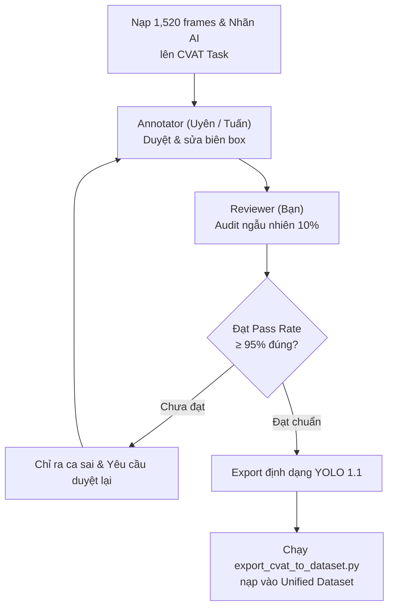

# 🏥 QUY CHUẨN ĐÁNH NHÃN DỮ LIỆU THỊ GIÁC BỆNH VIỆN TRÊN CVAT
> **Dự án**: Robot Trợ Lý Bệnh Viện — Phát Hiện Người & Hỗ Trợ Lâm Sàng (Godot 4 Simulation)  
> **Công cụ gán nhãn**: CVAT (Computer Vision Annotation Tool)  
> **Đối tượng áp dụng**: Kỹ sư & Thành viên Gán Nhãn (Bạn, Uyên, Tuấn)  
> **Phiên bản**: v3.0 (Chuẩn hóa 3 Classes lâm sàng: patient, doctor, wheelchair & Phân tách Hard Negatives)

---

## 1. Triết Lý & Nguyên Tắc Cốt Lõi

1. **Nguyên tắc "Visible Only" (Chỉ viền phần nhìn thấy được)**:
   - ✅ **ĐÚNG**: Bounding box phải ôm sát đường biên của **phần cơ thể thực tế nhìn thấy** qua camera robot.
   - ❌ **SAI**: Không bao giờ vẽ bao trùm các bộ phận bị che khuất hoàn toàn sau quầy lễ tân, bức tường hay sau tấm rèm (không vẽ full-body theo tưởng tượng).
2. **Không ai phải vẽ từ con số 0 (AI-Assisted Workflow)**:
   - Toàn bộ ảnh nạp lên CVAT **đã được nạp sẵn Bounding Box nháp** do Teacher Model / 3D Raycast sinh ra.
   - Nhiệm vụ chính của người kiểm định: **Chỉ việc kéo chỉnh mép box bị lệch, bấm phím xóa nhãn ảo, hoặc bổ sung những ca AI bị sót**.
   - Thời gian trung bình mỗi frame: chỉ từ **5 – 10 giây/frame**.

---

## 2. Danh Mục Classes Quy Chuẩn (3 Classes Lâm Sàng)

| Class ID | Tên Lớp | Màu Sắc | Đối tượng áp dụng |
| :---: | :---: | :---: | :--- |
| **0** | `patient` | 🟩 **Xanh lá (#00FF00)** | Bệnh nhân người lớn, người già chống gậy/gù lưng, trẻ em 4 tuổi, bệnh nhân ngồi băng ghế chờ, bệnh nhân nằm giường cấp cứu. |
| **1** | `doctor` | 🟨 **Vàng cam (#FFA500)** | Bác sĩ áo blouse trắng, điều dưỡng đồ scrub xanh ngọc, bác sĩ cầm hồ sơ bệnh án clipboard, bác sĩ tuần tra hành lang. |
| **2** | `wheelchair` | 🟦 **Xanh cyan (#00FFFF)** | Xe lăn y tế (áp dụng cho cả xe có người bệnh ngồi hoặc xe lăn rỗng). |

> [!CAUTION]
> ### 🚫 QUY TẮC TUYỆT ĐỐI VỚI STANDEE / POSTER HÌNH NGƯỜI:
> - **KHÔNG GÁN NHÃN CHO STANDEE / MÀN HÌNH QUẢNG CÁO!**
> - *Lý do*: Standee là vật thể tĩnh, không phát ra tiếng nói. Khi robot tiến tới, hệ thống VAD (nhận diện giọng nói) sẽ lắng nghe trong 3 giây. Nếu im lặng, FSM tự động hủy tương tác và bỏ đi tuần tra tiếp.
> - **Nếu thấy AI tự vẽ box lên Standee hoặc hình người trên poster/màn hình $\rightarrow$ Chọn box đó và bấm `Delete` ngay lập tức!**

---

## 3. Hướng Dẫn Chi Tiết Các Tình Huống Lâm Sàng Đặc Thù

### 3.1 Bệnh Nhân Nằm Giường (Recumbent Bed Patient — U2.8 / U2.11)
- **Đặc điểm**: Thân người nằm ngang trên đệm giường bệnh, đầu gối lên gối. Tỉ lệ khung hình nằm ngang ($W > H$).
- **Cách gán nhãn**:
  - Vẽ 1 box `person` ôm trọn phần thân trên, đầu và chân nhìn thấy trên mặt đệm.
  - Box có thể nằm ngang, sát mép đệm hoặc thành chắn giường.

### 3.2 Bệnh Nhân Ngồi Xe Lăn (Wheelchair Patient — U2.9)
- **Đặc điểm**: Bệnh nhân ngồi cố định trên xe lăn (Co-occurrence).
- **Cách gán nhãn**:
  - Vẽ **1 box `person`** cho phần cơ thể người (đầu, thân, chân).
  - Vẽ **1 box `wheelchair`** cho toàn bộ khung xe lăn (bánh xe, tựa lưng, để chân).
  - Hai box này **ĐƯỢC PHÉP CHỒNG LẤN (OVERLAP)**. Hệ thống YOLO26n NMS-Free sẽ bắt độc lập cả 2 class!

### 3.3 Bệnh Nhi / Trẻ Em (Pediatric Patient — U2.10, U6.6, U6.8)
- **Trẻ em đứng một mình (U2.10)**: Chiều cao $\approx 1.02\text{m}$. Vẽ 1 box `person` ôm khít từ đỉnh đầu đến gót chân.
- **Trẻ em đi dắt tay mẹ (U6.6)**: Vẽ **2 box `person` riêng biệt** (1 box người mẹ lớn, 1 box đứa trẻ nhỏ).
- **Trẻ em được mẹ bế trên tay (U6.8)**: 
  - Vẽ **1 box `person`** cho người mẹ.
  - Vẽ **1 box `person` thứ hai** cho em bé nằm ngang trước ngực mẹ.
  - Chấp nhận 2 box lồng ghép lên nhau!

### 3.4 Che Khuất Bởi Đạo Cụ Y Tế (Partial Occlusion — U3.x)
- **Đứng sau quầy lễ tân / Bàn làm việc**: Chỉ vẽ box `person` cho nửa thân trên (từ thắt lưng hoặc ngực lên đến đỉnh đầu). Không kéo box xuống chân bị che sau bàn.
- **Che sau rèm bệnh viện / Cột truyền dịch**: Nếu phần cơ thể nhìn thấy $\ge 15\%$ diện tích cơ thể $\rightarrow$ Vẽ ôm phần nhìn thấy. Nếu bị che $\ge 85\%$ (chỉ thấy 1 bàn tay/mũi giày) $\rightarrow$ Bỏ qua không gán nhãn.

---

## 4. Phím Tắt Thần Tốc Trên Giao Diện CVAT

Để thao tác nhanh bằng một tay trên bàn phím:

| Phím tắt | Chức năng | Hướng dẫn thao tác |
| :---: | :--- | :--- |
| **`Space`** hoặc **`F`** | Chuyển frame kế tiếp | Xem xong 1 ảnh, nếu box chuẩn $\rightarrow$ Bấm `Space` lướt tiếp (mất 2s). |
| **`D`** | Lùi về frame trước | Quay lại kiểm tra frame vừa lướt qua. |
| **`N`** | Tạo Bounding Box mới | Bấm `N` $\rightarrow$ Chọn class (`0: person` hoặc `1: wheelchair`) $\rightarrow$ Kéo chuột vẽ. |
| **`Del`** / **`Backspace`** | Xóa box được chọn | Click vào box AI vẽ nhầm (ví dụ box trên Standee) $\rightarrow$ Bấm `Del`. |
| **`Ctrl + S`** | Lưu kết quả | Bấm lưu định kỳ sau mỗi 20–30 frames. |
| **`Shift + Kéo chuột`** | Di chuyển góc nhìn (Pan) | Di chuyển vùng ảnh khi phóng to. |

---

## 5. Quy Trình Phối Hợp & Kiểm Tra Chéo (Review Workflow)

---

## 6. Tiêu Chí Nghiệm Thu (Acceptance Checklist)

Trước khi bấm "Export Annotations" từ CVAT, hãy kiểm tra 5 điều kiện sau:
- [ ] 100% người thật trong mọi tư thế (đứng, ngồi, nằm giường) đều có box `person`.
- [ ] Không có bất kỳ Standee, poster hay màn hình hiển thị nào bị gắn nhãn.
- [ ] Bounding box ôm sát mép nhìn thấy thực tế, không bị thừa khoảng trắng quá 10%.
- [ ] Các ca xe lăn có người ngồi đều có đủ 2 box: 1 `person` và 1 `wheelchair`.
- [ ] Đã bấm `Ctrl + S` lưu công việc trên giao diện CVAT.
