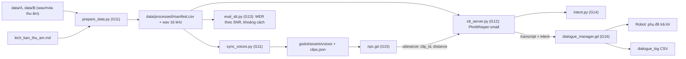
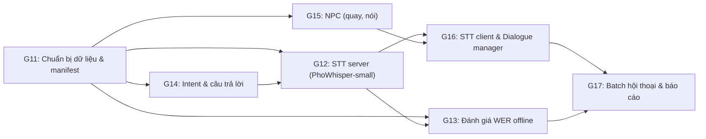

# Kế hoạch & Danh mục Prompt: STT tiếng Việt (PhoWhisper-small) & NPC tương tác với robot (Sim_Voice)

Tài liệu này theo đúng nguyên tắc và cấu trúc của `docs/lesson_2.md` và nối tiếp `godot_robot_yolo_prompt.md` (G1–G10):
- **Phân rã chức năng (Decomposition)**: Mỗi tính năng là 1 module Python hoặc 1 script Godot, đơn nhiệm.
- **Quy trình chuẩn**: `Yêu cầu ➔ Đặc tả (Input/Output/Edge case) ➔ Pseudocode (Hợp đồng) ➔ Prompt có cấu trúc ➔ Kiểm chứng (Test, Verification)`.
- **Cấu trúc Prompt chuẩn**:
  - **Ngữ cảnh**: Công nghệ, môi trường runtime.
  - **Nhiệm vụ**: Tên module, script, class, hàm cần triển khai.
  - **Ràng buộc**: Kiểu dữ liệu, xử lý lỗi, validation, quy tắc dữ liệu không suy diễn bừa bãi.
  - **Ví dụ / Pseudocode**: Minh họa luồng thực thi.
  - **Output mong muốn**: Code sạch + unit test + danh sách giả định.

**Nguồn chân lý:**
1. Mục 2 **Hợp đồng chung** của file này (message WebSocket STT, hằng số, trạng thái NPC và robot).
2. `recordings/kich_ban_thu_am.md` (transcript chuẩn và nhãn intent của từng câu).
3. Mục 2 của `godot_robot_yolo_prompt.md` cho mọi thứ đã có từ G1–G10.

Khi các nguồn khác nhau, theo thứ tự ưu tiên 1 ➔ 2 ➔ 3.

**Mục tiêu:** khi robot đến gần, NPC quay lại và nói một câu (lấy từ file thu âm thật). Robot "nghe" câu đó qua STT PhoWhisper-small, hiểu ý định, rồi trả lời bằng phụ đề. Mọi lượt hội thoại được ghi log để tính WER và độ chính xác intent theo khoảng cách và mức ồn.

---

## 🤖 Hướng dẫn dành cho AI thực thi file này

1. **Làm tuần tự từ PROMPT G11 đến G17.** Không nhảy bước. G1–G10 đã xong và chạy được.
2. **Sau mỗi prompt, chạy toàn bộ mục "Kiểm chứng".** Chỉ sang prompt tiếp theo khi đạt.
3. **Mọi giả định** ghi vào `ASSUMPTIONS.md` dạng `[G<số>] <giả định> — <lý do>`. Không bịa intent, field, tên message ngoài Mục 2 và kịch bản thu âm.
4. **Cập nhật `PROGRESS.md`** sau mỗi prompt.
5. **Thiếu thông tin hoặc dữ liệu không khớp ➔ DỪNG LẠI VÀ HỎI.** Đặc biệt: cấu trúc thư mục `data/` khác Mục 2.4 thì dừng và báo, không tự đoán.
6. **Không gọi model thật trong unit test.** STT dùng `FakeTranscriber`; YOLO giữ nguyên như G1–G10.
7. **Không sửa logic G1–G10** trừ chỗ Mục 2.3 yêu cầu (thêm trạng thái robot). Cần sửa thêm ➔ hỏi trước.
8. **Dữ liệu giọng nói là dữ liệu cá nhân.** Không upload lên dịch vụ ngoài, không commit file `.wav` vào git, không in nội dung transcript ra log ở mức `info` (chỉ `clip_id`, độ dài, thời gian xử lý).
9. **Không sửa file gốc trong `data/`.** Mọi file đã chuyển đổi ghi vào `data/processed/`.

---

## 1. Kiến trúc tổng thể



**Luồng một lượt hội thoại:**

| Bước | Thành phần | Kết quả |
| :--- | :--- | :--- |
| Robot ở `ARRIVED`, cách NPC ≤ `TALK_TRIGGER_DIST` | `main.gd` | NPC chuyển `NOTICE` |
| NPC quay mặt về robot | `npc.gd` | Quay xong ➔ `TALK` |
| NPC phát clip thu âm qua `AudioStreamPlayer3D` | `npc.gd` | Robot chuyển `LISTEN` |
| Clip phát xong, gửi `utterance` | `dialogue_manager.gd` | Robot chuyển `THINK` |
| Server đọc file gốc, giảm âm theo khoảng cách, trộn ồn, chạy PhoWhisper | `stt_server.py` | `text` |
| Nhận intent và slot (tên khoa, số phòng) | `intent.py` | `intent`, `slots` |
| Trả `transcript` về Godot | `stt_server.py` | |
| Robot hiện phụ đề câu trả lời, ghi log | `dialogue_manager.gd` | Robot `RESPOND` ➔ `ARRIVED`; NPC `IDLE` |

**Cấu trúc thư mục bổ sung:**
```
Data-Science-Major-Project/
  data/                          (người dùng cung cấp, KHÔNG sửa)
    A/  B/  noise/ (tùy chọn)
    processed/                   (G11 sinh ra)
  sim_vision/
    python/
      voice/
        transcripts.py           (G11: đọc kịch bản ➔ bảng transcript)
        prepare_data.py          (G11)
        sync_voices.py           (G11)
        text_norm.py             (G13)
        audio_sim.py             (G12: giảm âm, trộn ồn)
        transcriber.py           (G12: interface + PhoWhisperTranscriber)
        stt_server.py            (G12)
        eval_stt.py              (G13)
        intent.py                (G14)
        hospital_map.json        (G14: dữ liệu giả lập)
        responses.py             (G14)
      tests/voice/
    godot/
      scripts/npc.gd             (G15)
      scripts/stt_client.gd      (G16)
      scripts/dialogue_manager.gd(G16)
      scripts/subtitle.gd        (G16)
      assets/voices/             (G11 sinh ra, không commit)
      tools/dialogue_batch.gd    (G17)
```

---

## 2. Hợp đồng chung (nguồn chân lý)

### 2.1 Hằng số (thêm vào `Config` và `python/voice/config.py`)

| Tên | Giá trị | Ý nghĩa |
| :-- | :-- | :-- |
| `DATA_DIR` | `/Users/quangmanh/Project/Data-Science-Major-Project/data` | Thư mục dữ liệu gốc (đọc từ biến môi trường `DATA_DIR`, mặc định giá trị này) |
| `STT_WS_URL` | `ws://127.0.0.1:8766` | Địa chỉ STT server |
| `STT_MODEL_ID` | `vinai/PhoWhisper-small` | Model STT |
| `SAMPLE_RATE` | 16000 | Tần số lấy mẫu chuẩn |
| `TALK_TRIGGER_DIST` | 2.0 m | NPC bắt đầu nói khi robot đến gần hơn mức này |
| `TURN_DURATION_S` | 0.6 | Thời gian NPC quay mặt |
| `STT_TIMEOUT_S` | 10.0 | Quá thời gian này không có transcript ➔ lỗi |
| `NPC_COOLDOWN_S` | 8.0 | Thời gian chờ trước lượt nói tiếp theo |
| `MAX_TURNS` | 1 | Số lượt nói mỗi episode (tạm thời) |
| `SUBTITLE_S` | 4.0 | Thời gian hiện phụ đề câu trả lời |
| `REF_DIST_M` | 1.0 | Khoảng cách tham chiếu cho SNR |
| `DEFAULT_SNR_DB` | 20 | SNR mặc định tại 1 m |

### 2.2 Message WebSocket STT (JSON, UTF-8)

Godot ➔ Python:
```json
{"type": "utterance", "utt_id": 7, "clip_id": "A_07_n", "distance_m": 1.4, "snr_db": 20, "noise": "babble"}
```
- `noise` ∈ `"none" | "white" | "babble" | "<tên file trong data/noise không có đuôi>"`.

Python ➔ Godot (thành công):
```json
{"type": "transcript", "utt_id": 7, "clip_id": "A_07_n",
 "text": "phòng khám số 205 đi đường nào",
 "intent": "hoi_phong", "intent_conf": 0.9, "slots": {"room": "205"},
 "response": "Dạ, phòng 205 ở tầng 2. Mời anh chị đi theo tôi.",
 "stt_ms": 640.2, "audio_s": 2.35, "effective_snr_db": 17.1}
```

Python ➔ Godot (lỗi):
```json
{"type": "error", "utt_id": 7, "message": "clip not found: A_99_n"}
```

### 2.3 Trạng thái

- `NpcState` = `"IDLE" | "NOTICE" | "TALK" | "WAIT_REPLY"`. Ban đầu `IDLE`.
- `RobotState` **mở rộng** từ G1: thêm `"LISTEN" | "THINK" | "RESPOND"` sau `ARRIVED`. Controller G7 không đổi: khi robot ở `LISTEN`, `THINK`, `RESPOND` thì `main.gd` giữ `v = 0, omega = 0` và không gọi controller.

### 2.4 Cấu trúc dữ liệu đầu vào (`DATA_DIR`)

```
data/
  A/  A_01_r.wav, A_01_n.wav, ..., A_C01_r.wav, ...   (chấp nhận .wav, .m4a)
  B/  B_01_r.wav, ...
  noise/  (tùy chọn) *.wav tiếng ồn nền
```
- Tên file theo regex: `^(A|B)_(\d{2}|C\d{2})_(r|n)\.(wav|m4a)$`.
- Câu chung `C01..C10` lưu dưới tên `A_C01_r.wav`, `B_C01_r.wav`.
- File không khớp regex ➔ bỏ qua, ghi vào báo cáo `data/processed/skipped.csv`.

### 2.5 Transcript chuẩn

- Lấy từ các bảng trong `recordings/kich_ban_thu_am.md` (cột Mã, Câu, Intent).
- **Bản `_r` (đọc rõ):** transcript = câu trong kịch bản, `ref_verified = true`.
- **Bản `_n` (nói tự nhiên):** người thu được phép đổi chữ, nên transcript trong kịch bản chỉ là gần đúng ➔ `ref_verified = false`. WER chính chỉ tính trên `_r`. Với `_n`, G11 sinh file `data/processed/transcripts_n_todo.csv` để người dùng nghe và sửa tay; sửa xong ➔ `ref_verified = true`.

### 2.6 Chuẩn hóa văn bản để tính WER

1. Unicode NFC (tiếng Việt hay bị lẫn NFC/NFD).
2. Chữ thường.
3. Bỏ dấu câu `.,!?;:"'()…-`, giữ nguyên dấu thanh tiếng Việt.
4. Gộp khoảng trắng.
5. Không đổi số sang chữ. Lỗi do khác cách viết số (`205` và `hai trăm linh năm`) được đếm riêng ở cột `number_mismatch`.

---

## 🗺️ Bản đồ Chức năng (Feature Breakdown)



| Prompt | Phần | Kết quả |
| :-- | :-- | :-- |
| G11 | `transcripts.py`, `prepare_data.py`, `sync_voices.py` | `manifest.csv`, wav 16 kHz, clip cho Godot |
| G12 | `audio_sim.py`, `transcriber.py`, `stt_server.py` | Server trả transcript đúng Mục 2.2 |
| G13 | `text_norm.py`, `eval_stt.py` | Bảng WER/CER theo người, kiểu đọc, SNR, khoảng cách |
| G14 | `intent.py`, `hospital_map.json`, `responses.py` | Intent, slot, câu trả lời |
| G15 | `npc.gd`, sửa `human.tscn` | NPC quay mặt và phát clip |
| G16 | `stt_client.gd`, `dialogue_manager.gd`, `subtitle.gd` | Một lượt hội thoại hoàn chỉnh trong Godot |
| G17 | `dialogue_batch.gd`, báo cáo | N lượt tự động, WER và độ chính xác intent theo khoảng cách |

> **Lưu ý thứ tự:** G14 viết trước khi hoàn thiện G12 phần `response`. Nếu làm G12 trước, để `intent = null`, `response = null` và bổ sung sau G14.

---

## 📝 PROMPT G11: Chuẩn bị dữ liệu & manifest

### G11.1 Đặc tả (Specification)
- **Input**: `DATA_DIR` (Mục 2.4), `recordings/kich_ban_thu_am.md`.
- **Output**:
  - `data/processed/wav/<clip_id>.wav`: mono, 16 kHz, PCM 16-bit, đã cắt im lặng đầu cuối (giữ lại 200 ms).
  - `data/processed/manifest.csv` với cột: `clip_id, speaker, gender, sentence_id, take, text_ref, intent, ref_verified, duration_s, rms_dbfs, src_path`.
  - `data/processed/transcripts_n_todo.csv` (cho bản `_n`), `skipped.csv`, `missing.csv` (câu trong kịch bản mà chưa có file).
  - `godot/assets/voices/<clip_id>.wav` và `godot/assets/voices/clips.json` (do `sync_voices.py`).
- **Ràng buộc**:
  - `speaker` A ➔ `gender = "male"`, B ➔ `"female"`.
  - Chuyển `.m4a` bằng `ffmpeg` (gọi qua `subprocess`, kiểm tra có ffmpeg, không có ➔ báo lỗi rõ).
  - File hỏng, rỗng, dài < 0.3 s hoặc > 15 s ➔ đưa vào `skipped.csv` kèm lý do.
  - Clip bị rè (> 1% mẫu chạm ±1.0) ➔ vẫn giữ nhưng gắn cờ `clipping = true` trong manifest.
  - Chạy lại nhiều lần cho cùng kết quả (idempotent); file đã xử lý và không đổi thì bỏ qua.
  - Nếu `transcripts_n_todo.csv` đã được người dùng sửa (cột `text_fixed` có giá trị), dùng `text_fixed` làm `text_ref` và `ref_verified = true`.

### G11.2 Pseudocode (Hợp đồng xử lý)
```
load_script_table(md_path):
    đọc mọi bảng markdown có cột "Mã", "Câu", "Intent"
    với mã A_xx, B_xx: sentence_id = mã
    với mã Cxx: tạo 2 dòng A_Cxx, B_Cxx
    return dict sentence_id ➔ (text, intent)

prepare():
    script = load_script_table(...)
    for f in walk(DATA_DIR/A, DATA_DIR/B):
        m = regex(f.name); nếu không khớp: skipped.append(f, "bad name"); continue
        clip_id = f"{spk}_{sid}_{take}"; key = f"{spk}_{sid}"
        nếu key không có trong script: skipped.append(f, "not in script"); continue
        audio = load(f) ➔ mono ➔ resample 16k ➔ trim silence (giữ 200 ms)
        kiểm tra độ dài, clipping
        save processed/wav/clip_id.wav
        text, intent = script[key]; fixed = todo_fixes.get(clip_id)
        manifest.append(clip_id, spk, gender, sid, take, fixed or text, intent,
                        ref_verified = (take == "r") or fixed is not None, ...)
    missing = mọi (key, take) trong script ✕ {r, n} chưa có file
    ghi manifest, skipped, missing, transcripts_n_todo (giữ text_fixed cũ)
```

### G11.3 Prompt gửi AI
```markdown
### Ngữ cảnh:
Python 3.10+, macOS (Apple Silicon), `soundfile`, `librosa` (resample, trim), `numpy`, `pandas`, ffmpeg có sẵn trên máy. Dữ liệu ở `DATA_DIR` theo Mục 2.4; transcript theo Mục 2.5 và file `recordings/kich_ban_thu_am.md`.

### Nhiệm vụ:
1. `python/voice/config.py`: hằng số Mục 2.1, đọc `DATA_DIR` từ biến môi trường.
2. `python/voice/transcripts.py`: `load_script_table(md_path) -> dict[str, ScriptRow]`.
3. `python/voice/prepare_data.py`: CLI `python -m voice.prepare_data` theo pseudocode G11.2.
4. `python/voice/sync_voices.py`: copy `processed/wav` sang `godot/assets/voices/`, sinh `clips.json` dạng `{clip_id: {speaker, gender, sentence_id, take, intent, duration_s}}` (KHÔNG chứa text_ref).

### Ràng buộc:
1. Đúng đặc tả G11.1 và pseudocode G11.2.
2. Không ghi gì vào `DATA_DIR/A`, `DATA_DIR/B`.
3. Thư mục `data/` khác Mục 2.4 (vd không có A/ hoặc B/, tên file theo kiểu khác) ➔ in ra cấu trúc thực tế và DỪNG, hỏi người dùng.
4. Type hint mọi hàm; hàm thuần tách riêng để test.

### Ví dụ:
- `A_07_r.m4a` ➔ `processed/wav/A_07_r.wav`, dòng manifest `A_07_r, A, male, 07, r, "Phòng khám số 205 đi đường nào?", hoi_phong, true, ...`.
- `B_C03_n.wav` ➔ `text_ref = "Phòng xét nghiệm máu đi đường nào?"`, `ref_verified = false`.
- `ghi_am_moi.wav` ➔ `skipped.csv: ghi_am_moi.wav, bad name`.

### Output mong muốn:
Các file trên + test pytest dùng thư mục tạm và file sóng sin giả: parse bảng kịch bản (đủ 30 + 30 + 10×2 dòng); regex tên file; resample về 16 kHz; file quá ngắn bị bỏ; idempotent; `text_fixed` được ưu tiên. Cập nhật ASSUMPTIONS.md.
```

### G11.4 Quy trình kiểm chứng
- [ ] `pytest tests/voice -k prepare` pass.
- [ ] Chạy với dữ liệu thật: số dòng manifest + skipped = số file trong `data/A` và `data/B`.
- [ ] Mở `missing.csv` xem bạn nào còn thiếu câu nào.
- [ ] Nghe thử 3 file trong `processed/wav`: không bị méo, không bị cắt mất chữ đầu/cuối.

---

## 📝 PROMPT G12: STT server (PhoWhisper-small)

### G12.1 Đặc tả (Specification)
- **Input**: Message `utterance` (Mục 2.2).
- **Output**: Message `transcript` hoặc `error` (Mục 2.2).
- **Ràng buộc**:
  - Model `vinai/PhoWhisper-small` qua `transformers` (`WhisperForConditionalGeneration` + `WhisperProcessor`), `language="vi"`, `task="transcribe"`, decode greedy hoặc beam 1–5 (tham số dòng lệnh).
  - Thiết bị: `mps` nếu có (Mac), rồi `cuda`, rồi `cpu`; in ra thiết bị đang dùng lúc khởi động. Load model một lần.
  - Tải model lần đầu từ Hugging Face là được phép (model này là yêu cầu của người dùng); cache ở thư mục mặc định. Không dùng model khác.
  - **Mô phỏng âm thanh (`audio_sim.py`)**, hàm thuần, có `seed`:
    - Giảm âm theo khoảng cách: `gain = REF_DIST_M / max(distance_m, 0.3)`, kẹp `gain ≤ 1.5`.
    - Trộn ồn: mức ồn cố định sao cho SNR tại `REF_DIST_M` = `snr_db`; vì tiếng nói giảm theo khoảng cách nên `effective_snr_db = snr_db + 20·log10(gain)`.
    - `noise = "white"`: nhiễu trắng; `"babble"`: trộn 4 đến 6 clip khác người trong manifest, dịch thời gian ngẫu nhiên, giảm 20 dB (mô phỏng người nói chuyện xung quanh); tên file: đọc `data/noise/<tên>.wav`, lặp nếu ngắn hơn; `"none"`: không trộn.
    - Kẹp biên độ về [−1, 1] sau khi trộn.
  - `clip_id` không có trong manifest ➔ `error`. JSON hỏng ➔ `error`, server không dừng.
  - Xử lý từng utterance trong thread riêng (`asyncio.to_thread`); hàng chờ tối đa 4, đầy ➔ `error "stt busy"`.
  - Sau khi có `text`: gọi `intent.classify(text)` và `responses.build(intent, slots)` (G14). Chưa có G14 ➔ trả `null`.
  - Log mức `info`: `utt_id, clip_id, audio_s, stt_ms`. KHÔNG log `text`.

### G12.2 Pseudocode (Hợp đồng xử lý)
```
startup:
    manifest = read_csv(processed/manifest.csv)        // không có ➔ báo chạy G11 trước, exit(1)
    device = mps | cuda | cpu
    transcriber = PhoWhisperTranscriber(STT_MODEL_ID, device)

on_message(text):
    msg = parse_utterance(text)                         // lỗi ➔ error
    row = manifest[msg.clip_id]                         // không có ➔ error "clip not found"
    speech = load_wav(row.path)
    rng = Random(hash(msg.utt_id, msg.clip_id))
    audio, eff_snr = audio_sim.render(speech, msg.distance_m, msg.snr_db, msg.noise, rng)
    t0 = now(); text = transcriber.transcribe(audio, SAMPLE_RATE); stt_ms = now() - t0
    intent, conf, slots = intent.classify(text)
    response = responses.build(intent, slots)
    send transcript{...}
```

### G12.3 Prompt gửi AI
```markdown
### Ngữ cảnh:
Python 3.10+, macOS Apple Silicon (MPS), `torch`, `transformers`, `websockets` (asyncio), `soundfile`, `numpy`. Manifest từ G11. Hợp đồng ở Mục 2.1, 2.2.

### Nhiệm vụ:
1. `python/voice/audio_sim.py`: `render(speech, distance_m, snr_db, noise, rng) -> tuple[np.ndarray, float]`.
2. `python/voice/transcriber.py`: interface `Transcriber { transcribe(audio: np.ndarray, sr: int) -> str }`, lớp `PhoWhisperTranscriber`, lớp `FakeTranscriber` (trả `text_ref` từ manifest, dùng cho test).
3. `python/voice/stt_server.py`: server WebSocket tại 127.0.0.1:8766, tham số `--device`, `--beams`, `--port`.

### Ràng buộc:
1. Đúng đặc tả G12.1 và pseudocode G12.2.
2. `audio_sim.render` là hàm thuần, cùng `rng` ➔ cùng kết quả.
3. Kiểm tra `audio` đúng 16 kHz, mono, float32 trước khi đưa vào model.
4. Audio dài hơn 30 s ➔ cắt còn 30 s và ghi cảnh báo (Whisper chỉ nhận 30 s mỗi lần).

### Ví dụ:
- `render(x, distance_m=2.0, snr_db=20, noise="white")` ➔ `gain = 0.5`, `effective_snr_db ≈ 13.98`.
- `render(x, distance_m=0.5, snr_db=20, noise="none")` ➔ `gain = 1.5` (bị kẹp), `effective_snr_db = inf` (không có ồn).
- `{"type":"utterance","utt_id":1,"clip_id":"Z_01_r","distance_m":1,"snr_db":20,"noise":"none"}` ➔ `{"type":"error","utt_id":1,"message":"clip not found: Z_01_r"}`.

### Output mong muốn:
Các file trên + test pytest với `FakeTranscriber`: SNR đo lại trên tín hiệu sau trộn sai lệch ≤ 0.5 dB; gain theo khoảng cách; cùng seed cùng kết quả; clip không tồn tại; JSON hỏng; hàng chờ đầy ➔ "stt busy"; log không chứa text. Cập nhật ASSUMPTIONS.md.
```

### G12.4 Quy trình kiểm chứng
- [ ] Test pass.
- [ ] Chạy server thật, gửi `A_07_r` với `distance_m=1, noise="none"` ➔ text gần giống "phòng khám số 205 đi đường nào".
- [ ] Ghi lại `stt_ms` trên máy Mac: mục tiêu < 1500 ms cho câu 3 giây. Ghi kết quả vào PROGRESS.md.

---

## 📝 PROMPT G13: Đánh giá WER offline

### G13.1 Đặc tả (Specification)
- **Input**: `manifest.csv`, `Transcriber`, lưới điều kiện.
- **Output**: `reports/stt_eval_<timestamp>.csv` (mỗi dòng một clip ✕ một điều kiện) và `reports/stt_summary.md`.
- **Ràng buộc**:
  - Chuẩn hóa theo Mục 2.6 (`text_norm.py`), WER và CER bằng `jiwer`.
  - Lưới mặc định: `distance_m ∈ {0.5, 1, 2, 3}`, `snr_db ∈ {30, 20, 10, 5}`, `noise ∈ {none, white, babble}` (`none` chỉ chạy với 1 SNR). Seed cố định.
  - Chỉ tính WER trên clip `ref_verified = true`. Clip `_n` chưa sửa tay ➔ chỉ tính intent accuracy (G14), cột WER để trống.
  - Bảng tổng hợp: WER theo `speaker`, `take` (r/n), `noise`, `snr_db`, `distance_m`; kèm số clip mỗi ô. Có khoảng tin cậy 95% bằng bootstrap theo clip (1000 lần).
  - Cột `number_mismatch`: câu có số trong `text_ref` mà `hyp` viết khác dạng.
  - Có cache kết quả STT theo `(clip_id, distance, snr, noise, seed, model, beams)` để chạy lại nhanh.
  - Vẽ 2 biểu đồ: WER theo SNR (mỗi loại ồn một đường) và WER theo khoảng cách.

### G13.2 Prompt gửi AI
```markdown
### Ngữ cảnh:
Python 3.10+, `jiwer`, `pandas`, `matplotlib`, `transcriber.py` và `audio_sim.py` từ G12. Chuẩn hóa ở Mục 2.6.

### Nhiệm vụ:
1. `python/voice/text_norm.py`: `normalize(text) -> str`, `has_number_mismatch(ref, hyp) -> bool`.
2. `python/voice/eval_stt.py`: CLI `python -m voice.eval_stt --grid default --model vinai/PhoWhisper-small`.

### Ràng buộc:
1. Đúng đặc tả G13.1.
2. Không gọi STT server qua WebSocket; gọi `Transcriber` trực tiếp.
3. Lỗi một clip không làm dừng cả lượt đánh giá; ghi cột `error`.

### Ví dụ:
- `normalize("Phòng khám số 205 đi đường nào?")` ➔ `"phòng khám số 205 đi đường nào"`.
- `normalize` của chuỗi NFD và NFC cùng nội dung ➔ giống nhau.
- ref `"phòng 205"`, hyp `"phòng hai trăm linh năm"` ➔ `number_mismatch = true`.

### Output mong muốn:
Các file trên + test: normalize (dấu câu, hoa thường, NFC/NFD, khoảng trắng); WER khi ref = hyp là 0; bỏ qua clip chưa xác minh; cache hit không gọi transcriber; bootstrap trả khoảng chứa giá trị trung bình. Cập nhật ASSUMPTIONS.md.
```

### G13.3 Quy trình kiểm chứng
- [ ] Test pass.
- [ ] Chạy với `FakeTranscriber` ➔ WER = 0 mọi ô (kiểm tra đường ống).
- [ ] Chạy thật: WER tăng khi SNR giảm và khi khoảng cách tăng. Nếu không tăng ➔ kiểm tra lại `audio_sim` trước khi kết luận.
- [ ] Dò vết 3 clip có WER cao nhất: nghe audio sau mô phỏng, đọc hyp, ghi nguyên nhân vào báo cáo.

---

## 📝 PROMPT G14: Intent & câu trả lời

### G14.1 Đặc tả (Specification)
- **Input**: `text` (từ STT, đã hoặc chưa chuẩn hóa).
- **Output**: `(intent: str, intent_conf: float, slots: dict)` và câu trả lời `response: str`.
- **Ràng buộc**:
  - Tập intent đúng bảng Mục 6 của `kich_ban_thu_am.md`, thêm `unknown`.
  - **Baseline luật** (keyword sau chuẩn hóa), xét theo thứ tự ưu tiên: `cap_cuu` ➔ `dung_lai` ➔ `dieu_chinh_toc_do` ➔ `dieu_chinh_am_luong` ➔ `nhac_lai` ➔ `gap_nhan_vien` ➔ `dan_duong` ➔ `hoi_khoa` ➔ `hoi_phong` ➔ các intent còn lại ➔ `unknown`.
  - Khớp nguyên từ hoặc cụm từ, không khớp chuỗi con (vd "đau" không khớp trong "đâu").
  - `intent_conf`: 1.0 nếu khớp cụm từ đặc trưng, 0.6 nếu chỉ khớp từ đơn, 0 nếu `unknown`.
  - Slot: `department` (tra bí danh trong `hospital_map.json`), `room` (số 3 chữ số), `floor`.
  - `hospital_map.json` là **dữ liệu giả lập**, có trường `"is_mock": true`; sau khảo sát bệnh viện sẽ thay bằng dữ liệu thật.
  - `responses.build`: mẫu câu tiếng Việt cho từng intent; thiếu slot ➔ câu hỏi lại ("Dạ, anh chị muốn đến khoa nào ạ?"). `cap_cuu` luôn trả "Tôi đang gọi nhân viên y tế ngay. Anh chị giữ bình tĩnh nhé." `khong_ho_tro` luôn từ chối lịch sự, không đưa lời khuyên y khoa.
  - Không gọi LLM ở bước này.

### G14.2 Prompt gửi AI
```markdown
### Ngữ cảnh:
Python 3.10+, `text_norm.py` (G13). Tập intent ở `recordings/kich_ban_thu_am.md` Mục 6.

### Nhiệm vụ:
Tạo `python/voice/intent.py` (`classify(text) -> IntentResult`), `python/voice/hospital_map.json` (khoảng 12 khoa, 15 phòng, nhà thuốc, thu ngân, cấp cứu, thang máy, nhà vệ sinh; có `is_mock: true`), `python/voice/responses.py` (`build(intent, slots) -> str`).

### Ràng buộc:
1. Đúng đặc tả G14.1, kể cả thứ tự ưu tiên.
2. Mọi khoa, phòng xuất hiện trong kịch bản thu âm phải có trong `hospital_map.json`.
3. Không bịa thông tin y khoa trong câu trả lời.

### Ví dụ:
- "bố mình đang khó thở quá gọi bác sĩ giúp mình với" ➔ `cap_cuu` (không phải `gap_nhan_vien`).
- "khoa tiêu hóa ở tầng mấy" ➔ `hoi_khoa`, `{department: "tiêu hóa"}`.
- "phòng 112 ở tầng một hay tầng hai ạ" ➔ `hoi_phong`, `{room: "112"}`.
- "em có cần đeo khẩu trang không ạ" ➔ `khong_ho_tro`.
- "xin chào" ➔ `unknown`, response "Dạ, anh chị cần tôi giúp gì ạ?".

### Output mong muốn:
Các file trên + test: chạy `classify` trên toàn bộ `text_ref` của kịch bản và in độ chính xác + ma trận nhầm lẫn; các ví dụ trên; khớp nguyên từ. Ghi rõ trong ASSUMPTIONS.md rằng luật được viết dựa trên chính kịch bản nên độ chính xác trên `text_ref` sẽ cao hơn thực tế.
```

### G14.3 Quy trình kiểm chứng
- [ ] Test pass; độ chính xác trên `text_ref` ≥ 95%.
- [ ] Chạy `classify` trên `hyp` của G13 (SNR 20, 1 m) ➔ ghi độ chính xác; so với trên `text_ref` để thấy STT làm giảm bao nhiêu.
- [ ] Đọc toàn bộ câu trả lời trong `responses.py`: không có lời khuyên y khoa.

---

## 📝 PROMPT G15: NPC quay lại và nói

### G15.1 Đặc tả (Specification)
- **Input**: Vị trí robot, trạng thái robot, `clips.json`.
- **Output**: NPC quay mặt về robot, phát clip, signal `utterance_finished(clip_id: String)`.
- **Ràng buộc**:
  - `npc.gd` gắn vào `human.tscn` (G4), không phá animation idle/walk sẵn có.
  - `@export var speaker: String = "A"` (A nam, B nữ). Có model người nữ cho B thì dùng; chưa có ➔ dùng chung model và ghi ASSUMPTIONS.md.
  - `@export var clip_id: String = ""` (rỗng = chọn ngẫu nhiên trong các clip của `speaker`, ưu tiên clip có intent khác nhau giữa các lần). `@export var seed: int = -1`.
  - Chuyển trạng thái theo pseudocode G15.2. Khi `NOTICE`: dừng đi bộ, tween quay trục Y về phía robot trong `TURN_DURATION_S`. Khi `TALK`: chạy animation `talk` nếu có, không có thì `idle`; phát clip bằng `AudioStreamPlayer3D` gắn ở đầu (`unit_size = 1.0`, `attenuation_model = INVERSE_DISTANCE`).
  - Robot rời xa hơn `TALK_TRIGGER_DIST + 1.0` khi NPC đang `TALK` ➔ dừng phát, về `IDLE`, không gửi utterance.
  - Clip không load được ➔ `push_error`, về `IDLE`, không crash.
  - Hàm thuần `next_state(state, robot_state, dist, cooldown_left, turns_done) -> String` để test.

### G15.2 Pseudocode (Hợp đồng xử lý)
```
next_state(s, rs, d, cd, turns):
    if s == IDLE and rs == ARRIVED and d <= TALK_TRIGGER_DIST and cd <= 0 and turns < MAX_TURNS: return NOTICE
    if s == TALK and d > TALK_TRIGGER_DIST + 1.0: return IDLE        // robot bỏ đi
    return s

_process(delta):
    s2 = next_state(...)
    if s == IDLE and s2 == NOTICE: dừng walk; tween quay về robot; khi xong ➔ state = TALK; play clip
    if s == TALK and s2 == IDLE: stop audio
    khi audio finished: state = WAIT_REPLY; emit utterance_finished(clip_id)

on_reply_shown():          // gọi bởi dialogue_manager sau khi robot trả lời
    state = IDLE; cooldown = NPC_COOLDOWN_S; turns += 1; tiếp tục idle/walk
```

### G15.3 Prompt gửi AI
```markdown
### Ngữ cảnh:
Godot 4.3, GDScript có kiểu tĩnh. `human.tscn` (G4), `Config` (G1, thêm hằng số Mục 2.1), clip ở `res://assets/voices/` và `clips.json` (G11). Trạng thái ở Mục 2.3.

### Nhiệm vụ:
Tạo `godot/scripts/npc.gd`, cập nhật `godot/scenes/human.tscn` (thêm `AudioStreamPlayer3D`, node `Head` làm điểm phát), thêm hằng số vào `config.gd`.

### Ràng buộc:
1. Đúng đặc tả G15.1 và pseudocode G15.2.
2. Không đổi API sẵn có của `human.gd` (waypoint, walks).
3. Góc quay chọn đường ngắn nhất (không quay vòng 350°).

### Ví dụ:
- `next_state(IDLE, ARRIVED, 1.5, 0, 0)` ➔ `NOTICE`.
- `next_state(IDLE, APPROACH, 1.5, 0, 0)` ➔ `IDLE`.
- `next_state(IDLE, ARRIVED, 1.5, 3.0, 0)` ➔ `IDLE` (đang cooldown).
- `next_state(TALK, ARRIVED, 3.5, 0, 0)` ➔ `IDLE`.
- NPC hướng 170°, robot ở hướng −170° ➔ quay 20°, không quay 340°.

### Output mong muốn:
Script + scene + test GUT cho `next_state` và hàm tính góc quay ngắn nhất. Cập nhật ASSUMPTIONS.md.
```

### G15.4 Quy trình kiểm chứng
- [ ] Test GUT pass.
- [ ] Chạy scene: robot đến gần ➔ NPC quay lại mượt, nghe rõ tiếng từ phía NPC (thử đi vòng quanh để thấy âm 3D).
- [ ] Đẩy robot ra xa giữa lúc NPC nói ➔ NPC dừng nói.

---

## 📝 PROMPT G16: STT client & Dialogue manager

### G16.1 Đặc tả (Specification)
- **Input**: Signal `utterance_finished` (G15), message `transcript` (Mục 2.2).
- **Output**: Robot đổi trạng thái `LISTEN ➔ THINK ➔ RESPOND ➔ ARRIVED`; phụ đề trên màn hình; dòng log hội thoại.
- **Ràng buộc**:
  - `stt_client.gd`: giống `vision_client.gd` (G6) về kết nối lại, kiểm tra message, bỏ message cũ theo `utt_id`. Hàm thuần `parse_transcript(text) -> Dictionary`.
  - `dialogue_manager.gd`:
    - NPC vào `TALK` ➔ robot `LISTEN`.
    - `utterance_finished` ➔ gửi `utterance` với `distance_m` thật (mặt phẳng XZ), `snr_db` và `noise` lấy từ `@export` (mặc định `DEFAULT_SNR_DB`, `"babble"`); robot `THINK`.
    - Nhận `transcript` đúng `utt_id` ➔ robot `RESPOND`, hiện phụ đề 2 dòng trong `SUBTITLE_S`: dòng 1 "Nghe được: <text>" (nhỏ, màu nhạt), dòng 2 "Robot: <response>". Hết thời gian ➔ robot `ARRIVED`, gọi `npc.on_reply_shown()`.
    - Quá `STT_TIMEOUT_S` hoặc nhận `error` ➔ phụ đề "Robot: Xin lỗi, tôi chưa nghe rõ. Anh chị nói lại được không ạ?", log `error`, về `ARRIVED`.
    - STT mất kết nối ➔ overlay hiện `STT: mất kết nối`; NPC vẫn nói nhưng robot trả lời câu xin lỗi ở trên.
  - Ô góc nhìn (G5) thêm dòng `STT: đã kết nối / mất kết nối`.
  - Log `logs/dialogue_<timestamp>.csv`: `time_s, utt_id, clip_id, speaker, take, distance_m, snr_db, noise, effective_snr_db, hyp_text, intent_pred, intent_conf, stt_ms, error`. (`text_ref` và `intent_true` ghép sau ở G17 từ manifest, không đưa vào Godot.)

### G16.2 Pseudocode (Hợp đồng xử lý)
```
on_npc_talk_started(): robot.state = LISTEN
on_utterance_finished(clip_id):
    utt_id += 1
    stt.send({"type":"utterance","utt_id":utt_id,"clip_id":clip_id,
              "distance_m":dist_xz(robot,npc),"snr_db":snr_db,"noise":noise})
    robot.state = THINK; deadline = now + STT_TIMEOUT_S
on_transcript(r):
    if r.utt_id != utt_id: return
    robot.state = RESPOND; subtitle.show(r.text, r.response, SUBTITLE_S); log(r)
_process():
    if robot.state == THINK and now > deadline: show_sorry(); log(error="timeout"); finish()
on_subtitle_done(): finish()
finish(): robot.state = ARRIVED; npc.on_reply_shown()
```

### G16.3 Prompt gửi AI
```markdown
### Ngữ cảnh:
Godot 4.3, GDScript có kiểu tĩnh. Đã có `main.gd` (G8), `view_overlay.gd` (G5), `vision_client.gd` (G6, dùng làm mẫu), `npc.gd` (G15), STT server (G12). Hợp đồng ở Mục 2.

### Nhiệm vụ:
Tạo `godot/scripts/stt_client.gd`, `godot/scripts/dialogue_manager.gd`, `godot/scripts/subtitle.gd` + `subtitle.tscn`; cập nhật `main.gd` (giữ robot đứng yên khi ở LISTEN/THINK/RESPOND), `config.gd` (enum RobotState mở rộng), `view_overlay.gd` (dòng STT).

### Ràng buộc:
1. Đúng đặc tả G16.1 và pseudocode G16.2.
2. Không đổi `controller.gd` (G7). Test cũ G1–G10 phải vẫn pass.
3. Phụ đề hỗ trợ tiếng Việt có dấu (font có đủ glyph), nền tối mờ, chữ ≥ 22 px.

### Ví dụ:
- `parse_transcript('{"type":"transcript","utt_id":3,"clip_id":"A_07_r","text":"...","intent":"hoi_phong","intent_conf":1.0,"slots":{},"response":"...","stt_ms":500,"audio_s":2,"effective_snr_db":20}')` ➔ `ok = true`.
- Nhận `utt_id = 2` khi đang chờ `utt_id = 3` ➔ bỏ qua.
- Không có transcript sau 10 s ➔ câu xin lỗi, log `timeout`.

### Output mong muốn:
Các file trên + test GUT cho `parse_transcript`, logic timeout, bỏ `utt_id` cũ, chuyển trạng thái robot. Chạy lại toàn bộ test G1–G10. Cập nhật ASSUMPTIONS.md.
```

### G16.4 Quy trình kiểm chứng
- [ ] Toàn bộ test GUT (cũ và mới) pass.
- [ ] Bật YOLO server + STT server, chạy scene: robot tìm người ➔ đến gần ➔ NPC quay lại nói ➔ phụ đề hiện câu nghe được và câu trả lời.
- [ ] Tắt STT server ➔ robot trả lời câu xin lỗi, không treo.

---

## 📝 PROMPT G17: Batch hội thoại & báo cáo

### G17.1 Đặc tả (Specification)
- **Output**: `logs/dialogue_batch_<timestamp>.csv`, `reports/dialogue_summary.md`.
- **Ràng buộc**:
  - `dialogue_batch.gd`: chạy N episode (mặc định 40), mỗi episode: đặt robot và NPC ngẫu nhiên (seed = chỉ số episode), chọn `speaker` và `clip_id` theo vòng để phủ đều các intent, đặt `snr_db` và `noise` theo danh sách cấu hình; chạy đến khi xong 1 lượt hội thoại hoặc quá 60 giây.
  - Thêm biến thể khoảng cách: cho robot dừng ở các mức `H_TARGET` khác nhau (0.45, 0.55, 0.65) để có khoảng cách nói khác nhau.
  - `python/voice/analyze_dialogue.py`: ghép log với manifest (`text_ref`, `intent_true`), tính WER (chỉ `ref_verified`), intent accuracy, tỉ lệ trả lời đúng `cap_cuu` (recall của `cap_cuu` phải được báo riêng), thời gian từ lúc NPC nói xong đến lúc có phụ đề.
  - Báo cáo có: bảng tổng hợp, WER và intent accuracy theo khoảng cách, 5 lượt sai tiêu biểu (clip_id, hyp, intent dự đoán, intent đúng).

### G17.2 Prompt gửi AI
```markdown
### Ngữ cảnh:
Godot 4.3, Python 3.10+, `pandas`, `jiwer`, `matplotlib`. Toàn bộ G11–G16 đã xong.

### Nhiệm vụ:
Tạo `godot/tools/dialogue_batch.tscn` + `dialogue_batch.gd`, `python/voice/analyze_dialogue.py`; cập nhật `README.md` (mục "Hội thoại NPC": chạy 2 server, chạy scene, chạy batch, đọc báo cáo).

### Ràng buộc:
1. Đúng đặc tả G17.1.
2. Không đổi logic G11–G16; phát hiện lỗi ➔ ghi PROGRESS.md và hỏi trước khi sửa.
3. Báo cáo ghi rõ: dữ liệu chỉ có 2 người nói, 20 tuổi; kết quả chưa đại diện cho người cao tuổi.

### Output mong muốn:
Các file trên; chạy batch 40 episode; báo cáo `dialogue_summary.md`; cập nhật ASSUMPTIONS.md và PROGRESS.md.
```

### G17.3 Quy trình kiểm chứng
- [ ] ≥ 95% episode hoàn thành một lượt hội thoại (không treo, không timeout do lỗi code).
- [ ] Recall `cap_cuu` được báo riêng; mọi lượt `cap_cuu` bị bỏ sót được dò vết.
- [ ] Số liệu WER trong báo cáo khớp với G13 ở cùng điều kiện (sai lệch nhỏ do khoảng cách khác nhau).

---

## 📎 Phụ lục A: Hỏi tiếp để kiểm chứng (dùng sau mỗi prompt)

1. Còn edge case nào chưa xử lý? (clip rất ngắn, NPC và robot quá sát, hai lượt nói chồng nhau, STT trả text rỗng)
2. Đề xuất thêm 5 test ngoài danh sách.
3. Chỗ nào trong code dùng giả định không có trong đặc tả?
4. Hàm nào có tác dụng phụ (ghi file, đổi trạng thái ngoài hàm)?
5. Chuỗi tiếng Việt đi qua những bước nào, ở bước nào có thể bị đổi giữa NFC và NFD?

**Tự kiểm chứng:** chạy thử với dữ liệu nhỏ (1 clip) ➔ đọc model card `vinai/PhoWhisper-small` và tài liệu `transformers` Whisper ➔ kiểm tra đúng phiên bản `torch`/`transformers` đang cài và MPS hoạt động ➔ mở từng link AI đưa ra.

## 📎 Phụ lục B: Nối với đồ án

| # | Hạng mục | Dùng cho |
| :-- | :-- | :-- |
| D1 | Bảng WER theo SNR và khoảng cách (G13) | Chương đánh giá STT trong báo cáo |
| D2 | `intent.py` baseline luật | Mốc so sánh khi thay bằng PhoBERT hoặc LLM + RAG |
| D3 | `hospital_map.json` (giả lập) | Thay bằng dữ liệu thật sau khảo sát bệnh viện |
| D4 | Intent `dan_duong`, `dieu_chinh_toc_do`, `dung_lai` | Lệnh đầu vào cho policy RL dẫn đường |
| D5 | Câu trả lời dạng chữ | Bước sau: TTS tiếng Việt để robot nói thành tiếng |

## 📎 Phụ lục C: Việc người dùng cần làm (AI không làm được)

| # | Việc | Khi nào |
| :-- | :-- | :-- |
| U1 | Đặt file thu âm vào `data/A`, `data/B` đúng tên Mục 2.4 | Trước G11 |
| U2 | Nghe và sửa `transcripts_n_todo.csv` (cột `text_fixed`) | Sau G11, trước khi chạy WER cho bản `_n` |
| U3 | (Tùy chọn) Thêm tiếng ồn nền vào `data/noise/` (vd tự ghi âm sảnh đông người, hoặc bộ DEMAND giấy phép CC BY-SA) | Trước G13 |
| U4 | (Tùy chọn) Model người nữ cho NPC giọng B | Trước G15 |

---

## 🎯 Bảng Checklist Quyết Định & Dò Vết (Theo Lesson 2)

| Bước | Tiêu chí kiểm chứng | Trạng thái | Quyết định |
| :--- | :--- | :---: | :---: |
| **G11** | Manifest đủ, không sửa data gốc, `_n` gắn `ref_verified=false`, idempotent | [ ] | Chấp nhận / Sửa / Từ chối |
| **G12** | PhoWhisper-small chạy trên MPS, SNR mô phỏng đúng ±0.5 dB, không log text | [ ] | Chấp nhận / Sửa / Từ chối |
| **G13** | Chuẩn hóa NFC, WER chỉ trên clip đã xác minh, WER tăng khi ồn tăng | [ ] | Chấp nhận / Sửa / Từ chối |
| **G14** | Thứ tự ưu tiên đúng, `cap_cuu` không bị nhầm, không có lời khuyên y khoa | [ ] | Chấp nhận / Sửa / Từ chối |
| **G15** | NPC quay đường ngắn nhất, âm 3D, dừng nói khi robot bỏ đi | [ ] | Chấp nhận / Sửa / Từ chối |
| **G16** | Một lượt hội thoại hoàn chỉnh, timeout và mất kết nối không treo, test cũ vẫn pass | [ ] | Chấp nhận / Sửa / Từ chối |
| **G17** | ≥ 95% episode hoàn thành, recall `cap_cuu` báo riêng, báo cáo có lượt sai tiêu biểu | [ ] | Chấp nhận / Sửa / Từ chối |

## 📒 Nhật ký AI

| Prompt | Lần | Prompt / câu hỏi | Kết quả AI trả | Test (đạt / chưa đạt) | Quyết định | Lý do |
| :-- | :-- | :-- | :-- | :-- | :-- | :-- |
| G11 | 1 | | | | | |
