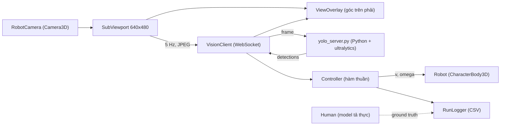
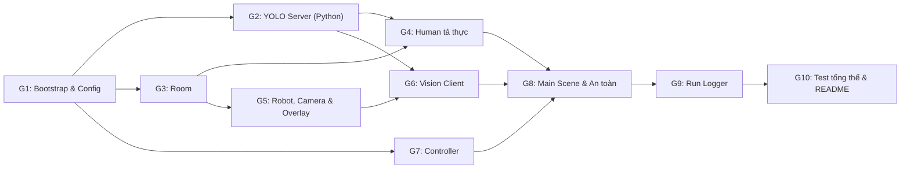

# Kế hoạch & Danh mục Prompt: Robot tìm người bằng YOLOv8n trong Godot (Sim_Vision)

Tài liệu này theo đúng nguyên tắc và cấu trúc của `docs/lesson_2.md`:
- **Phân rã chức năng (Decomposition)**: Mỗi tính năng là 1 scene hoặc 1 script Godot (hoặc 1 module Python), đơn nhiệm.
- **Quy trình chuẩn**: `Yêu cầu ➔ Đặc tả (Input/Output/Edge case) ➔ Pseudocode (Hợp đồng) ➔ Prompt có cấu trúc ➔ Kiểm chứng (Test, Verification)`.
- **Cấu trúc Prompt chuẩn**:
  - **Ngữ cảnh**: Công nghệ, môi trường runtime.
  - **Nhiệm vụ**: Tên scene, script, class, hàm cần triển khai.
  - **Ràng buộc**: Kiểu dữ liệu, xử lý lỗi, validation, quy tắc dữ liệu không suy diễn bừa bãi.
  - **Ví dụ / Pseudocode**: Minh họa luồng thực thi.
  - **Output mong muốn**: Code sạch + unit test + danh sách giả định.

**Nguồn chân lý:** Mục 2 **Hợp đồng chung** của file này (định dạng message WebSocket, hằng số, tên trạng thái). Khi prompt nào khác Mục 2, theo Mục 2.

**Mục tiêu:** dựng 1 căn phòng, 1 robot, 1 người tả thực và 1 ô góc nhìn robot ở góc trên bên phải. Robot dùng `yolov8n.pt` để tìm người, quay về phía người và tiến lại gần. Đây là bước đầu của đồ án robot dẫn đường bệnh viện; về sau bộ điều khiển sẽ được thay bằng policy RL, nên bộ điều khiển phải tách riêng.

---

## 🤖 Hướng dẫn dành cho AI thực thi file này

1. **Làm tuần tự từ PROMPT G1 đến G10.** Không nhảy bước.
2. **Sau mỗi prompt, chạy toàn bộ mục "Kiểm chứng".** Chỉ sang prompt tiếp theo khi đạt.
3. **Mọi giả định** ghi vào `ASSUMPTIONS.md` dạng `[G<số>] <giả định> — <lý do>`. Không bịa field, tên message, hằng số ngoài Mục 2.
4. **Cập nhật `PROGRESS.md`** sau mỗi prompt: phần đã xong, test pass, vấn đề tồn tại.
5. **Thiếu thông tin hoặc yêu cầu mâu thuẫn ➔ DỪNG LẠI VÀ HỎI.** Không giải quyết bằng mọi giá.
6. **Không gọi YOLO thật trong unit test.** Python dùng model giả qua interface; Godot test bộ điều khiển bằng dữ liệu detection giả. YOLO thật chỉ dùng ở mục Kiểm chứng của G4 và G10.
7. **Không dùng API đã bị bỏ ở Godot 4** (`KinematicBody`, `yield`, `instance()`…). Mọi biến GDScript có kiểu tĩnh (`var x: float`).
8. **Không tự thay model.** Chỉ dùng `yolov8n.pt` do người dùng cung cấp; không tự tải model khác. Không thay người tả thực bằng hình khối.
9. **Asset 3D** chỉ dùng loại có giấy phép CC0, MIT hoặc tương đương; ghi nguồn vào `assets/CREDITS.md`.

---

## 1. Kiến trúc tổng thể



**Luồng xử lý mỗi chu kỳ nhận diện:**

| Bước | Thành phần | Kết quả |
| :--- | :--- | :--- |
| Lấy ảnh từ camera robot (5 Hz) | `VisionClient` | Ảnh 640×480 |
| Mã hóa JPEG, gửi qua WebSocket | `VisionClient` | Message `frame` |
| Chạy YOLOv8n, lọc class `person` | `yolo_server.py` | Message `detections` |
| Bỏ kết quả cũ, chọn người có `conf` cao nhất | `VisionClient` + `Controller` | 1 detection hoặc không có |
| Tính trạng thái và `(v, omega)` | `Controller` | `SEARCH` / `APPROACH` / `ARRIVED` |
| Kiểm tra an toàn, di chuyển robot | `Robot` | Robot quay, tiến hoặc dừng |
| Vẽ box, ghi log | `ViewOverlay`, `RunLogger` | Ô góc nhìn + 1 dòng CSV |

**Cấu trúc thư mục đích:**
```
sim_vision/
  godot/
    project.godot
    scenes/        main.tscn, room.tscn (G3), human.tscn (G4), robot.tscn (G5)
    scripts/
      config.gd           (G1: hằng số Mục 2)
      robot.gd            (G5)
      view_overlay.gd     (G5)
      vision_client.gd    (G6)
      controller.gd       (G7)
      main.gd             (G8)
      run_logger.gd       (G9)
    assets/        (model, texture, CREDITS.md)
    tests/         (GUT: test_controller.gd, test_vision_client.gd, ...)
    addons/gut/
  python/
    yolo_server.py, detector.py, protocol.py   (G2)
    tests/
    requirements.txt
    yolov8n.pt     (người dùng cung cấp)
  logs/
  ASSUMPTIONS.md, PROGRESS.md, README.md
```

---

## 2. Hợp đồng chung (nguồn chân lý)

### 2.1 Hằng số

| Tên | Giá trị | Ý nghĩa |
| :-- | :-- | :-- |
| `WS_URL` | `ws://127.0.0.1:8765` | Địa chỉ YOLO server |
| `CAPTURE_HZ` | 5 | Tần số gửi ảnh |
| `IMG_W`, `IMG_H` | 640, 480 | Độ phân giải SubViewport |
| `JPEG_QUALITY` | 0.8 | Chất lượng JPEG |
| `YOLO_CONF` | 0.4 | Ngưỡng tin cậy phía server |
| `V_MAX` | 0.8 m/s | Vận tốc tiến tối đa |
| `OMEGA_MAX` | 1.5 rad/s | Vận tốc quay tối đa |
| `K_ANG` | 2.0 | Hệ số quay |
| `K_LIN` | 1.5 | Hệ số tiến |
| `H_TARGET` | 0.65 | Chiều cao box (tỉ lệ khung hình) coi là đã đến |
| `H_HYST` | 0.10 | Độ trễ để thoát `ARRIVED` |
| `ALIGN_TOL` | 0.25 | Lệch tâm quá mức này thì chỉ quay, không tiến |
| `LOST_TIMEOUT_S` | 1.5 | Mất người quá thời gian này thì về `SEARCH` |
| `SEARCH_OMEGA` | 0.5 rad/s | Tốc độ quay khi tìm |
| `STALE_MS` | 500 | Kết quả trễ hơn mức này bị bỏ |
| `SAFE_DIST_HUMAN` | 0.8 m | Dừng nếu khoảng cách thật tới người nhỏ hơn |
| `SAFE_DIST_OBSTACLE` | 0.5 m | Dừng nếu raycast phía trước chạm vật cản |
| `RECONNECT_S` | 2.0 | Chu kỳ thử kết nối lại |

### 2.2 Message WebSocket (JSON, UTF-8)

Godot ➔ Python:
```json
{"type": "frame", "frame_id": 12, "width": 640, "height": 480, "jpeg_b64": "<base64>"}
```

Python ➔ Godot (thành công):
```json
{"type": "detections", "frame_id": 12, "infer_ms": 23.5,
 "detections": [{"x1": 0.41, "y1": 0.20, "x2": 0.58, "y2": 0.86, "conf": 0.87}]}
```

Python ➔ Godot (lỗi):
```json
{"type": "error", "frame_id": 12, "message": "invalid jpeg"}
```

- Tọa độ chuẩn hóa về [0, 1] theo `width`, `height`; `0 ≤ x1 < x2 ≤ 1`, `0 ≤ y1 < y2 ≤ 1`.
- `detections` chỉ chứa class `person` (COCO id 0), sắp `conf` giảm dần.
- `frame_id` là số nguyên tăng dần, do Godot sinh.

### 2.3 Trạng thái robot

`RobotState` = `"SEARCH"` | `"APPROACH"` | `"ARRIVED"`. Trạng thái ban đầu: `SEARCH`.

### 2.4 Quy ước hướng

Trong Godot, `omega > 0` là quay trái (ngược chiều kim đồng hồ nhìn từ trên xuống), `omega < 0` là quay phải. Người nằm bên phải ảnh (`cx > 0.5`) ➔ robot quay phải ➔ `omega < 0`.

---

## 🗺️ Bản đồ Chức năng (Feature Breakdown)



| Prompt | Phần | Kết quả |
| :-- | :-- | :-- |
| G1 | Khởi tạo project Godot + Python, `config.gd`, GUT, file theo dõi | Project chạy rỗng |
| G2 | `yolo_server.py`, `detector.py`, `protocol.py` | Server trả detection đúng Mục 2.2 |
| G3 | `room.tscn` | Phòng 8×6×3 m, PBR, ánh sáng |
| G4 | `human.tscn` | Người tả thực, YOLO nhận ra |
| G5 | `robot.tscn`, `robot.gd`, `view_overlay.gd` | Robot di chuyển được, ô góc nhìn |
| G6 | `vision_client.gd` | Gửi ảnh, nhận detection, tự nối lại |
| G7 | `controller.gd` | Hàm thuần tính trạng thái và `(v, omega)` |
| G8 | `main.tscn`, `main.gd` | Ghép tất cả, kiểm tra an toàn |
| G9 | `run_logger.gd` | CSV mỗi chu kỳ nhận diện |
| G10 | Test tổng thể, README | Chạy được từ đầu đến cuối |

---

## 📝 PROMPT G1: Bootstrap & Config

### G1.1 Đặc tả (Specification)
- **Input**: Không.
- **Output**: Project Godot mở được, có scene `main.tscn` rỗng; môi trường Python cài được; file theo dõi tiến độ.
- **Ràng buộc**:
  - `config.gd` là `class_name Config`, chỉ chứa hằng số `const` đúng tên và giá trị Mục 2.1, cộng enum trạng thái Mục 2.3.
  - Cài GUT (Godot Unit Test) cho Godot 4 vào `addons/gut/`.
  - `requirements.txt` ghim phiên bản: `ultralytics`, `websockets`, `opencv-python-headless`, `numpy`, `pytest`, `pytest-asyncio`.

### G1.2 Prompt gửi AI
```markdown
### Ngữ cảnh:
Godot 4.3 trở lên, renderer Forward+, GDScript có kiểu tĩnh. Python 3.10+. Hợp đồng chung ở Mục 2 của file kế hoạch.

### Nhiệm vụ:
1. Tạo cấu trúc thư mục như Mục 1.
2. `godot/scripts/config.gd`: `class_name Config`, hằng số Mục 2.1, `enum RobotState { SEARCH, APPROACH, ARRIVED }` và hàm `state_name(s) -> String`.
3. Cài GUT vào `godot/addons/gut/`, tạo `godot/tests/test_config.gd`.
4. `python/requirements.txt` có ghim phiên bản.
5. Tạo `ASSUMPTIONS.md`, `PROGRESS.md`, `.gitignore` (bỏ `logs/`, `.godot/`, `__pycache__/`, `*.pt`).

### Ràng buộc:
1. Tên và giá trị hằng số đúng từng chữ như Mục 2.1.
2. Không thêm hằng số ngoài Mục 2.1; cần thêm ➔ ghi ASSUMPTIONS.md và hỏi.

### Ví dụ:
- `Config.H_TARGET` ➔ `0.65`; `Config.state_name(Config.RobotState.ARRIVED)` ➔ `"ARRIVED"`.

### Output mong muốn:
Các file trên; test GUT kiểm tra vài hằng số và `state_name`; cập nhật ASSUMPTIONS.md, PROGRESS.md.
```

### G1.3 Quy trình kiểm chứng
- [ ] Mở project bằng Godot 4.3, không có lỗi trong Output.
- [ ] `pip install -r requirements.txt` chạy được.
- [ ] Chạy GUT: `test_config.gd` pass.

---

## 📝 PROMPT G2: YOLO Server (Python)

### G2.1 Đặc tả (Specification)
- **Input**: Message `frame` theo Mục 2.2.
- **Output**: Message `detections` hoặc `error` theo Mục 2.2.
- **Ràng buộc**:
  - Load `yolov8n.pt` một lần lúc khởi động. Không có file ➔ in lỗi rõ ràng, thoát mã ≠ 0. Không tự tải model.
  - Chỉ giữ class `person` (`classes=[0]`), `conf ≥ YOLO_CONF`.
  - JSON hỏng, thiếu trường, JPEG không giải mã được ➔ trả `error`, server không dừng.
  - Một client gửi dồn nhiều frame ➔ chỉ xử lý frame mới nhất, bỏ các frame đang chờ.
  - Log mỗi frame: `frame_id`, số detection, `infer_ms`. Không lưu ảnh.

### G2.2 Pseudocode (Hợp đồng xử lý)
```
startup:
    if not exists("yolov8n.pt"): print lỗi; exit(1)
    detector = YoloDetector("yolov8n.pt")

parse_frame(text):
    msg = json.loads(text)                                  // lỗi ➔ ProtocolError("invalid json")
    kiểm tra type == "frame", frame_id int ≥ 0, width/height int > 0, jpeg_b64 str
    img = cv2.imdecode(base64decode(jpeg_b64))              // None ➔ ProtocolError("invalid jpeg")
    return frame_id, img

detect(img):
    t0 = now()
    boxes = model(img, classes=[0], conf=YOLO_CONF, verbose=False)
    dets = [{x1/w, y1/h, x2/w, y2/h, conf} cho mỗi box], làm tròn 4 chữ số, sắp conf giảm dần
    return dets, (now() - t0) ms

on_message(ws, text):
    try: frame_id, img = parse_frame(text)
    except ProtocolError as e: send {"type":"error","frame_id":id nếu đọc được,"message":e}; return
    dets, ms = detector.detect(img)
    send {"type":"detections","frame_id":frame_id,"infer_ms":ms,"detections":dets}
```

### G2.3 Prompt gửi AI
```markdown
### Ngữ cảnh:
Python 3.10+, `ultralytics`, `websockets` (asyncio), `opencv-python-headless`, `numpy`. Hợp đồng message ở Mục 2.2.

### Nhiệm vụ:
Tạo `python/protocol.py` (parse_frame, build_detections, build_error, ProtocolError), `python/detector.py` (interface `Detector` có `detect(img) -> tuple[list[dict], float]`, lớp `YoloDetector`), `python/yolo_server.py` (server WebSocket tại 127.0.0.1:8765, tham số dòng lệnh `--model`, `--port`).

### Ràng buộc:
1. Đúng đặc tả G2.1 và pseudocode G2.2.
2. Có type hint cho mọi hàm. `protocol.py` là hàm thuần, không phụ thuộc ultralytics.
3. Chạy suy luận trong thread riêng (`asyncio.to_thread`) để không chặn vòng lặp sự kiện.
4. Chỉ xử lý frame mới nhất của mỗi client.

### Ví dụ:
- Frame hợp lệ có 1 người ➔ `{"type":"detections","frame_id":3,"infer_ms":21.4,"detections":[{"x1":0.41,"y1":0.2,"x2":0.58,"y2":0.86,"conf":0.87}]}`.
- `{"type":"frame","frame_id":4}` (thiếu jpeg_b64) ➔ `{"type":"error","frame_id":4,"message":"missing field: jpeg_b64"}`.
- `"abc"` ➔ `{"type":"error","frame_id":null,"message":"invalid json"}`.

### Output mong muốn:
Các file trên + test pytest với `FakeDetector`: JSON hỏng; thiếu trường; JPEG hỏng; tọa độ chuẩn hóa đúng; sắp conf giảm dần; server không dừng sau lỗi; frame dồn chỉ xử lý frame mới nhất. Cập nhật ASSUMPTIONS.md.
```

### G2.4 Quy trình kiểm chứng
- [ ] `pytest python/tests` pass.
- [ ] Chạy `python yolo_server.py --model yolov8n.pt`, gửi ảnh người thật từ một script nhỏ ➔ có detection `conf > 0.7`.
- [ ] Xóa tạm `yolov8n.pt` ➔ server báo lỗi rõ và thoát.

---

## 📝 PROMPT G3: Căn phòng (`room.tscn`)

### G3.1 Đặc tả (Specification)
- **Output**: Scene phòng trông giống thật, có collision, dùng lại được.
- **Ràng buộc**:
  - Kích thước trong lòng 8 m × 6 m, trần 3 m. Gốc tọa độ ở tâm sàn.
  - Vật liệu PBR (albedo + normal + roughness) cho sàn, tường, trần; không dùng màu trơn.
  - 1 `DirectionalLight3D` (giả nắng qua cửa sổ) + 1 đến 2 `OmniLight3D` trên trần, bật shadow.
  - `WorldEnvironment`: SDFGI hoặc VoxelGI, SSAO, tone mapping ACES.
  - 2 đến 4 đồ vật (ghế, bàn, chậu cây) có `StaticBody3D` + collision, đặt sát tường để giữa phòng trống.
  - Có hàm `get_free_position(min_clearance: float) -> Vector3` trả điểm ngẫu nhiên trên sàn, không chồng lên đồ vật.

### G3.2 Prompt gửi AI
```markdown
### Ngữ cảnh:
Godot 4.3, Forward+, GDScript có kiểu tĩnh. Texture PBR lấy từ nguồn CC0 (vd ambientCG, Poly Haven).

### Nhiệm vụ:
Tạo `godot/scenes/room.tscn` và `godot/scripts/room.gd` (có `get_free_position`).

### Ràng buộc:
1. Đúng đặc tả G3.1.
2. Ghi tên, link và giấy phép từng texture/model vào `assets/CREDITS.md`.
3. `get_free_position` thử tối đa 100 lần; không tìm được ➔ `push_error` và trả `Vector3.ZERO`.

### Ví dụ:
- `get_free_position(0.5)` ➔ điểm có `y = 0`, `|x| ≤ 3.5`, `|z| ≤ 2.5`, cách mọi đồ vật ≥ 0.5 m.

### Output mong muốn:
Scene + script + test GUT cho `get_free_position` (100 lần gọi đều nằm trong phòng và không chồng đồ vật); hướng dẫn tải texture từng bước; cập nhật ASSUMPTIONS.md.
```

### G3.3 Quy trình kiểm chứng
- [ ] Chạy scene: ánh sáng có bóng, sàn và tường có vân, không có mảng đen.
- [ ] Test GUT pass.

---

## 📝 PROMPT G4: Người tả thực (`human.tscn`) — BƯỚC QUAN TRỌNG NHẤT

### G4.1 Đặc tả (Specification)
YOLOv8n được train trên ảnh người thật (COCO). **Người dạng capsule, low-poly, hoạt hình sẽ không bị phát hiện**, nên bước này phải đạt trước khi làm robot.

- **Output**: Scene người tả thực, có animation, YOLO nhận ra là `person`.
- **Ràng buộc**:
  - Model người 3D tả thực có rig xương, định dạng `.glb`/`.gltf`. Nguồn gợi ý: **MakeHuman** (xuất CC0) hoặc **Microsoft Rocketbox** (MIT). Animation từ Mixamo được phép nếu ghi rõ điều khoản.
  - Có texture da, tóc, quần áo; cao 1.6 đến 1.8 m; chân chạm sàn.
  - Animation `idle` bắt buộc. Tùy chọn `walk` với biến `@export var walks: bool = false` để đi chậm (0.5 m/s) giữa các waypoint.
  - Có `CollisionShape3D` dạng capsule (chỉ để va chạm, không hiển thị).
  - Không tìm được model đạt yêu cầu ➔ **DỪNG LẠI VÀ HỎI**, không thay bằng hình khối.
- **Cổng kiểm tra (gate)**: Script `tools/detect_gate.gd` đặt camera ở cao 1.2 m nhìn thẳng vào người tại 1, 2, 4, 6 m; mỗi mốc chụp 20 ảnh với góc người quay 0°, 45°, 90°, 180°; gửi qua YOLO server (G2) và in bảng tỉ lệ phát hiện.

### G4.2 Pseudocode (Hợp đồng xử lý)
```
detect_gate():
    for d in [1, 2, 4, 6]:
        for yaw in [0, 45, 90, 180]:
            đặt người cách camera d mét, quay yaw độ
            hits = 0
            repeat 20 lần (đổi nhẹ ánh sáng ±10%, lệch camera ±5°):
                ảnh = chụp SubViewport; kết quả = gửi YOLO
                if có detection conf ≥ 0.5: hits += 1
            in d, yaw, hits/20
    ghi bảng vào logs/detect_gate.csv
```

### G4.3 Prompt gửi AI
```markdown
### Ngữ cảnh:
Godot 4.3, Forward+. YOLO server ở G2 đang chạy tại `ws://127.0.0.1:8765`. Hợp đồng ở Mục 2.

### Nhiệm vụ:
1. Hướng dẫn từng bước lấy model người tả thực (MakeHuman hoặc Rocketbox), xuất sang `.glb`, import vào Godot, gắn animation.
2. Tạo `godot/scenes/human.tscn`, `godot/scripts/human.gd` (idle, walk tùy chọn, waypoint).
3. Tạo `godot/tools/detect_gate.tscn` + `detect_gate.gd` theo pseudocode G4.2.

### Ràng buộc:
1. Đúng đặc tả G4.1. Không dùng hình khối hay nhân vật hoạt hình thay người.
2. Vật liệu da, tóc, quần áo dùng PBR; kiểm tra không có texture bị thiếu (màu hồng/trắng).
3. Không tìm được model đạt yêu cầu ➔ dừng lại và hỏi.

### Ví dụ:
- Kết quả gate mong đợi: `d=2, yaw=0 ➔ 20/20`; `d=6, yaw=180 ➔ có thể thấp, ghi lại`.

### Output mong muốn:
Hướng dẫn + scene + script + `logs/detect_gate.csv` mẫu; ghi nguồn và giấy phép vào CREDITS.md; cập nhật ASSUMPTIONS.md.
```

### G4.4 Quy trình kiểm chứng
- [ ] Tỉ lệ phát hiện `conf ≥ 0.5` ≥ 90% tại 1 đến 4 m với yaw 0° và 45°.
- [ ] Tỉ lệ ≥ 70% tại 2 m với yaw 90° và 180°.
- [ ] **Không đạt ➔ đổi model người hoặc cải thiện ánh sáng/texture, chạy lại. KHÔNG hạ `YOLO_CONF` để lách.**

---

## 📝 PROMPT G5: Robot, Camera & Ô góc nhìn

### G5.1 Đặc tả (Specification)
- **Input**: `(v, omega)` từ bên ngoài qua `set_command(v: float, omega: float)`.
- **Output**: Robot di chuyển trong phòng; ô 320×240 ở góc trên bên phải hiển thị camera robot.
- **Ràng buộc**:
  - `robot.tscn`: gốc `CharacterBody3D`; thân trụ cao 1.0 m, bán kính 0.25 m; đầu hình hộp; `CollisionShape3D`.
  - `Camera3D` trên đầu, cao 1.2 m so với sàn, FOV dọc 70°, hướng về `-Z` của robot.
  - Camera render vào `SubViewport` 640×480 (`IMG_W`, `IMG_H`), `update_mode = ALWAYS`. Camera chính của người xem là camera khác (nhìn chéo từ trên).
  - `RayCast3D` phía trước, dài 1.0 m, dùng cho an toàn ở G8.
  - Differential drive: `v` kẹp về `[0, V_MAX]`, `omega` kẹp về `[-OMEGA_MAX, OMEGA_MAX]`; di chuyển trong `_physics_process` bằng `move_and_slide`.
  - `view_overlay.gd`: `TextureRect` neo góc trên phải, cách mép 16 px, có viền 2 px. Hàm `show_detections(dets: Array, state: String, connected: bool)` vẽ box (tọa độ chuẩn hóa ➔ pixel của ô), nhãn `person 0.87`, trạng thái robot, và `YOLO: đã kết nối` / `YOLO: mất kết nối`.

### G5.2 Prompt gửi AI
```markdown
### Ngữ cảnh:
Godot 4.3, GDScript có kiểu tĩnh, `Config` từ G1. Hợp đồng ở Mục 2.

### Nhiệm vụ:
Tạo `godot/scenes/robot.tscn`, `godot/scripts/robot.gd` (`set_command`, `get_camera_viewport() -> SubViewport`, `front_obstacle_distance() -> float`), `godot/scenes/view_overlay.tscn`, `godot/scripts/view_overlay.gd` (`show_detections`).

### Ràng buộc:
1. Đúng đặc tả G5.1. Hằng số lấy từ `Config`, không viết số cứng.
2. `front_obstacle_distance` trả `INF` nếu raycast không chạm.
3. Overlay vẽ bằng `_draw()` của một `Control` đặt trên `TextureRect`, không chỉnh sửa ảnh gốc.

### Ví dụ:
- `set_command(2.0, -3.0)` ➔ robot chạy với `v = 0.8`, `omega = -1.5`.
- Detection `{x1:0.25, y1:0.25, x2:0.75, y2:0.75}` ➔ box vẽ tại (80, 60) đến (240, 180) trong ô 320×240.

### Output mong muốn:
Các file trên + test GUT: kẹp `v`, `omega`; chuyển tọa độ chuẩn hóa sang pixel; `front_obstacle_distance` khi không chạm. Cập nhật ASSUMPTIONS.md.
```

### G5.3 Quy trình kiểm chứng
- [ ] Gọi thử `set_command(0.3, 0.5)` ➔ robot đi vòng tròn, không xuyên tường.
- [ ] Ô góc phải hiển thị đúng hình camera robot, không bị đen hoặc đứng hình.
- [ ] Test GUT pass.

---

## 📝 PROMPT G6: Vision Client (`vision_client.gd`)

### G6.1 Đặc tả (Specification)
- **Input**: `SubViewport` của robot.
- **Output**: Signal `detections_received(frame_id: int, dets: Array, infer_ms: float)` và `connection_changed(connected: bool)`.
- **Ràng buộc**:
  - Dùng `WebSocketPeer`; gọi `poll()` mỗi frame.
  - Chụp ảnh mỗi `1 / CAPTURE_HZ` giây; chỉ gửi khi đã kết nối; mã hóa `save_jpg_to_buffer(JPEG_QUALITY)` rồi `Marshalls.raw_to_base64`.
  - `frame_id` tăng dần từ 0. Lưu thời điểm gửi của từng frame.
  - Kết quả có `frame_id` nhỏ hơn hoặc bằng frame đã xử lý gần nhất, hoặc trễ hơn `STALE_MS` ➔ bỏ qua.
  - Message sai định dạng (theo Mục 2.2) hoặc `type == "error"` ➔ `push_warning`, bỏ qua, không crash.
  - Mất kết nối ➔ phát `connection_changed(false)`, thử nối lại mỗi `RECONNECT_S`.
  - Hàm thuần `parse_message(text: String) -> Dictionary` trả `{ok: bool, frame_id, dets, infer_ms, error}` để test riêng.

### G6.2 Pseudocode (Hợp đồng xử lý)
```
_process(delta):
    ws.poll()
    cập nhật trạng thái kết nối; đổi ➔ emit connection_changed
    nếu chưa kết nối và đã quá RECONNECT_S từ lần thử trước: ws.connect_to_url(WS_URL)
    nếu đã kết nối và đến lúc chụp:
        img = viewport.get_texture().get_image()
        send {"type":"frame","frame_id":next_id,"width":IMG_W,"height":IMG_H,"jpeg_b64":base64(jpg(img))}
        sent_at[next_id] = now_ms(); next_id += 1
    while ws.get_available_packet_count() > 0:
        r = parse_message(packet)
        if not r.ok: push_warning(r.error); continue
        if r.frame_id <= last_id or now_ms() - sent_at[r.frame_id] > STALE_MS: continue
        last_id = r.frame_id
        emit detections_received(r.frame_id, r.dets, r.infer_ms)
```

### G6.3 Prompt gửi AI
```markdown
### Ngữ cảnh:
Godot 4.3, GDScript có kiểu tĩnh, `Config` (G1), robot có `get_camera_viewport()` (G5), server ở G2. Hợp đồng ở Mục 2.2.

### Nhiệm vụ:
Tạo `godot/scripts/vision_client.gd` (Node) với `setup(viewport: SubViewport)`, `parse_message`, hai signal ở G6.1.

### Ràng buộc:
1. Đúng đặc tả G6.1 và pseudocode G6.2.
2. Kiểm tra từng trường của detection: đủ 5 trường, là số, nằm trong [0, 1], `x1 < x2`, `y1 < y2`; detection sai ➔ bỏ riêng detection đó.
3. Dọn `sent_at` cho frame cũ để không rò bộ nhớ.

### Ví dụ:
- `parse_message('{"type":"detections","frame_id":5,"infer_ms":20,"detections":[]}')` ➔ `{ok: true, frame_id: 5, dets: [], ...}`.
- `parse_message('{"detections":"abc"}')` ➔ `{ok: false, error: "..."}`.
- Nhận frame 7 rồi mới nhận frame 6 ➔ frame 6 bị bỏ.

### Output mong muốn:
Script + test GUT cho `parse_message` (hợp lệ, thiếu trường, sai kiểu, tọa độ ngoài [0,1], type error) và logic bỏ frame cũ/trễ. Cập nhật ASSUMPTIONS.md.
```

### G6.4 Quy trình kiểm chứng
- [ ] Test GUT pass.
- [ ] Bật server + scene: log Godot thấy `detections_received` khoảng 5 lần/giây.
- [ ] Tắt server ➔ `connection_changed(false)`; bật lại ➔ tự nối lại trong ≤ 3 giây.

---

## 📝 PROMPT G7: Controller (`controller.gd`) — hàm thuần, sau này thay bằng RL

### G7.1 Đặc tả (Specification)
- **Input**: `state: RobotState`, `dets: Array` (có thể rỗng), `time_since_seen_s: float`.
- **Output**: `{state: RobotState, v: float, omega: float, target: Dictionary}` (`target` rỗng nếu không có).
- **Ràng buộc**:
  - Chọn detection có `conf` cao nhất; bằng nhau ➔ chọn box có `h` lớn hơn.
  - `cx = (x1 + x2) / 2`, `h = y2 - y1`, `error_x = cx - 0.5`.
  - Công thức và máy trạng thái đúng pseudocode G7.2.
  - Không đọc scene, không đọc thời gian hệ thống, không có biến toàn cục ➔ test được hoàn toàn.
  - Giao diện `class_name Controller` với `func step(state, dets, time_since_seen_s) -> Dictionary`, để G8 có thể thay bằng `RLController` cùng giao diện.

### G7.2 Pseudocode (Hợp đồng xử lý)
```
step(state, dets, t_lost):
    if dets rỗng:
        if t_lost > LOST_TIMEOUT_S or state == SEARCH: return {SEARCH, v=0, omega=SEARCH_OMEGA, {}}
        return {state, v=0, omega=0, {}}                    // vừa mất dấu: đứng chờ
    d = argmax(conf, rồi h)
    cx, h = tâm x, chiều cao của d; e = cx - 0.5
    if h >= H_TARGET: return {ARRIVED, 0, 0, d}
    if state == ARRIVED and h >= H_TARGET - H_HYST: return {ARRIVED, 0, 0, d}
    omega = clamp(-K_ANG * e, -OMEGA_MAX, OMEGA_MAX)
    v = clamp(K_LIN * (H_TARGET - h), 0, V_MAX)
    if abs(e) > ALIGN_TOL: v = 0
    return {APPROACH, v, omega, d}
```

### G7.3 Prompt gửi AI
```markdown
### Ngữ cảnh:
Godot 4.3, GDScript có kiểu tĩnh, `Config` (G1). Hằng số và quy ước hướng ở Mục 2.1, 2.4.

### Nhiệm vụ:
Tạo `godot/scripts/controller.gd` (`class_name Controller`, `func step(...) -> Dictionary`).

### Ràng buộc:
1. Đúng đặc tả G7.1 và pseudocode G7.2, kể cả thứ tự các điều kiện.
2. Hàm thuần, không tác dụng phụ.
3. So sánh số thực trong test dùng sai số 1e-6.

### Ví dụ:
| Input | Output |
| --- | --- |
| `SEARCH`, `[]`, 0.0 | `SEARCH`, v=0, omega=0.5 |
| `APPROACH`, `[]`, 0.5 | `APPROACH`, v=0, omega=0 |
| `APPROACH`, `[]`, 2.0 | `SEARCH`, v=0, omega=0.5 |
| `SEARCH`, `[{cx=0.80, h=0.30, conf=0.9}]` | `APPROACH`, v=0, omega=-0.6 |
| `APPROACH`, `[{cx=0.55, h=0.30}]` | `APPROACH`, v=0.525, omega=-0.1 |
| `APPROACH`, `[{cx=0.50, h=0.70}]` | `ARRIVED`, v=0, omega=0 |
| `ARRIVED`, `[{cx=0.50, h=0.58}]` | `ARRIVED` (còn trong vùng trễ) |
| `ARRIVED`, `[{cx=0.50, h=0.50}]` | `APPROACH`, v=0.225, omega=0 |
| 2 người conf 0.6 và 0.9 | chọn người conf 0.9 |

### Output mong muốn:
Script + test GUT cho đủ các ví dụ trên + 5 test biên tự đề xuất (vd cx=0 hoặc 1, h=0, omega bị kẹp). Liệt kê giả định.
```

### G7.4 Quy trình kiểm chứng
- [ ] Test GUT pass toàn bộ bảng ví dụ.
- [ ] Dò vết bằng tay ví dụ `cx=0.55, h=0.30`: e=0.05 ➔ omega=-0.1; v=1.5×0.35=0.525.
- [ ] Kiểm tra dấu omega khớp Mục 2.4.

---

## 📝 PROMPT G8: Main Scene & An toàn (`main.tscn`)

### G8.1 Đặc tả (Specification)
- **Output**: Scene chạy được: phòng, người, robot, ô góc nhìn, robot tự tìm và tiến lại gần người.
- **Ràng buộc**:
  - Lúc bắt đầu: robot và người đặt bằng `room.get_free_position(0.6)`, cách nhau ≥ 3 m; robot hướng ngẫu nhiên. Có `@export var seed: int` để lặp lại được (−1 = ngẫu nhiên).
  - Nối `vision_client.detections_received` ➔ `controller.step` ➔ kiểm tra an toàn ➔ `robot.set_command`.
  - **An toàn** (ghi đè controller): khoảng cách thật tới người < `SAFE_DIST_HUMAN` hoặc `robot.front_obstacle_distance()` < `SAFE_DIST_OBSTACLE` ➔ `v = 0` (vẫn cho quay).
  - Mất kết nối YOLO ➔ `set_command(0, 0)`, trạng thái giữ nguyên.
  - Giữa hai lần nhận kết quả, robot giữ lệnh cuối; quá `LOST_TIMEOUT_S` không có kết quả mới ➔ gọi `controller.step` với `dets = []`.
  - Phím `R` đặt lại vị trí ngẫu nhiên; phím `Esc` thoát.
  - Bộ điều khiển được chọn qua `@export var controller_path: NodePath` để sau này thay bằng RL.

### G8.2 Prompt gửi AI
```markdown
### Ngữ cảnh:
Godot 4.3, GDScript có kiểu tĩnh. Đã có room (G3), human (G4), robot + overlay (G5), vision_client (G6), controller (G7). Hợp đồng ở Mục 2.

### Nhiệm vụ:
Tạo `godot/scenes/main.tscn`, `godot/scripts/main.gd`, và hàm thuần `apply_safety(cmd: Dictionary, dist_human: float, dist_obstacle: float) -> Dictionary`.

### Ràng buộc:
1. Đúng đặc tả G8.1.
2. `apply_safety` là hàm thuần, chỉ đặt `v = 0`, không đổi `omega`, không đổi `state`.
3. Khoảng cách thật tính trên mặt phẳng XZ giữa tâm robot và tâm người.

### Ví dụ:
- `apply_safety({v:0.5, omega:0.2}, 0.7, 2.0)` ➔ `{v:0, omega:0.2}`.
- `apply_safety({v:0.5, omega:0.2}, 2.0, 0.4)` ➔ `{v:0, omega:0.2}`.
- `apply_safety({v:0.5, omega:0.2}, 2.0, 2.0)` ➔ không đổi.

### Output mong muốn:
Scene + script + test GUT cho `apply_safety` và logic đặt vị trí ban đầu (cách nhau ≥ 3 m, với seed cố định cho kết quả giống nhau). Cập nhật ASSUMPTIONS.md.
```

### G8.3 Quy trình kiểm chứng
- [ ] Bật server, chạy scene: robot quay tìm, thấy người, quay thẳng, tiến lại và dừng; ô góc nhìn hiện box và trạng thái.
- [ ] Tắt server giữa chừng ➔ robot dừng, ô báo mất kết nối.
- [ ] Test GUT pass.

---

## 📝 PROMPT G9: Run Logger (`run_logger.gd`)

### G9.1 Đặc tả (Specification)
- **Input**: Mỗi lần có kết quả nhận diện (sau `apply_safety`).
- **Output**: File `logs/run_<YYYYMMDD_HHMMSS>.csv`, mỗi lần chạy 1 file.
- **Ràng buộc**:
  - Cột đúng thứ tự: `time_s, frame_id, state, n_det, conf, cx, h, true_distance_m, true_angle_deg, v, omega, infer_ms, connected`.
  - `true_angle_deg`: góc giữa hướng trước của robot và hướng tới người, dương khi người bên trái, trong (−180, 180].
  - Không có detection ➔ `conf, cx, h` để trống.
  - Ghi đệm, flush mỗi 1 giây và khi thoát (`NOTIFICATION_WM_CLOSE_REQUEST`).
  - Không ghi được file ➔ `push_error` một lần, scene vẫn chạy.
- **Mục đích đồ án**: so `h` với `true_distance_m` và `cx` với `true_angle_deg` để đo sai số nhận diện, làm mô hình nhiễu cho mô phỏng RL sau này.

### G9.2 Prompt gửi AI
```markdown
### Ngữ cảnh:
Godot 4.3, GDScript có kiểu tĩnh. `main.gd` (G8) gọi logger mỗi chu kỳ.

### Nhiệm vụ:
Tạo `godot/scripts/run_logger.gd` với `open()`, `log_row(row: Dictionary)`, `close()`, và hàm thuần `format_row(row) -> String`, `signed_angle_deg(forward: Vector3, to_target: Vector3) -> float`.

### Ràng buộc:
1. Đúng đặc tả G9.1.
2. Số thực ghi 4 chữ số thập phân, dấu chấm thập phân.

### Ví dụ:
- `signed_angle_deg(Vector3(0,0,-1), Vector3(-1,0,0))` ➔ `90.0` (người bên trái).
- `signed_angle_deg(Vector3(0,0,-1), Vector3(1,0,0))` ➔ `-90.0`.

### Output mong muốn:
Script + test GUT cho `format_row` (có/không có detection) và `signed_angle_deg` (0°, ±90°, 180°). Cập nhật ASSUMPTIONS.md.
```

### G9.3 Quy trình kiểm chứng
- [ ] Chạy 30 giây ➔ có file CSV khoảng 150 dòng, đủ cột.
- [ ] Mở bằng pandas: `true_distance_m` giảm dần khi robot tiến lại gần.

---

## 📝 PROMPT G10: Test tổng thể & README

### G10.1 Đặc tả (Specification)
- **Output**: Script chạy nhiều lượt tự động, báo cáo kết quả, README đầy đủ.
- **Ràng buộc**:
  - `tools/batch_run.gd`: chạy N lượt (mặc định 10) với seed 0..N−1, mỗi lượt tối đa 30 giây mô phỏng; ghi `logs/batch_summary.csv`: `seed, success, time_to_arrive_s, final_distance_m, collisions, frames, mean_infer_ms`.
  - **Thành công** khi robot ở trạng thái `ARRIVED` với `true_distance_m` trong [0.8, 1.5] m trước 30 giây.
  - `python/analyze_logs.py`: đọc các CSV, in tỉ lệ thành công, thời gian trung bình, và biểu đồ `h` theo `true_distance_m`.
  - README: cài đặt, cách lấy model người, cách chạy server, cách chạy scene, cách chạy test, cách chạy batch, giải thích hằng số Mục 2.1.

### G10.2 Prompt gửi AI
```markdown
### Ngữ cảnh:
Godot 4.3, Python 3.10+, pandas, matplotlib. Toàn bộ G1–G9 đã xong.

### Nhiệm vụ:
Tạo `godot/tools/batch_run.tscn` + `batch_run.gd`, `python/analyze_logs.py`, `README.md`.

### Ràng buộc:
1. Đúng đặc tả G10.1.
2. Batch chạy được ở chế độ headless nếu môi trường hỗ trợ; nếu không thì ghi rõ trong README.
3. Không đổi logic G1–G9; phát hiện lỗi ➔ ghi PROGRESS.md và hỏi trước khi sửa.

### Output mong muốn:
Các file trên; chạy batch 10 lượt; cập nhật ASSUMPTIONS.md và PROGRESS.md lần cuối.
```

### G10.3 Quy trình kiểm chứng
- [ ] ≥ 9/10 lượt thành công.
- [ ] Không có lượt nào va chạm với người.
- [ ] `mean_infer_ms` < 100 ms trên CPU.
- [ ] Làm theo README từ máy sạch chạy được.

---

## 📎 Phụ lục A: Hỏi tiếp để kiểm chứng (dùng sau mỗi prompt)

1. Còn edge case nào chưa xử lý? (người ra khỏi khung hình, hai người đứng gần nhau, robot kẹt góc tường)
2. Đề xuất thêm 5 test ngoài danh sách.
3. Chỗ nào trong code dùng giả định không có trong đặc tả?
4. Hàm nào có tác dụng phụ (ghi file, đổi biến ngoài hàm)?
5. Chỉ ra dòng code xử lý dấu `omega` và giải thích vì sao đúng với Mục 2.4.

**Tự kiểm chứng:** chạy thử với dữ liệu nhỏ ➔ đọc tài liệu chính thức Godot 4.3 và Ultralytics ➔ kiểm tra đúng phiên bản đang dùng ➔ mở từng link AI đưa ra.

## 📎 Phụ lục B: Nối với đồ án

| # | Hạng mục | Dùng cho |
| :-- | :-- | :-- |
| C1 | `controller.gd` có giao diện `step(...)` cố định | Thay bằng `RLController` (Godot RL Agents) mà không đổi `main.gd` |
| C2 | CSV G9 có ground truth | Đo sai số nhận diện ➔ mô hình nhiễu cho môi trường RL |
| C3 | `room.tscn` dùng lại được | Mở rộng thành bản đồ một tầng bệnh viện từ số liệu khảo sát |
| C4 | `human.tscn` có waypoint | Mở rộng thành đám đông và bệnh nhân đi chậm, hay dừng |

---

## 🎯 Bảng Checklist Quyết Định & Dò Vết (Theo Lesson 2)

| Bước | Tiêu chí kiểm chứng | Trạng thái | Quyết định |
| :--- | :--- | :---: | :---: |
| **G1** | Project mở được, hằng số đúng Mục 2.1, GUT chạy | [ ] | Chấp nhận / Sửa / Từ chối |
| **G2** | Server đúng Mục 2.2, lỗi không làm dừng server, không tự tải model | [ ] | Chấp nhận / Sửa / Từ chối |
| **G3** | Phòng PBR, ánh sáng có bóng, `get_free_position` đúng | [ ] | Chấp nhận / Sửa / Từ chối |
| **G4** | Người tả thực, gate ≥ 90% tại 1–4 m, không hạ ngưỡng | [ ] | Chấp nhận / Sửa / Từ chối |
| **G5** | Robot kẹp vận tốc, ô góc nhìn đúng, box đúng tọa độ | [ ] | Chấp nhận / Sửa / Từ chối |
| **G6** | Bỏ frame cũ/trễ, message sai không crash, tự nối lại | [ ] | Chấp nhận / Sửa / Từ chối |
| **G7** | Đúng toàn bộ bảng ví dụ, dấu omega đúng, hàm thuần | [ ] | Chấp nhận / Sửa / Từ chối |
| **G8** | Robot tìm và tiến lại gần, an toàn ghi đè, mất kết nối thì dừng | [ ] | Chấp nhận / Sửa / Từ chối |
| **G9** | CSV đủ cột, góc có dấu đúng, flush khi thoát | [ ] | Chấp nhận / Sửa / Từ chối |
| **G10** | ≥ 9/10 lượt thành công, không va người, README chạy được | [ ] | Chấp nhận / Sửa / Từ chối |

## 📒 Nhật ký AI

| Prompt | Lần | Prompt / câu hỏi | Kết quả AI trả | Test (đạt / chưa đạt) | Quyết định | Lý do |
| :-- | :-- | :-- | :-- | :-- | :-- | :-- |
| G1 | 1 | | | | | |
