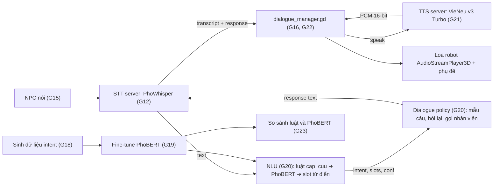
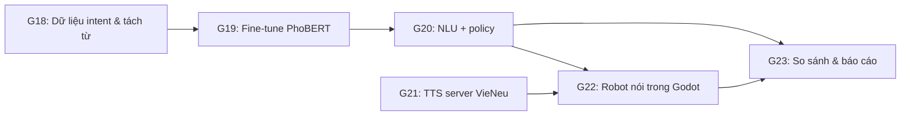

# Kế hoạch & Danh mục Prompt: Hiểu câu hỏi (PhoBERT-base-v2) & Robot trả lời bằng giọng nói (VieNeu-TTS v3 Turbo)

Tài liệu này theo đúng nguyên tắc và cấu trúc của `docs/lesson_2.md`, nối tiếp `godot_robot_yolo_prompt.md` (G1–G10) và `godot_npc_stt_prompt.md` (G11–G17):
- **Phân rã chức năng (Decomposition)**: Mỗi tính năng là 1 module Python hoặc 1 script Godot, đơn nhiệm.
- **Quy trình chuẩn**: `Yêu cầu ➔ Đặc tả (Input/Output/Edge case) ➔ Pseudocode (Hợp đồng) ➔ Prompt có cấu trúc ➔ Kiểm chứng (Test, Verification)`.
- **Cấu trúc Prompt chuẩn**:
  - **Ngữ cảnh**: Công nghệ, môi trường runtime.
  - **Nhiệm vụ**: Tên module, script, class, hàm cần triển khai.
  - **Ràng buộc**: Kiểu dữ liệu, xử lý lỗi, validation, quy tắc dữ liệu không suy diễn bừa bãi.
  - **Ví dụ / Pseudocode**: Minh họa luồng thực thi.
  - **Output mong muốn**: Code sạch + unit test + danh sách giả định.

**Nguồn chân lý:**
1. Mục 2 **Hợp đồng chung** của file này.
2. `recordings/kich_ban_thu_am.md` (tập intent, transcript chuẩn).
3. Mục 2 của `godot_npc_stt_prompt.md` và `godot_robot_yolo_prompt.md`.

Khi các nguồn khác nhau, theo thứ tự ưu tiên 1 ➔ 2 ➔ 3.

**Mục tiêu:** robot nghe câu hỏi (STT đã có ở G12), **hiểu ý định bằng PhoBERT-base-v2 đã fine-tune**, chọn câu trả lời an toàn từ mẫu, rồi **nói câu trả lời bằng VieNeu-TTS v3 Turbo** qua loa 3D trên đầu robot. Đồng thời so sánh PhoBERT với bộ luật G14 để làm chương đánh giá trong báo cáo.

---

## 🤖 Hướng dẫn dành cho AI thực thi file này

1. **Làm tuần tự từ PROMPT G18 đến G23.** Không nhảy bước. G1–G17 đã xong và chạy được.
2. **Sau mỗi prompt, chạy toàn bộ mục "Kiểm chứng".** Chỉ sang prompt tiếp theo khi đạt.
3. **Mọi giả định** ghi vào `ASSUMPTIONS.md` dạng `[G<số>] <giả định> — <lý do>`. Không bịa intent, field, tên message, tham số API ngoài Mục 2.
4. **Cập nhật `PROGRESS.md`** sau mỗi prompt.
5. **Thiếu thông tin hoặc API không khớp ➔ DỪNG LẠI VÀ HỎI.** Đặc biệt: nếu không tìm thấy cách cho thư viện `vieneu` đọc model từ thư mục local, dừng lại và báo, không tự tải model khác.
6. **Chỉ dùng model local ở Mục 2.1.** Chạy với `HF_HUB_OFFLINE=1` và `TRANSFORMERS_OFFLINE=1`. Không tải model mới từ Internet.
7. **Không gọi model thật trong unit test.** Dùng `FakeIntentModel`, `FakeTTS`.
8. **Tập test là file thu âm thật** (G11). Không bao giờ đưa câu trong kịch bản thu âm hoặc transcript của file thu âm vào tập train.
9. **An toàn:** robot không đưa lời khuyên y khoa; câu trả lời chỉ lấy từ mẫu (`responses.py`) và `hospital_map.json`. Model không sinh câu trả lời tự do.
10. **Không sửa logic G1–G17** trừ chỗ prompt yêu cầu. Cần sửa thêm ➔ hỏi trước.

---

## 1. Kiến trúc tổng thể



**Luồng một lượt hỏi đáp:**

| Bước | Thành phần | Kết quả |
| :--- | :--- | :--- |
| NPC nói xong, Godot gửi `utterance` | `dialogue_manager.gd` | Robot `THINK` |
| PhoWhisper chuyển giọng nói thành chữ | `stt_server.py` | `text` |
| Kiểm tra luật khẩn cấp, rồi PhoBERT phân loại intent | `nlu.py` | `intent`, `intent_conf` |
| Tra tên khoa, số phòng trong `hospital_map.json` | `slots.py` | `slots` |
| Chọn câu trả lời theo mẫu, hỏi lại nếu thiếu slot hoặc độ tin cậy thấp | `policy.py` | `response`, `action` |
| Godot nhận `transcript`, gửi `speak` sang TTS | `dialogue_manager.gd` | |
| VieNeu tổng hợp giọng (có cache) | `tts_server.py` | PCM 16-bit |
| Robot phát âm thanh qua loa 3D, hiện phụ đề | `robot_voice.gd` | Robot `RESPOND` ➔ `ARRIVED` |

**Cấu trúc thư mục bổ sung:**
```
Data-Science-Major-Project/
  models/                                  (người dùng đã tải, KHÔNG sửa)
    PhoBert-base-v2/
    Vie-neu-v3-turbo/
    MOSS-Audio-Tokenizer-Nano/
    MOSS-Audio-Tokenizer-Nano-ONNX/
  models_finetuned/
    phobert-intent/                        (G19 sinh ra)
  data/
    nlu/                                   (G18 sinh ra)
      seed.csv, generated_raw.csv, reviewed.csv,
      train.csv, val.csv, test_ref.csv, test_stt.csv
  sim_vision/
    python/
      nlu/
        segment.py      (G18: tách từ)
        build_dataset.py(G18)
        asr_noise.py    (G18: tạo lỗi giả kiểu STT)
        train_phobert.py(G19)
        phobert_intent.py(G20)
        slots.py        (G20)
        nlu.py          (G20)
        policy.py       (G20)
        eval_nlu.py     (G23)
      tts/
        tts_engine.py   (G21)
        tts_server.py   (G21)
        pregen.py       (G21: sinh sẵn câu trả lời)
      tests/nlu/, tests/tts/
    godot/
      scripts/tts_client.gd   (G22)
      scripts/robot_voice.gd  (G22)
```

---

## 2. Hợp đồng chung (nguồn chân lý)

### 2.1 Đường dẫn model và hằng số

| Tên | Giá trị | Ý nghĩa |
| :-- | :-- | :-- |
| `PROJECT_ROOT` | `/Users/quangmanh/Project/Data-Science-Major-Project` | Gốc dự án (biến môi trường, mặc định giá trị này) |
| `PHOBERT_DIR` | `${PROJECT_ROOT}/models/PhoBert-base-v2` | PhoBERT-base-v2 gốc |
| `PHOBERT_FT_DIR` | `${PROJECT_ROOT}/models_finetuned/phobert-intent` | PhoBERT sau fine-tune |
| `VIENEU_DIR` | `${PROJECT_ROOT}/models/Vie-neu-v3-turbo` | VieNeu-TTS v3 Turbo |
| `MOSS_CODEC_DIR` | `${PROJECT_ROOT}/models/MOSS-Audio-Tokenizer-Nano` | Audio tokenizer (bản PyTorch) |
| `MOSS_CODEC_ONNX_DIR` | `${PROJECT_ROOT}/models/MOSS-Audio-Tokenizer-Nano-ONNX` | Audio tokenizer (bản ONNX) |
| `TTS_WS_URL` | `ws://127.0.0.1:8767` | TTS server |
| `MAX_SEQ_LEN` | 64 | Độ dài token tối đa cho PhoBERT |
| `CONF_THRESHOLD` | chọn trên tập val ở G19 (khởi điểm 0.6) | Dưới ngưỡng ➔ hỏi lại |
| `MAX_CLARIFY` | 2 | Hỏi lại quá số lần này ➔ gọi nhân viên |
| `ROBOT_VOICE` | chọn ở G21 từ `list_preset_voices()` | Giọng mặc định của robot |
| `TTS_CACHE_DIR` | `${PROJECT_ROOT}/data/tts_cache` | Cache âm thanh đã tổng hợp |
| `TTS_TIMEOUT_S` | 8.0 | Quá thời gian ➔ chỉ hiện phụ đề |

### 2.2 Tập intent

18 intent trong `kich_ban_thu_am.md` Mục 6 **cộng `unknown`** (câu ngoài phạm vi, chào hỏi chung chung) = 19 lớp. Không thêm, không bớt.

### 2.3 Kết quả NLU (Python, dùng chung cho luật và PhoBERT)

```python
@dataclass(frozen=True)
class IntentResult:
    intent: str                 # một trong 19 lớp
    intent_conf: float          # [0, 1]
    slots: dict[str, str]       # department, room, floor (chỉ giá trị có trong hospital_map.json)
    source: str                 # "rule_emergency" | "phobert" | "rule"
    top3: list[tuple[str, float]]
```

### 2.4 Kết quả policy

```python
@dataclass(frozen=True)
class PolicyResult:
    action: str     # "answer" | "guide" | "clarify" | "call_staff" | "emergency" | "refuse" | "repeat" | "adjust"
    response: str   # câu tiếng Việt robot sẽ nói
    target: str | None  # id địa điểm trong hospital_map.json nếu action == "guide"
```

Message `transcript` của G12 (Mục 2.2 file trước) **thêm** 2 trường: `"action"`, `"target"`. Các trường cũ giữ nguyên.

### 2.5 Message WebSocket TTS (JSON, UTF-8)

Godot ➔ Python:
```json
{"type": "speak", "utt_id": 7, "text": "Dạ, phòng 205 ở tầng 2. Mời anh chị đi theo tôi.", "voice": "<ROBOT_VOICE>"}
```

Python ➔ Godot (thành công):
```json
{"type": "audio", "utt_id": 7, "sample_rate": 24000, "channels": 1,
 "pcm16_b64": "<base64 PCM 16-bit little-endian>", "duration_s": 2.9,
 "tts_ms": 85.3, "cache_hit": true}
```

Python ➔ Godot (lỗi):
```json
{"type": "error", "utt_id": 7, "message": "text too long"}
```

- `sample_rate` gửi sang Godot cố định 24000 (server resample từ tần số gốc của model).
- `text` tối đa 300 ký tự.

---

## 🗺️ Bản đồ Chức năng (Feature Breakdown)



| Prompt | Phần | Kết quả |
| :-- | :-- | :-- |
| G18 | `segment.py`, `build_dataset.py`, `asr_noise.py` | `train/val/test` cho intent |
| G19 | `train_phobert.py` | `models_finetuned/phobert-intent`, ngưỡng tin cậy |
| G20 | `phobert_intent.py`, `slots.py`, `nlu.py`, `policy.py` | NLU thay thế G14, policy an toàn |
| G21 | `tts_engine.py`, `tts_server.py`, `pregen.py` | TTS local có cache |
| G22 | `tts_client.gd`, `robot_voice.gd` | Robot nói thành tiếng |
| G23 | `eval_nlu.py`, batch đầu cuối | Bảng so sánh luật và PhoBERT, độ trễ, độ dễ nghe của TTS |

---

## 📝 PROMPT G18: Dữ liệu intent & tách từ

### G18.1 Đặc tả (Specification)
- **Input**: `kich_ban_thu_am.md`, `hospital_map.json` (G14), manifest và kết quả STT (G11, G13).
- **Output**: các file trong `data/nlu/` (cột chung: `id, text, text_seg, intent, source, split`).
- **Ràng buộc**:
  - **Tách từ** bằng RDRSegmenter (gói `py_vncorenlp`, cần Java ≥ 8) như khuyến nghị của PhoBERT. Kiểm tra `java -version` trước; không có Java ➔ DỪNG VÀ HỎI. Bọc trong `segment.py` có hàm `segment(text) -> str` và cache.
  - **Tập test (không bao giờ dùng để train):**
    - `test_ref.csv`: `text_ref` của mọi clip `ref_verified = true` (G11), bỏ trùng.
    - `test_stt.csv`: `hyp` của G13 cho cùng clip, ghi kèm `snr_db`, `distance_m`, `noise`.
  - **Tập train/val (sinh mới, không chép câu kịch bản):**
    - `seed.csv`: 3 đến 5 câu mẫu tự viết cho mỗi intent, khác câu trong kịch bản. Có cả 2 kiểu xưng hô ("cho tôi hỏi", "dạ cho em hỏi", "bác hỏi tí").
    - Sinh câu bằng **mẫu ghép slot** (template ✕ tên khoa/phòng trong `hospital_map.json`) và **biến đổi có quy tắc** (thêm từ đệm "ờ", "à", "ạ", đổi trật tự, bỏ chủ ngữ). Mục tiêu 60 đến 120 câu mỗi intent.
    - Nếu người dùng muốn dùng LLM để sinh thêm câu: chỉ ghi vào `generated_raw.csv`, **bắt buộc người dùng duyệt** thành `reviewed.csv` (cột `keep`: 1/0) trước khi đưa vào train.
    - `unknown`: câu chào hỏi, câu ngoài phạm vi bệnh viện (thời tiết, bóng đá), câu vô nghĩa.
  - **Chống rò rỉ:** câu train/val có độ tương đồng chuỗi (normalized Levenshtein ≥ 0.9) với bất kỳ câu test nào ➔ loại khỏi train/val, ghi vào `leak_removed.csv`.
  - **Tăng cường kiểu lỗi STT** (`asr_noise.py`, có seed): bỏ dấu một số chữ, thay chữ đồng âm hay gặp (bảng nhỏ tự định nghĩa, vd "khoa/hoa", "tầng/tần"), xóa hoặc nhân đôi một từ ngắn. Chỉ áp cho train, tỉ lệ 30% số câu.
  - Chia train/val 85/15, phân tầng theo intent, seed cố định.

### G18.2 Pseudocode (Hợp đồng xử lý)
```
build():
    test_ref = unique(manifest[ref_verified].text_ref, intent)
    test_stt = g13_results[ref_verified] ➔ (hyp, intent, snr, dist, noise)
    pool = seed ∪ expand_templates(seed, hospital_map) ∪ rule_variants(seed) ∪ reviewed[keep == 1]
    pool = dedupe(normalize(pool))
    pool, leaked = remove_similar(pool, test_ref ∪ test_stt, threshold=0.9)
    train, val = stratified_split(pool, 0.85, seed=42)
    train += asr_noise(sample(train, 0.3), seed=42)
    for each set: text_seg = segment(text)
    ghi file; in thống kê số câu mỗi intent mỗi tập
```

### G18.3 Prompt gửi AI
```markdown
### Ngữ cảnh:
Python 3.10+, macOS Apple Silicon, `py_vncorenlp` (cần Java), `pandas`, `rapidfuzz`, `scikit-learn`. Tập intent ở Mục 2.2. Manifest và kết quả STT từ G11, G13. `text_norm.py` từ G13.

### Nhiệm vụ:
Tạo `python/nlu/segment.py`, `python/nlu/asr_noise.py`, `python/nlu/build_dataset.py` (CLI `python -m nlu.build_dataset`) và file `data/nlu/seed.csv` (tự viết theo ràng buộc).

### Ràng buộc:
1. Đúng đặc tả G18.1 và pseudocode G18.2.
2. Không chép câu trong `kich_ban_thu_am.md` vào seed hoặc train/val.
3. Không gọi LLM hay dịch vụ ngoài trong script. Bước sinh bằng LLM (nếu có) là việc thủ công của người dùng.
4. Intent nào có < 60 câu train sau khi lọc ➔ in cảnh báo và DỪNG, hỏi người dùng có muốn bổ sung seed không.

### Ví dụ:
- `segment("khoa tim mạch ở đâu")` ➔ `"khoa tim_mạch ở đâu"`.
- Seed `"cho tôi hỏi khoa {department} ở đâu"` + `department = "tiêu hóa"` ➔ `"cho tôi hỏi khoa tiêu hóa ở đâu"`.
- Câu train `"phòng khám số 205 đi đường nào"` trùng câu test ➔ bị loại, ghi `leak_removed.csv`.

### Output mong muốn:
Các file trên + test pytest: segment có cache; template ghép đủ slot; lọc rò rỉ; chia phân tầng đúng tỉ lệ; asr_noise cùng seed cùng kết quả. Bảng thống kê số câu mỗi intent. Cập nhật ASSUMPTIONS.md.
```

### G18.4 Quy trình kiểm chứng
- [ ] Test pass.
- [ ] Mở `train.csv`, đọc ngẫu nhiên 30 câu: tự nhiên, đúng nhãn. Sai nhãn > 2 câu ➔ sửa seed và chạy lại.
- [ ] `leak_removed.csv` có câu nào thì kiểm tra lý do.
- [ ] Mỗi intent ≥ 60 câu train.

---

## 📝 PROMPT G19: Fine-tune PhoBERT-base-v2

### G19.1 Đặc tả (Specification)
- **Input**: `train.csv`, `val.csv` (cột `text_seg`, `intent`), `PHOBERT_DIR`.
- **Output**: `PHOBERT_FT_DIR/` (model, tokenizer, `label_map.json`, `threshold.json`, `train_report.md`).
- **Ràng buộc**:
  - `AutoModelForSequenceClassification.from_pretrained(PHOBERT_DIR, num_labels=19, local_files_only=True)`; tokenizer từ cùng thư mục. Thiếu file ➔ báo rõ file nào thiếu, DỪNG.
  - Input là `text_seg` (đã tách từ). `max_length = MAX_SEQ_LEN`, cắt và đệm.
  - Thiết bị: `mps` nếu có, không thì `cpu`. Không dùng fp16 trên MPS.
  - Siêu tham số mặc định: lr 2e-5, batch 16, 10 epoch, warmup 10%, weight decay 0.01, early stopping theo **macro-F1 trên val** (patience 3), seed 42. Ghi tất cả vào `train_report.md`.
  - **Ngưỡng tin cậy:** sau train, trên val, chọn `CONF_THRESHOLD` trong [0.3, 0.9] bước 0.05 sao cho tối đa macro-F1 khi coi dự đoán có `max_prob < threshold` là `unknown`. Ghi `threshold.json`.
  - `label_map.json`: thứ tự nhãn cố định theo Mục 2.2 (sắp chữ cái).
  - Báo cáo: macro-F1, accuracy, F1 từng lớp, ma trận nhầm lẫn trên val. **Không** chạy trên test ở bước này (để G23).

### G19.2 Prompt gửi AI
```markdown
### Ngữ cảnh:
Python 3.10+, `torch` (MPS), `transformers`, `datasets`, `scikit-learn`, `evaluate`. Model gốc local tại `PHOBERT_DIR` (Mục 2.1). Chạy offline (`HF_HUB_OFFLINE=1`).

### Nhiệm vụ:
Tạo `python/nlu/train_phobert.py` (CLI có tham số siêu tham số, mặc định như G19.1).

### Ràng buộc:
1. Đúng đặc tả G19.1.
2. Không đọc `test_ref.csv`, `test_stt.csv` trong script này.
3. Lưu checkpoint tốt nhất; chạy lại với cùng seed cho kết quả gần giống (ghi sai lệch vào báo cáo).
4. Lỗi hết bộ nhớ trên MPS ➔ gợi ý giảm batch, không tự đổi siêu tham số khác.

### Ví dụ:
- `python -m nlu.train_phobert --epochs 10 --batch 16` ➔ in log từng epoch: `epoch 3 | train_loss 0.41 | val_macro_f1 0.93`.
- `threshold.json` ➔ `{"conf_threshold": 0.55, "val_macro_f1_with_threshold": 0.94}`.

### Output mong muốn:
Script + test pytest chạy trên dữ liệu 40 câu giả với model nhỏ giả (hoặc 1 bước train) để kiểm tra đường ống; `train_report.md` mẫu. Cập nhật ASSUMPTIONS.md.
```

### G19.3 Quy trình kiểm chứng
- [ ] Train xong không lỗi; macro-F1 val ≥ 0.90.
- [ ] Đọc ma trận nhầm lẫn: các cặp hay nhầm (vd `gap_nhan_vien` và `cap_cuu`) được ghi chú.
- [ ] Load lại model từ `PHOBERT_FT_DIR` cho cùng kết quả trên val.

---

## 📝 PROMPT G20: NLU + Dialogue policy

### G20.1 Đặc tả (Specification)
- **Input**: `text` từ STT.
- **Output**: `IntentResult` (Mục 2.3) và `PolicyResult` (Mục 2.4).
- **Ràng buộc NLU (`nlu.py`)**, theo thứ tự:
  1. Chuẩn hóa (`text_norm.normalize`). Rỗng ➔ `unknown`, conf 0.
  2. **Luật khẩn cấp** (lấy từ phần `cap_cuu` của `intent.py` G14): khớp ➔ trả `cap_cuu`, conf 1.0, `source = "rule_emergency"`, không chạy PhoBERT.
  3. **PhoBERT**: tách từ ➔ dự đoán; `max_prob < CONF_THRESHOLD` ➔ intent vẫn ghi lớp dự đoán nhưng policy xử lý như độ tin cậy thấp.
  4. **Slot**: `slots.py` tra bí danh khoa/phòng trong `hospital_map.json`, số phòng 3 chữ số phải tồn tại trong map; không tồn tại ➔ không gán slot.
  - Tham số `--nlu rule|phobert` trên `stt_server.py` để chuyển giữa G14 và G20 (cùng `IntentResult`).
  - PhoBERT load một lần, chạy `torch.inference_mode()`.
- **Ràng buộc policy (`policy.py`)**, hàm thuần có trạng thái truyền vào (`clarify_count`):

| Điều kiện | action | response |
| :-- | :-- | :-- |
| `cap_cuu` | `emergency` | "Tôi đang gọi nhân viên y tế ngay. Anh chị giữ bình tĩnh nhé." |
| conf < ngưỡng và `clarify_count < MAX_CLARIFY` | `clarify` | "Dạ, anh chị nói lại giúp tôi được không ạ?" |
| conf < ngưỡng và `clarify_count ≥ MAX_CLARIFY` | `call_staff` | "Tôi sẽ gọi nhân viên hỗ trợ anh chị ạ." |
| `hoi_khoa`, `hoi_phong`, `dan_duong` có slot | `guide` | Mẫu G14 + "Mời anh chị đi theo tôi." |
| `hoi_khoa`, `hoi_phong`, `dan_duong` thiếu slot | `clarify` | "Dạ, anh chị muốn đến khoa nào ạ?" |
| `khong_ho_tro` | `refuse` | Từ chối lịch sự, gợi ý hỏi bác sĩ |
| `nhac_lai` | `repeat` | Câu trả lời trước đó (nếu có) |
| `dieu_chinh_toc_do`, `dieu_chinh_am_luong`, `dung_lai`, `tiep_tuc` | `adjust` | Mẫu G14 |
| còn lại | `answer` | Mẫu G14 |

  - Mọi `response` lấy từ `responses.py` (G14) hoặc bảng trên; không ghép chuỗi tự do ngoài slot hợp lệ.

### G20.2 Pseudocode (Hợp đồng xử lý)
```
understand(text):
    t = normalize(text)
    if t == "": return IntentResult("unknown", 0, {}, "rule", [])
    if emergency_rule(t): return IntentResult("cap_cuu", 1.0, slots(t), "rule_emergency", [])
    probs = phobert(segment(t))
    top3 = sorted(probs)[:3]; (intent, conf) = top3[0]
    return IntentResult(intent, conf, slots(t), "phobert", top3)

decide(r, clarify_count, last_response):
    if r.intent == "cap_cuu": return emergency
    if r.intent_conf < CONF_THRESHOLD:
        return clarify if clarify_count < MAX_CLARIFY else call_staff
    ... theo bảng G20.1
```

### G20.3 Prompt gửi AI
```markdown
### Ngữ cảnh:
Python 3.10+, `torch` (MPS), `transformers`. Model fine-tune ở `PHOBERT_FT_DIR` (G19). `intent.py`, `responses.py`, `hospital_map.json` từ G14; `segment.py` từ G18; `stt_server.py` từ G12. Hợp đồng ở Mục 2.3, 2.4.

### Nhiệm vụ:
Tạo `python/nlu/phobert_intent.py` (`PhoBertIntent.predict(text_seg) -> list[tuple[str, float]]`), `python/nlu/slots.py`, `python/nlu/nlu.py` (`understand(text) -> IntentResult`), `python/nlu/policy.py` (`decide(result, clarify_count, last_response) -> PolicyResult`); cập nhật `stt_server.py` (tham số `--nlu`, thêm `action`, `target` vào `transcript`).

### Ràng buộc:
1. Đúng đặc tả G20.1 và pseudocode G20.2.
2. `understand` và `decide` có interface giống nhau cho cả 2 chế độ `rule` và `phobert`.
3. Không thay đổi các trường cũ của message `transcript`.
4. Log `info`: `intent`, `conf`, `source`, `action`, thời gian NLU. Không log `text`.

### Ví dụ:
- "bố mình đang khó thở quá gọi bác sĩ giúp mình với" ➔ `cap_cuu`, `source = rule_emergency`, action `emergency`.
- "cho hỏi khoa tim mạch" (PhoBERT `hoi_khoa` 0.97) ➔ slot `department = tim mạch` ➔ action `guide`, target `dept_tim_mach`.
- "khoa abc xyz ở đâu" ➔ `hoi_khoa` nhưng không có slot ➔ action `clarify`.
- conf 0.4, `clarify_count = 2` ➔ action `call_staff`.
- "em có cần nhịn ăn không" ➔ `khong_ho_tro` ➔ action `refuse`, không có lời khuyên y khoa.

### Output mong muốn:
Các file trên + test pytest với `FakeIntentModel`: thứ tự ưu tiên (luật khẩn cấp chạy trước); ngưỡng; từng dòng của bảng policy; số phòng không tồn tại không thành slot; `stt_server` trả đủ trường mới. Cập nhật ASSUMPTIONS.md.
```

### G20.4 Quy trình kiểm chứng
- [ ] Test pass.
- [ ] Chạy `stt_server.py --nlu phobert`, gửi 5 clip khác intent ➔ `action` và `response` hợp lý.
- [ ] Đọc toàn bộ câu trả lời có thể sinh ra (in hết tổ hợp mẫu ✕ slot): không có lời khuyên y khoa, không có địa điểm ngoài map.

---

## 📝 PROMPT G21: TTS server (VieNeu-TTS v3 Turbo, chạy local)

### G21.1 Đặc tả (Specification)
- **Input**: Message `speak` (Mục 2.5).
- **Output**: Message `audio` hoặc `error` (Mục 2.5).
- **Ràng buộc**:
  - Thư viện `vieneu` (Apache 2.0). API cơ bản theo tài liệu: `from vieneu import Vieneu`, `tts = Vieneu()`, `tts.list_preset_voices()`, `audio = tts.infer(text, voice=...)`, `tts.save(audio, path)`. Bản v3 Turbo xuất 48 kHz.
  - **Bắt buộc đọc model từ local** (`VIENEU_DIR`, `MOSS_CODEC_DIR` hoặc `MOSS_CODEC_ONNX_DIR`). Tài liệu công khai không nói rõ tham số đường dẫn local, nên AI phải **đọc mã nguồn gói `vieneu` đã cài** (`python -c "import vieneu, inspect; print(inspect.signature(vieneu.Vieneu))"` và các file trong package) để tìm tham số đúng. Ghi kết quả vào ASSUMPTIONS.md. Không tìm được ➔ **DỪNG VÀ HỎI**, không tự tải model.
  - Chạy với `HF_HUB_OFFLINE=1`. Khởi động mà vẫn có request tải mạng ➔ coi là lỗi.
  - Backend: mặc định ONNX trên CPU (bản cài `pip install vieneu`). Nếu thử PyTorch trên MPS thì ghi kết quả so sánh tốc độ, không bắt buộc.
  - `tts_engine.py`: interface `TTSEngine { synth(text, voice) -> tuple[np.ndarray, int] }`, lớp `VieneuEngine`, lớp `FakeTTS` (sinh sóng sin độ dài tỉ lệ số ký tự).
  - **Cache** theo `sha1(text_normalized_nfc + voice + model_version)` thành file `.wav` 24 kHz trong `TTS_CACHE_DIR`. Cache hit ➔ không gọi model.
  - **Sinh sẵn** (`pregen.py`): mọi câu trả lời có thể có (tổ hợp mẫu ✕ slot của G20) ➔ lưu cache trước khi demo. In số câu và tổng thời gian.
  - Hậu xử lý: resample 48 kHz ➔ 24 kHz, chuẩn hóa âm lượng về −20 dBFS RMS, thêm 100 ms im lặng đầu và cuối, kẹp [−1, 1], chuyển PCM 16-bit.
  - `text` rỗng hoặc > 300 ký tự ➔ `error`. Chuẩn hóa văn bản trước khi đọc: số phòng "205" đọc là "hai không năm" (bảng quy tắc riêng cho số phòng), "BHYT" ➔ "bảo hiểm y tế".
  - **Chọn giọng robot:** in danh sách `list_preset_voices()`; sinh 1 câu mẫu cho mỗi giọng vào `reports/voices/`; người dùng nghe và chọn. Ghi `ROBOT_VOICE` vào config. Không dùng tính năng clone giọng với giọng của người thật nếu chưa có đồng ý của người đó.

### G21.2 Pseudocode (Hợp đồng xử lý)
```
startup:
    os.environ["HF_HUB_OFFLINE"] = "1"
    engine = VieneuEngine(local paths)        // không tìm được cách load local ➔ exit, báo lỗi
    kiểm tra ROBOT_VOICE có trong list_preset_voices()

on_message(msg):
    validate(msg)                              // lỗi ➔ error
    text = tts_normalize(msg.text)
    key = sha1(nfc(text) + voice + MODEL_VERSION)
    if exists(cache/key.wav): pcm, sr = load; hit = True
    else: audio, sr0 = engine.synth(text, voice); pcm = postprocess(audio, sr0 ➔ 24000); save; hit = False
    send audio{utt_id, sample_rate: 24000, channels: 1, pcm16_b64, duration_s, tts_ms, cache_hit: hit}
```

### G21.3 Prompt gửi AI
```markdown
### Ngữ cảnh:
Python 3.10+, macOS Apple Silicon, gói `vieneu` (Apache 2.0), `numpy`, `soundfile`, `librosa` (resample), `websockets`. Model local ở Mục 2.1. Chạy offline. Tài liệu: https://github.com/pnnbao97/VieNeu-TTS và https://pypi.org/project/vieneu/.

### Nhiệm vụ:
1. Đọc mã nguồn gói `vieneu` đã cài để tìm cách load từ `VIENEU_DIR` và codec MOSS local; báo lại cách làm trước khi viết code.
2. Tạo `python/tts/tts_engine.py`, `python/tts/text_for_tts.py` (chuẩn hóa văn bản để đọc), `python/tts/tts_server.py` (cổng 8767), `python/tts/pregen.py`, `python/tts/pick_voice.py`.

### Ràng buộc:
1. Đúng đặc tả G21.1 và pseudocode G21.2.
2. Không bịa tham số của `Vieneu(...)`; mọi tham số dùng phải chỉ ra được trong mã nguồn hoặc tài liệu.
3. Suy luận chạy trong thread riêng; hàng chờ tối đa 4, đầy ➔ `error "tts busy"`.
4. Log `info`: `utt_id`, độ dài text, `tts_ms`, `cache_hit`. Không log nội dung text.

### Ví dụ:
- `speak "Dạ, phòng 205 ở tầng 2."` lần đầu ➔ `cache_hit: false`; lần 2 ➔ `cache_hit: true`, `tts_ms` < 20.
- `text_for_tts("Phòng 205")` ➔ `"Phòng hai không năm"`.
- `speak` với text 400 ký tự ➔ `{"type":"error","utt_id":..,"message":"text too long"}`.

### Output mong muốn:
Các file trên + test pytest với `FakeTTS`: cache hit/miss; resample đúng 24 kHz; RMS sau chuẩn hóa ≈ −20 dBFS (±1 dB); PCM 16-bit đúng độ dài; text rỗng/quá dài; hàng chờ đầy. File `reports/voices/*.wav` để người dùng chọn giọng. Cập nhật ASSUMPTIONS.md với cách load local đã tìm được.
```

### G21.4 Quy trình kiểm chứng
- [ ] Ngắt mạng, chạy `tts_server.py` ➔ vẫn khởi động và tổng hợp được.
- [ ] Nghe 10 câu trả lời: đọc đúng dấu, số phòng đọc rõ, không bị rè.
- [ ] Đo `tts_ms` (cache miss) trên Mac cho câu khoảng 15 từ, ghi vào PROGRESS.md.
- [ ] `pregen.py` chạy xong, demo không còn cache miss.

---

## 📝 PROMPT G22: Robot nói trong Godot

### G22.1 Đặc tả (Specification)
- **Input**: Message `transcript` (G12 + G20), message `audio` (G21).
- **Output**: Robot phát câu trả lời qua loa 3D trên đầu, phụ đề hiện cùng lúc, NPC nhìn robot trong lúc robot nói.
- **Ràng buộc**:
  - `tts_client.gd`: giống `stt_client.gd` về kết nối lại, kiểm tra message, bỏ `utt_id` cũ. Hàm thuần `parse_audio(text) -> Dictionary` và `pcm16_to_stream(bytes, sample_rate) -> AudioStreamWAV` (`format = FORMAT_16_BITS`, `mix_rate = sample_rate`, `stereo = false`, `data = bytes`).
  - `robot_voice.gd`: `AudioStreamPlayer3D` gắn ở đầu robot; hàm `say(stream)`, signal `finished_speaking`.
  - `dialogue_manager.gd` (G16) cập nhật:
    - Nhận `transcript` ➔ gửi `speak` với `response`, `voice = ROBOT_VOICE` ➔ robot `RESPOND`.
    - Nhận `audio` ➔ phát, hiện phụ đề đến khi `finished_speaking` (không dùng `SUBTITLE_S` cố định nữa; nếu không có âm thanh thì dùng `SUBTITLE_S`).
    - Quá `TTS_TIMEOUT_S` hoặc TTS lỗi/mất kết nối ➔ chỉ hiện phụ đề trong `SUBTITLE_S`, log `tts_error`.
    - `action == "clarify"` ➔ sau khi robot nói xong, NPC phát thêm một clip **cùng `sentence_id`, khác `take`** (nếu có) để mô phỏng người bệnh nói lại; tăng `clarify_count`. Không có clip khác ➔ kết thúc lượt.
    - `action == "emergency"` ➔ overlay hiện cảnh báo đỏ "GỌI NHÂN VIÊN Y TẾ", log `emergency`.
    - `action == "guide"` ➔ log `target`; việc dẫn đường thật làm ở giai đoạn RL, tạm thời chỉ hiện "Đang dẫn đến: <tên địa điểm>".
  - Ô góc nhìn thêm dòng `TTS: đã kết nối / mất kết nối`.
  - Log hội thoại (G16) thêm cột: `action, target, response_len, tts_ms, tts_cache_hit, tts_error, speak_duration_s`.

### G22.2 Prompt gửi AI
```markdown
### Ngữ cảnh:
Godot 4.3, GDScript có kiểu tĩnh. Đã có `stt_client.gd`, `dialogue_manager.gd`, `subtitle.gd` (G16), `npc.gd` (G15), `robot.tscn` (G5), TTS server (G21). Hợp đồng ở Mục 2.4, 2.5.

### Nhiệm vụ:
Tạo `godot/scripts/tts_client.gd`, `godot/scripts/robot_voice.gd`; cập nhật `robot.tscn` (thêm `AudioStreamPlayer3D` ở `Head`), `dialogue_manager.gd`, `view_overlay.gd`, `config.gd` (hằng số Mục 2.1 liên quan Godot).

### Ràng buộc:
1. Đúng đặc tả G22.1.
2. Không đổi `controller.gd`. Toàn bộ test G1–G17 phải vẫn pass.
3. Robot nói thì NPC không phát clip (không nói chồng).

### Ví dụ:
- `pcm16_to_stream(<9600 byte>, 24000)` ➔ stream dài 0.2 s.
- Nhận `audio` của `utt_id = 4` khi đang chờ `utt_id = 5` ➔ bỏ qua.
- TTS tắt ➔ phụ đề vẫn hiện 4 giây, log `tts_error = "disconnected"`.

### Output mong muốn:
Các file trên + test GUT cho `parse_audio`, `pcm16_to_stream`, logic timeout TTS, nhánh `clarify` và `emergency`. Chạy lại toàn bộ test cũ. Cập nhật ASSUMPTIONS.md.
```

### G22.3 Quy trình kiểm chứng
- [ ] Toàn bộ test GUT pass.
- [ ] Bật 3 server (YOLO, STT, TTS), chạy scene: robot đến gần ➔ NPC hỏi ➔ robot trả lời thành tiếng từ phía robot, phụ đề khớp lời nói.
- [ ] Tắt TTS server ➔ chỉ có phụ đề, không treo.
- [ ] Clip cấp cứu ➔ overlay đỏ và câu trả lời khẩn cấp.

---

## 📝 PROMPT G23: So sánh luật và PhoBERT & batch đầu cuối

### G23.1 Đặc tả (Specification)
- **Output**: `reports/nlu_compare.md`, `reports/nlu_compare.csv`, `reports/e2e_summary.md`.
- **Ràng buộc**:
  - **So sánh intent** (`eval_nlu.py`) giữa `rule` (G14) và `phobert` (G20), trên:
    - `test_ref.csv` (chữ chuẩn).
    - `test_stt.csv` tách theo `snr_db` và `distance_m`.
  - Chỉ số: accuracy, macro-F1, F1 từng lớp, **recall `cap_cuu`** (báo riêng, kèm danh sách câu bị bỏ sót), tỉ lệ `clarify` (độ tin cậy thấp), độ trễ NLU trung bình và p95.
  - Khoảng tin cậy 95% bằng bootstrap theo câu (1000 lần). So sánh cặp luật và PhoBERT bằng **McNemar test** trên cùng tập câu.
  - Biểu đồ: macro-F1 theo SNR (2 đường: luật, PhoBERT).
  - **Độ dễ nghe của TTS:** đưa toàn bộ câu trả lời đã sinh sẵn (G21) qua PhoWhisper (G12, `noise = "none"`, 1 m) ➔ WER khứ hồi. WER cao ở câu nào thì ghi câu đó.
  - **Batch đầu cuối:** chạy `dialogue_batch.gd` (G17) với 3 server, 40 episode, `--nlu phobert`. Báo: tỉ lệ hoàn thành lượt, phân bố `action`, độ trễ từ lúc NPC nói xong đến lúc robot bắt đầu nói (tách STT, NLU, TTS).
  - Ghi rõ hạn chế: test chỉ có 2 người nói 20 tuổi; câu train là câu sinh ra, không phải hội thoại bệnh viện thật.

### G23.2 Prompt gửi AI
```markdown
### Ngữ cảnh:
Python 3.10+, `pandas`, `scikit-learn`, `statsmodels` (McNemar), `matplotlib`, `jiwer`. Đã có G12–G22.

### Nhiệm vụ:
Tạo `python/nlu/eval_nlu.py`, `python/tts/eval_tts_roundtrip.py`, `python/voice/analyze_e2e.py`; cập nhật `README.md` (mục "Hỏi đáp và giọng nói robot").

### Ràng buộc:
1. Đúng đặc tả G23.1.
2. Chỉ đọc tập test ở bước này; không train lại, không chỉnh ngưỡng dựa trên test.
3. Không đổi logic G18–G22; phát hiện lỗi ➔ ghi PROGRESS.md và hỏi trước khi sửa.

### Ví dụ:
- Bảng kết quả dạng: `| Tập | Cách | Accuracy | Macro-F1 [CI 95%] | Recall cap_cuu | p95 NLU ms |`.
- McNemar: `b = 12, c = 3, p = 0.035` ➔ PhoBERT tốt hơn có ý nghĩa ở mức 0.05.

### Output mong muốn:
Các file trên; báo cáo `nlu_compare.md`, `e2e_summary.md`; cập nhật ASSUMPTIONS.md và PROGRESS.md lần cuối.
```

### G23.3 Quy trình kiểm chứng
- [ ] Recall `cap_cuu` = 1.0 ở cả 2 cách trên `test_ref` (nhờ luật khẩn cấp). Không đạt ➔ dò vết và sửa luật trước khi báo cáo.
- [ ] Số câu test giống nhau giữa luật và PhoBERT (so sánh công bằng).
- [ ] Kết quả trên `test_stt` thấp hơn `test_ref`. Nếu không ➔ kiểm tra lại có rò rỉ dữ liệu không.
- [ ] Batch 40 episode ≥ 95% hoàn thành.

---

## 📎 Phụ lục A: Hỏi tiếp để kiểm chứng (dùng sau mỗi prompt)

1. Còn edge case nào chưa xử lý? (STT trả chuỗi rỗng, câu có hai ý định, tên khoa viết sai chính tả, TTS trả âm thanh rỗng)
2. Đề xuất thêm 5 test ngoài danh sách.
3. Chỗ nào trong code dùng giả định không có trong đặc tả? Tham số nào của `vieneu` hoặc `transformers` mà bạn không chắc?
4. Có chỗ nào dữ liệu test có thể lọt vào train không?
5. Câu trả lời nào robot có thể nói mà không lấy từ mẫu?

**Tự kiểm chứng:** chạy thử với 1 câu ➔ đọc tài liệu chính thức (model card PhoBERT của VinAI, README VieNeu-TTS, tài liệu `transformers`) ➔ kiểm tra đúng phiên bản thư viện đang cài ➔ mở từng link AI đưa ra.

## 📎 Phụ lục B: Nối với đồ án

| # | Hạng mục | Dùng cho |
| :-- | :-- | :-- |
| E1 | Bảng so sánh luật và PhoBERT theo SNR | Chương đánh giá NLU |
| E2 | `action = guide`, `target` | Mục tiêu đầu vào cho policy RL dẫn đường |
| E3 | `adjust` (đi chậm, dừng, đi tiếp) | Lệnh điều chỉnh tốc độ trong môi trường RL |
| E4 | `hospital_map.json` giả lập | Thay bằng dữ liệu thật sau khảo sát |
| E5 | WER khứ hồi của TTS | Chỉ số độ dễ nghe của robot |

## 📎 Phụ lục C: Việc người dùng cần làm (AI không làm được)

| # | Việc | Khi nào |
| :-- | :-- | :-- |
| U1 | Cài Java ≥ 8 (cho VnCoreNLP) | Trước G18 |
| U2 | (Tùy chọn) Sinh thêm câu bằng LLM vào `generated_raw.csv` và duyệt cột `keep` | Trong G18 |
| U3 | Đọc 30 câu train ngẫu nhiên, sửa nhãn sai | Sau G18 |
| U4 | Nghe các giọng mẫu trong `reports/voices/`, chọn `ROBOT_VOICE` | Trong G21 |
| U5 | Duyệt toàn bộ câu trả lời của robot (không có lời khuyên y khoa) | Sau G20 |

---

## 🎯 Bảng Checklist Quyết Định & Dò Vết (Theo Lesson 2)

| Bước | Tiêu chí kiểm chứng | Trạng thái | Quyết định |
| :--- | :--- | :---: | :---: |
| **G18** | Tách từ đúng, không rò rỉ test, ≥ 60 câu mỗi intent, nhãn đúng khi đọc mẫu | [ ] | Chấp nhận / Sửa / Từ chối |
| **G19** | Load local offline, macro-F1 val ≥ 0.90, ngưỡng chọn trên val | [ ] | Chấp nhận / Sửa / Từ chối |
| **G20** | Luật khẩn cấp chạy trước, policy đúng bảng, không có câu ngoài mẫu | [ ] | Chấp nhận / Sửa / Từ chối |
| **G21** | VieNeu chạy offline từ local, cache đúng, số phòng đọc rõ | [ ] | Chấp nhận / Sửa / Từ chối |
| **G22** | Robot nói qua loa 3D, phụ đề khớp, TTS lỗi không treo, test cũ pass | [ ] | Chấp nhận / Sửa / Từ chối |
| **G23** | So sánh công bằng, recall `cap_cuu` = 1.0, McNemar, batch ≥ 95% | [ ] | Chấp nhận / Sửa / Từ chối |

## 📒 Nhật ký AI

| Prompt | Lần | Prompt / câu hỏi | Kết quả AI trả | Test (đạt / chưa đạt) | Quyết định | Lý do |
| :-- | :-- | :-- | :-- | :-- | :-- | :-- |
| G18 | 1 | | | | | |
