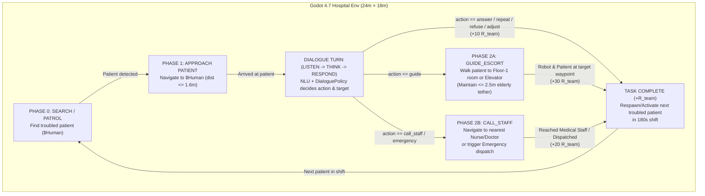

# Hospital Helper Robot — RL Training Plan (Phase 1: Single Agent, Multi-Agent Shared-Reward Ready)

> [!IMPORTANT]
> **Design Alignment Summary (Resolved via `/grill-me`)**
> 1. **Control Scope**: Hierarchical — NLU + [`policy.py`](file:///C:/document/Study%20documents/Robo-helper-in-Hospital/sim_vision/python/nlu/policy.py) extracts patient intent, action, and destination slot, while the **RL Policy (`RLController`)** controls continuous locomotion `(v, omega)` across all task phases (`SEARCH`, `APPROACH`, `GUIDE_ESCORT`, `CALL_STAFF`).
> 2. **Episode & Shared Reward**: Continuous `180 s` hospital shift serving multiple troubled patients sequentially; maximizes cumulative **Shared Team Reward (`R_team`)** per patient helped, ready for multi-robot scaling without reward redesign.
> 3. **Smart Floor-1 Routing**: Direct escort to Floor-1 rooms (`101`, `110`, `112`, `nha_thuoc`, `tiep_don`, `nha_ve_sinh`), escort to the **Elevator (`thang_may`)** for Floor 2–4 requests, and navigate to / alert the nearest **Medical Staff (`MedicalStaffNurse` / `MedicalStaffDoctor`)** for `call_staff` and `emergency`.
> 4. **Elderly Patient Tether Escorting**: Coupled escort where the elderly patient walks behind the robot (`~0.48 m/s`); the robot must pace itself within a `2.5 m` tether so both arrive together.
> 5. **Sensors & Observation**: `31-D` compact vector combining a **17-ray horizontal LiDAR fan (`200°` FOV)**, YOLO person bounding box, task-phase one-hot, relative goal polar coordinates, and patient tether state.
> 6. **Training Stack**: **Fast Surrogate Training (`8x–16x` headless)** via a lightweight **Godot–Python WebSocket Gym Bridge** + **Custom PyTorch PPO** adhering strictly to [`LOGGING_CHECKPOINT_RULES.md`](file:///C:/document/Study%20documents/Robo-helper-in-Hospital/agents/rules/LOGGING_CHECKPOINT_RULES.md), with live full-stack (`YOLOv8` + `PhoWhisper STT` + `VieNeu-TTS`) evaluation in `run_simulation.py --controller rl`.

---

## 1. System Architecture & Task State Machine

### Destination Resolution Table (`Smart Floor-1 Routing`)

| Patient Request / NLU Output | NLU `action` | NLU `target` / `floor` | RL Physical Target Waypoint (`Room.get_room_waypoint`) | Completion Condition |
| :--- | :--- | :--- | :--- | :--- |
| Info / Hours / Price / Procedure / Repeat / Refuse | `answer`, `repeat`, `refuse`, `adjust` | `None` | Stay at patient (`ARRIVED`) | Verbal/subtitle reply completed (`+10.0`) |
| Emergency (`cap_cuu`) or Repeated Clarify Failure (`>= 2`) | `emergency`, `call_staff` | `None` or `"101"` | Nearest Medical Staff (`MedicalStaffNurse` at `(-1.9, 0, 7.45)` or `MedicalStaffDoctor`) | Robot reaches staff within `1.5 m` & alerts (`+20.0`) |
| Floor-1 Room / Facility (`101`, `110`, `112`, `nha_thuoc`, `tiep_don`, `nha_ve_sinh`, `ghe_cho`) | `guide` | Floor `1` target | Exact room waypoint in [`room.gd`](file:///C:/document/Study%20documents/Robo-helper-in-Hospital/sim_vision/godot/scripts/room.gd#L44-L66) | Both Robot (`<= 1.4 m`) and Patient (`<= 2.0 m`) reach waypoint (`+30.0`) |
| Upper-Floor Department / Room (`Tim mạch` F3, `Tiêu hóa` F2, `Nhi` F4, etc.) | `guide` | Floor `2, 3, 4` | **Elevator (`thang_may`)** at `(10.5, 0.0, 4.6)` | Both Robot and Patient reach Elevator doors (`+30.0`) |
| Unsupported / Out-of-Building (`gui_xe` F0, `can_tin`) | `answer` | Facility key | Verbal directions at spot; if patient requests escort, route to `tiep_don` (Reception) | Verbal reply or Reception handoff |

---

## 2. Observation Space (`31-D` Float Vector) & Action Space (`2-D` Continuous)

### 2.1 Observation Vector (`obs_dim = 31`, normalized to `[-1, 1]` / `[0, 1]`)

| Index | Dim | Feature Group | Description |
| :--- | :---: | :--- | :--- |
| `0..16` | `17` | **2D LiDAR Fan** | 17 horizontal raycasts on [`Robot`](file:///C:/document/Study%20documents/Robo-helper-in-Hospital/sim_vision/godot/scripts/robot.gd) spanning `[-100°, +100°]` (`max_range = 6.0 m`), normalized as `clamp(dist / 6.0, 0.0, 1.0)`. Detects walls, sliding doors, furniture, and NPCs. |
| `17..20` | `4` | **Visual Person Detection** | `[has_det (0/1), cx - 0.5, h, conf]` from YOLOv8 (live mode) or frustum-projected noisy detector (fast training mode). |
| `21..24` | `4` | **Task Phase One-Hot** | `[is_search, is_approach, is_guide_escort, is_call_staff]`. |
| `25..27` | `3` | **Active Goal Polar Vector** | `[clamp(d_goal / 25.0, 0, 1), sin(θ_goal), cos(θ_goal)]` in robot's local frame (points to last-known patient cue in `SEARCH/APPROACH`, target room/elevator in `GUIDE_ESCORT`, or nearest staff in `CALL_STAFF`). |
| `28..30` | `3` | **Patient Tether & Proprioception** | `[clamp(d_tether / 5.0, 0, 1), v / V_MAX, omega / OMEGA_MAX]` (`d_tether` is distance to escorted patient during `GUIDE_ESCORT`, `0.0` otherwise). *(Total = 31 floats)* |

### 2.2 Action Space (`act_dim = 2`)
- Continuous action $a = (a_v, a_\omega) \in [-1, 1]^2$ mapped to differential-drive commands:
  - Linear velocity: $v = \frac{a_v + 1}{2} \cdot V_{\max} \in [0.0, 0.8]\text{ m/s}$
  - Angular velocity: $\omega = a_\omega \cdot \Omega_{\max} \in [-1.2, +1.2]\text{ rad/s}$
- During `LISTEN / THINK / RESPOND` dialogue turns, commands are held at $(0, 0)$ per the existing [`Main.is_dialogue_state`](file:///C:/document/Study%20documents/Robo-helper-in-Hospital/sim_vision/godot/scripts/main.gd) contract.

---

## 3. Shared Team Reward (`R_team`) & Potential-Based Shaping

The reward at step $t$ is decomposed into **Shared Team Task Reward** (identical whether 1 or $N$ robots are active) and **Individual Navigation Shaping**:

$$r_t = R_{\text{team}}(t) + R_{\text{progress}}(t) + R_{\text{tether}}(t) + R_{\text{safety}}(t)$$

1. **Shared Team Task Completion (`R_team`)**:
   - **Verbal Assistance Resolved (`answer` / `repeat` / `refuse` / `adjust`)**: $+10.0$
   - **Staff Summoned / Emergency Dispatched (`call_staff` / `emergency`)**: $+20.0$
   - **Successful Patient Escort to Destination / Elevator (`guide`)**: $+30.0$
2. **Potential-Based Progress Reward (`R_progress`)**:
   - $R_{\text{progress}}(t) = 1.5 \cdot \left(d_{\text{target}}(t - 1) - d_{\text{target}}(t)\right)$
   - Rewards smooth forward progress toward the patient (Phase 1), destination room/elevator (Phase 2A), or medical staff (Phase 2B).
3. **Elderly Patient Tether Pacing (`R_tether`, active in `GUIDE_ESCORT`)**:
   - While escorting, the patient walks toward the robot at $0.48\text{ m/s}$ when $d_{\text{tether}} \in [0.9\text{ m}, 2.5\text{ m}]$.
   - If $d_{\text{tether}} \in [0.9\text{ m}, 2.2\text{ m}]$: $+0.03$ per step (well-paced escort bonus).
   - If $d_{\text{tether}} > 2.5\text{ m}$ (robot outran the elderly patient): $-0.08$ per step and progress reward is paused until the robot slows/waits for the patient to catch up within $2.2\text{ m}$.
4. **Safety, Collision & Time Penalties (`R_safety`)**:
   - Time step penalty: $-0.01$ per step (encourages efficient routing).
   - Hard collision with wall/furniture/seated patient: $-5.0$.

---

## 4. Two-Stage Training Curriculum

| Stage | Name | Environment Configuration | Target Skills Learned | Promotion Criterion |
| :---: | :--- | :--- | :--- | :--- |
| **Stage 1** | **Lobby & Corridor Patient Assistance** | Spawn robot & troubled patients in Lobby (`tiep_don`) and Central Corridor (`hanh_lang`); tasks cover `APPROACH` + `answer` (`+10`), `call_staff` (`+20`), and short-range `guide` to Lobby/Corridor targets (`nha_thuoc`, `thang_may`, `110`). | Visual/LiDAR approach, stopping at `ARRIVED`, avoiding benches/staff, basic escort pacing. | `>= 80%` task completion rate over 50 evaluation episodes & `< 0.2` collisions/ep. |
| **Stage 2** | **Full 6-Room Hospital Multi-Patient Shift** | Continuous `180 s` episodes across all 6 rooms (`101`, `110`, `112`, `nha_thuoc`, `tiep_don`, `thang_may`), pocket sliding doors, patrolling corridor doctor (with pardon/step-aside), and elderly patient tether escorting. | Doorway transit, multi-room pathing, waiting for elderly patients, maximizing cumulative patients helped per shift. | Mean `>= 3.5` patients helped per `180 s` shift (`>= 85%` task success). |

---

## 5. Implementation Files & Compliance with `LOGGING_CHECKPOINT_RULES.md`

### 5.1 Godot Side (`sim_vision/godot/`)
1. **[`scripts/robot.gd`](file:///C:/document/Study%20documents/Robo-helper-in-Hospital/sim_vision/godot/scripts/robot.gd) & [`scenes/robot.tscn`](file:///C:/document/Study%20documents/Robo-helper-in-Hospital/sim_vision/godot/scenes/robot.tscn)**:
   - Added `get_lidar_readings() -> PackedFloat32Array` (17 horizontal raycasts across `[-100°, +100°]`, range `6.0 m`).
2. **`scripts/rl_env_bridge.gd` & `scripts/rl_controller.gd`**:
   - `RLController` implements the same `step(...)` interface as [`Controller`](file:///C:/document/Study%20documents/Robo-helper-in-Hospital/sim_vision/godot/scripts/controller.gd) for live evaluation, and `RLEnvBridge` provides observation building, reward computation, smart Floor-1 routing, and elderly patient escort pacing.
3. **`tests/test_rl_env.gd`**:
   - GUT tests verifying 17-ray LiDAR, 31-D observation bounds, smart destination routing, shared team reward, and elderly tether pacing.

### 5.2 Python RL Training Side (`src/` & `sim_vision/python/`)
1. **`src/utils/run_logger.py` & `src/utils/checkpoint_utils.py`**:
   - Strict adherence to [`LOGGING_CHECKPOINT_RULES.md`](file:///C:/document/Study%20documents/Robo-helper-in-Hospital/agents/rules/LOGGING_CHECKPOINT_RULES.md) with `weights_only=True`, JSON-safe hex RNG serialization, automatic rotation of `.log` files at 20MB, and registry updates.
2. **`src/models/ppo_agent.py`**:
   - Actor-Critic PPO network mapping 31-D observations to 2-D continuous actions `(a_v, a_omega)`.
3. **`src/training/hospital_env.py`**:
   - Fast simulated hospital shift environment with exact 24m × 18m hospital geometry, sliding doors, 17-ray LiDAR raycasts, smart Floor-1/Elevator/Staff routing, and elderly patient escorting.
4. **`src/training/rl_hospital_train.py`** (CLI entry point per [`LOGGING_CHECKPOINT_RULES.md`](file:///C:/document/Study%20documents/Robo-helper-in-Hospital/agents/rules/LOGGING_CHECKPOINT_RULES.md)):
   - Supports `--epochs`, `--seed`, `--stage {0,1,2}`, `--resume`, `--force-resume`, `--tb`, `--smoke`.
   - Writes to `experiments/runs/<YYYYmmdd_HHMMSS>_<run_name>/` and consolidates outputs into `experiments/results/rl_hospital/`.
5. **[`run_simulation.py`](file:///C:/document/Study%20documents/Robo-helper-in-Hospital/run_simulation.py)**:
   - Added `--controller {fsm,rl}` and `--rl-checkpoint` flags so the trained PPO agent can be launched with 1 command alongside live YOLOv8, PhoWhisper STT, and VieNeu-TTS.
