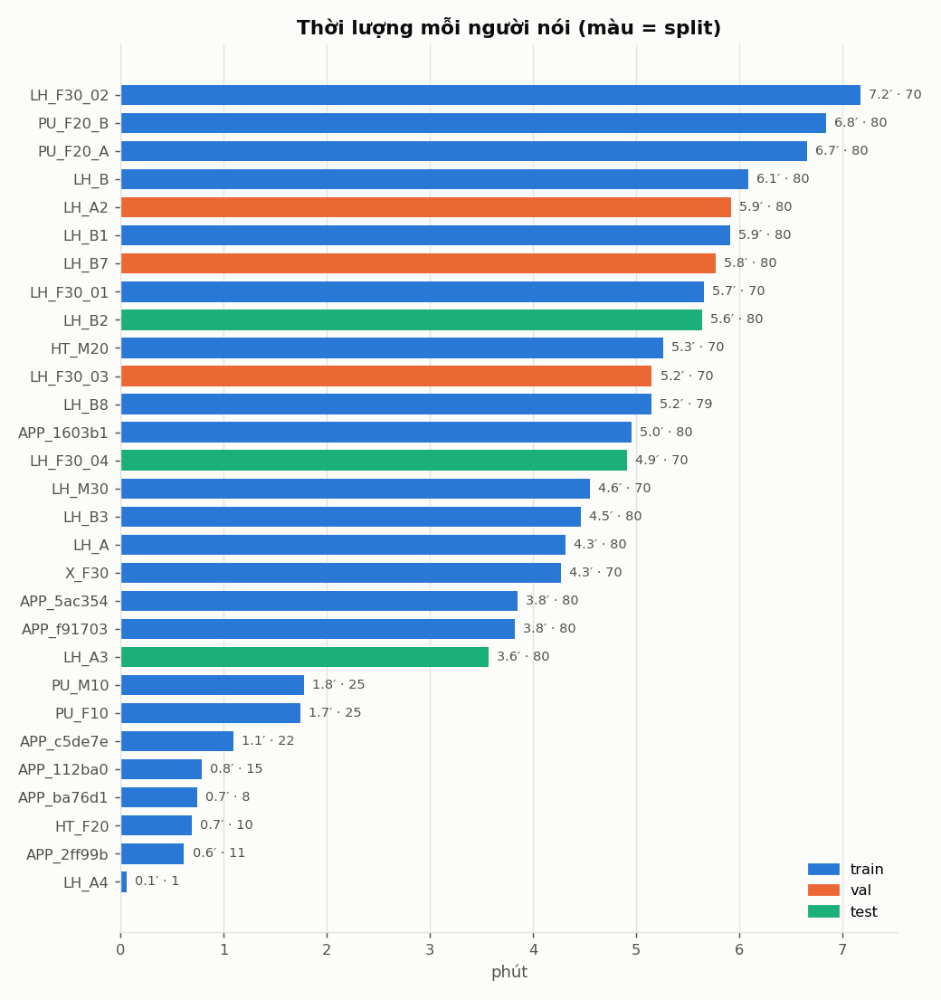
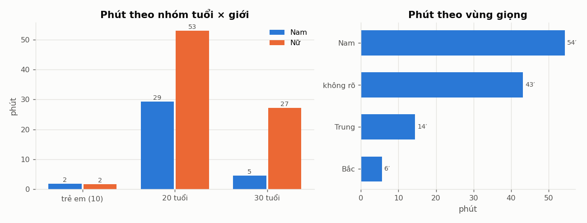
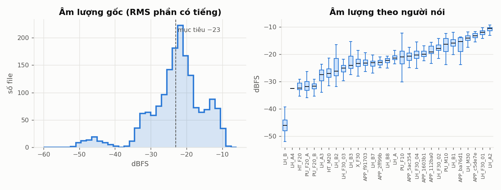
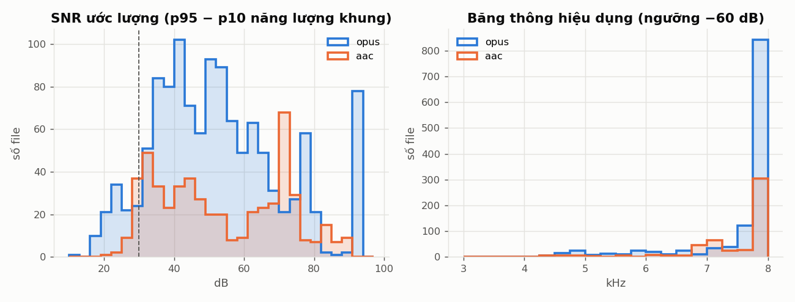
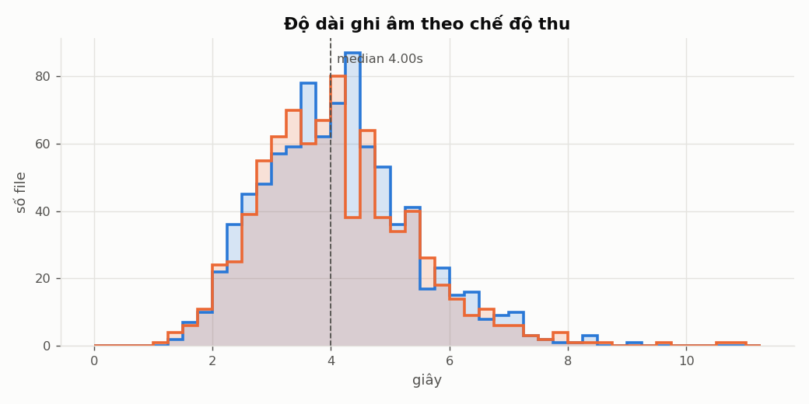
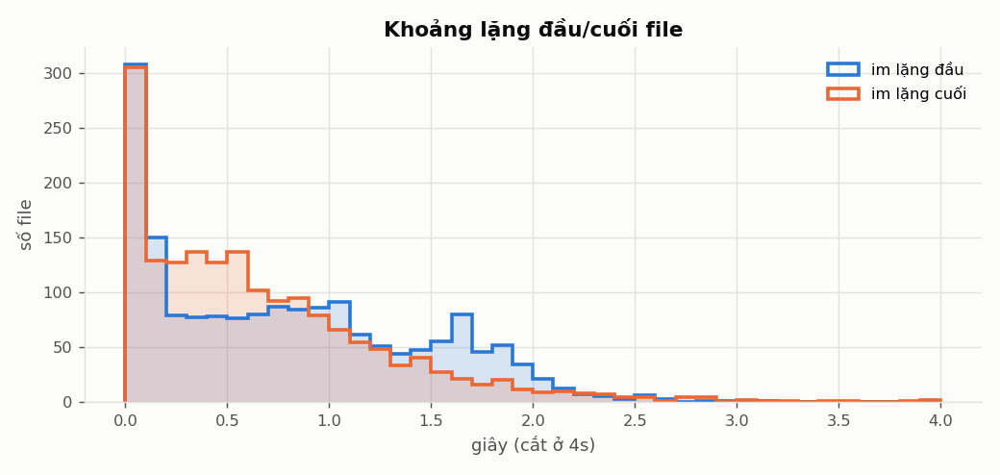
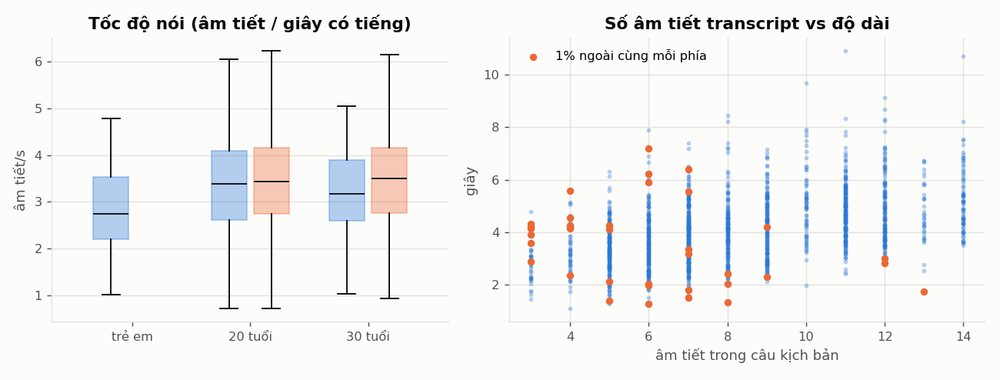
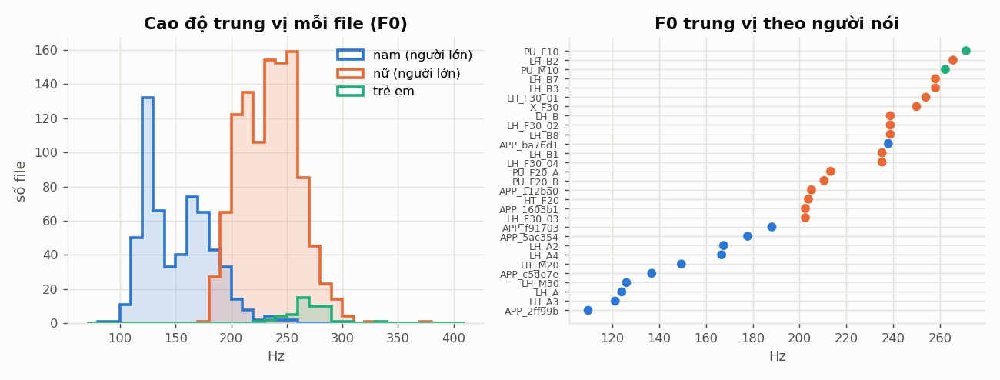
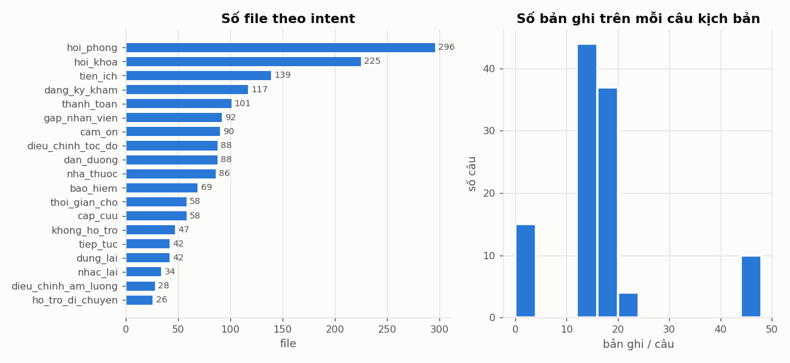

# EDA bộ dữ liệu giọng nói cho fine-tune STT

**Ngày:** 2026-11-10 · **Dữ liệu:** `data/processed/voice_dataset/` · **Mô hình đích:** PhoASR-whisper-small (`models/PhoASR-whisper-small`)

Tài liệu này mô tả bộ dữ liệu giọng nói sau khi chuẩn hóa. Mỗi phân tích đều trả lời ba câu hỏi: dữ liệu trông như thế nào, điều đó ảnh hưởng gì tới mô hình, và cần làm gì.

Các con số trong tài liệu được tạo lại bằng:

```bash
python3 scripts/prepare_voice_dataset.py   # chuẩn hóa audio + manifest + split  (~25 s)
python3 scripts/eda_voice_dataset.py       # biểu đồ + docs/figures/voice_eda/stats.json
```

---

## 1. Tóm tắt

| Chỉ số | Giá trị |
|---|---|
| Tổng số bản ghi đã xử lý | 1.839 |
| Dùng được để train | **1.726 file, 1,96 giờ, 29 người nói** |
| Train / val / test | 1.266 file (86,5 phút, 23 người) / 230 (16,9 phút, 3 người) / 230 (14,1 phút, 3 người) |
| Độ dài file | trung vị 4,0 s, khoảng 1,1–10,9 s |
| Câu kịch bản khác nhau | 110 câu, 283 từ vựng, 19 intent |

**Năm điều ảnh hưởng mô hình nhiều nhất**, xếp theo mức độ:

1. **Test không đo được khả năng tổng quát hóa sang câu mới.** 100% câu trong test và val đều đã có trong train, vì mọi người đọc cùng 110 câu. WER trên test chỉ đo khả năng nghe được *giọng người mới*, không đo được khả năng nghe *câu mới*. Mô hình có thể học thuộc câu và WER vẫn thấp (§9).
2. **Nhãn của file `_n` chỉ là gần đúng.** 823 file `_n` (48%) dùng câu kịch bản làm nhãn, trong khi người nói được phép thêm "ờ, dạ" và đổi chữ. Đây là nhiễu nhãn có hệ thống: mô hình sẽ học cách "sửa" lời nói tự nhiên về đúng câu kịch bản (§7).
3. **Dữ liệu rất ít (1,44 giờ train) và lệch.** Nữ 20 tuổi chiếm 45% thời lượng. Trẻ em chỉ có 3,5 phút, nam 30 tuổi 4,6 phút, giọng miền Bắc 5,6 phút. Mô hình sẽ yếu ở các nhóm thiếu dữ liệu (§3).
4. **Âm lượng gốc chênh nhau 35 dB giữa các người nói.** Đã chuẩn hóa về −23 dBFS. LH_B phải tăng tới +30 dB nên nhiễu nền cũng bị khuếch đại theo (§4).
5. **Khoảng 18% file bị cắt sát ở cuối** (khoảng lặng cuối dưới 0,1 s), dễ mất âm tiết cuối. Khi đó nhãn có chữ mà audio không có (§6).

---

## 2. Pipeline chuẩn hóa

**Định dạng chuẩn** là WAV RIFF, PCM 16-bit, **16 kHz, mono**, không metadata. Đây là đúng định dạng đầu vào của Whisper/PhoASR. Nguồn gốc gồm 1.206 file Opus/WebM và 520 file AAC/M4A, phần lớn thu ở 48 kHz.

| Bước | Chi tiết |
|---|---|
| Nguồn | `voice_finetune/` (zip của Lê Hà + các thư mục Phương Uyên, Hoàng Tuấn, Female 30, Male 30) và `data/raw/minio_app_voice/` (bản ghi web app trong MinIO `major-be-fe/voice/`) |
| Giải mã | `ffmpeg -ac 1 -ar 16000 -sample_fmt s16`. ffmpeg nhận định dạng theo nội dung file, nên các file "`.wav`" thực chất là WebM vẫn giải mã đúng |
| Đo chất lượng | đo **trước** khi chỉnh âm lượng: RMS, peak, clipping, SNR, khoảng lặng đầu/cuối, F0, băng thông |
| Chuẩn hóa âm lượng | đưa RMS phần có tiếng về **−23 dBFS**, peak không vượt **−1 dBFS**. Cột `gain_db` ghi mức đã chỉnh |
| Ghép nhãn | lấy từ kịch bản của app thu âm (`configs/voice_scripts.json`, xuất từ `Major_BE_FE/backend/src/voice/voice.scripts.ts`) |
| Chia tập | **mỗi người nói chỉ nằm trong một tập**. Test: LH_A3 (nam 20, Bình Định), LH_B2 (nữ 20, Hải Phòng), LH_F30_04 (nữ 30, Bình Thuận). Val: LH_A2, LH_B7, LH_F30_03 |

**File đầu ra** (trong `data/processed/voice_dataset/`):
- `wav/<speaker_id>/<utt_id>.wav`
- `manifest.csv`: đủ metadata và chỉ số chất lượng, có cột `usable`, `exclude_reason`, `split`
- `train.jsonl`, `val.jsonl`, `test.jsonl`: mỗi dòng là `{"audio_filepath", "text", "duration", "speaker_id", "mode", "intent"}`

**Các file bị loại (113 file):**

| Lý do | Số file | Giải thích |
|---|---|---|
| `withdrawn_subject` | 70 | LH_F30_05: người nói đã rút dữ liệu khỏi Drive ngày 30/10. **Bản gốc vẫn còn trong MinIO `voice_finetune/`, cần quyết định có xóa không** |
| `no_transcript` | 25 | X_M30 (file "Mơ Nướng N.m4a"): tên file không có mã câu |
| `app_test_session` | 13 | 8 session M30 trên web app, mỗi file khoảng 1,2 s, âm 400 Hz đều với SNR 89 dB, tức là âm thử chứ không phải giọng người |
| `no_signal` | 3 | APP_9078e4, APP_a2ab7d: file toàn số 0 |
| `too_short`, `duplicate_take` | 2 | file dưới 0,5 s, hoặc thu lại cùng câu và cùng chế độ |

> Ban đầu 28 file của LH_B bị coi là "gần như im lặng" vì RMS khoảng −51 dBFS. Kiểm tra lại thì các file này vẫn có SNR 31–38 dB và đo được F0, tức là giọng thật nhưng thu quá nhỏ. Vì vậy mình đổi tiêu chí loại thành peak dưới −45 dBFS, và giữ lại 28 file này.

---

## 3. Người nói và nhân khẩu học





**Quan sát:**
- Có 29 người nói (12 nam, 17 nữ). Phần lớn có 3,5–7,2 phút mỗi người. Có 7 người dưới 2 phút: 2 trẻ em, 4 session app thu dở, và LH_A4 chỉ có 1 file. Phân bố khá đều (Gini 0,29); 5 người nhiều nhất chiếm 28% thời lượng.
- **Lệch theo nhóm tuổi × giới:** nữ 20 có 53,0 phút, nam 20 có 29,3, nữ 30 có 27,2, **nam 30 chỉ 4,6, trẻ em 3,5** (2 em, mỗi em khoảng 1,75 phút).
- **Vùng giọng:** Nam 54,3 phút, Trung 14,4, **Bắc 5,6** (chỉ LH_B2, mà người này lại nằm trong test). Còn 43,1 phút không rõ vùng vì các nhóm ngoài Lê Hà không có `metadata.json`.
- Robot dùng trong bệnh viện, nơi có nhiều **người già** (kịch bản N và G cho nhóm 50 và 80 tuổi). Nhưng dữ liệu hiện **chưa có người nào trên 34 tuổi**.

**Ảnh hưởng tới mô hình:**
- **Train không có giọng Bắc** vì người Bắc duy nhất (LH_B2) nằm trong test. WER của LH_B2 sẽ cho biết mô hình gốc xử lý giọng Bắc tốt tới đâu, nhưng fine-tune không cải thiện được phần này.
- Với trẻ em và người già, cao độ và cách phát âm khác hẳn người lớn (§8). Mô hình sẽ gần như không học được gì cho các nhóm này. Đúng ra cần báo WER riêng cho từng nhóm, nhưng hiện chưa đủ dữ liệu để đánh giá.

**Nên làm:**
- Ưu tiên thu thêm: giọng Bắc (đưa vào train), nam 30, trẻ em, và người 50 và 80 tuổi (app đã có sẵn kịch bản N và G).
- Khi train, cân nhắc lấy mẫu theo trọng số người nói để vài người nhiều dữ liệu không lấn át.
- Bổ sung vùng miền cho X_F30, HT_*, PU_* và APP_*.

---

## 4. Âm lượng và clipping



**Quan sát:**
- RMS phần có tiếng: trung vị −22,1 dBFS, 90% file nằm trong khoảng −34,9 đến −11,6 dBFS.
- Trung vị theo người nói chênh tới **35 dB**: LH_B khoảng −46 dBFS, LH_A2 khoảng −11 dBFS.
- Mức chỉnh âm lượng: 90% file nằm trong khoảng −11 đến +12 dB, riêng LH_B tới **+30 dB**. Có 37 file bị giới hạn bởi peak, nên chưa lên được tới −23.
- **8 file bị clipping** (tín hiệu bị bão hòa), đều của LH_B1.

**Ảnh hưởng tới mô hình:**
- Whisper chuyển audio thành log-mel rồi chuẩn hóa theo giá trị lớn nhất trong file, nên khá bền với âm lượng. Nhưng khi âm lượng chênh 35 dB, nhiễu nền của file nhỏ tiếng sẽ chiếm một phần lớn trong khoảng động 80 dB của log-mel. Chuẩn hóa giúp các file có phân phối đặc trưng đồng đều hơn.
- Tăng +30 dB cho LH_B cũng **khuếch đại nhiễu nền 30 dB**. File vẫn dùng được (SNR khoảng 34 dB), nhưng là nhóm cần nghe kiểm tra.
- Clipping tạo ra hài âm giả ở tần số cao. Chỉ 8 file nên ảnh hưởng nhỏ.

**Nên làm:** giữ bước chuẩn hóa. Khi train, thêm augmentation đổi âm lượng ngẫu nhiên ±6 dB để mô hình không phụ thuộc vào âm lượng đã chuẩn hóa. Microphone của robot sẽ không cho ra đúng −23 dBFS.

---

## 5. Nhiễu (SNR) và băng thông



**Quan sát:**
- SNR ước lượng (chênh lệch năng lượng giữa khung có tiếng to nhất và khung yên tĩnh nhất): trung vị 50,6 dB. Có **144 file dưới 30 dB**, trong đó **toàn bộ 80 file của LH_A3** (nằm trong test), 31 file X_F30, 13 file LH_B3.
- 81 file có SNR trên 90 dB, trong đó **toàn bộ 80 file của LH_A2**, kèm theo âm lượng −14 dBFS. Đây là dấu hiệu thiết bị đã bật khử nhiễu hoặc tự động chỉnh mức thu (AGC), nên phần im lặng bị đưa về gần 0 tuyệt đối.
- Băng thông: phần lớn file giữ đủ tới 8 kHz (giới hạn của 16 kHz). Có **268 file bị cắt dưới 7 kHz**, thấp nhất là PU_F10 (khoảng 5,0 kHz), PU_M10 (5,7), LH_A2 (5,8), LH_M30 (6,4). Nguyên nhân là codec nén mạnh hoặc thiết bị lọc bớt tần số cao.

**Ảnh hưởng tới mô hình:**
- Robot hoạt động trong **hành lang bệnh viện ồn**, còn dữ liệu train chủ yếu sạch (SNR trung vị 50 dB). Mô hình sẽ đánh giá quá cao độ chính xác khi chạy thật. LH_A3 là người nói nhiễu nhất và nằm trong test, nên test có phần nào phản ánh điều kiện nhiễu.
- Mất dải 5–8 kHz là mất phần lớn năng lượng của phụ âm xát (s, x, ch). Trẻ em vừa ít dữ liệu vừa bị cắt băng thông thấp nhất, nên đây là nhóm dễ sai nhất.
- File có im lặng tuyệt đối (do khử nhiễu) không giống tín hiệu microphone thật. Mô hình có thể sinh ra chữ khi gặp nhiễu nền thật, vì nó chưa từng thấy nhiễu nền.

**Nên làm:**
- Thêm augmentation nhiễu nền khi train, ở SNR 5–20 dB. Nên dùng tiếng ồn bệnh viện, hoặc MUSAN nếu không có.
- Thêm augmentation giới hạn băng thông ngẫu nhiên (lọc thông thấp 4–8 kHz) để mô hình không phụ thuộc vào dải cao.
- Thu một tập nhỏ bằng **chính microphone của robot** để đánh giá riêng.

---

## 6. Độ dài, khoảng lặng và file bị cắt





**Quan sát:**
- Độ dài: trung vị 4,0 s, trung bình 4,09 s, 90% file nằm trong khoảng 2,2–6,4 s, dài nhất 10,9 s. `_r` và `_n` có phân phối gần như giống nhau (trung vị 4,04 và 3,95 s). Không file nào vượt 30 s.
- Khoảng lặng chiếm **35,7%** tổng thời lượng. Trung vị khoảng lặng đầu là 0,72 s, cuối là 0,54 s. Có 611 file lặng đầu hơn 1 s.
- **305 file có khoảng lặng cuối dưới 0,1 s**, tức là bị cắt ngay khi đang nói hoặc vừa nói xong. Tập trung ở LH_F30_04 (57/70, thuộc test), PU_F20_A (54/80), HT_M20 (36) và APP_f91703 (34). Có 308 file tương tự ở đầu.
- 13 cặp `_r`/`_n` có độ dài bằng nhau tới 0,01 s, nhưng nội dung file khác nhau (đã so MD5). Đây là do app thu theo thời lượng cố định, không phải trùng lặp.

**Ảnh hưởng tới mô hình:**
- Whisper luôn đệm mỗi đầu vào lên **30 s**, nên 86% khung của encoder là phần đệm. Điều này không làm giảm độ chính xác, nhưng tốn tính toán. Có thể ghép nhiều câu ngắn cùng người nói thành một mẫu khoảng 20–28 s để train nhanh hơn khoảng 5 lần, nhưng phải ghép transcript theo đúng thứ tự.
- **File bị cắt cuối là nhiễu nhãn**: nhãn có âm tiết cuối mà audio không có. Mô hình sẽ học cách "đoán" phần cuối câu từ ngữ cảnh. Vì 110 câu lặp lại, nó học thuộc rất nhanh. Đây cũng là một nguồn gây ra hiện tượng Whisper sinh ra chữ không có trong audio.
- Khoảng lặng dài ở đầu file không gây hại cho Whisper, nhưng làm VAD (bộ phát hiện tiếng nói) của robot khó căn thời điểm hơn. Dữ liệu này cũng không đại diện cho cách VAD cắt đoạn khi chạy thật.

**Nên làm:**
- Nghe kiểm tra 305 file bị cắt cuối. Nếu mất chữ thì sửa nhãn hoặc loại file. Ưu tiên LH_F30_04 vì nó nằm trong test và sẽ làm WER test cao giả tạo.
- Có thể cắt bớt khoảng lặng hai đầu, chừa lại 0,2–0,3 s, để giống đầu ra của VAD hơn.

---

## 7. Tốc độ nói, chế độ `_r`/`_n` và độ khớp giữa nhãn và audio



**Quan sát:**
- Tốc độ nói (âm tiết trên giây có tiếng): trung vị 3,38. Trẻ em 2,75 (chỉ có `_r`). Người lớn `_r` khoảng 3,2–3,4, `_n` khoảng 3,4–3,5, tức là nói tự nhiên nhanh hơn một chút.
- Tương quan giữa số âm tiết trong câu kịch bản và độ dài file chỉ là **r = 0,47**. Nếu nhãn khớp hoàn toàn với audio thì con số này phải cao hơn nhiều. Phần chênh đến từ khoảng lặng, cách đọc khác nhau, và file `_n` không khớp kịch bản.
- 1% ngoài cùng ở mỗi phía:
  - **Quá nhanh (trên 6,5 âm tiết/s)**: tập trung ở **APP_5ac354** (9 file, ví dụ `A_01_n` 12 âm tiết trong 1,7 s), LH_A3 và LH_M30 `_n`. Nghi bị cắt mất chữ, hoặc người nói bỏ bớt chữ.
  - **Quá chậm (dưới 1,3 âm tiết/s)**: HT_M20 `_n` (6–7 âm tiết trong khoảng 6 s có tiếng) và các câu rất ngắn như C10 "Cảm ơn nhé". Nghi có nói thêm ngoài kịch bản, ngập ngừng dài, hoặc nhiễu bị tính là tiếng nói.
- So `_n` với `_r` của cùng câu và cùng người: tỉ lệ độ dài trung vị là 0,975, và chỉ 44% câu `_n` dài hơn `_r`. Như vậy `_n` **không** dài hơn `_r` một cách nhất quán. Nhiều người đọc `_n` gần như `_r`, nhưng không đo được tỉ lệ này nếu chưa nghe.

**Ảnh hưởng tới mô hình:**
- **823 file `_n` đang dùng câu kịch bản làm nhãn.** Khi người nói thêm "ờ, dạ" hay đổi chữ, mô hình bị dạy là phải bỏ hoặc sửa những gì nghe thấy. Với Whisper (có bộ giải mã đóng vai trò mô hình ngôn ngữ), điều này làm tăng xu hướng ghi ra **câu kịch bản thay vì lời người dùng thật sự nói**. Hệ quả trực tiếp là robot hiểu sai intent khi người dùng nói câu ngoài kịch bản.
- Các file nằm ở hai đuôi phân phối tốc độ nhiều khả năng có nhãn sai. Chỉ khoảng 36 file, nhưng sai số kiểu này gây hại hơn nhiễu âm thanh.

**Nên làm:**
- Lần fine-tune đầu: **chỉ dùng `_r`** (883 file, nhãn đúng), hoặc giảm trọng số `_n`.
- Ghi transcript thật (verbatim) cho `_n`. Có thể cho PhoASR gốc nhận dạng trước rồi người sửa lại; cột `verbatim_transcript` trong `voice/src/.../unannotated/metadata.csv` đã có sẵn để điền.
- Nghe kiểm tra các file ngoại lai (danh sách đầy đủ trong `stats.json` → `rate.outliers`). Kiểm tra cả session APP_5ac354.
- Augmentation đổi tốc độ 0,9×/1,0×/1,1× để bù độ đa dạng tốc độ nói.

---

## 8. Cao độ giọng (F0)



**Quan sát:**
- F0 trung vị: nam 20 là 158 Hz, nam 30 là 126 Hz, nữ 20 là 235 Hz, nữ 30 là 239 Hz, trẻ em 262–271 Hz. Đúng với phân bố sinh lý thông thường.
- Phân bố F0 của nam có **hai đỉnh**: một nhóm khoảng 110–150 Hz và một nhóm khoảng 165–190 Hz (LH_A2, APP_5ac354, APP_f91703). Giọng nam trẻ cao vẫn có thể ở mức này.
- **APP_ba76d1 được gán là nam (nhóm A) nhưng F0 khoảng 238 Hz**, nằm hẳn trong vùng giọng nữ. Nhiều khả năng là người nữ hoặc trẻ em đã chọn nhầm nhóm A trên app. Cần nghe kiểm tra; nếu đúng là nhầm thì phải sửa metadata giới tính.
- **PU_F20_A và PU_F20_B có F0 gần như trùng nhau** (213 và 210 Hz, khoảng tứ phân vị 207–219 và 203–219). Đây có thể là **cùng một người** đọc cả kịch bản A lẫn B. Pipeline đang coi là 2 người. Khả năng trùng người không ảnh hưởng tính hợp lệ của split, vì cả hai đều nằm trong train.

**Ảnh hưởng tới mô hình:**
- Trẻ em có F0 cao hơn hẳn và formant cũng cao hơn. Các mô hình ASR được huấn luyện chủ yếu trên giọng người lớn thường sai nhiều với giọng trẻ em, mà ở đây trẻ em chỉ có 3,5 phút.
- Nếu một người bị gán nhầm giới tính thì không làm hỏng việc train ASR. Nhưng các báo cáo WER theo giới sẽ sai.

**Nên làm:** nghe xác nhận APP_ba76d1 và PU_F20_A/B. Cân nhắc augmentation đổi cao độ ±2 nửa cung hoặc VTLP (biến đổi độ dài thanh quản) để mở rộng dải giọng.

---

## 9. Văn bản: intent, số câu và rò rỉ câu giữa train và test



**Quan sát:**
- Toàn bộ dữ liệu chỉ có **110 câu khác nhau** (C có 10 câu chung, A 30, B 30, T 25, K 15), **283 từ vựng**, 14.204 token. Không có từ nào chỉ xuất hiện đúng một lần.
- Mỗi câu có trung bình 15,7 bản ghi. Câu chung C được đọc tới 46 lần, trong khi câu K của trẻ em chỉ có 2 bản ghi mỗi câu.
- Intent lệch: `hoi_phong` có 296 file, `hoi_khoa` 225, còn `ho_tro_di_chuyen` chỉ 26 và `dieu_chinh_am_luong` 28.
- **100% câu trong test và val đều có trong train.**

**Ảnh hưởng tới mô hình:**
- Đây là vấn đề lớn nhất khi đánh giá. Với từ vựng chỉ 283 từ và 110 câu lặp đi lặp lại, Whisper sẽ **học thuộc câu**. WER trên test sẽ thấp (có thể dưới 5%), nhưng không nói lên khả năng nhận dạng câu bệnh nhân tự nói ngoài kịch bản. Đồng thời mô hình dễ bị **quên những gì đã học từ trước**: nhận dạng tiếng Việt tổng quát kém đi, và hay "ép" câu lạ về câu kịch bản gần nhất.
- Nếu đánh giá NLU/intent trên đầu ra của STT với cùng 110 câu, kết quả cũng bị lạc quan quá mức theo cùng cách.

**Nên làm:**
- Thêm một **split chia theo câu**: giữ riêng khoảng 15–20% câu kịch bản (chọn để đủ intent), không cho xuất hiện trong train. Báo cáo cả hai loại WER: theo người mới và theo câu mới.
- Luôn đánh giá thêm trên một tập tiếng Việt tổng quát (ví dụ một phần Common Voice vi hoặc VIVOS) trước và sau fine-tune, để phát hiện mô hình bị quên kiến thức cũ.
- Fine-tune nhẹ tay: learning rate thấp, ít epoch, chặn sớm theo WER của split chia theo câu. Có thể chỉ train bộ giải mã hoặc dùng LoRA.
- Tăng độ đa dạng văn bản: thêm kịch bản mới, hoặc dùng TTS để sinh thêm câu cho các intent ít dữ liệu (`data/tts_cache` đã có sẵn pipeline TTS).

---

## 10. Việc cần làm trước khi train

| Ưu tiên | Việc | Lý do (mục) |
|---|---|---|
| **P0** | Quyết định về dữ liệu của LH_F30_05 trong MinIO (`major-be-fe/voice_finetune/Lê Hà/Nữ 30/F30_05`) | Người nói đã rút dữ liệu (§2) |
| **P0** | Tạo split chia theo câu và tập đánh giá tiếng Việt tổng quát | Test hiện không đo được câu mới (§9) |
| **P0** | Lần train đầu chỉ dùng `_r`, hoặc ghi transcript thật cho `_n` | 823 file nhãn gần đúng (§7) |
| P1 | Nghe kiểm tra 305 file bị cắt cuối (ưu tiên LH_F30_04 trong test) và khoảng 36 file có tốc độ nói bất thường | Nhãn không khớp audio (§6, §7) |
| P1 | Thêm augmentation: nhiễu 5–20 dB, đổi tốc độ, giới hạn băng thông, đổi âm lượng ±6 dB, SpecAugment | Dữ liệu sạch hơn môi trường thật, ít dữ liệu (§4, §5, §7) |
| P1 | Xác nhận APP_ba76d1 (giới tính) và PU_F20_A/B (một hay hai người) | §8 |
| P2 | Thu thêm: giọng Bắc cho train, nam 30, trẻ em, người 50 và 80 tuổi, và một tập bằng microphone của robot | §3, §5 |
| P2 | Ghi transcript cho X_M30 (25 file) | §2 |

---

## Phụ lục: các cột của `manifest.csv`

| Cột | Ý nghĩa |
|---|---|
| `utt_id`, `audio_path`, `raw_path` | mã bản ghi = `<speaker_id>__<mã câu>_<r/n>`, đường dẫn WAV chuẩn, đường dẫn file gốc |
| `src_codec`, `src_sr` | codec và tần số lấy mẫu của file gốc |
| `speaker_id`, `collector`, `source`, `group`, `session` | người nói (`LH_*` Lê Hà, `PU_*` Phương Uyên, `HT_*` Hoàng Tuấn, `X_*` không rõ người thu, `APP_*` web app), người thu, nguồn |
| `gender`, `age`, `region`, `province`, `script` | metadata người nói (của Lê Hà lấy từ `metadata.json`, các nhóm khác suy ra từ tên thư mục hoặc nhóm trên app) |
| `code`, `mode`, `text`, `intent`, `prompt_note` | mã câu, `r` / `n` / `u` (không ghi chế độ), câu kịch bản, intent, ghi chú khi ghép nhãn |
| `duration_s`, `speech_s`, `lead_sil_s`, `trail_sil_s` | độ dài, khoảng từ đầu đến cuối phần có tiếng, khoảng lặng đầu và cuối |
| `rms_dbfs`, `speech_rms_dbfs`, `peak_dbfs`, `clip_ratio` | âm lượng gốc **trước** khi chuẩn hóa |
| `snr_db`, `f0_hz`, `cutoff_hz`, `gain_db` | SNR ước lượng, F0 trung vị, băng thông hiệu dụng (ngưỡng −60 dB), mức âm lượng đã chỉnh |
| `exclude_reason`, `usable`, `split` | lý do loại, có dùng được không, train/val/test |
