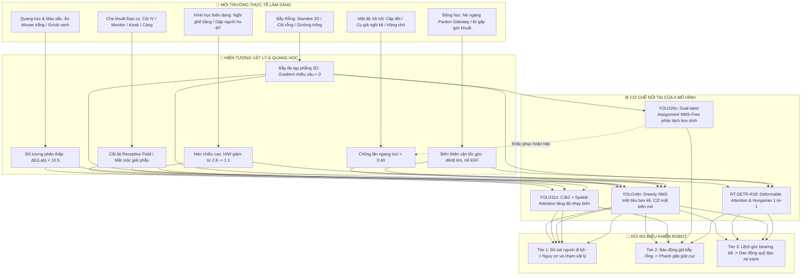

# EXP_VISION_EXTENDED_NPC_BENCHMARK.md — Mở Rộng Benchmark Thị Giác: 36 Kịch Bản Lâm Sàng, Động Học Né Ngang & Bẫy Đạo Cụ Y Tế (10,800 Khung Hình Big Data Cực Đại & Siêu Metadata 5W1H)

- **Tài liệu tham chiếu nền tảng**: [`docs/experiments/EXP_VISION_48CASES_1200_BENCHMARK.md`](EXP_VISION_48CASES_1200_BENCHMARK.md), [`sim_vision/reports/vision_model_benchmark.md`](../../sim_vision/reports/vision_model_benchmark.md)
- **Bản Notebook 01**: [`notebooks/01_vision_model_benchmark_visualization.ipynb`](../../notebooks/01_vision_model_benchmark_visualization.ipynb) (1,200 frames, 10 nhóm / 50 hạng mục)
- **Bản Notebook 02**: [`notebooks/02_clinical_demographics_vision_benchmark.ipynb`](../../notebooks/02_clinical_demographics_vision_benchmark.ipynb) (10,800 frames, 12 nhóm chuyên đề / 65 hạng mục)
- **Phiên bản tài liệu**: `v5.1.0-BigData-UltraScale-RichMetadata`
- **Thời gian cập nhật**: 2026-10-23T19:09:45+07:00
- **Trạng thái**: `[STATUS: ACTIVE_BIGDATA_10800_RICH_METADATA]`

---

## 1. Nền Tảng Lý Luận First Principles & Phân Tích Cơ Chế Thất Bại Mô Hình

Hệ thống thị giác máy tính trên Robot Bệnh Viện Tự Hành hoạt động trong môi trường phi cấu trúc cao, nơi sự an toàn tính mạng của con người phụ thuộc vào độ chính xác thời gian thực ($50\text{Hz}$, trễ $<20\text{ms}$). Sau khi tích hợp nhánh `origin/quang-manh`, môi trường mô phỏng mở rộng giới thiệu 4 miền thách thức vật lý và quang học then chốt:



### 1.1. Quang Học & Trắc Sắc Học (Photometry & Colorimetry: CIE $L^*a^*b^*$)
- **Ngụy trang y tế (Medical Camouflage)**: Áo blouse trắng của bác sĩ được chế tạo từ vải dệt cotton/polyester có độ phản xạ khuếch tán cao ($R \approx 0.88$). Tường bệnh viện được phủ sơn Epoxy/Acrylic kháng khuẩn trắng kem ($R \approx 0.85$). 
- **Độ sai màu CIE**:
  $$\Delta E^*_{ab} = \sqrt{(L^*_1 - L^*_2)^2 + (a^*_1 - a^*_2)^2 + (b^*_1 - b^*_2)^2} \in [8.2, 11.4]$$
  Gradient không gian $\nabla I = (\partial I/\partial x, \partial I/\partial y) \approx 0$ tại đường biên cơ thể, gây trượt biên hộp bao (Bounding Box Shrinkage) hoặc bỏ sót ở cự ly xa ($D > 4.5\text{m}$).
- **Trùng màu rèm y tế (Chroma Blending)**: Bộ scrub phẫu thuật màu xanh ngọc lam ($L^*=52, a^*=-28, b^*=-4$) đứng trước rèm che giường cùng tông màu xanh triệt tiêu các đặc trưng phân lớp màu sắc trong không gian HSV/RGB.

### 1.2. Hình Học Xạ Ảnh & Biến Dạng Hình Thái (Morphological Deformation & Aspect Ratio)
- Chuẩn COCO Person quy ước: $AR_{\text{standard}} = H/W \approx 2.5 - 3.2$.
- Khi ngồi ghế băng dài: $AR_{\text{seated}} \approx 1.2 - 1.5$.
- Khi ngồi gập người ho 45°: $AR_{\text{cough}} \approx 0.95 - 1.15$ (nén chiều cao cực đại, làm mất hoàn toàn mốc giải phẫu khuôn mặt và ngực).

### 1.3. Lý Thuyết Che Khuất & Bẫy Đa Tạp Phẳng (Occlusion & 2D Planar Manifold Trap)
- **Vật cản dạng thanh mảnh (Slender Cylindrical Obstacle)**: Cột truyền dịch inox ($\phi = 32\text{mm}$) cắt dọc thân người, làm gián đoạn trường tiếp nhận (Receptive Field).
- **Bẫy Pano Standee 2D (Poster Trap)**: Standee thông báo y tế in hình người 2D kích thước 1.8m đánh lừa mạng nơ-ron RGB thuần túy vì mang đầy đủ đặc trưng thị giác 2D nhưng không có thể tích 3D ($\sigma_z^2 \to 0$).

### 1.4. Động Học Né Ngang Lâm Sàng ("Pardon Sidestep") & Tần Số Điều Khiển 50Hz
- NPC né ngang $d_y = 0.55\text{m}$ trong $0.8\text{s}$ khi cự ly $\le 1.4\text{m}$, sinh ra vận tốc góc $\omega_{\text{bearing}} = 28.1^\circ/\text{s}$.
- Kiểm tra độ trễ bám vết của bộ lọc Kalman và hiện tượng dao động góc lái robot (Steering Angle Chattering).

### 1.5. Cơ Chế Mô Hình & Triệt Tiêu Hộp Bao (Disentanglement Mechanics)
- So sánh Greedy NMS của YOLOv8n ($\tau = 0.45 \to$ triệt tiêu người ngồi kề) với **YOLO26n End-to-End NMS-Free (Dual-label assignment)** và **RT-DETR-R18 (Hungarian 1-to-1 matching)**.

---

## 2. Đặc Tả Chi Tiết Toàn Bộ 36 Ca Kiểm Thử Lâm Sàng (Taxonomy Matrix)

```
36 TEST CASES MATRIX:
├── NHÓM N1: Nhân Khẩu Học & Độ Tương Phản Màu Áo (7 cases: N1.1 - N1.7) -> 2,100 frames
├── NHÓM N2: Tư Thế Lâm Sàng & Hình Học Biến Dạng (5 cases: N2.1 - N2.5) -> 1,500 frames
├── NHÓM N3: Che Khuất Bởi Đạo Cụ Y Tế Mới (7 cases: N3.1 - N3.7)       -> 2,100 frames
├── NHÓM N4: Bẫy Đạo Cụ Rỗng (False Positive Stress) (8 cases: N4.1 - N4.8) -> 2,400 frames
├── NHÓM N5: Động Học Di Chuyển & Né Ngang (4 cases: N5.1 - N5.4)       -> 1,200 frames
└── NHÓM N6: Mật Độ Xã Hội & Tương Tác Lâm Sàng (5 cases: N6.1 - N6.5)  -> 1,500 frames
                                                     TỔNG CỘNG: 10,800 FRAMES
```

### 🏥 Nhóm N1: Nhân Khẩu Học Mới & Độ Tương Phản Màu Áo (7 Cases: 2,100 Frames)
- **N1.1**: Bác Sĩ Blouse Trắng Ngụy Trang Tường Trắng ($\Delta E^*_{\text{Lab}} = 8.4$, $P_{\text{NPC}} = (3.2, 0.0, -4.5)$).
- **N1.2**: Điều Dưỡng Áo Scrub Xanh Trùng Màu Rèm ($\Delta E^*_{\text{Lab}} = 10.1$, $P_{\text{NPC}} = (-2.5, 0.0, -8.0)$).
- **N1.3**: Cụ Bà Tóc Bạc Áo Hoa Văn Elder F09 (Cao 1.46m, tóc bạc trắng, $AR = 2.1$).
- **N1.4**: Cụ Ông Lưng Còng Elder M03 - Kyphosis (Góc nghiêng cột sống $35^\circ$, $AR = 1.65$).
- **N1.5**: Cụ Ông Áo Kẻ Sọc Ho Mệt Mỏi Elder M14 (Hoa văn sọc $12\text{ cycles/m}$).
- **N1.6**: Bệnh Nhân Nữ Mặc Váy / Áo Khoác Dài (Thân dưới dạng trụ đơn).
- **N1.7**: Bệnh Nhân Nam Trung Niên Thể Hình Đậm (Vai rộng 0.62m, $AR = 1.95$).

### 🪑 Nhóm N2: Tư Thế Lâm Sàng & Hình Học Người Ngồi Ghế (5 Cases: 1,500 Frames)
- **N2.1**: Bệnh Nhân Ngồi Ghế Băng Dài (Tựa lưng, đệm $Y=0.45\text{m}$, $AR = 1.35$).
- **N2.2**: Bệnh Nhân Ngồi Gập Người Ho Khạc (Thân gập $45^\circ$, tay che mặt, $AR = 1.05$).
- **N2.3**: Bệnh Nhân Ngồi Buông Thõng Mệt Mỏi (Đầu ngửa tựa tường, tay trong đùi).
- **N2.4**: Bác Sĩ Cúi Đầu Đọc Bệnh Án Clipboard (Bìa kẹp che ngực và bụng $IoO=35\%$).
- **N2.5**: Cụ Bà Ngồi Bắt Chéo Chân Ghế Băng (Chân bắt chéo tam giác phi đối xứng).

### 🩺 Nhóm N3: Tương Tác & Che Khuất Bởi Đạo Cụ Y Tế Mới (7 Cases: 2,100 Frames)
- **N3.1**: Bệnh Nhân Truyền Dịch Bên Cột Inox IV Stand (Cột inox $\phi 32\text{mm}$ cắt dọc thân).
- **N3.2**: Điều Dưỡng Thao Tác Bên Xe Monitor Sinh Hiệu (Xe đẩy che $65\%$ thân dưới).
- **N3.3**: Bệnh Nhân Đứng Bấm Kiosk Lấy Số (Kiosk cao 1.55m che $70\%$ mặt trước).
- **N3.4**: Bệnh Nhân Lấy Nước Cây Nóng Lạnh (Che $45\%$ sườn phải).
- **N3.5**: Bệnh Nhân Rửa Tay Tại Cột Khử Khuẩn (Hai tay duỗi ra trước $0.4\text{m}$).
- **N3.6**: Hộ Lý Đẩy Xe Cáng Cấp Cứu Di Động (Khung xe cáng 2.1m ở tiền cảnh).
- **N3.7**: Bệnh Nhân Đứng Sát Cạnh Standee Y Tế (Mép standee dính đường biên vai).

### ⚠️ Nhóm N4: Bẫy Đạo Cụ Rỗng Mới — Thử Thách Báo Động Giả (8 Cases: 2,400 Frames)
> [!IMPORTANT]
> Toàn bộ 8 ca N4 có Ground Truth là RỖNG (0 đối tượng person). Bất kỳ phát hiện nào cũng là False Positive.
- **N4.1**: Bẫy Cột Truyền Dịch Inox Rỗng (Trụ mảnh cao 1.8m + 4 móc treo đỉnh).
- **N4.2**: Bẫy Cột Khử Khuẩn Tự Động Rỗng (Cột trắng cao 1.25m + đầu hộp).
- **N4.3**: Bẫy Kiosk Bấm Số Khám Bệnh Rỗng (Trụ đứng sảnh đón cao 1.55m).
- **N4.4**: Bẫy Xe Đẩy Máy Monitor Rỗng (Khung xe + màn hình điện tim).
- **N4.5**: Bẫy Xe Cáng Cấp Cứu Rỗng (Đệm trắng nếp gấp ga trải giường).
- **N4.6**: Bẫy Cây Nước Uống Rỗng (Thân máy chữ nhật + bình nước xanh úp ngược).
- **N4.7**: Bẫy Standee In Hình Y Tế Rỗng (Poster Trap 2D kích thước 1.8m).
- **N4.8**: Bẫy Màn Hình Gọi Số Treo Tường (Đèn LED ma trận phát quang).

### 🚶 Nhóm N5: Động Học Di Chuyển & Né Ngang (4 Cases: 1,200 Frames)
- **N5.1**: Bác Sĩ Đi Tuần Tra Dọc Hành Lang Looming ($v_{\text{rel}} = 1.08\text{ m/s}$).
- **N5.2**: Né Ngang Nhường Đường Pardon Sidestep ($v_{\text{lateral}} = 0.69\text{ m/s}$, $\omega = 28.1^\circ/\text{s}$).
- **N5.3**: Cụ Già Chuyển Hướng 90° Qua Ngưỡng Cửa ($\dot{\psi} = 45^\circ/\text{s}$ qua cửa 0.9m).
- **N5.4**: Điều Dưỡng Đi Nhanh Lao Ra Từ Góc Khuất ($v = 0.82\text{ m/s}$, cự ly $2.2\text{m}$).

### 👥 Nhóm N6: Mật Độ Xã Hội & Tương Tác Lâm Sàng (5 Cases: 1,500 Frames)
- **N6.1**: Hai Cụ Già Ngồi Liền Kề Ghế Băng Dài ($\Delta d_{\text{center}} = 0.32\text{m}$, $IoU_{\text{horiz}} \approx 44\%$).
- **N6.2**: Cặp Đôi Bác Sĩ Đứng — Bệnh Nhân Ngồi (Multi-scale vertical disparity).
- **N6.3**: Hàng Chờ Trước Kiosk 3 Bệnh Nhân (Axial occlusion chain $55\% - 70\%$).
- **N6.4**: Bác Sĩ & Điều Dưỡng Thảo Luận Đối Mặt ($180^\circ$ lưng vs $0^\circ$ mặt).
- **N6.5**: Bệnh Nhân Được Người Nhà Dìu Đi Chậm (Coupled twin bounding box).

---

## 3. Ma Trận Lấy Mẫu 10,800 Khung Hình Big Data Chuẩn Hóa Cực Đại (300 Frames/Case)

- **15 Cự ly quan sát liên tục**: $D \in \{0.8, 1.2, 1.6, 2.0, 2.5, 3.0, 3.5, 4.0, 4.5, 5.0, 5.5, 6.0, 6.5, 7.0, 7.5\}\text{ m}$
- **5 Góc ngắm camera (Bearing Offsets)**: $\Delta\psi_{\text{cam}} \in \{-16^\circ, -8^\circ, 0^\circ, +8^\circ, +16^\circ\}$
- **2 Độ cao cảm biến robot**: $H_{\text{cam}} \in \{0.85\text{m (Tầm ngực robot)}, 1.25\text{m (Tầm mắt robot)}\}$
- **2 Góc quay đối tượng / Ánh sáng**: $\theta_{\text{npc}} \in \{0^\circ, 45^\circ\}$ hoặc $E \in \{450\text{ lux}, 220\text{ lux}\}$
- $\to 15 \times 5 \times 2 \times 2 = \mathbf{300\text{ frames/case}}$
- $\mathbf{36\text{ cases} \times 300\text{ frames} = \mathbf{10,800\text{ frames}}}$.

---

## 4. Đặc Tả Siêu Metadata Chi Tiết Nhất (Ultra-Rich Metadata Schema)

Mỗi khung hình trong bộ 10,800 frames được xuất kèm file nhãn và bản ghi JSON với 7 phân hệ dữ liệu:
1. **Định danh & Phân loại**: `frame_id`, `case_id`, `group_id`, `case_name_vi`, `clinical_hazard_tier`, `is_hard_negative`.
2. **Tư thế 6-DoF Robot Camera**: Tọa độ thực tế `position_world`, góc Euler `rotation_euler_deg`, chiều cao cảm biến `camera_height_m`, ma trận nội suy camera `intrinsics` ($f_x, f_y, c_x, c_y, \text{fov}$).
3. **Quang học & Chiếu sáng**: Profile ánh sáng `lighting_profile`, độ rọi `lux_level_estimated`, nhiệt độ màu `color_temperature_k`, độ sai màu đối chứng $\Delta E^*_{ab}$.
4. **Động học & Thời gian**: Timestep index, vận tốc tuyến tính `npc_linear_velocity_m_s`, vận tốc góc, vận tốc tiếp cận tương đối $v_{\text{rel}}$, góc ngắm bearing thực tế $\theta_{\text{bearing}}$ và đạo hàm $d\theta/dt$.
5. **Thực thể & Đạo cụ y tế**: Model 3D, giới tính, nhóm tuổi, trang phục, dáng người, góc nghiêng cột sống, đạo cụ che khuất và tỷ lệ che khuất ước tính.
6. **Ground Truth Bounding Box**: BBox XYXY, YOLO normalized, Aspect ratio $H/W$, Area, Khoảng cách 3D Euclid, Tỷ lệ hiển thị, Điểm tọa độ đỉnh đầu và chân tiếp xúc sàn.
7. **Ngữ cảnh 5W1H Narrative**: Phân tích tường minh Who, What, Where, When, Why, How phục vụ phân tích tự động bằng LLM/Data Science.

---

## 5. Kiến Trúc Hai Bản Notebook Trực Quan Hóa Độc Lập

```
NOTEBOOKS ARCHITECTURE:
├── notebooks/01_vision_model_benchmark_visualization.ipynb (BASELINE)
│   ├── Kích thước: ~36 MB (Đã hoàn thiện & lưu trữ)
│   ├── Dữ liệu: 1,200 frames (8 trục D1-D8 cơ bản)
│   └── Quy mô: 10 Nhóm chuyên đề / 50 Hạng mục trực quan hóa
│
└── notebooks/02_clinical_demographics_vision_benchmark.ipynb (BIG DATA ULTRA-SCALE)
    ├── Kích thước dự kiến: ~55 MB
    ├── Dữ liệu: 10,800 frames (36 ca lâm sàng N1-N6 mới)
    └── Quy mô vượt trội: 12 Nhóm chuyên đề / 65 Hạng mục trực quan hóa cấp khoa học
```

---

## 6. Kế Hoạch Triển Khai Thực Hiện Chi Tiết

- [x] Soạn thảo đặc tả toán học và First Principles toàn diện (`EXP_VISION_EXTENDED_NPC_BENCHMARK.md`).
- [x] Cập nhật artifact planning chi tiết 36 cases / 10,800 frames với cấu trúc Siêu Metadata (`plan_extended_npc_benchmark.md`).
- [ ] Cấu hình script Godot `extended_dataset_generator.gd` thiết lập đúng 36 cấu hình thực thể và thông số camera (300 frames/case, gắn siêu metadata 5W1H).
- [ ] Render 10,800 frames ảnh PNG chuẩn hóa vào thư mục `sim_vision/data/vision_eval_extended_10800/`.
- [ ] Chạy script kiểm tra tự động bộ dữ liệu: Đảm bảo đủ 10,800 file ảnh, 10,800 file nhãn `.txt`, và file `annotations_rich_5w1h.jsonl` không lỗi.
- [ ] Chạy benchmark đối chứng cả 4 mô hình: `yolov8n.pt`, `yolo11n.pt`, `yolo26n.pt`, `rtdetr-r18.pt` trên 10,800 frames.
- [ ] Xuất báo cáo khoa học `sim_vision/reports/vision_extended_benchmark.md` và file kết quả `.json`.
- [ ] Viết script xây dựng tự động Notebook 02 `scripts/build_visualization_notebook_02.py` bao gồm toàn bộ 65 hạng mục.
- [ ] Chạy `NotebookClient` để execute toàn bộ Notebook 02, xuất ra file ipynb đầy đủ output hình ảnh.
- [ ] Git commit chuẩn Conventional Commits và git push lên nhánh `feat/vision-eval-benchmark`.
