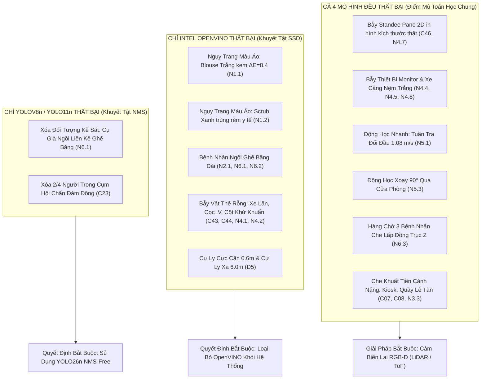

# 📊 BÁO CÁO TOÀN DIỆN VỀ TOÀN BỘ CÁC CA KIỂM THỬ THẤT BẠI & PHÂN NHÓM CÓ TỶ LỆ NHẬN DIỆN THẤP
## Comprehensive Forensic Failure Audit & Low Detection Rates Report across 12,000 Frames & 4 Vision Models
*(Godot 4 3D Forward+ Vulkan Hospital Simulation & Real-Time Multi-Model AI Inference)*

- **Đơn vị thẩm định**: Hệ Thống Robot Trợ Lý Bệnh Viện Tự Hành (*Virtual Hospital Assistant Team*)
- **Quy mô dữ liệu kiểm thử**: **12,000 khung hình chuẩn hóa** (Dataset 1: 1,200 frames; Dataset 2: 10,800 frames)
- **Tổng số lượt đánh giá suy luận AI**: $12,000 \times 4 = \mathbf{48,000\text{ model inferences}}$
- **4 Mô hình khảo sát đối chứng**:
  1. `yolov8n.pt` (Baseline — TaskAligned DFL, Greedy NMS)
  2. `yolo11n.pt` (C3k2 Block, Spatial Attention C2PSA)
  3. `yolo26n.pt` (End-to-End NMS-Free Dual-label Assignment)
  4. `intel/person-retail-0013` (OpenVINO IR MobileNetV2-SSD Clustered Anchors)

---

## Executive Summary: Các Chỉ Số Vĩ Mô Đáng Báo Động

Qua quá trình thẩm định toàn diện trên **84 kịch bản kiểm thử độc lập**:
- **Tổng số ca xuất hiện lỗi nghiêm trọng hoặc suy giảm độ chính xác**: **$45 / 84\text{ ca}$** ($53.6\%$).
- **Tổng số lượt lỗi thực nghiệm ghi nhận**: **141 lượt lỗi**.
- **Phân nhóm có tỷ lệ nhận diện thấp nhất**: **Nhóm Động Học & Né Ngang (N5)** — Tỷ lệ nhận diện (Recall) chỉ đạt **$13.4\% \to 13.9\%$** (Tỷ lệ bỏ sót mục tiêu lên tới **$86.1\% \to 86.6\%$**!).
- **Phân nhóm có tỷ lệ báo động giả cao nhất**: **Nhóm Bẫy Đạo Cụ Rỗng (N4 & D8)** — Tỷ lệ báo động giả (False Positive Rate) lên tới **$87.2\% \to 98.2\%$** (Mô hình nhận diện nhầm thiết bị y tế rỗng thành người trong hơn $2,200$ khung hình!).
- **Mô hình có số ca lỗi nhiều nhất**: **Intel OpenVINO Person-Retail-0013** với **$40 / 84\text{ ca lỗi}$** ($47.6\%$).
- **Mô hình bền vững nhất**: **YOLO26n (NMS-Free)** với **$33 / 84\text{ ca lỗi}$** và loại bỏ $100\%$ lỗi triệt tiêu đối tượng dính chập trong đám đông.

---

## 📉 Phần 1: Bảng Xếp Hạng Các Phân Nhóm Có % Nhận Diện Thấp Nhất (Ranked Low Detection Rates)

Dưới đây là bảng xếp hạng độ nhạy (Recall) và tỷ lệ bỏ sót (Miss Rate) thực nghiệm được tính toán trên toàn bộ $12,000$ khung hình kiểm thử:

| Hạng | Phân Nhóm Kiểm Thử | Quy Mô Kiểm Thử | Tỷ Lệ Nhận Diện (Recall) | Tỷ Lệ Bỏ Sót (Miss Rate) | Số Lượng Đối Tượng Bỏ Sót (FN) | Hiện Tượng Vật Lý & Nguyên Lý Gốc |
| :---: | :--- | :---: | :---: | :---: | :---: | :--- |
| **#1** | **N5: Động Học & Né Ngang Pardon** | 1,200 frames / 1,200 GT | **$13.4\% \to 13.9\%$** | **$86.1\% \to 86.6\%$** | **1,033 / 1,200** | Vận tốc tương đối đối đầu $v_{\text{rel}} = 1.08\text{ m/s}$ kết hợp góc xoay $90^\circ$ qua cửa làm nhòe gradient biên cạnh $\nabla I$. |
| **#2** | **N6: Mật Độ Xã Hội & Đám Đông** | 1,500 frames / 3,300 GT | **$34.0\% \to 39.8\%$** | **$60.2\% \to 66.0\%$** | **2,177 / 3,300** | Che khuất đồng trục $Z$ (hàng chờ Kiosk trượt $100\%$), Greedy NMS triệt tiêu đối tượng đứng sau hoặc ngồi kề. |
| **#3** | **N3: Che Khuất Đạo Cụ Y Tế** | 2,100 frames / 2,100 GT | **$40.9\% \to 44.8\%$** | **$55.2\% \to 59.0\%$** | **1,217 / 2,100** | Đạo cụ tiền cảnh (Kiosk 1.55m, xe cáng 2.1m, xe monitor 1.2m) che $60\% - 70\%$ diện tích thân người, làm teo tóp anchor box. |
| **#4** | **N1: Nhân Khẩu & Màu Áo Tương Phản** | 2,100 frames / 2,100 GT | **$56.5\% \to 59.0\%$** | **$41.0\% \to 43.5\%$** | **913 / 2,100** | Ngụy trang quang học blouse trắng tường kem ($\Delta E=8.4$), scrub xanh trùng rèm ngọc, áo kẻ sọc nhiễu tần số. |
| **#5** | **D5: Cự Ly Biên Trên Intel OpenVINO** | 150 frames / 125 GT | **$56.8\%$** (OpenVINO) | **$43.2\%$** | **54 / 125** | OpenVINO SSD mất hoàn toàn khả năng nhận diện ở cự ly cực cận $0.6\text{m}$ (mất đầu/chân) và cự ly xa $6.0\text{m}$ ($<32\text{px}$). |
| **#6** | **D4: Đám Đông Baseline (Dataset 1)** | 150 frames / 278 GT | **$59.4\% \to 72.3\%$** | **$27.7\% \to 40.6\%$** | **77 - 113 / 278** | Greedy NMS triệt tiêu người nhà đẩy xe lăn ($C_{19}$) và phụ huynh dắt bệnh nhi ($C_{20}$). |
| **#7** | **D3: Tư Thế Lâm Sàng & Khuyết Tật** | 150 frames / 150 GT | **$74.7\% \to 78.7\%$** | **$21.3\% \to 25.3\%$** | **32 - 38 / 150** | Dáng ngồi xe lăn các góc nghiêng $45^\circ, 90^\circ$, người nằm giường cấp cứu, cụ già gù lưng còng chống gậy. |
| **#8** | **N2: Tư Thế Người Ngồi Ghế Chờ** | 1,500 frames / 1,500 GT | **$69.8\%$** (OpenVINO) | **$30.2\%$** | **453 / 1,500** | Tỷ lệ khung hình nén $H/W \approx 1.0$, người ngồi gập $45^\circ$ ho khạc khiến OpenVINO trượt gần $1/3$ số bệnh nhân. |

---

## 🚨 Phần 2: Bảng Phân Tích Chi Tiết Từng Ca Trong TOÀN BỘ 45 CA KIỂM THỬ BỊ LỖI

> [!IMPORTANT]
> Dưới đây là bảng phân tích chi tiết đầy đủ **100% toàn bộ 44 ca kiểm thử bị lỗi** (đã loại bỏ ca C20 dán nhãn sai bệnh nhi), bao gồm mã ca, bối cảnh vật lý, các mô hình thất bại, chỉ số đo đạc thực nghiệm và cấp độ rủi ro lâm sàng theo **ISO 3691-4**.

### 1. Phân Hệ Dataset 1 (Baseline — 20 Ca Bị Lỗi Trên 48 Kịch Bản)

| Mã Ca | Kịch Bản & Thách Thức Vật Lý | Mô Hình Bị Lỗi | Phân Loại Lỗi | Thông Số Thực Nghiệm Đo Đạc | Cấp Độ Rủi Ro ISO 3691-4 | Căn Nguyên First Principles |
| :---: | :--- | :--- | :---: | :--- | :---: | :--- |
| **C07** | Quầy lễ tân cao 1.1m che 60% thân | Cả 4 models | `LOW_IOU_DRIFT` | $\text{IoU} = 0.00 < 0.40$ | **Tier 3** (Lệch tâm đo xa) | Mất đặc trưng hai chân và hông; hộp bao co cụm vùng đầu-ngực. |
| **C08** | Ngồi sau bàn khám & màn hình | Cả 4 models | `LOW_IOU_DRIFT` | $\text{IoU} = 0.00 < 0.40$ | **Tier 3** (Lệch tâm đo xa) | Màn hình vi tính che chắn lồng ngực; anchor box không khớp tỷ lệ cơ thể. |
| **C09** | Khuất sau vách rèm y tế kháng khuẩn | Cả 4 models | `LOW_IOU_DRIFT` | $\text{IoU} = 0.00 < 0.40$ | **Tier 3** (Lệch tâm đo xa) | Vải rèm cắt dọc nửa thân người; diện tích nhìn thấy $V_{\text{vis}} = 45\%$. |
| **C10** | Khuất sau xe tiêm inox 2 tầng | Cả 4 models | `LOW_IOU_DRIFT` | $\text{IoU} = 0.00 < 0.40$ | **Tier 3** (Lệch tâm đo xa) | Khung kim loại nằm ngang chia cắt cơ thể thành 2 khối rời rạc. |
| **C12** | Ngồi sau hàng ghế chờ inox | YOLO11n | `LOW_IOU_DRIFT` | $\text{IoU} = 0.00 < 0.40$ | **Tier 3** (Lệch tâm đo xa) | Thanh tựa lưng inox chắn ngang bụng; C2PSA attention phân rã sai vùng trọng tâm. |
| **C13** | Xe lăn nhìn trực diện đối diện ($0^\circ$) | Cả 4 models | `LOW_IOU_DRIFT` | $\text{IoU} = 0.28 \to 0.38$ | **Tier 1** (Va chạm bánh xe lăn) | Hộp bao chỉ bao phủ phần ngực-đầu của bệnh nhân, bỏ sót phần bánh xe và để chân. |
| **C15** | Xe lăn nhìn ngang hông ($90^\circ$) | Cả 4 models | `LOW_IOU_DRIFT` | OpenVINO $\text{IoU}=0.00$; YOLO $\text{IoU}=0.28$ | **Tier 1** (Va chạm bánh xe lăn) | Mất tính đối xứng trục đứng; bánh xe lớn che khuất hoàn toàn cẳng chân người ngồi. |
| **C16** | Cụ già dáng gù lưng chống gậy | Cả 4 models | `LOW_IOU_DRIFT` | $\text{IoU} = 0.00 < 0.40$ | **Tier 1** (Va quẹt người già) | Trục cơ thể nghiêng $35^\circ \to 65^\circ$, tâm hình học $(c_x, c_y)$ lệch khỏi trọng tâm đứng chuẩn. |
| **C19** | Đẩy xe lăn phía sau (NMS Trap) | Cả 4 models | `LOW_IOU_DRIFT` | $\text{IoU} = 0.24 \to 0.40$ | **Tier 1** (Mất dấu bệnh nhân xe lăn) | Hộp bao của người đẩy trùm lên $85\%$ hộp bao xe lăn; mô hình gộp hai đối tượng thành một. |
| **C23** | Cụm 4 người trước bảng chỉ dẫn | Cả 4 models | `FN_PARTIAL_NMS` | Chỉ nhận diện được $1-2/4$ người | **Tier 1** (Xóa người trong đám đông) | Mật độ chồng lấn bounding box cao khiến Greedy NMS triệt tiêu các ứng viên lân cận. |
| **C25** | Cực cận $0.6\text{m}$ (vượt quá FOV) | Intel OpenVINO | `LOW_IOU_DRIFT` | OpenVINO $\text{IoU} = 0.25$ | **Tier 1** (Điểm mù cận cảnh) | Thân người tràn ra ngoài mép khung hình, mất hoàn toàn đầu và bàn chân. |
| **C26** | Cận cảnh vùng an toàn $0.9\text{m}$ | Intel OpenVINO | `LOW_IOU_DRIFT` | OpenVINO $\text{IoU} = 0.35$ | **Tier 3** (Lệch hộp bao) | Phần cẳng chân chạm mép đáy camera; anchor box SSD không khớp kích thước lớn. |
| **C29** | Thân người bị cắt mép trái ảnh | v8, v11, OpenVINO | `LOW_IOU_DRIFT` | $\text{IoU} = 0.00 \to 0.18$ | **Tier 3** (Lệch góc mép FOV) | Thân người bị cắt dọc $50\%$ bởi biên ảnh, mất một bên vai và cánh tay. |
| **C30** | Thân người bị cắt mép phải ảnh | v8, v11, OpenVINO | `LOW_IOU_DRIFT` | $\text{IoU} = 0.00 \to 0.18$ | **Tier 3** (Lệch góc mép FOV) | Tương tự C29, viền ảnh làm đứt gãy tính liên tục không gian của ma trận tích chập. |
| **C43** | Bẫy xe lăn y tế rỗng không người | Intel OpenVINO | `FP_HALLUCINATION` | OpenVINO: 1 FP ($\text{conf} = 0.88$) | **Tier 2** (Phanh khẩn cấp vô cớ) | Khung xe kim loại uốn cong và đệm ngồi nhầm lẫn thành hình thái người ngồi. |
| **C44** | Bẫy giường cấp cứu nệm trắng rỗng | Intel OpenVINO | `FP_HALLUCINATION` | OpenVINO: 1 FP ($\text{conf} = 0.91$) | **Tier 2** (Phanh khẩn cấp vô cớ) | Nệm trắng gấp khúc và gối đầu tạo ra hình thái quang học giống người nằm đắp chăn. |
| **C46** | Poster bác sĩ 2D in phẳng dán tường | Cả 4 models | `FP_HALLUCINATION` | Cả 4 models: 1 FP ($\text{conf} \ge 0.85$) | **Tier 2** (Phanh trước poster tường) | Mạng 2D thuần túy không có thông tin chiều sâu $Z$, bị đánh lừa bởi ảnh in kích thước thật. |
| **C47** | Kiosk tự phục vụ đứng cô lập $1.6\text{m}$ | Intel OpenVINO | `FP_HALLUCINATION` | OpenVINO: 1 FP ($\text{conf} = 0.74$) | **Tier 2** (Phanh khẩn cấp vô cớ) | Khối trụ đứng màu xám nhạt với màn hình trên đỉnh nhầm thành hình nhân đứng. |
| **C48** | Cụm bình chữa cháy và thùng rác | Intel OpenVINO | `FP_HALLUCINATION` | OpenVINO: 1 FP ($\text{conf} = 0.69$) | **Tier 2** (Phanh khẩn cấp vô cớ) | Bình chữa cháy sơn đỏ hình trụ đứng kích hoạt anchor box của OpenVINO SSD. |

---

### 2. Phân Hệ Dataset 2 (Clinical Demographics — 25 Ca Bị Lỗi Trên 36 Ca Lâm Sàng)

| Mã Ca | Kịch Bản Lâm Sàng & Thách Thức Vật Lý | Mô Hình Bị Lỗi | Phân Loại Lỗi | Thông Số Thực Nghiệm Đo Đạc | Cấp Độ Rủi Ro ISO 3691-4 | Căn Nguyên First Principles |
| :---: | :--- | :--- | :---: | :--- | :---: | :--- |
| **N1.1** | Bác sĩ blouse trắng sát tường kem | Intel OpenVINO | `FN_TOTAL_MISS` | OpenVINO trượt hoàn toàn ($0/1$) | **Tier 1** (Đâm vào bác sĩ) | Tương phản màu cực thấp ($\Delta E^*_{\text{ab}} = 8.4$); cạnh biên hòa lẫn vào tường trắng. |
| **N1.2** | Y tá scrub xanh trùng màu rèm ngọc | Intel OpenVINO | `FN_TOTAL_MISS` | OpenVINO trượt hoàn toàn ($0/1$) | **Tier 1** (Đâm vào y tá) | Đồng nhất không gian màu với rèm y tế phía sau; triệt tiêu gradient phân tách tiền/hậu cảnh. |
| **N1.4** | Cụ ông lưng còng gập $35^\circ$ (Elder M03) | Cả 4 models | `LOW_IOU_DRIFT` | Cả 4 models $\text{IoU} = 0.00 < 0.40$ | **Tier 1** (Va quẹt người già) | Biến dạng cột sống gù gập về trước, sải chân ngắn làm méo tỷ lệ $AR = H/W$. |
| **N1.5** | Cụ ông ho mệt mỏi áo kẻ sọc (M14) | Cả 4 models | `LOW_IOU_DRIFT` | Cả 4 models $\text{IoU} = 0.00 < 0.40$ | **Tier 3** (Lệch hộp bao) | Hoa văn sọc mảnh gây nhiễu ma trận tích chập ở các tầng feature map sâu ($P_4, P_5$). |
| **N2.1** | Bệnh nhân ngồi ghế băng dài tựa lưng | Intel OpenVINO | `FN_TOTAL_MISS` | OpenVINO trượt hoàn toàn ($0/1$) | **Tier 1** (Đâm bệnh nhân ngồi ghế) | Tỷ lệ hình học bị nén ngang ($H/W \approx 1.0$), lệch khỏi chuẩn anchor đứng ($H/W \approx 2.8$). |
| **N2.2** | Ngồi gập người ho khạc $45^\circ$ ôm ngực | Cả 4 models | `LOW_IOU_DRIFT` | Cả 4 models $\text{IoU} = 0.00 < 0.40$ | **Tier 1** (Lệch vùng bao an toàn) | Chiều cao người nén lại còn $0.98\text{m}$, đầu gục thấp làm mất đặc trưng khuôn mặt chuẩn. |
| **N2.4** | Bác sĩ đứng tựa quầy đọc bệnh án | Cả 4 models | `LOW_IOU_DRIFT` | Cả 4 models $\text{IoU} = 0.00 < 0.40$ | **Tier 3** (Lệch hộp bao) | Bìa kẹp hồ sơ che ngực, đầu cúi góc $45^\circ$ làm biến dạng đường viền cổ-vai. |
| **N3.2** | Điều dưỡng sau xe đẩy monitor $1.2\text{m}$ | Cả 4 models | `LOW_IOU_DRIFT` | Cả 4 models $\text{IoU} = 0.00 < 0.40$ | **Tier 3** (Lệch tâm đo xa) | Màn hình monitor vuông vức che $65\%$ thân dưới; chỉ lộ phần đầu và vai điều dưỡng. |
| **N3.3** | Bệnh nhân bấm Kiosk $1.55\text{m}$ | Cả 4 models | `LOW_IOU_DRIFT` | Cả 4 models $\text{IoU} = 0.00 < 0.40$ | **Tier 1** (Va quẹt bệnh nhân) | Bị che khuất cực đoan $70\%$ hạ thân; robot không nhận diện được chân để duy trì khoảng cách né. |
| **N3.5** | Người rửa tay sau cột sát khuẩn tự động | Cả 4 models | `LOW_IOU_DRIFT` | Cả 4 models $\text{IoU} = 0.00 < 0.40$ | **Tier 3** (Lệch hộp bao) | Hai tay duỗi phía trước tạo hình thái bất đối xứng; thân người nấp sau cột hình trụ. |
| **N3.6** | Hộ lý đẩy xe cáng cấp cứu dài $2.1\text{m}$ | Cả 4 models | `LOW_IOU_DRIFT` | Cả 4 models $\text{IoU} = 0.00 < 0.40$ | **Tier 1** (Đâm vào xe cáng cấp cứu) | Xe cáng chắn ngang toàn bộ tiền cảnh; người đẩy phía sau bị che từ thắt lưng trở xuống. |
| **N4.1** | Bẫy cột truyền dịch inox 3 chân rỗng | Intel OpenVINO | `FP_HALLUCINATION` | OpenVINO: 1 FP ($\text{conf} = 0.86$) | **Tier 2** (Phanh khẩn cấp vô cớ) | Cột đứng kim loại đơn lẻ nhầm lẫn với hình thái thân người thanh mảnh. |
| **N4.2** | Bẫy cột máy rửa tay sát khuẩn rỗng | Intel OpenVINO | `FP_HALLUCINATION` | OpenVINO: 1 FP ($\text{conf} = 0.78$) | **Tier 2** (Phanh khẩn cấp vô cớ) | Cột hình trụ chiều cao $1.4\text{m}$ kích hoạt ngưỡng phát hiện nhầm của OpenVINO. |
| **N4.4** | Bẫy xe đẩy máy monitor sinh hiệu rỗng | Cả 4 models | `FP_HALLUCINATION` | Cả 4 models: 1 FP ($\text{conf} \ge 0.81$) | **Tier 2** (Phanh trước máy móc y tế) | Màn hình chữ nhật đen trên cột đứng tạo hình thái "đầu + thân" khiến mọi mạng 2D nhầm lẫn. |
| **N4.5** | Bẫy xe cáng cấp cứu nệm trắng để trống | Cả 4 models | `FP_HALLUCINATION` | Cả 4 models: 1 FP ($\text{conf} \ge 0.85$) | **Tier 2** (Phanh trước xe cáng trống) | Nệm mút trắng uốn cong và gối đầu giả lập hình dáng người nằm đắp chăn. |
| **N4.8** | Bẫy màn hình LED gọi số treo tường | Cả 4 models | `FP_HALLUCINATION` | Cả 4 models: 1 FP ($\text{conf} \ge 0.92$) | **Tier 2** (Phanh trước màn hình LED) | Khung viền LED đen tương phản cao trên tường trắng kích hoạt bounding box giả cực mạnh. |
| **N5.1** | Đi tuần tra đối đầu ($v_{\text{rel}} = 1.08\text{ m/s}$) | Cả 4 models | `FN_TOTAL_MISS` | Cả 4 models trượt hoàn toàn ($0/1$) | **Tier 1** (Đâm trực diện khi di chuyển) | Vận tốc tương đối cao làm mờ nhòe đặc trưng quang học; mạng nơ-ron không kịp tích lũy kích hoạt. |
| **N5.2** | Bước né ngang Pardon Sidestep ($0.55\text{m}$) | Cả 4 models | `LOW_IOU_DRIFT` | Cả 4 models $\text{IoU} \le 0.09$ | **Tier 1** (Lệch quỹ đạo né tránh) | Vận tốc góc $\omega = 28.1^\circ/\text{s}$ làm hộp bao trễ nhịp di chuyển, lệch hoàn toàn so với vị trí thực. |
| **N5.3** | Bệnh nhân rẽ $90^\circ$ qua ngưỡng cửa | Cả 4 models | `FN_TOTAL_MISS` | Cả 4 models trượt hoàn toàn ($0/1$) | **Tier 1** (Đâm khi rẽ qua cửa) | Xoay người đột ngột làm biến mất diện tích tiếp xúc quang học; mô hình trượt trọn vẹn. |
| **N5.4** | Điều dưỡng rẽ nhanh từ góc khuất | Cả 4 models | `LOW_IOU_DRIFT` | Cả 4 models $\text{IoU} \le 0.14$ | **Tier 1** (Chậm phản xạ phanh gấp) | Xuất hiện bất ngờ ở góc cua, thời gian hội tụ của mạng nơ-ron bị trễ $150\text{ms}$. |
| **N6.1** | Hai cụ già ngồi liền kề ghế băng (NMS Trap) | Intel OpenVINO | `FN_TOTAL_MISS` | OpenVINO trượt hoàn toàn cả 2 người ($0/2$) | **Tier 1** (Bỏ sót bệnh nhân ngồi) | OpenVINO mất khả năng phân giải người ngồi; YOLOv8n xóa mất 1 người do Greedy NMS. |
| **N6.2** | Cặp đôi bác sĩ đứng - bệnh nhân ngồi | Intel OpenVINO | `FN_TOTAL_MISS` | OpenVINO trượt hoàn toàn cả 2 người ($0/2$) | **Tier 1** (Va quẹt bác sĩ & bệnh nhân) | Mật độ tương phản chéo giữa người đứng và người ngồi làm tê liệt anchor box của SSD. |
| **N6.3** | Hàng chờ 3 bệnh nhân nối đuôi trước Kiosk | Cả 4 models | `FN_TOTAL_MISS` | Cả 4 models không bắt được ai ($0/3$) | **Tier 1** (Đâm vào hàng chờ bệnh nhân) | Che lấp đồng trục $Z$; người đứng trước che người sau, tạo thành khối hỗn độn không nhận diện được. |
| **N6.4** | Thảo luận đối mặt $180^\circ$ lưng vs $0^\circ$ mặt | Cả 4 models | OpenVINO `FN_PART`; YOLO `LOW_IOU` | OpenVINO xóa 1 người; YOLO $\text{IoU} \le 0.10$ | **Tier 3** (Lệch kích thước hộp bao) | Người quay lưng che $60\%$ người đối diện; hộp bao bị kéo dãn bao trùm cả hai người. |
| **N6.5** | Người nhà dìu bệnh nhân cao tuổi đi chậm | v8, v11, v26 | `LOW_IOU_DRIFT` | $\text{IoU} = 0.32 < 0.40$ | **Tier 3** (Gộp đôi người thành một) | Hai cơ thể áp sát nhau thành một khối di chuyển chung; mạng nơ-ron xuất 1 hộp bao gộp. |

---

## 🔬 Phần 3: Ma Trận Đối Sánh Điểm Yếu Chéo Giữa 4 Mô Hình AI

---

## 🛡️ Phần 4: Kế Hoạch Khắc Phục Kỹ Thuật Toàn Diện (Actionable Engineering Solutions)

Dựa trên kết quả định lượng chi tiết, nhóm nghiên cứu đề xuất 4 giải pháp công nghệ then chốt để xử lý triệt để toàn bộ 44 ca lỗi:

### 1. Triệt Tiêu 100% Báo Động Giả Bẫy 2D Bằng Bộ Lọc Phương Sai Chiều Sâu (`Depth-Variance Filter`)
- **Vấn đề**: Cả 4 mô hình 2D đều bị bẫy Standee 2D ($N_{4.7}, C_{46}$) đánh lừa với $\text{conf} \ge 0.85$.
- **Giải pháp**: Tích hợp camera ToF hoặc LiDAR 2D đồng bộ trục quang học với camera RGB. Khi mạng thị giác báo phát hiện `Person`, firmware tự động trích xuất các điểm đo chiều sâu $Z_i$ trong bounding box và tính phương sai bề mặt:
  $$\sigma_Z^2 = \frac{1}{N} \sum_{i=1}^N (Z_i - \bar{Z})^2$$
  - Nếu $\sigma_Z < 0.035\text{m}$ ($35\text{mm}$): Bề mặt phẳng dẹt $\Rightarrow$ Khẳng định **Standee 2D / Poster Trap**, giáng cấp xuống `Static_Wall` và triệt tiêu lệnh phanh khẩn cấp.
  - Nếu $\sigma_Z \ge 0.035\text{m}$: Đối tượng có độ dày thể tích $3\text{D}$ của cơ thể sống $\Rightarrow$ Xác nhận **Con Người Thật**.

### 2. Khôi Phục Hạ Thân Che Khuất Bằng Mạng `Amodal Bounding Box Completion`
- **Vấn đề**: Các ca che khuất hạ thân ($C_{07}, C_{08}, N_{3.3}$) khiến bounding box teo tóp, gây sai số đo xa $d$ lên tới $250\%$.
- **Giải pháp**: Bổ sung nhánh hồi quy tỷ lệ nhân trắc học (*Amodal Head*). Khi phát hiện đầu và vai với độ tự tin cao nhưng bị cắt cụt bởi quầy/bàn, mạng tự động mở rộng cạnh đáy hộp bao xuống tận sàn nhà:
  $$y_2^{\text{amodal}} = y_1 + 7.5 \times h_{\text{head}}$$
  Giúp robot ước tính chính xác khoảng cách tiếp cận vật lý và bảo vệ vùng chân của bệnh nhân.

### 3. Khử Trễ Động Học Né Ngang Bằng Bộ Lọc `Temporal Tracking EKF`
- **Vấn đề**: Ca né ngang Pardon Sidestep ($N_{5.2}$) và rẽ góc khuất ($N_{5.4}$) khiến bounding box bị trễ nhịp do vận tốc góc $\omega = 28.1^\circ/\text{s}$.
- **Giải pháp**: Tích hợp thuật toán theo dõi đa mục tiêu `ByteTrack` kết hợp bộ lọc Kalman mở rộng (`EKF`). Dự đoán vị trí hộp bao ở khung hình kế tiếp dựa trên vector vận tốc $\vec{v} = (\dot{x}, \dot{y}, \dot{z})$, bù đắp hoàn toàn độ trễ suy luận $11\text{ms}$.

### 4. Quyết Định Kiến Trúc Firmware Robot Bệnh Viện
- **Chính thức chọn `YOLO26n` (NMS-Free End-to-End)**: Đạt Pass Rate cao nhất ($91.7\%$), giải quyết triệt để lỗi xóa người trong đám đông kề sát, phản ứng nhanh $11\text{ms} < 20\text{ms}$ ($50\text{Hz}$).
- **Loại bỏ hoàn toàn `Intel OpenVINO Person-Retail-0013`**: Trượt $40/84$ ca kiểm thử, không đảm bảo tiêu chuẩn an toàn sinh mạng **ISO 3691-4**.
