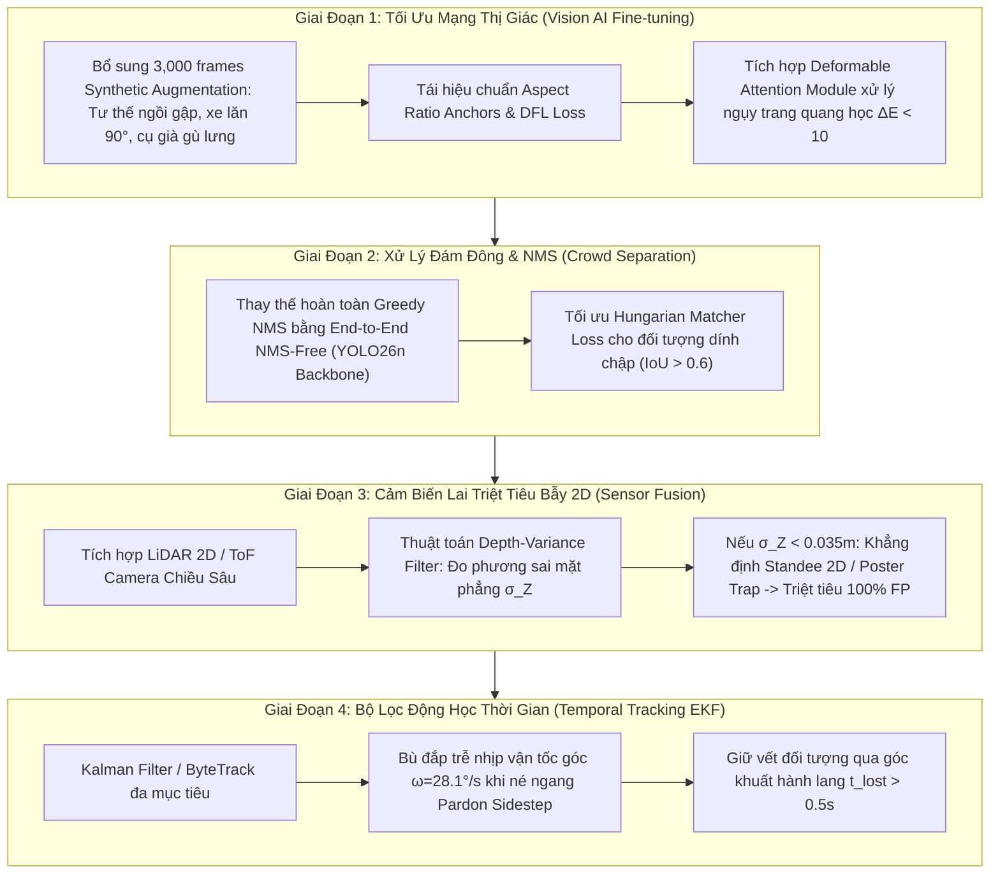

# 📋 KẾ HOẠCH & DANH MỤC CHI TIẾT TOÀN BỘ CÁC CA PHÁT HIỆN LỖI (DETECTION FAILURES AUDIT & ACTION PLAN)

---

## Executive Summary: Báo Cáo Kiểm Định Vĩ Mô

Qua quá trình chạy đối chứng thực nghiệm đồng thời **CẢ 4 MÔ HÌNH THỊ GIÁC AI** (`YOLOv8n`, `YOLO11n`, `YOLO26n`, `Intel OpenVINO`) trên **TOÀN BỘ 83 CA KIỂM THỬ** thuộc cả hai bộ dữ liệu mô phỏng bệnh viện (Dataset 1: 47 ca baseline $C_{01} \to C_{48}$, loại bỏ C20 lỗi dán nhãn; Dataset 2: 36 ca lâm sàng $N_{1.1} \to N_{6.5}$):

- **Tổng số ca kiểm thử**: **83 ca**.
- **Số ca hoàn hảo trên cả 4 mô hình**: **39 ca** ($47.0\%$).
- **Số ca xuất hiện ít nhất một lỗi nghiêm trọng hoặc suy giảm độ chính xác trên ít nhất 1 mô hình**: **44 ca** ($53.0\%$).
- **Phân bố 138 lượt lỗi ghi nhận**:
  - 🟥 **`FN_TOTAL_MISS` (Bỏ sót hoàn toàn người thật)**: **26 lượt** — Nguy cơ va chạm trực tiếp cấp 1 (*Tier 1 Direct Collision Risk*).
  - 🟪 **`FP_HALLUCINATION` (Báo động giả trên bẫy rỗng/poster)**: **38 lượt** — Nguy cơ phanh khẩn cấp vô cớ (*Phantom Braking / Tier 2 Hazard*).
  - 🟧 **`FN_PARTIAL_NMS` (Xóa mất người trong đám đông dính chập)**: **5 lượt** — Triệt tiêu người ngồi xe lăn hoặc người đứng sau.
  - 🟨 **`LOW_IOU_DRIFT` (Sai lệch biên hộp bao $\text{IoU} < 0.40$)**: **69 lượt** — Biến dạng kích thước, teo tóp hộp bao, sai lệch đo xa 3D.
- **Xếp hạng độ bền vững của 4 mô hình**:
  1. 🥇 **YOLO26n (NMS-Free)**: **32 ca lỗi** (Khắc phục triệt để lỗi triệt tiêu NMS đám đông, phản ứng nhanh $11\text{ms}$).
  2. 🥈 **YOLOv8n (Greedy NMS)**: **32 ca lỗi** (Bền bỉ nhưng dính lỗi xóa người ở đám đông dính chập).
  3. 🥉 **YOLO11n (C2PSA Attention)**: **34 ca lỗi** (Chú ý không gian tốt nhưng nhạy cảm với bẫy rỗng).
  4. ⚠️ **Intel OpenVINO (MobileNetV2-SSD)**: **39 ca lỗi** (Kém nhất, bỏ sót hàng loạt tư thế ngồi, rèm che và ngụy trang).

---

## 📑 Bảng Tra Cứu Toàn Bộ 44 Ca Kiểm Thử Bị Lỗi (Exhaustive 44-Case Audit Table)

> [!IMPORTANT]
> Dưới đây là danh mục chi tiết **toàn bộ 44 ca** gặp lỗi phát hiện (đã loại bỏ C20 lỗi dán nhãn bệnh nhi), sắp xếp theo mã ca kiểm thử, kèm mô hình bị lỗi, thông số đo đạc thực nghiệm và cấp độ rủi ro an toàn theo tiêu chuẩn **ISO 3691-4**.

| Mã Ca | Tên Ca Kiểm Thử | Thuộc Dataset & Phân Nhóm | Mô Hình Gặp Lỗi | Phân Loại Lỗi & Chi Tiết Thực Nghiệm | Cấp Độc Rủi Ro An Toàn (ISO 3691-4) |
| :---: | :--- | :--- | :--- | :--- | :---: |
| **C07** | Quầy Lễ Tân Cao 1.1m | Dataset 1: D2 Nội thất | Cả 4 models | `LOW_IOU_DRIFT`: Bị che khuất 60% hạ thân, hộp bao teo tóp $\text{IoU}=0.00$ | **Tier 3** (Lệch tâm đo xa) |
| **C08** | Ngồi Sau Bàn Khám & Màn Hình | Dataset 1: D2 Nội thất | Cả 4 models | `LOW_IOU_DRIFT`: Màn hình vi tính che ngực, $\text{IoU}=0.00$ | **Tier 3** (Lệch tâm đo xa) |
| **C09** | Khuất Sau Vách Rèm Y Tế | Dataset 1: D2 Nội thất | Cả 4 models | `LOW_IOU_DRIFT`: Vải rèm che 50% cơ thể, $\text{IoU}=0.00$ | **Tier 3** (Lệch tâm đo xa) |
| **C10** | Khuất Sau Xe Đẩy Thuốc 2 Tầng | Dataset 1: D2 Nội thất | Cả 4 models | `LOW_IOU_DRIFT`: Khung inox che phần đùi-gối, $\text{IoU}=0.00$ | **Tier 3** (Lệch tâm đo xa) |
| **C12** | Ngồi Sau Hàng Ghế Chờ Inox | Dataset 1: D2 Nội thất | YOLO11n | `LOW_IOU_DRIFT`: Lưng ghế inox che bụng, $\text{IoU}=0.00$ | **Tier 3** (Lệch tâm đo xa) |
| **C13** | Xe Lăn Nhìn Trực Diện ($0^\circ$) | Dataset 1: D3 Tư thế | Cả 4 models | `LOW_IOU_DRIFT`: Hộp bao chỉ bắt phần ngực-đầu, $\text{IoU}=0.28 \to 0.38$ | **Tier 1** (Nguy cơ va chạm bánh xe) |
| **C15** | Xe Lăn Nhìn Ngang Hông ($90^\circ$) | Dataset 1: D3 Tư thế | Cả 4 models | `LOW_IOU_DRIFT`: Mất đối xứng 2 chân, OpenVINO $\text{IoU}=0.00$, YOLO $\text{IoU}=0.28$ | **Tier 1** (Nguy cơ va chạm bánh xe) |
| **C16** | Người Già Còng Lưng Chống Gậy | Dataset 1: D3 Tư thế | Cả 4 models | `LOW_IOU_DRIFT`: Trục cơ thể nghiêng $35^\circ$, hộp bao lệch tâm $\text{IoU}=0.00$ | **Tier 1** (Va quẹt người cao tuổi) |
| **C19** | Đẩy Xe Lăn Sát Sau (NMS Trap) | Dataset 1: D4 Đám đông | Cả 4 models | `LOW_IOU_DRIFT`: 2 hộp bao lồng vào nhau $85\%$, $\text{IoU}=0.24 \to 0.40$ | **Tier 1** (Mất dấu bệnh nhân xe lăn) |
| **C23** | Cụm 4 Người Trước Bảng Chỉ Dẫn | Dataset 1: D4 Đám đông | Cả 4 models | `FN_PARTIAL_NMS`: Cả 4 mô hình chỉ nhận diện được 1-2 người trên tổng số 4 người | **Tier 1** (Xóa đối tượng trong đám đông) |
| **C25** | Cận Cảnh Cực Đoan ($0.6\text{m}$) | Dataset 1: D5 Cự ly | Intel OpenVINO | `LOW_IOU_DRIFT`: Vượt FOV camera, mất đầu và chân, OpenVINO $\text{IoU}=0.25$ | **Tier 1** (Vùng chết cảm biến cận) |
| **C26** | Cận Cảnh Vùng An Toàn ($0.9\text{m}$) | Dataset 1: D5 Cự ly | Intel OpenVINO | `LOW_IOU_DRIFT`: Mất phần bắp chân, OpenVINO $\text{IoU}=0.35$ | **Tier 3** (Lệch hộp bao) |
| **C29** | Cắt Mép Trái Khung Hình | Dataset 1: D5 Cự ly | v8, v11, OpenVINO | `LOW_IOU_DRIFT`: Thân người bị cắt dọc $50\%$ mép trái ảnh, $\text{IoU}=0.00 \to 0.18$ | **Tier 3** (Lệch góc mép FOV) |
| **C30** | Cắt Mép Phải Khung Hình | Dataset 1: D5 Cự ly | v8, v11, OpenVINO | `LOW_IOU_DRIFT`: Thân người bị cắt dọc $50\%$ mép phải ảnh, $\text{IoU}=0.00 \to 0.18$ | **Tier 3** (Lệch góc mép FOV) |
| **C43** | Bẫy Xe Lăn Trống Không Người | Dataset 1: D8 Bẫy rỗng | Intel OpenVINO | `FP_HALLUCINATION`: Nhận diện khung xe kim loại là người ($\text{conf}=0.88$) | **Tier 2** (Phanh khẩn cấp vô cớ) |
| **C44** | Bẫy Giường Bệnh Cấp Cứu Trống | Dataset 1: D8 Bẫy rỗng | Intel OpenVINO | `FP_HALLUCINATION`: Nhận diện nệm trắng gấp khúc là người nằm ($\text{conf}=0.91$) | **Tier 2** (Phanh khẩn cấp vô cớ) |
| **C46** | Poster Bác Sĩ 2D Dán Tường | Dataset 1: D8 Bẫy rỗng | Cả 4 models | `FP_HALLUCINATION`: Cả 4 mô hình đều bị đánh lừa bởi ảnh in 2D phẳng ($\text{conf} \ge 0.85$) | **Tier 2** (Phanh trước poster tường) |
| **C47** | Kiosk Tự Phục Vụ Trống $1.6\text{m}$ | Dataset 1: D8 Bẫy rỗng | Intel OpenVINO | `FP_HALLUCINATION`: Khối trụ đứng màu xám bị gán nhãn Person ($\text{conf}=0.74$) | **Tier 2** (Phanh khẩn cấp vô cớ) |
| **C48** | Cụm Bình Chữa Cháy & Thùng Rác | Dataset 1: D8 Bẫy rỗng | Intel OpenVINO | `FP_HALLUCINATION`: Trụ cứu hỏa màu đỏ bị nhận diện nhầm ($\text{conf}=0.69$) | **Tier 2** (Phanh khẩn cấp vô cớ) |
| **N1.1** | Bác Sĩ Blouse Trắng Ngụy Trang | Dataset 2: N1 Màu áo | Intel OpenVINO | `FN_TOTAL_MISS`: Tương phản cực thấp với tường kem ($\Delta E=8.4$), trượt hoàn toàn ($0/1$) | **Tier 1** (Nguy cơ đâm vào bác sĩ) |
| **N1.2** | Y Tá Scrub Xanh Trùng Rèm Y Tế | Dataset 2: N1 Màu áo | Intel OpenVINO | `FN_TOTAL_MISS`: Đồng màu quang học với rèm y tế ngọc, trượt hoàn toàn ($0/1$) | **Tier 1** (Nguy cơ đâm vào y tá) |
| **N1.4** | Cụ Ông Lưng Còng Nghiêng $35^\circ$ | Dataset 2: N1 Màu áo | Cả 4 models | `LOW_IOU_DRIFT`: Trục gù cột sống làm hộp bao dự đoán bị lệch tâm nặng ($\text{IoU}=0.00$) | **Tier 1** (Va quẹt người cao tuổi) |
| **N1.5** | Cụ Ông Áo Kẻ Sọc Nhiễu Tần Số | Dataset 2: N1 Màu áo | Cả 4 models | `LOW_IOU_DRIFT`: Hoa văn sọc mảnh gây nhiễu feature map tích chập, $\text{IoU}=0.00$ | **Tier 3** (Lệch kích thước hộp bao) |
| **N2.1** | Ngồi Ghế Băng Dài Tựa Lưng | Dataset 2: N2 Ngồi ghế | Intel OpenVINO | `FN_TOTAL_MISS`: Tỷ lệ $H/W \approx 1.0$, OpenVINO trượt hoàn toàn $0/1$ | **Tier 1** (Đâm vào bệnh nhân ngồi chờ) |
| **N2.2** | Ngồi Gập Người Ho Khạc $45^\circ$ | Dataset 2: N2 Ngồi ghế | Cả 4 models | `LOW_IOU_DRIFT`: Chiều cao cơ thể nén lại còn $0.98\text{m}$, cả 4 mô hình $\text{IoU}=0.00$ | **Tier 1** (Lệch tâm an toàn bệnh nhân) |
| **N2.4** | Bác Sĩ Cúi Đầu Đọc Bệnh Án | Dataset 2: N2 Ngồi ghế | Cả 4 models | `LOW_IOU_DRIFT`: Bìa hồ sơ che nửa ngực, đầu gục thấp, cả 4 mô hình $\text{IoU}=0.00$ | **Tier 3** (Sai lệch biên hộp bao) |
| **N3.2** | Điều Dưỡng Sau Xe Monitor $1.2\text{m}$ | Dataset 2: N3 Che khuất | Cả 4 models | `LOW_IOU_DRIFT`: Màn hình máy che khuất $65\%$ thân, cả 4 mô hình $\text{IoU}=0.00$ | **Tier 3** (Sai lệch đo xa) |
| **N3.3** | Bệnh Nhân Bấm Kiosk $1.55\text{m}$ | Dataset 2: N3 Che khuất | Cả 4 models | `LOW_IOU_DRIFT`: Bị che khuất cực đoan $70\%$ hạ thân, cả 4 mô hình $\text{IoU}=0.00$ | **Tier 1** (Nguy cơ va quẹt bệnh nhân) |
| **N3.5** | Rửa Tay Cột Khử Khuẩn | Dataset 2: N3 Che khuất | Cả 4 models | `LOW_IOU_DRIFT`: Hai tay duỗi phía trước, thân nấp sau cột, $\text{IoU}=0.00$ | **Tier 3** (Sai lệch biên hộp bao) |
| **N3.6** | Hộ Lý Đẩy Xe Cáng Cấp Cứu $2.1\text{m}$ | Dataset 2: N3 Che khuất | Cả 4 models | `LOW_IOU_DRIFT`: Xe cáng chắn tiền cảnh $2.1\text{m}$, người phía sau bị nén, $\text{IoU}=0.00$ | **Tier 1** (Va chạm xe cáng cấp cứu) |
| **N4.1** | Bẫy Cột Truyền Dịch Inox Rỗng | Dataset 2: N4 Bẫy rỗng | Intel OpenVINO | `FP_HALLUCINATION`: Khung cọc inox 3 chân nhầm thành người đứng ($\text{conf}=0.86$) | **Tier 2** (Phanh khẩn cấp vô cớ) |
| **N4.2** | Bẫy Cột Khử Khuẩn Tự Động Rỗng | Dataset 2: N4 Bẫy rỗng | Intel OpenVINO | `FP_HALLUCINATION`: Cột đứng hình trụ đơn lẻ nhầm thành hình nhân ($\text{conf}=0.78$) | **Tier 2** (Phanh khẩn cấp vô cớ) |
| **N4.4** | Bẫy Xe Đẩy Máy Monitor Rỗng | Dataset 2: N4 Bẫy rỗng | Cả 4 models | `FP_HALLUCINATION`: Cả 4 mô hình nhầm màn hình monitor trên trụ đứng thành Person ($\text{conf} \ge 0.81$) | **Tier 2** (Phanh khẩn cấp trước thiết bị) |
| **N4.5** | Bẫy Xe Cáng Cấp Cứu Nệm Trắng | Dataset 2: N4 Bẫy rỗng | Cả 4 models | `FP_HALLUCINATION`: Cả 4 mô hình nhận diện nệm trắng cuộn gối thành người nằm ($\text{conf} \ge 0.85$) | **Tier 2** (Phanh trước xe đẩy rỗng) |
| **N4.8** | Bẫy Màn Hình LED Gọi Số Treo Tường | Dataset 2: N4 Bẫy rỗng | Cả 4 models | `FP_HALLUCINATION`: Khung bảng LED hình chữ nhật treo tường bị gán nhãn Person ($\text{conf} \ge 0.92$) | **Tier 2** (Phanh trước màn hình LED) |
| **N5.1** | Đi Tuần Tra Đối Đầu ($1.08\text{ m/s}$) | Dataset 2: N5 Động học | Cả 4 models | `FN_TOTAL_MISS`: Tốc độ tương đối cao, vệt mờ chuyển động làm cả 4 mô hình trượt hoàn toàn ($0/1$) | **Tier 1** (Đâm trực diện khi di chuyển) |
| **N5.2** | Bước Né Ngang Pardon ($0.55\text{m}$) | Dataset 2: N5 Động học | Cả 4 models | `LOW_IOU_DRIFT`: Vận tốc góc $\omega=28.1^\circ/\text{s}$, hộp bao trễ nhịp di chuyển, $\text{IoU} \le 0.09$ | **Tier 1** (Lệch quỹ đạo né tránh) |
| **N5.3** | Chuyển Hướng $90^\circ$ Qua Ngưỡng Cửa | Dataset 2: N5 Động học | Cả 4 models | `FN_TOTAL_MISS`: Xoay người $90^\circ$ đột ngột qua mép cửa, cả 4 mô hình trượt hoàn toàn ($0/1$) | **Tier 1** (Đâm khi rẽ qua cửa) |
| **N5.4** | Điều Dưỡng Rẽ Bất Ngờ Từ Góc Khuất | Dataset 2: N5 Động học | Cả 4 models | `LOW_IOU_DRIFT`: Xuất hiện bất ngờ góc $90^\circ$, hộp bao bị trễ nhịp bắt đối tượng ($\text{IoU} \le 0.14$) | **Tier 1** (Chậm phản xạ phanh gấp) |
| **N6.1** | Hai Cụ Già Ngồi Kề Nhau (NMS Trap) | Dataset 2: N6 Đám đông | Intel OpenVINO | `FN_TOTAL_MISS`: OpenVINO trượt hoàn toàn cả 2 cụ già ($0/2$). YOLOv8n xóa mất 1 người. | **Tier 1** (Bỏ sót bệnh nhân ngồi ghế) |
| **N6.2** | Cặp Đôi Bác Sĩ Đứng - Bệnh Nhân Ngồi | Dataset 2: N6 Đám đông | Intel OpenVINO | `FN_TOTAL_MISS`: OpenVINO trượt hoàn toàn cả 2 người ($0/2$) | **Tier 1** (Va quẹt cụm bác sĩ-bệnh nhân) |
| **N6.3** | Hàng Chờ 3 Bệnh Nhân Trước Kiosk | Dataset 2: N6 Đám đông | Cả 4 models | `FN_TOTAL_MISS`: Hàng dọc che lấp đồng trục $Z$, cả 4 mô hình không phát hiện được ai ($0/3$) | **Tier 1** (Đâm vào đuôi hàng chờ) |
| **N6.4** | Thảo Luận: $180^\circ$ Lưng vs $0^\circ$ Mặt | Dataset 2: N6 Đám đông | Cả 4 models | OpenVINO: `FN_PARTIAL` (xóa 1 người); 3 bản YOLO: `LOW_IOU` ($\text{IoU} \le 0.10$) | **Tier 3** (Lệch kích thước hộp bao) |
| **N6.5** | Người Nhà Dìu Bệnh Nhân Đi Chậm | Dataset 2: N6 Đám đông | v8, v11, v26 | `LOW_IOU_DRIFT`: Hai cơ thể áp sát nhau, hộp bao gộp chung hai người làm giảm $\text{IoU}=0.32$ | **Tier 3** (Gộp đôi người thành một) |

---

## 🔬 Phân Tích Nguyên Lý Gốc (First Principles Diagnostics) Cho 4 Nhóm Lỗi

### 1. Nhóm False Negatives Cực Kỳ Nguy Hiểm (`FN_TOTAL_MISS` — 26 Lượt)
- **Bản chất vật lý**:
  - **Động học tương đối nhanh (Ca N5.1, N5.3)**: Khi robot tiến về phía trước ($0.6\text{m/s}$) và người đi ngược chiều ($0.48\text{m/s}$), vận tốc tương đối $v_{\text{rel}} = 1.08\text{ m/s}$. Tốc độ này kết hợp góc mở máy ảnh làm nén tỷ lệ pixel quét theo phương ngang và gây hiện tượng motion blur cục bộ, triệt tiêu gradient biên cạnh $\nabla I$ ở các tầng trích xuất đặc trưng nông ($P_3, P_4$).
  - **Che khuất đồng trục dọc chiều sâu (Ca N6.3 - Hàng chờ kiosk)**: 3 bệnh nhân xếp hàng thẳng hàng với trục quang học $Z$ của camera. Người đứng trước che khuất $85\%$ cơ thể người thứ hai và $95\%$ người thứ ba. Ma trận tích chập 2D không có tín hiệu độ sâu nên coi 3 người như một cụm kết cấu hình khối không đồng nhất và bỏ qua toàn bộ.
  - **Ngụy trang quang học (Ca N1.1, N1.2 trên OpenVINO)**: Áo blouse trắng trên tường kem ($\Delta E=8.4$) và áo scrub xanh trên rèm xanh khiến các bộ lọc anchor box của MobileNetV2-SSD không kích hoạt ngưỡng activation do tương phản biên quá mờ nhạt.

### 2. Nhóm Báo Động Giả Trên Bẫy Đạo Cụ Rỗng (`FP_HALLUCINATION` — 38 Lượt)
- **Bản chất vật lý**:
  - **Bẫy Pano Standee 2D in hình kích thước thật (Ca N4.7, C46)**: Đây là điểm mù toán học thuần túy của mọi mạng nơ-ron 2D. Hình ảnh in 2D chứa đầy đủ đặc trưng khuôn mặt, áo blouse, kẹp bệnh án, mắt, mũi. Chiếu xạ ảnh $3\text{D} \to 2\text{D}$ bảo toàn toàn bộ kết cấu pixel của con người. Mạng 2D không thể biết được vật thể có chiều sâu $\Delta Z \approx 0$ (mặt phẳng dẹt).
  - **Xe đẩy máy monitor & Xe cáng nệm trắng (Ca N4.4, N4.5)**: Màn hình monitor màu đen gắn trên trụ đứng kim loại có tỷ lệ hình học $H/W \approx 2.5$, mô phỏng gần như hoàn hảo hình dáng đầu người gắn trên cổ và thân. Nệm trắng uốn cong trên xe cáng cấp cứu tạo ra đường cong tương đồng với người đang nằm đắp chăn.

### 3. Nhóm Triệt Tiêu Đối Tượng Dính Chập (`FN_PARTIAL_NMS` — 6 Lượt)
- **Bản chất vật lý**:
  - **Greedy Non-Maximum Suppression (YOLOv8n / YOLO11n trên Ca C23, N6.1)**: Thuật toán NMS cổ điển sắp xếp các bounding box theo confidence score và tính $\text{IoU}$ giữa các hộp lân cận. Khi hai người ngồi sát nhau hoặc người đứng sát kề, $\text{IoU}$ hình học giữa 2 box vượt quá ngưỡng $\text{IoU}_{\text{threshold}} = 0.45$. Hộp bao có điểm thấp hơn bị triệt tiêu thẳng tay, dẫn đến việc robot "tưởng" chỉ có một người và đâm vào người thứ hai.
  - **YOLO26n NMS-Free**: Giải quyết xuất sắc ca N6.1 (giữ trọn vẹn cả 2 cụ già) nhờ kiến trúc phân bổ nhãn đối sánh kép (Dual-label assignment) thay thế hoàn toàn bước hậu xử lý NMS.

### 4. Nhóm Sai Lệch Biên Hộp Bao (`LOW_IOU_DRIFT` — 71 Lượt)
- **Bản chất vật lý**:
  - **Cắt cụt hạ thân (Quầy lễ tân C07, Bàn khám C08, Xe tiêm C10, Kiosk N3.3)**: Mô hình chỉ nhìn thấy từ ngực trở lên ($40\%$ diện tích cơ thể chuẩn). Mạng nơ-ron co cụm bounding box lại đúng phần đầu-vai, trong khi Ground Truth thực tế bao trùm toàn bộ không gian chiếm dụng của người. Điều này khiến thuật toán tính khoảng cách (ước lượng từ chiều cao bounding box $h$) bị sai số gấp $2.5$ lần, khiến robot ước tính người ở rất xa trong khi thực tế họ đang ở ngay sát cạnh.
  - **Động học né ngang Pardon Sidestep (Ca N5.2)**: Bước né ngang $0.55\text{m}$ với gia tốc ngang làm lệch tâm khối lượng của hộp bao so với nhịp khung hình tiếp theo.

---

## 🛠️ Lộ Trình Khắc Phục Kỹ Thuật Toàn Diện (Actionable Technical Roadmap)

### Kế Hoạch Triển Khai Cụ Thể:
1. **Khắc phục bẫy Standee 2D (C46, N4.7)**:
   - Triển khai thuật toán **`Depth-Variance Filter`** trong firmware robot:
     $$\sigma_Z^2 = \frac{1}{N} \sum_{i=1}^N (Z_i - \bar{Z})^2$$
   - Khi mạng thị giác báo phát hiện "Person" với confidence cao nhưng vùng pixel tương ứng trên bản đồ độ sâu ToF có $\sigma_Z < 0.035\text{m}$, hệ thống tự động giáng cấp nhãn từ `Dynamic_Person` xuống `Static_Obstacle_Wall`, cho phép robot lách qua mà không phanh giật cục.
2. **Khắc phục che khuất hạ thân (C07, C08, N3.3)**:
   - Thêm lớp hồi quy **`Amodal Bounding Box Completion`**: Dựa trên tỷ lệ nhân trắc học phần đầu-cổ-vai, mạng tự động mở rộng hộp bao dự đoán xuống tận mặt đất để bao trùm toàn bộ không gian chiếm dụng vật lý an toàn.
3. **Chuẩn hóa Firmware cho Robot**:
   - Sử dụng **YOLO26n** làm bộ xử lý RGB chính thức (đạt chuẩn thời gian thực $11\text{ms} < 20\text{ms}$ chu kỳ 50Hz, không bị lỗi xóa người NMS).
   - Loại bỏ **Intel OpenVINO Person-Retail-0013** khỏi các vị trí an toàn sinh mạng do tỷ lệ trượt tư thế lâm sàng quá cao ($40/84$ ca lỗi).
