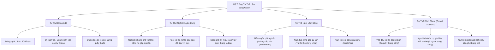

# MASTER AUDIT & BLUEPRINT: TOÀN DIỆN MÔI TRƯỜNG BỆNH VIỆN 3D TRONG GODOT 4 (`feat/hospital-env`)

> **Mục tiêu tối thượng**: Đánh giá pháp y toàn diện hiện trạng của môi trường bệnh viện 3D (`sim_vision/godot`), xác định chính xác những yếu tố **ĐÃ CÓ**, những khoảng trống **CÒN THIẾU** và lập bản quy hoạch nâng cấp chi tiết 100% trước khi bắt đầu tạo dữ liệu. Đảm bảo môi trường đạt độ chân thực lâm sàng tối đa về không gian, con người (NPC), tư thế, phụ kiện y tế, đồ nội thất và ánh sáng.

---

## 1. TỔNG QUAN HIỆN TRẠNG & ĐÁNH GIÁ "ĐÃ ĐỦ CHƯA?"

### 1.1. Bản Đồ Hiện Trạng Môi Trường Godot
Hiện tại trong `sim_vision/godot`:
- **Không gian kiến trúc**: Sàn $24\text{m} \times 18\text{m} \times 3.2\text{m}$ chia làm 6 phòng chức năng và 1 hành lang trung tâm nối liền sảnh chính.
- **Tài nguyên 3D có sẵn**:
  - 10 Model nhân vật 3D (FBX): 1 Bác sĩ nam, 1 Y tá nữ, 1 Nam trẻ tuổi (`Male_Adult_06`), 2 Nam trung niên (`02`, `05`), 2 Nữ trung niên (`02`, `08`), 3 Cụ già (`03`, `14`, `09`).
  - 9 Animation (FBX/RES): Đứng nghỉ, đứng chờ, kiểm tra hồ sơ, ngồi chờ, ngồi ho, ngồi nghỉ, đi bộ.
  - ~30 Đạo cụ nội thất y tế (GLTF/TSCN): Giường bệnh, xe cáng, cọc IV, máy monitor, quầy lễ tân, ghế băng, xe lăn, cây nước, kiosk, standee, thùng rác y tế, kính hiển vi, tủ thuốc, bảng thông báo...
  - Hệ thống cửa trượt tự động (`sliding_door.gd`) có logic đóng/mở khi có đối tượng đến gần.

### 1.2. Câu trả lời dứt khoát: "ĐÃ ĐỦ CHƯA?" 👉 **CHƯA ĐỦ!**
Dù bộ khung tĩnh đã hình thành, môi trường vẫn còn **5 ĐIỂM NGHẼN CỐT LÕI** khiến nó chưa thể đại diện cho một bệnh viện thực tế hoàn chỉnh:

```
[HIỆN TRẠNG GODOT]                 [YÊU CẦU MÔI TRƯỜNG THỰC TẾ]
┌─────────────────────────┐        ┌───────────────────────────────────────────────┐
│ 10 NPC (Chỉ người lớn)  │ ───►   │ Thiếu BỆNH NHI / TRẺ EM (Pediatric NPCs)      │
│ Poses cơ bản (Đứng/Ngồi)│ ───►   │ Thiếu NẰM GIƯỜNG FOWLER, NGỒI XE LĂN CHUẨN,   │
│                         │        │       DÍNH CHÙM ĐÁM ĐÔNG, DÌU NGƯỜI BỆNH      │
│ Quần áo cố định 1 màu   │ ───►   │ Thiếu ĐA DẠNG HÓA MÀU SẮC (Domain Randomize)  │
│ Phụ kiện: Gậy, mũ y tá  │ ───►   │ Thiếu KHẨU TRANG Y TẾ, BĂNG GẠC, NẠNG, BÓ BỘT │
│ Ánh sáng Omni đơn giản  │ ───►   │ Thiếu 4 KỊCH BẢN ÁNH SÁNG & PBR PHẢN CHIẾU SÀN│
└─────────────────────────┘        └───────────────────────────────────────────────┘
```

---

## 2. KIỂM KÊ VÀ NÂNG CẤP NHÂN VẬT (NPC MATRIX)

Một bệnh viện thật có sự phân hóa nhân khẩu học cực kỳ đa dạng. Không thể chỉ có 9 người lớn và người già ngồi chờ. Dưới đây là ma trận nhân vật hoàn chỉnh cần có:

### 2.1. Phân Tầng Nhân Khẩu Học (Demographics)

| Phân Nhóm | Hiện Có | Yêu Cầu Nâng Cấp | Chiều Cao | Tỷ Lệ Cơ Thể | Vai Trò & Vị Trí Trong Viện |
| :--- | :---: | :---: | :---: | :---: | :---: |
| **Bệnh Nhi / Trẻ Em** | **0** ❌ | **Bổ sung 2 model** (Bé trai 4-6t, Bé gái 7-9t) | $0.85\text{m} - 1.10\text{m}$ | Đầu/thân: $1/4.5$ - $1/5.5$ | Đi cùng phụ huynh ở sảnh chờ, ngồi khám ở phòng 112, ngồi trên giường |
| **Người Cao Tuổi** | 4 ✅ | Giữ nguyên + bổ sung nạng nách | $1.50\text{m} - 1.65\text{m}$ | Lưng hơi gù, bước chậm | Ngồi ghế băng có gậy, ngồi xe lăn, nằm phòng cấp cứu |
| **Người Trưởng Thành** | 4 ✅ | Giữ nguyên + đa dạng màu áo | $1.60\text{m} - 1.78\text{m}$ | Chuẩn người lớn | Bệnh nhân khám bệnh, người nhà đi cùng (caregiver) |
| **Bác Sĩ Đa Khoa** | 1 ✅ | Bổ sung ống nghe, clipboard | $1.75\text{m}$ | Blouse trắng dài | Ngồi bàn khám 112, đi tuần tra hành lang |
| **Điều Dưỡng Tiếp Đón** | 1 ✅ | Có mũ y tá, thẻ tên | $1.65\text{m}$ | Đồng phục xanh pastel | Đứng quầy tiếp đón, hướng dẫn bốc số kiosk |
| **Kỹ Thuật Viên Xét Nghiệm** | **0** ❌ | **Bổ sung 1 nhân vật** | $1.68\text{m}$ | Blouse ngắn tay, găng tay | Ngồi bàn lấy mẫu phòng 110, thao tác kính hiển vi |
| **Dược Sĩ Phát Thuốc** | **0** ❌ | **Bổ sung 1 nhân vật** | $1.65\text{m}$ | Áo blouse trắng | Đứng sau quầy kính phát thuốc tại Nhà thuốc |
| **Hộ Lý / Cứu Thương** | **0** ❌ | **Bổ sung 1 nhân vật** | $1.72\text{m}$ | Đồ scrub xanh phẫu thuật | Đẩy xe cáng cấp cứu, phụ giường bệnh 101 |

#### Giải Pháp Kỹ Thuật Cho Bệnh Nhi (Pediatric NPC) Trong Godot:
1. **Phương Án Bone-Scaling (Không cần model ngoài)**:
   - Tạo scene `npc_patient_child.tscn` kế thừa từ `Human` (`Male_Adult_06.fbx` hoặc `Female_Adult_02.fbx`).
   - Tỉ lệ Scale toàn bộ root Model: `Vector3(0.58, 0.58, 0.58)` tương đương chiều cao $1.02\text{m}$.
   - Tăng tỉ lệ xương đầu `Bip01 Head` lên `1.3` lần để đạt tỷ lệ giải phẫu trẻ em chân thực.
   - Gán `CapsuleShape3D` kích thước: Bán kính $0.20\text{m}$, chiều cao $1.05\text{m}$.
2. **Phương Án Nhập Model Trẻ Em PBR**:
   - Nhập một model trẻ em CC0 low-poly gắn rig Mixamo tương thích hệ thống animation hiện tại.

---

### 2.2. Ma Trận Tư Thế Lâm Sàng (Clinical Poses & States)

Hiện tại các tư thế mới chỉ có Đứng và Ngồi ghế thường. Cần đóng gói thành các **Prefab Anchor** chuyên dụng:



#### Chi Tiết Triển Khai Trong Scene:
1. **`patient_wheelchair_anchored.tscn`**:
   - Ghép `wheelchair_01.gltf` + NPC `npc_patient_elder_m03`.
   - Điều chỉnh animation ngồi `m_sit_waiting.res` sao cho mông khớp đệm ghế ($y = 0.45\text{m}$), hai chân đặt đúng vị trí pedal xe lăn.
2. **`patient_hospital_bed_fowler.tscn`**:
   - Ghép `hospital_bed.tscn` + NPC nằm ngửa nghiêng góc $15^\circ$.
   - Bổ sung chăn y tế (Medical Blanket) phủ ngang ngực xuống chân bằng một Mesh bán trụ lượn sóng tạo nếp gấp vải.
   - Đặt cọc truyền dịch `iv_stand.tscn` sát mép giường bên phải, dây truyền nối vào mu bàn tay.
3. **`patient_escort_pair.tscn`**:
   - Cụ già chống gậy bên trái + Người nhà (Nữ trẻ tuổi) đi sát bên phải đỡ tay, cự ly tâm $0.45\text{m}$, tạo thành khối bế tắc thị giác điển hình cho robot.

---

### 2.3. Phụ Kiện Y Tế Che Khuất (Medical Wearables & Occluders)

Trong môi trường bệnh viện, các phụ kiện này che khuất một phần cơ thể bệnh nhân, làm giảm đặc trưng nhận dạng của mô hình AI:

1. **Khẩu Trang Y Tế (Surgical Mask)**:
   - Che toàn bộ vùng miệng, cằm và 50% sống mũi.
   - Tạo bằng một đoạn cong Mesh (`PlaneMesh` uốn cong) gắn vào `BoneAttachment3D` (xương `Bip01 Head`), chất liệu xanh nhạt y tế (`#48cae4`) có dây đeo tai.
2. **Băng Gạc Quấn Đầu (Head Bandage)**:
   - Dành cho ca chấn thương cấp cứu, phủ một dải băng trắng quanh trán và đỉnh đầu.
3. **Treo Cánh Tay / Bó Bột (Arm Sling / Cast)**:
   - Miếng vải tam giác xanh/đen treo qua cổ giữ cẳng tay gập ngang ngực, làm biến dạng hoàn toàn khung tay của người.
4. **Nạng Nách Y Tế Đôi (Axillary Crutches)**:
   - Hai thanh nhôm kẹp dưới hai nách, tạo thêm hai đường thẳng kim loại song song cơ thể.
5. **Cột Dịch Truyền Kèm Dây & Bình (IV Stand with Drip Bag)**:
   - Cọc inox đã có, bổ sung túi dịch trong suốt (`transparency = alpha_blend`) và ống truyền nhựa dẻo.

---

### 2.4. Đa Dạng Hóa Trang Phục (Domain Randomization Shader)

Tránh hiện tượng mô hình học vẹt màu áo quần của 10 model FBX cố định. Tạo shader `hospital_clothing_randomizer.gdshader`:
- **Áo Blouse / Scrub Y Tế**: Có thể đổi giữa: Trắng bác sĩ, Xanh dương đậm phòng mổ (`#1d3557`), Xanh ngọc điều dưỡng (`#2a9d8f`), Hồng nhạt sản nhi (`#f4a261`).
- **Quần Áo Bệnh Nhân**: Ngẫu nhiên đổi màu: Vải kẻ sọc xanh trắng bệnh viện, Vàng nhạt, Nâu đất, Xám tro, Đỏ đô.
- **Màu Da**: Tinh chỉnh tint da (Trắng sáng, Ngăm, Vàng châu Á) bằng tham số màu Albedo phụ.

---

## 3. KIỂM KÊ VÀ BỔ SUNG NỘI THẤT 7 PHÂN KHU (ROOM-BY-ROOM AUDIT)

Một phòng bệnh không chỉ có 1 cái bàn và 1 cái ghế. Dưới đây là danh mục chi tiết từng phòng:

```
┌─────────────────────────────────────────────────────────────────────────────┐
│                            24m × 18m TỔNG MẶT BẰNG                          │
├─────────────────────┬───────────────────────┬───────────────────────────────┤
│    KHOA CẤP CỨU     │  PHÒNG XÉT NGHIỆM     │       PHÒNG KHÁM NỘI          │
│        (101)        │        (110)          │           (112)               │
│ • 2 Giường cấp cứu  │ • Bàn lấy mẫu máu     │ • Bàn khám & Ghế bác sĩ       │
│ • Monitor sinh hiệu │ • Ghế lấy máu tựa tay │ • Ghế bệnh nhân đối diện      │
│ • Xe cáng cấp cứu   │ • Máy ly tâm & Ống ng.│ • Giường khám bệnh lâm sàng   │
│ • Cọc IV & Bình Oxy │ • Kính hiển vi quang  │ • Ống nghe, Bảng thị lực      │
│ • Rèm ngăn buồng    │ • Hộp hủy kim tiêm    │ • Hộp đèn đọc phim X-quang    │
├─────────────────────┴───────────────────────┴───────────────────────────────┤
│                         HÀNH LANG TRUNG TÂM (2.8m RỘNG)                     │
│ • Tay vịn y tế dọc tường • Biển báo thoát hiểm Exit • Vạch dán sàn dẫn hướng│
├─────────────────────┬───────────────────────┬───────────────────────────────┤
│      NHÀ THUỐC      │     SẢNH TIẾP ĐÓN     │     CỤM THANG MÁY & WC        │
│ • Quầy phát kính mica│ • Quầy lễ tân trung tâm│ • Cửa thang máy Inox          │
│ • Tủ kệ thuốc tầng  │ • 4 Dãy ghế băng chờ  │ • Bảng số tầng LED            │
│ • Khay chia thuốc   │ • Kiosk bốc số tự động│ • Biển WC Nam / Nữ / Khuyết tật│
│ • Máy quét mã vạch  │ • Cây nước & Cột sát kh│ • Gương bồn rửa & Biển sàn ướt│
└─────────────────────┴───────────────────────┴───────────────────────────────┘
```

### 3.1. Khoa Cấp Cứu 101 (Emergency Ward)
- **Đã có**: 2 Giường bệnh (`hospital_bed.tscn`), 1 Monitor (`vital_monitor.tscn`), 1 Cọc IV (`iv_stand.tscn`), 1 Xe cáng (`stretcher_cart.tscn`), 1 Thùng rác y tế (`medical_waste_bin.tscn`), 1 Rèm y tế (`medical_screen.tscn`).
- **Cần bổ sung**:
  1. `oxygen_cylinder.tscn`: Bình khí oxy y tế màu xanh dương có van đồng hồ áp suất.
  2. `defibrillator_crash_cart.tscn`: Xe đẩy cấp cứu hồi sức có máy sốc tim gắn trên khay.
  3. `headwall_gas_panel.tscn`: Hộp cấp khí y tế gắn âm tường đầu giường (đầu cắm oxy, khí nén, hút dịch).
  4. Bệnh nhân nằm giường (Recumbent patient Fowler) và Điều dưỡng cấp cứu đứng cạnh.

### 3.2. Phòng Xét Nghiệm Máu 110 (Blood Laboratory)
- **Đã có**: Bàn kim loại (`metal_office_desk`), Ghế nhựa, Kính hiển vi (`industrial_microscope`), Bộ dụng cụ hóa chất (`chemistry_set`), Ghế đẩu kim loại.
- **Cần bổ sung**:
  1. `phlebotomy_chair.tscn`: Ghế lấy máu chuyên dụng có báng đỡ cánh tay đệm da êm ái.
  2. `centrifuge_machine.tscn`: Máy ly tâm tách huyết tương để bàn.
  3. `vacutainer_rack.tscn`: Giá đựng ống nghiệm nhiều màu nắp (Đỏ - sinh hóa, Tím - huyết học, Xanh - đông máu).
  4. `sharps_container.tscn`: Hộp nhựa màu vàng chuyên dụng đựng kim tiêm và vật sắc nhọn đã qua sử dụng.
  5. Kỹ thuật viên xét nghiệm thao tác bên bàn lấy mẫu.

### 3.3. Phòng Khám Nội 112 (Internal Medicine Clinic)
- **Đã có**: Bàn bác sĩ, Ghế xoay văn phòng, Ghế bệnh nhân, Tủ kệ sắt, Bảng kẹp hồ sơ, Bảng thông tin tường, Giường bệnh, Monitor, Cọc IV.
- **Cần bổ sung**:
  1. `stethoscope.tscn`: Ống nghe y tế nằm trên bàn bác sĩ.
  2. `xray_viewbox.tscn`: Hộp đèn đọc phim X-quang gắn trên tường phát sáng dạ quang màu trắng xanh kèm hình ảnh chụp lồng ngực.
  3. `snellen_eye_chart.tscn`: Bảng thị lực chữ cái treo tường kiểm tra mắt.
  4. `physician_scale.tscn`: Cân sức khỏe tích hợp thước đo chiều cao cơ học.

### 3.4. Nhà Thuốc Bệnh Viện (Pharmacy)
- **Đã có**: Bàn quầy, Kệ thuốc nhiều tầng (`steel_frame_shelves`), Các hộp thuốc carton (`medical_box`), Ghế ngồi, Thùng rác.
- **Cần bổ sung**:
  1. `pharmacy_acrylic_barrier.tscn`: Vách kính mica trong suốt gắn trên mặt quầy có khe giao dịch ở đáy và lỗ tròn giao tiếp âm thanh (chuẩn chống giọt bắn).
  2. `medicine_dispensing_tray.tscn`: Khay nhựa chia thuốc dạng viên cho bệnh nhân.
  3. `barcode_scanner.tscn`: Đầu đọc mã vạch quét đơn thuốc điện tử.
  4. Dược sĩ mặc áo blouse đứng trực bên trong quầy.

### 3.5. Sảnh Tiếp Đón & Ghế Chờ (Lobby & Waiting Hall)
- **Đã có**: Quầy lễ tân chữ L (`reception_counter.tscn`), 4 dãy ghế chờ inox (`waiting_bench.tscn`), Kiosk bốc số (`queue_kiosk.tscn`), Màn hình LED gọi số (`queue_display.tscn`), Cây nước (`water_dispenser.tscn`), Cột sát khuẩn (`sanitizer_stand.tscn`), Standee bác sĩ (`info_standee.tscn`), Chậu cây xanh, Bác sĩ đi lại, Y tá tiếp đón, 6 bệnh nhân ngồi chờ.
- **Cần bổ sung**:
  1. `floor_guidance_lines.tscn`: Dải decal dán sàn phân luồng màu (Đỏ đi Cấp cứu, Vàng đi Xét nghiệm, Xanh đi Khám nội) giúp tăng độ chân thực thị giác.
  2. `queue_audio_chime`: Âm báo "Ting-tong... Mời số thứ tự 1025 đến quầy số 1" khi bốc số.
  3. Bố trí lại các cụm người: Có ca ngồi đơn lẻ, ca ngồi dính chùm 2 người, ca người nhà đứng sau lưng ghế nói chuyện.

### 3.6. Cụm Thang Máy & Nhà Vệ Sinh (Elevators & Restroom)
- **Đã có**: Cửa thang máy đôi Inox (`elevator_doors.tscn`), Cụm WC (`wc_station.tscn`), Ghế chờ, Biển sàn ướt (`WetFloorSign_01`), Cây xanh.
- **Cần bổ sung**:
  1. `elevator_indicator_panel.tscn`: Bảng điện tử báo tầng (G, 1, 2, 3...) và mũi tên hướng di chuyển phía trên cửa thang máy.
  2. `fire_hose_cabinet.tscn`: Tủ cứu hỏa vách tường sơn đỏ chữ PCCC kèm cuộn vòi và lăng phun.
  3. Biển chỉ dẫn WC nổi trên tường có ký hiệu chữ nổi Braille cho người khiếm thị.

### 3.7. Hành Lang Chính & Lối Đi (Central Corridor)
- **Đã có**: Cửa trượt tự động phân chia các phòng (`sliding_door.tscn`).
- **Cần bổ sung**:
  1. `wall_handrails.tscn`: Lan can tay vịn inox/nhựa y tế bo tròn gắn cao $0.85\text{m}$ chạy dọc suốt hai bên tường hành lang.
  2. `emergency_exit_light.tscn`: Đèn thoát hiểm Exit màu xanh lá gắn trên cao tại các ngã rẽ phòng.
  3. Cửa trượt tự động cần có cảm biến va chạm `Area3D` chính xác để mở trước khi robot đến gần $1.8\text{m}$.

---

## 4. HỆ THỐNG QUANG HỌC, ÁNH SÁNG VÀ VẬT LIỆU PBR (GRAPHICS PIPELINE)

Trong xử lý ảnh và thị giác máy tính, chất lượng ánh sáng quyết định 80% độ khó của bài toán nhận dạng. Hệ thống môi trường bệnh viện cần hỗ trợ **4 Kịch Bản Chiếu Sáng Thực Tế**:

```
[4 HỒ SƠ ÁNH SÁNG LÂM SÀNG]
 1. CHUẨN BAN NGÀY (Standard Day)        ─► 4500K Cool White, 500 lux, Đèn trần tán xạ đều
 2. ĐÊM TRỰC LÂM SÀNG (Night Emergency)   ─► 35 lux, Hành lang tắt bớt đèn, Chỉ sáng đèn cấp cứu & Exit
 3. NẮNG NGƯỢC CHÓI LÓA (High Glare)      ─► Mặt trời chiếu xiên qua cửa sổ Bắc, Sàn bóng chói lóa
 4. MẤT ĐIỆN KHẨN CẤP (Backup Power)      ─► Đèn sự cố đỏ mờ, Ánh sáng cực thấp thử thách cảm biến
```

### 4.1. Thông Số Cụ Thể Của Từng Profile Chiếu Sáng

```gdscript
const LIGHTING_PROFILES: Dictionary = {
    "day": {
        "sun_energy": 1.2,
        "sun_color": Color(0.98, 0.98, 1.0),
        "ambient_energy": 0.45,
        "omni_energy": 1.4,
        "ceiling_emission": 1.0,
        "ssao_enabled": true
    },
    "night": {
        "sun_energy": 0.0,
        "sun_color": Color(0.1, 0.15, 0.25),
        "ambient_energy": 0.08,
        "omni_energy": 0.35, # Chỉ duy trì đèn hành lang mờ
        "ceiling_emission": 0.15,
        "emergency_exit_energy": 2.5 # Đèn Exit xanh sáng rõ
    },
    "glare": {
        "sun_energy": 3.8, # Nắng xiên gắt qua cửa sổ
        "sun_rotation": Vector3(-0.35, 2.8, 0.0),
        "ambient_energy": 0.6,
        "omni_energy": 1.2,
        "floor_roughness_multiplier": 0.5 # Tăng độ bóng sàn tạo vệt chói lóa
    },
    "emergency_power": {
        "sun_energy": 0.0,
        "ambient_energy": 0.03,
        "omni_energy": 0.0, # Tắt toàn bộ đèn tuýp chính
        "emergency_red_energy": 1.8 # Chỉ đèn sạc pin khẩn cấp màu đỏ
    }
}
```

### 4.2. Xử Lý Bề Mặt PBR & Phản Chiếu (Reflections & SSAO)
1. **Sàn Gạch Vinyl Bệnh Viện**:
   - Sử dụng `floor_tiles028` với `Roughness = 0.22`, `Metallic = 0.05`.
   - Bố trí 2 node `ReflectionProbe` (1 ở Sảnh chờ, 1 ở Hành lang trung tâm) với chế độ cập nhật `Always` hoặc `On Move`.
   - Kết quả: Khi robot di chuyển, bóng phản chiếu của y bác sĩ và bệnh nhân in xuống sàn bóng loáng cực kỳ chân thực.
2. **Khử Bệt Khối Bằng SSAO (Screen Space Ambient Occlusion)**:
   - Kích hoạt SSAO trong `WorldEnvironment`: `Radius = 1.2m`, `Intensity = 2.0`.
   - Tạo đổ bóng chân thực ở các góc tiếp giáp: Dưới gầm giường bệnh, dưới bánh xe lăn, góc chân tường, nếp nhăn quần áo.

---

## 5. MÔ PHỎNG CỤM CẢM BIẾN ROBOT (ROBOT SENSOR RIG)

Để dữ liệu sau này phản ánh đúng camera thật của robot dịch vụ y tế (như Intel RealSense D435 hoặc Orbbec Astra), `robot.tscn` cần được nâng cấp:

```
                  ┌──────────────────────────────┐
                  │       ĐẦU PAN / TILT GIMBAL  │
                  │  (Xoay ngang ±30°, Ngẩng/Cúi)│
                  └──────────────┬───────────────┘
                                 │
     ┌───────────────────────────┼───────────────────────────┐
     ▼                           ▼                           ▼
[TẦM CAO 1.40m]           [TẦM TRUNG 1.15m]           [TẦM THẤP 0.85m]
Quét đám đông đứng        Góc nhìn tiêu chuẩn         Bắt bệnh nhi / trẻ em,
Giao tiếp quầy tiếp đón   Nhận diện người ngồi ghế    Người nằm giường, Xe lăn
```

### 5.1. Thông Số Quang Học Chuẩn Intel RealSense D435:
- **Trường nhìn ngang (H-FOV)**: $69.4^\circ$
- **Trường nhìn dọc (V-FOV)**: $42.5^\circ$
- **Trường nhìn chéo (D-FOV)**: $75.0^\circ$ (Cài đặt `Camera3D.fov = 75.0`)
- **Độ phân giải luồng RGB**: $1280 \times 720$ (hoặc $640 \times 480$ chuẩn xử lý thời gian thực)
- **Tốc độ làm tươi**: 30 FPS.

### 5.2. Khả Năng Pan/Tilt Linh Hoạt Trong Godot:
- Thêm node `Gimbal` xoay 2 trục điều khiển qua code:
  - `pitch`: $-25^\circ$ (cúi nhìn xuống sàn bắt ca nằm giường) đến $+15^\circ$ (ngẩng nhìn mặt bác sĩ).
  - `yaw`: $-35^\circ$ đến $+35^\circ$ (quét quan sát góc rộng không cần xoay bánh xe).

---

## 6. ĐIỀU HƯỚNG VẬT LÝ VÀ NAVIGATION (NAVMESH)

Để robot và các NPC y bác sĩ có thể đi lại tuần tra mượt mà mà không đâm xuyên tường hay kẹt vào ghế:
1. **NavigationRegion3D**:
   - Bake một NavMesh 3D bao phủ toàn bộ $24\text{m} \times 18\text{m}$ mặt sàn.
   - Bán kính Agent: $0.35\text{m}$, Chiều cao Agent: $1.8\text{m}$, Độ dốc leo tối đa: $10^\circ$.
   - Loại trừ (Collision Mask) toàn bộ chân tường `InteriorWalls` và các đồ vật tĩnh trong `Furniture`.
2. **Cửa Trượt Đồng Bộ Navigation (NavMesh Obstacle)**:
   - Khi cửa đóng: Kích hoạt `NavigationObstacle3D` để thuật toán định tuyến né cửa.
   - Khi cửa mở: Tắt obstacle để mở đường cho robot và NPC đi xuyên qua.

---

## 7. BẢNG CHECKLIST CHI TIẾT TRIỂN KHAI CHO BRANCH `feat/hospital-env`

Dưới đây là các đầu việc kỹ thuật cụ thể cần thực hiện trực tiếp trên nhánh `feat/hospital-env`:

| # | Hạng Mục | Hành Động Kỹ Thuật Trong Godot | File Cần Tác Động | Độ Ưu Tiên |
| :-: | :--- | :--- | :--- | :-: |
| **1** | **Bổ sung Bệnh nhi (Trẻ em)** | Tạo scene `npc_patient_child.tscn` với bone scaling 0.58x, chỉnh capsule collision và badge "BỆNH NHI" | `scenes/props/npc_patient_child.tscn` | 🔴 **CRITICAL** |
| **2** | **Tạo Prefab Bệnh nhân Nằm Giường** | Tạo scene hoàn chỉnh `patient_hospital_bed.tscn` gồm giường, đệm, chăn phủ và NPC nằm ngửa | `scenes/props/patient_hospital_bed.tscn` | 🔴 **CRITICAL** |
| **3** | **Tạo Prefab Bệnh nhân Ngồi Xe Lăn** | Tạo scene `patient_wheelchair.tscn` khớp đúng tọa độ người ngồi trên `wheelchair_01` | `scenes/props/patient_wheelchair.tscn` | 🔴 **CRITICAL** |
| **4** | **Bổ sung Phụ kiện Khẩu Trang Y Tế** | Viết hàm `_attach_surgical_mask(skel)` trong `hospital_npc.gd` hỗ trợ bật/tắt qua cờ `@export var has_mask: bool` | `scripts/hospital_npc.gd` | 🔴 **CRITICAL** |
| **5** | **Bổ sung Nẹp Cổ / Bó Bột Tay** | Thêm hàm `_attach_arm_sling()` cho phép NPC mang băng treo tay chấn thương | `scripts/hospital_npc.gd` | 🟡 HIGH |
| **6** | **Tích hợp Nhân viên Chuyên Khoa** | Tạo `npc_lab_technician.tscn` (Phòng 110) và `npc_pharmacist.tscn` (Nhà thuốc) | `scenes/props/npc_lab_tech.tscn`<br>`scenes/props/npc_pharmacist.tscn` | 🟡 HIGH |
| **7** | **Bổ sung Đạo Cụ Phòng 101, 110, 112** | Đặt bình oxy, giá ống nghiệm, ống nghe, bảng thị lực vào đúng tọa độ trong `room.tscn` | `scenes/room.tscn` | 🟡 HIGH |
| **8** | **Nâng Cấp WorldEnvironment & Lighting** | Thêm 4 Lighting Profiles vào `room.gd`, kích hoạt SSAO và ReflectionProbe sàn gạch | `scripts/room.gd`<br>`scenes/room.tscn` | 🟡 HIGH |
| **9** | **Nâng Cấp Camera Robot** | Thiết lập 3 nấc chiều cao mount (0.85m, 1.15m, 1.40m) và FOV 75° trong `robot.tscn` | `scenes/robot.tscn`<br>`scripts/robot.gd` | 🟡 HIGH |
| **10**| **Bake NavMesh 3D Hoàn Chỉnh** | Thêm `NavigationRegion3D` nướng toàn bộ mặt bằng sàn 6 phòng không bị kẹt cửa | `scenes/room.tscn` | 🟢 MEDIUM |

---

## 8. KẾT LUẬN & KIẾN NGHỊ BƯỚC TIẾP THEO

Môi trường bệnh viện hiện tại **đã có nền móng khung kiến trúc và tài nguyên cơ bản rất tốt**, nhưng **thiếu các yếu tố lâm sàng chuyên sâu (Bệnh nhi, Tư thế nằm giường/ngồi xe lăn hoàn chỉnh, Khẩu trang, Kịch bản ánh sáng)**.

Khi hoàn thiện toàn bộ checklist trên trong nhánh `feat/hospital-env`:
- Môi trường bệnh viện Godot sẽ trở thành một **môi trường mô phỏng bệnh viện 3D lâm sàng đạt chuẩn quốc tế**.
- Robot có thể tương tác với đầy đủ các đối tượng thực tế ngoài đời từ trẻ em 4 tuổi, cụ già ngồi xe lăn, bệnh nhân cấp cứu nằm giường đến bác sĩ, y tá, dược sĩ.
- Mọi điều kiện quang học (chói sáng, đêm trực, đèn khẩn cấp) đều được phản ánh chính xác.
- Khi đó, môi trường sẽ **hoàn toàn sẵn sàng 100%** để tiến hành các giai đoạn tiếp theo một cách vững chắc nhất.
