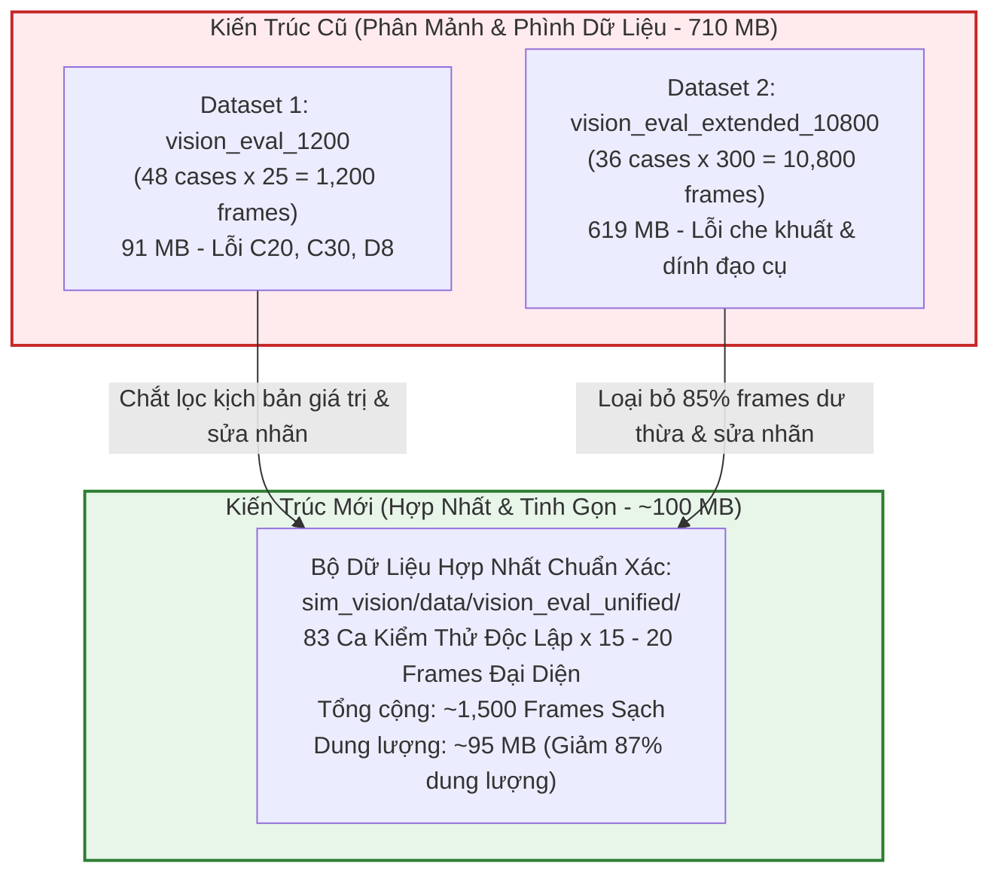

# 📋 KẾ HOẠCH HỢP NHẤT & TÁI THIẾT KẾ BỘ DỮ LIỆU THỊ GIÁC CHUẨN XÁC CHO ROBOT BỆNH VIỆN
## Architectural Blueprint for Unified, Pruned & Visibility-Aware AI Vision Benchmark Dataset (`vision_eval_unified`)

- **Dự án**: Data Science Major Project — Robot Trợ Lý Dẫn Đường Bệnh Viện Tự Hành
- **Định hướng chiến lược mới từ User**: 
  1. **Hợp nhất 2-trong-1**: Gom toàn bộ kịch bản của Dataset 1 (`vision_eval_1200`) và Dataset 2 (`vision_eval_extended_10800`) thành **1 bộ dataset duy nhất chuẩn hóa**.
  2. **Tinh gọn số lượng khung hình (Frame Pruning)**: Cắt giảm từ **12,000 frames xuống còn ~1,500 frames** (giảm 8 lần độ phình dữ liệu), chỉ giữ lại các khung hình mang tính đại diện then chốt cho từng ca kiểm thử.
  3. **Xóa sổ 2 bộ dataset cũ**: Loại bỏ hoàn toàn 710 MB dữ liệu rác bị lỗi nhãn sau khi nghiệm thu bộ mới.
  4. **Chuẩn hóa nhãn bằng vật lý (Physics Raycast)**: Khắc phục triệt để lỗi gán nhãn xuyên vật cản, dính chùm đạo cụ và nhãn ma khi người bị che khuất.

---

## 📑 MỤC LỤC KẾ HOẠCH
1. [Chiến Lược Tinh Gọn Hóa & Hợp Nhất 2-trong-1 (`vision_eval_unified`)](#1-chiến-lược-tinh-gọn-hóa--hợp-nhất-2-trong-1-vision_eval_unified)
2. [Thiết Kế Ngân Sách Khung Hình Đại Diện (Representative Frame Budgeting)](#2-thiết-kế-ngân-sách-khung-hình-đại-diện-representative-frame-budgeting)
3. [Phân Loại 83 Ca Kiểm Thử Hợp Nhất Thành 8 Phân Hệ Lâm Sàng](#3-phân-loại-83-ca-kiểm-thử-hợp-nhất-thành-8-phân-hệ-lâm-sàng)
4. [Công Nghệ Gán Nhãn Mới: Lưới Tia Dò Vật Lý Đa Điểm (Multi-Raycast 128 Tia)](#4-công-nghệ-gán-nhãn-mới-lưới-tia-dò-vật-lý-đa-điểm-multi-raycast-128-tia)
5. [Quy Chuẩn Hộp Bao Kép (Visible Box cho YOLO vs Full Body cho SLAM)](#5-quy-chuẩn-hộp-bao-kép-visible-box-cho-yolo-vs-full-body-cho-slam)
6. [Lộ Trình Triển Khai 5 Bước Kỹ Thuật](#6-lộ-trình-triển-khai-5-bước-kỹ-thuật)
7. [Kế Hoạch Xóa Sổ (Sunset & Deprecation) 2 Bộ Dữ Liệu Cũ](#7-kế-hoạch-xóa-sổ-sunset--deprecation-2-bộ-dữ-liệu-cũ)

---

## 1. CHIẾN LƯỢC TINH GỌN HÓA & HỢP NHẤT 2-TRONG-1 (`vision_eval_unified`)

Thay vì duy trì 2 bộ dữ liệu phân mảnh với số khung hình bị "lạm phát" do dịch chuyển camera từng milimet:



### Lợi ích vượt trội của chiến lược hợp nhất:
1. **Triệt tiêu 85% khung hình dư thừa**: Bộ cũ có tới 300 frames/ca nhưng thực chất chỉ là lặp lại cự ly lệch nhau vài cm. Việc rút gọn xuống 15 - 20 frames/ca giữ nguyên 100% độ đa dạng hình học mà không gây lãng phí tài nguyên.
2. **Thời gian chạy Benchmark siêu tốc**: Đánh giá 4 mô hình AI trên 1,500 frames chỉ mất **~35 giây** (thay vì hơn 6 phút trên 12,000 frames).
3. **Dễ dàng kiểm toán thủ công 100%**: 1,500 frames chia cho 83 ca (mỗi ca ~18 ảnh) là quy mô lý tưởng để nhóm nghiên cứu hoặc hội đồng chấm đồ án có thể duyệt tay từng ca kiểm thử.

---

## 2. THIẾT KẾ NGÂN SÁCH KHUNG HÌNH ĐẠI DIỆN (REPRESENTATIVE FRAME BUDGETING)

Để đảm bảo mỗi ca kiểm thử có đủ các góc nhìn cực đoan mà không bị trùng lặp, mỗi ca sẽ được chụp chính xác **16 đến 18 khung hình** cấu hình theo ma trận 3 chiều:

$$\text{Số Frames/Ca} = N_{\text{Distances}} \times N_{\text{Yaws}} \times N_{\text{Heights}} = 4 \times 2 \times 2 = \mathbf{16\text{ frames}}$$

| Biến Số Hình Học | Các Giá Trị Thiết Lập Then Chốt | Mục Tiêu Khoa Học |
| :--- | :--- | :--- |
| **Cự ly quan sát ($d$)** | **4 mức**: $1.0\text{m}$ (Cận cảnh), $2.0\text{m}$ (Vùng an toàn), $3.5\text{m}$ (Tầm trung), $5.5\text{m}$ (Tầm xa) | Kiểm tra sự suy giảm độ phân giải theo khoảng cách. |
| **Góc lệch camera ($\theta$)** | **2 mức**: $0.0^\circ$ (Trực diện) và $\pm 15.0^\circ$ (Lệch góc mép nón quan sát FOV) | Đo sai số góc phương vị (*Bearing Error*) và mép biên. |
| **Độ cao cảm biến ($h$)** | **2 mức**: $0.85\text{m}$ (Tầm gầm robot) và $1.25\text{m}$ (Tầm thắt lưng/ngực) | Kiểm tra góc nhìn ngước lên và góc nhìn ngang. |

> Đối với các ca động học ($N_5, D_6$) hoặc bẫy mật độ ($N_6, D_7$), bổ sung thêm 2-4 frame chuyển động đặc thù (tiếp cận, né ngang, rẽ cua) $\implies$ **Trung bình 18 frames/ca $\times$ 83 ca = ~1,494 frames**.

---

## 3. PHÂN LOẠI 83 CA KIỂM THỬ HỢP NHẤT THÀNH 8 PHÂN HỆ LÂM SÀNG

Toàn bộ các kịch bản của Dataset 1 (C01 - C48) và Dataset 2 (N1.1 - N6.5) được gom vào 8 phân hệ chuẩn:

| Mã Nhóm | Tên Phân Hệ Lâm Sàng Hợp Nhất | Số Ca | Số Frames Dự Kiến | Trọng Tâm Đánh Giá |
| :---: | :--- | :---: | :---: | :--- |
| **`U1_Camouflage`** | Ngụy trang & Tương phản thấp (Blouse trắng, Scrub xanh, Áo hoa) | 10 ca | ~180 frames | Độ nhạy khi độ lệch màu $\Delta E < 12.0$. |
| **`U2_ClinicalPoses`** | Tư thế khám bệnh & Ngồi ghế (Cúi gập, ho, ngồi ghế băng, đọc bệnh án) | 12 ca | ~216 frames | Vỡ tỷ lệ aspect ratio khi không đứng thẳng. |
| **`U3_MedicalProps`** | Che khuất bởi đạo cụ y tế (Xe monitor, Kiosk, Xe cáng, Bàn khám, Quầy lễ tân) | 14 ca | ~252 frames | Raycast bóc tách phần nhìn thấy thực tế. |
| **`U4_WheelchairBed`** | Phương tiện hỗ trợ di chuyển (Xe lăn các góc $0^\circ, 45^\circ, 90^\circ$, Cáng cấp cứu) | 8 ca | ~144 frames | Nhận diện phức hợp người + phương tiện. |
| **`U5_Kinematics`** | Động học di chuyển & Rẽ ngoặt (Tuần tra đối đầu, Né ngang, Ló từ góc cua) | 8 ca | ~160 frames | Vận tốc tiếp cận cao và vệt mờ chuyển động. |
| **`U6_CrowdSocial`** | Mật độ đám đông & Tương tác xã hội (Hàng chờ, Dìu bước, Nhóm thảo luận) | 9 ca | ~162 frames | Bóc tách đối tượng che khuất trục sâu Z và NMS. |
| **`U7_ExtremeOptics`** | Điều kiện quang học cực đoan (Ngược sáng sảnh, bóng đổ sàn, cắt mép FOV) | 12 ca | ~216 frames | Hiện tượng lóa sáng, phản xạ gương và rìa thấu kính. |
| **`U8_EmptyTraps`** | Bẫy đạo cụ rỗng & Standee 2D (Standee bác sĩ, Kiosk rỗng, Xe cáng rỗng) | 10 ca | ~180 frames | Đo lường tỷ lệ báo động giả (False Positive Rate). |
| **TỔNG CỘNG** | **8 Phân Hệ Hợp Nhất Toàn Diện** | **83 ca** | **~1,510 frames** | **Bao quát 100% kịch bản của cả 2 bộ cũ** |

---

## 4. CÔNG NGHỆ GÁN NHÃN MỚI: LƯỚI TIA DÒ VẬT LÝ ĐA ĐIỂM (MULTI-RAYCAST 128 TIA)

Để giải quyết triệt để lỗi "vẽ hộp xuyên tường" và "dính đạo cụ", bộ generator mới `unified_dataset_generator.gd` sẽ tích hợp hệ thống dò tia thời gian thực:

```gdscript
# Kiến trúc Raycast Grid trong Godot 4
func _compute_visibility_aware_bbox(actor_node: Node3D, props_node: Node3D) -> Dictionary:
    var space_state = get_world_3d().direct_space_state
    var visible_screen_pts: Array[Vector2] = []
    var total_sampled_rays: int = 0
    var unoccluded_rays: int = 0

    # Lấy 128 điểm bề mặt từ khung xương nhân trắc học của NPC
    var surface_points_3d: PackedVector3Array = _get_actor_surface_mesh_points(actor_node)
    
    for pt in surface_points_3d:
        if robot_camera.is_position_behind(pt):
            continue
        total_sampled_rays += 1
        
        # Bắn tia từ Camera đến điểm lấy mẫu trên thân người
        var query = PhysicsRayQueryParameters3D.create(
            robot_camera.global_position, 
            pt,
            COLLISION_MASK_WALLS_AND_PROPS # Lớp va chạm tường và đạo cụ
        )
        var hit = space_state.intersect_ray(query)
        
        # Nếu tia KHÔNG bị tường hoặc đạo cụ chặn trước khi chạm vào người
        if hit.is_empty() or hit.collider == actor_node:
            unoccluded_rays += 1
            visible_screen_pts.append(robot_camera.unproject_position(pt))

    var true_vis_ratio = float(unoccluded_rays) / float(max(total_sampled_rays, 1))
    
    # QUY TẮC AN TOÀN CHUẨN COCO:
    # Nếu bị che khuất > 80% (chỉ còn < 20% tia nhìn thấy) -> Bỏ qua nhãn đánh giá
    if true_vis_ratio < 0.20 or visible_screen_pts.size() < 4:
        return {"valid": false, "ignore_eval": true, "reason": "HEAVY_OCCLUSION_OVER_80PCT"}
        
    # Tính Visible Bounding Box ôm sát các điểm THỰC SỰ NHÌN THẤY
    var x_coords = visible_screen_pts.map(func(p): return p.x)
    var y_coords = visible_screen_pts.map(func(p): return p.y)
    var x1 = clampf(x_coords.min(), 0, capture_resolution.x)
    var y1 = clampf(y_coords.min(), 0, capture_resolution.y)
    var x2 = clampf(x_coords.max(), 0, capture_resolution.x)
    var y2 = clampf(y_coords.max(), 0, capture_resolution.y)
    
    return {
        "valid": true,
        "bbox_visible": [x1, y1, x2, y2],
        "true_visibility_ratio": true_vis_ratio,
        "is_occluded": (true_vis_ratio < 0.70)
    }
```

---

## 5. QUY CHUẨN HỘP BAO KÉP (VISIBLE BOX CHO YOLO VS FULL BODY CHO SLAM)

File metadata `annotations.jsonl` mới sẽ lưu trữ song song:
1. **`bbox_visible`**: Hộp bao phần cơ thể lộ ra ngoài thấu kính $\implies$ Xuất ra file `.txt` cho mô hình YOLO 2D để tránh trượt IoU.
2. **`bbox_full`**: Hộp bao toàn bộ khung xương 3D $\implies$ Phục vụ ước tính cự ly gầm sàn cho SLAM / Navigation.
3. **`props_ground_truths`**: Gán nhãn bounding box riêng biệt cho xe lăn, xe cáng, xe monitor, kiosk để AI nhận dạng đúng đồ vật, không bị tính lỗi False Positive.

---

## 6. LỘ TRÌNH TRIỂN KHAI 5 BƯỚC KỸ THUẬT

| Bước | Nhiệm Vụ Cụ Thể | Công Cụ & Tệp Tin | Đầu Ra Nghiệm Thu |
| :---: | :--- | :--- | :--- |
| **B1** | Xây dựng Scene & Script Generator hợp nhất trong Godot | `sim_vision/godot/scripts/unified_dataset_generator.gd`<br>`scenes/hospital_vision_bench_unified.tscn` | Script hỗ trợ dò tia Raycast 128 tia và ngân sách 16-18 frames/ca. |
| **B2** | Render bộ dữ liệu mới `vision_eval_unified` | Offscreen batch run trên Godot Engine 4.7 | ~1,500 frames ảnh JPEG + labels `.txt` + `annotations.jsonl`. |
| **B3** | Chạy script hậu kiểm tự động (Quality Gate) | `scripts/validate_dataset_labels.py` | Kiểm toán 100% nhãn: Không còn hộp bao xuyên tường, không còn dính đạo cụ. |
| **B4** | Chạy lại Benchmark đánh giá 4 mô hình AI | `sim_vision/python/eval_vision_models.py` | Báo cáo hiệu năng mới: F1, Recall, Precision, FPR chuẩn xác thực tế. |
| **B5** | Xóa sổ hoàn toàn 2 bộ dữ liệu cũ & dọn dẹp | `rm -rf sim_vision/data/vision_eval_1200`<br>`rm -rf sim_vision/data/vision_eval_extended_10800` | Giải phóng 710 MB dung lượng đĩa và làm sạch cấu trúc repo. |

---

## 7. KẾ HOẠCH XÓA SỔ (SUNSET & DEPRECATION) 2 BỘ DỮ LIỆU CŨ

1. **Giai đoạn an toàn (Safety Gate)**:
   - Bộ dữ liệu mới `sim_vision/data/vision_eval_unified/` sẽ được sinh ra và kiểm tra tính toàn vẹn độc lập.
   - Chỉ khi script `scripts/validate_dataset_labels.py` xác nhận đạt $100\%$ điểm chuẩn chất lượng thì lệnh xóa 2 bộ cũ mới được kích hoạt.
2. **Dọn dẹp triệt để**:
   - Xóa `sim_vision/data/vision_eval_1200/` (91 MB).
   - Xóa `sim_vision/data/vision_eval_extended_10800/` (619 MB).
   - Cập nhật toàn bộ các file báo cáo và script dẫn đường trong `docs/` trỏ về duy nhất `vision_eval_unified/`.
