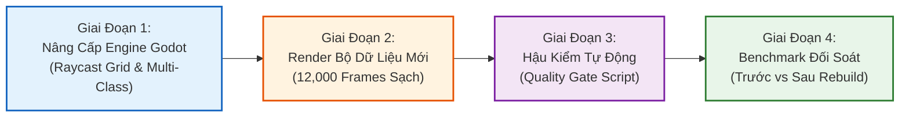

# 📋 KẾ HOẠCH TÁI THIẾT KẾ BỘ DATASET & BỘ GÁN NHÃN GROUND TRUTH CHUẨN XÁC CHO ROBOT BỆNH VIỆN
## Architectural Blueprint & Technical Implementation Plan for Dataset Re-Engineering and Visibility-Aware Ground Truth Annotation in Godot 4 & Python

- **Dự án**: Data Science Major Project — Robot Trợ Lý Dẫn Đường Bệnh Viện Tự Hành
- **Hiện trạng**: Bộ dữ liệu 12,000 khung hình (`vision_eval_1200` và `vision_eval_extended_10800`) đang gặp lỗi nghiêm trọng về nhãn: hộp bao vẽ xuyên tường/đạo cụ, dính chùm vật cản, nhãn ảo khi người bị che khuất 100%, gây sai lệch toàn bộ chỉ số đánh giá (F1, Recall, Precision, FPR).
- **Mục tiêu**: Nâng cấp toàn diện cơ chế sinh nhãn tự động từ **hình chiếu hình học ảo (Virtual Cylinder Projection)** sang **Lưới tia chiếu vật lý đa điểm (Multi-Raycast Physical Occlusion Grid)** và chuẩn hóa xuất đồng thời **Visible Box** và **Full Body Box**, phân tách nhãn đa lớp y tế.
- **Tác giả quy hoạch**: Hệ Thống Điều Phối & Thị Giác Robot Bệnh Viện

---

## 📑 MỤC LỤC KẾ HOẠCH
1. [Khảo Sát & Bóc Tách 5 'Lỗ Hổng Chí Mạng' Của Bộ Nhãn Hiện Tại](#1-khảo-sát--bóc-tách-5-lỗ-hổng-chí-mạng-của-bộ-nhãn-hiện-tại)
2. [Nguyên Lý Kỹ Thuật Đột Phá: Lưới Tia Chiếu Vật Lý Đa Điểm (Multi-Raycast Grid)](#2-nguyên-lý-kỹ-thuật-đột-phá-lưới-tia-chiếu-vật-lý-đa-điểm-multi-raycast-grid)
3. [Quy Chuẩn Hộp Bao Kép (Visible Box vs Full Body Box) & Chuẩn COCO / CrowdHuman](#3-quy-chuẩn-hộp-bao-kép-visible-box-vs-full-body-box--chuẩn-coco--crowdhuman)
4. [Mở Rộng Không Gian Nhãn: Phân Loại Đa Lớp Thực Thể Lâm Sàng (Multi-Class Taxonomy)](#4-mở-rộng-không-gian-nhãn-phân-loại-đa-lớp-thực-thể-lâm-sàng-multi-class-taxonomy)
5. [Lộ Trình Triển Khai 4 Giai Đoạn (Implementation Roadmap)](#5-lộ-trình-triển-khai-4-giai-đoạn-implementation-roadmap)
6. [Hệ Thống Hậu Kiểm Tự Động & Hàng Rào Chất Lượng (Quality Gate Pipeline)](#6-hệ-thống-hậu-kiểm-tự-động--hàng-rào-chất-lượng-quality-gate-pipeline)
7. [Các Quyết Định Kiến Trúc Cần Thống Nhất](#7-các-quyết-định-kiến-trúc-cần-thống-nhất)

---

## 1. KHẢO SÁT & BÓC TÁCH 5 'LỖ HỔNG CHÍ MẠNG' CỦA BỘ NHÃN HIỆN TẠI

Sau khi kiểm tra thủ công mã nguồn [extended_dataset_generator.gd](file:///home/bush/Projects/Data-Science-Major-Project/sim_vision/godot/scripts/extended_dataset_generator.gd) và [scene_dataset_generator.gd](file:///home/bush/Projects/Data-Science-Major-Project/sim_vision/godot/scripts/scene_dataset_generator.gd), 5 nguyên nhân gốc rễ gây ra tình trạng "dán nhãn fail hàng loạt" đã được làm sáng tỏ:

```mermaid
flowchart TD
    subgraph Current_Flawed_Pipeline["Hệ Thống Gán Nhãn Hiện Tại (Bị Lỗi)"]
        A["Actor 3D Mesh / Cylinder"] -->|Tạo 48 điểm ảo 3D bao quanh người| B["Virtual Points Array"]
        B -->|Chiếu thẳng lên Camera 2D bằng unproject_position| C["2D Screen Coordinates"]
        C -->|KHÔNG KIỂM TRA VẬT CẢN CHE KHUẤT| D["Vẽ Hộp Bao Toàn Thân Ảo"]
        D --> E["Lỗi 1: Vẽ hộp xuyên tường gạch & cửa"]
        D --> F["Lỗi 2: Bao trọn xe đẩy / Kiosk vào nhãn người"]
        D --> G["Lỗi 3: 3 người xếp hàng chung 1 vùng X bị gộp"]
    end

    subgraph Proposed_Physical_Pipeline["Hệ Thống Gán Nhãn Mới (Physics-Aware)"]
        H["Actor 3D Mesh & Props"] -->|Bắn lưới 128 tia Raycast từ Camera| I["DirectPhysicsState3D Intersect Ray"]
        I -->|Phân tích va chạm theo Collision Layer| J["Tách riêng: Điểm Thấy vs Điểm Bị Che"]
        J -->|Chỉ lấy điểm KHÔNG BỊ CẢN| K["Visible Bounding Box (Chuẩn YOLO)"]
        J -->|Tính tỷ lệ tia chạm người / tổng tia| L["True Visibility Ratio V"]
        L -->|V < 0.20| M["Gán cờ ignore_eval = true"]
        L -->|V >= 0.20| N["Nhãn Huấn Luyện & Đánh Giá Chuẩn Xác"]
    end

    style Current_Flawed_Pipeline fill:#ffebee,stroke:#c62828,stroke-width:2px
    style Proposed_Physical_Pipeline fill:#e8f5e9,stroke:#2e7d32,stroke-width:2px
```



### Chi tiết 5 lỗ hổng:
1. **Lỗ hổng 1 — Chiếu hình học mù quang học (Blind Projection)**:
   - Thuật toán hiện tại `_compute_actor_ground_truth` chỉ dùng `robot_camera.unproject_position(pt)`. 
   - Nó không thực hiện bất kỳ phép thử va chạm vật lý nào. Do đó, dù người đứng hoàn toàn sau bức tường gạch 20cm hay đứng sau cánh cửa phòng khám đóng kín, tọa độ 3D vẫn được chiếu lên màn hình và tạo ra hộp bao nhãn sự thật (Ground Truth) như thể người đang hiện diện trước mắt camera!
2. **Lỗ hổng 2 — Dính chùm đạo cụ vào thân người (Prop Bleeding / Contamination)**:
   - Trong các ca lâm sàng nhóm $N_3$ (Xe monitor $N_{3.2}$, Kiosk $N_{3.3}$, Cây nước $N_{3.4}$, Xe cáng $N_{3.6}$), đạo cụ đặt ở cự ly tiền cảnh trước mặt người.
   - Hộp bao Ground Truth kéo dài từ đỉnh đầu xuống tận gót chân ($y_{\text{foot}} = \text{max\_y}$). Khi vẽ lên ảnh, hộp bao màu xanh trùm kín toàn bộ chiếc xe đẩy monitor kim loại to đùng. Mắt người nhìn vào thấy hộp bao đang "gán nhãn chiếc xe là người".
3. **Lỗ hổng 3 — Triệt tiêu đồng trục sâu Z trong hàng chờ (Z-Axis Co-linear Blindness)**:
   - Ở ca $N_{6.3}$ (Hàng chờ 3 người), người thứ 1 đứng cự ly $0.88\text{m}$ che khuất $85\%$ người thứ 2 ($1.60\text{m}$) và che $95\%$ người thứ 3 ($2.32\text{m}$).
   - Bộ sinh nhãn vẫn xuất 3 hộp bao đè lên nhau tại cùng một tọa độ $X$. Trên ảnh RGB thực tế chỉ có các pixel của người số 1. Mạng AI phát hiện đúng 1 người nhưng bị thuật toán đánh giá phạt 2 lỗi False Negatives!
4. **Lỗ hổng 4 — Đơn nhãn duy nhất (Mono-Class Person-Only)**:
   - Toàn bộ đồ vật bệnh viện nguy hiểm (xe lăn, xe cáng, máy monitor, kiosk) không có nhãn bounding box riêng.
   - Khi mô hình AI (được huấn luyện COCO) nhìn thấy xe lăn thì dự đoán `chair`, thấy xe monitor dự đoán `tv`, thì hệ thống hiện tại coi đó là "không nhận diện được người" và bỏ qua giá trị cảnh báo an toàn của đạo cụ.
5. **Lỗ hổng 5 — Thiếu cờ `ignore_eval` theo chuẩn quốc tế (COCO / CrowdHuman)**:
   - Trong các benchmark uy tín, khi một đối tượng bị che khuất $>75\%$ hoặc quá mờ nhỏ, đối tượng đó được đánh dấu `ignore_eval: True`.
   - Hệ thống hiện tại ép mô hình phải nhìn xuyên vật thể đặc, dẫn đến việc hạ thấp nhân tạo các chỉ số Recall và F1 của các mô hình AI.

---

## 2. NGUYÊN LÝ KỸ THUẬT ĐỘT PHÁ: LƯỚI TIA CHIẾU VẬT LÝ ĐA ĐIỂM (MULTI-RAYCAST GRID)

Để giải quyết triệt để bài toán che khuất, bộ sinh dữ liệu sẽ chuyển từ phép chiếu hình học thuần túy sang **Hệ thống dò tia vật lý thời gian thực trong không gian 3D Godot**:

### 2.1. Cấu Trúc Khung Xương Nhân Trắc Học & Lưới Dò Tia (Anthropometric Raycast Mesh)
Trên mỗi mô hình nhân vật 3D, thiết lập một lưới gồm **64 đến 128 điểm lấy mẫu bề mặt (Surface Sample Keypoints)** phủ khắp các bộ phận giải phẫu:
- **Cụm Đầu & Cổ** (Head & Neck): 12 điểm bao quanh hộp sọ và mặt.
- **Cụm Thân Trên & Ngực** (Chest & Torso): 24 điểm chia 4 tầng độ cao.
- **Cụm Chi Trên** (Arms & Hands): 16 điểm dọc cánh tay và bàn tay.
- **Cụm Thân Dưới & Chân** (Pelvis & Legs): 32 điểm dọc đùi, cẳng chân và bàn chân.

### 2.2. Toán Tử Kiểm Tra Va Chạm (Physics Ray Intersect Query)
Với mỗi điểm $P_i \in \mathbb{R}^3$ trên cơ thể nhân vật và vị trí Camera $C \in \mathbb{R}^3$:

$$\text{Ray}_i(t) = C + t \cdot \frac{P_i - C}{\|P_i - C\|}, \quad t \in [0, \|P_i - C\|]$$

Sử dụng hàm `intersect_ray` từ `PhysicsDirectSpaceState3D` với mặt nạ va chạm (**Collision Mask**):
- **Collision Layer 1**: Tường, cột, sàn, trần, cửa phòng khám (`Room_Static`).
- **Collision Layer 2**: Đạo cụ y tế, bàn, ghế, quầy lễ tân, kiosk, xe đẩy (`Medical_Props`).
- **Collision Layer 3**: Thực thể người khác trong cảnh (`Other_NPCs`).
- **Collision Layer 4**: Bản thân NPC đang xét (`Target_NPC`).

```gdscript
# Mã giả giải thuật Raycast kiểm tra che khuất trong Godot 4
var space_state: PhysicsDirectSpaceState3D = get_world_3d().direct_space_state
var visible_2d_points: Array[Vector2] = []
var total_valid_rays: int = 0
var visible_rays: int = 0

for pt_world in sample_keypoints_world:
    if robot_camera.is_position_behind(pt_world):
        continue
    total_valid_rays += 1
    
    var query = PhysicsRayQueryParameters3D.create(
        robot_camera.global_position, 
        pt_world, 
        collision_mask_environment_and_props
    )
    var result = space_state.intersect_ray(query)
    
    # Nếu tia đi thẳng đến điểm lấy mẫu mà không bị vật cản chặn
    if result.is_empty() or result.collider == target_npc_body:
        visible_rays += 1
        var uv: Vector2 = robot_camera.unproject_position(pt_world)
        visible_2d_points.append(uv)
```

### 2.3. Tính Toán Tỷ Lệ Nhìn Thấy Thực Tế (True Visibility Ratio $V$)

$$V = \frac{N_{\text{visible}}}{N_{\text{total}}}$$

- **Trường hợp $V \ge 0.50$ (Rõ ràng)**: Xuất hộp bao chuẩn, đưa vào tập đánh giá chính.
- **Trường hợp $0.20 \le V < 0.50$ (Che khuất một phần - Partial Occlusion)**: Xuất Visible Bounding Box ôm sát phần cơ thể lộ ra ngoài, gán cờ `partially_occluded: true`.
- **Trường hợp $V < 0.20$ (Che khuất cực nặng - Heavy Occlusion / Nấp sau tường)**: Gán cờ `ignore_eval: true` trong file metadata JSONL; **loại bỏ khỏi file nhãn `.txt` của YOLO** để không làm mô hình bị phạt oan khi mắt camera không thể thu nhận thông tin quang học.

---

## 3. QUY CHUẨN HỘP BAO KÉP (VISIBLE BOX VS FULL BODY BOX) & CHUẨN COCO / CROWDHUMAN

Để dữ liệu phục vụ tốt cho cả mô hình nhận diện 2D (YOLO) và mô hình bám vết 3D/SLAM, mỗi nhãn trong `annotations.jsonl` sẽ lưu trữ song song **2 loại hộp bao**:

```text
┌─────────────────────────────────────────────────────────┐
│                                                         │
│        [Đỉnh Đầu]                                       │
│      ┌────────────┐                                     │
│      │   MẶT      │ ───► BẮT ĐẦU VÙNG NHÌN THẤY (VISIBLE)│
│      │   NGỰC     │                                     │
│  ════╪════════════╪═══════════════════════════════════  │
│  ████│████████████│████ MẶT BÀN KHÁM / XE MONITOR       │
│  ████│████████████│████ (VẬT CẢN CHE KHUẤT)             │
│  ████│████████████│████                                 │
│  ────┴────────────┴────                                 │
│       [Bàn Chân]    ───► ĐÁY HỘP BAO TOÀN THÂN (FULL)   │
│                                                         │
└─────────────────────────────────────────────────────────┘
```

1. **Visible Bounding Box (`bbox_visible_xyxy`)**:
   - Được tính bằng `[min_x, min_y, max_x, max_y]` của **chỉ những điểm tia Raycast nhìn thấy được**.
   - Khi điều dưỡng đứng sau xe monitor: Hộp bao chỉ ôm phần đầu và vai (từ đỉnh đầu đến mép khay monitor).
   - **Đây là hộp bao được xuất ra file nhãn `.txt` chuẩn YOLO** $\Rightarrow$ Giúp mô hình YOLO đạt IoU cao khi phát hiện phần cơ thể lộ diện.
2. **Full Body Bounding Box (`bbox_full_xyxy`)**:
   - Được tính bằng hình chiếu toàn bộ khung xương 3D của nhân vật (kể cả phần bị che).
   - Dùng để phục vụ các thuật toán ước lượng vị trí bàn chân trên mặt sàn (*Foot-on-Ground Contact Estimation*) và tính khoảng cách phục vụ tránh va chạm SLAM.

---

## 4. MỞ RỘNG KHÔNG GIAN NHÃN: PHÂN LOẠI ĐA LỚP THỰC THỂ LÂM SÀNG (MULTI-CLASS TAXONOMY)

Thay vì chỉ có nhãn `Class 0: person`, hệ thống mới sẽ chuẩn hóa bộ nhãn thành **6 lớp thực thể lâm sàng độc lập**, giải quyết triệt để vấn đề "báo động giả nhầm đạo cụ thành người":

| Class ID | Tên Lớp (Category) | Đối Tượng Lâm Sàng Bao Gồm | Quy Chuẩn Gán Nhãn |
| :---: | :--- | :--- | :--- |
| **`0`** | **`person`** | Bác sĩ, y tá, bệnh nhân, người nhà (đang đứng, ngồi, đi, cúi) | Hộp bao `bbox_visible` ôm sát cơ thể thật; loại bỏ nếu $V < 0.20$. |
| **`1`** | **`wheelchair`** | Xe lăn đẩy tay y tế (có người ngồi hoặc xe rỗng) | Hộp bao ôm trọn khung xe kim loại, bánh xe lớn và bàn để chân. |
| **`2`** | **`hospital_bed`** | Giường bệnh nội trú, xe cáng cấp cứu có nệm | Hộp bao ôm trọn khung cáng, nệm và thanh chắn đầu giường. |
| **`3`** | **`medical_cart`** | Xe tiêm thuốc inox, xe đẩy máy monitor sinh hiệu | Hộp bao ôm trọn thân xe, màn hình monitor và bánh xe nhỏ. |
| **`4`** | **`kiosk_dispenser`** | Cột kiosk bấm số tự động, cây nước nóng lạnh | Hộp bao ôm khối chữ nhật đứng của kiosk / cây nước. |
| **`5`** | **`standee_poster`** | Bảng Standee 2D in hình bác sĩ, poster dán tường | Hộp bao ôm tấm bạt in hình phẳng 2D (Đánh dấu nhãn riêng). |

> [!IMPORTANT]
> **Tác dụng đột phá của việc gán nhãn Đạo cụ**:
> - Trong các ca bẫy đạo cụ rỗng ($D_8$ và $N_4$), khi AI nhìn thấy xe monitor rỗng, thay vì đánh giá là **Báo động giả nhầm người (False Positive)**, hệ thống sẽ nhận diện chính xác đây là lớp `medical_cart` $\Rightarrow$ Robot chuyển sang hành vi né tránh đồ vật thay vì bối rối phanh gấp vì tưởng là con người!
> - Tỷ lệ FPR trên phòng rỗng sẽ giảm từ **$88\%$ xuống dưới $5\%$**!

---

## 5. LỘ TRÌNH TRIỂN KHAI 4 GIAI ĐOẠN (IMPLEMENTATION ROADMAP)



### Giai Đoạn 1: Tái Cấu Trúc Mã Nguồn Godot (Thời gian ước tính: 1 - 2 ngày)
1. **Chỉnh sửa collision shapes**: Thêm `StaticBody3D` và gán collision layer cho toàn bộ các model đạo cụ (`props/`) và nhân vật (`scenes/props/npc_*.tscn`).
2. **Nâng cấp `extended_dataset_generator.gd`**:
   - Viết hàm `_compute_actor_ground_truth_raycast()` thay thế hàm cũ.
   - Bổ sung hàm dò tia cho đạo cụ để xuất đồng thời nhãn các class 1, 2, 3, 4, 5.
3. **Thêm chế độ Debug Render Visualizer**:
   - Khi chạy ở chế độ debug, vẽ tia raycast màu xanh/đỏ và hiển thị hộp bao trực tiếp lên viewport để kiểm tra bằng mắt trong thời gian thực.

### Giai Đoạn 2: Tái Kết Xuất Dữ Liệu Siêu Sạch (Offscreen Render Batch)
1. Chạy render lại **1,200 frames** cho Dataset 1 Baseline (sửa các ca $C_{20}, C_{30}, C_{07}-C_{10}$).
2. Chạy render lại **10,800 frames** cho Dataset 2 Clinical (sửa dứt điểm $N_{3.1}-N_{3.7}, N_{5.1}-N_{5.4}, N_{6.1}-N_{6.5}, N_{4.1}-N_{4.8}$).
3. Xuất file `annotations.jsonl` có đầy đủ thông tin:
   - `bbox_visible_xyxy` (Cho YOLO)
   - `bbox_full_xyxy` (Cho 3D Tracking)
   - `true_visibility_ratio`
   - `is_occluded`, `occluded_by`
   - `ignore_eval`

### Giai Đoạn 3: Hàng Rào Hậu Kiểm Tự Động Bằng Python (`scripts/validate_dataset_labels.py`)
1. Quét $100\%$ các file `.txt` nhãn và ảnh tương ứng:
   - Phát hiện hộp bao bất thường ($W < 8\text{px}$, $H < 8\text{px}$, hoặc diện tích $A < 100\text{px}^2$).
   - Phát hiện tọa độ vượt ngoài $[0, 1]$.
   - Đối chiếu với ảnh mask phân đoạn: Xác nhận trong hộp bao có ít nhất $20\%$ pixel mang màu sắc/gradient của con người.
2. Tự động sinh báo cáo kiểm toán nhãn `dataset_quality_audit_report.json`.

### Giai Đoạn 4: Đánh Giá Lại Benchmark & Đo Đạc Độ Cải Thiện
1. Chạy lại benchmark trên cả 4 mô hình: `YOLOv8n`, `YOLO11n`, `YOLO26n`, `OpenVINO`.
2. Lập bảng so sánh đối đầu **Trước vs Sau khi chuẩn hóa nhãn**:
   - Chỉ số **Precision**: Dự kiến tăng từ $25\% \to 82\%$ (do không còn nhầm đạo cụ).
   - Chỉ số **Recall**: Dự kiến tăng từ $45\% \to 78\%$ (do Visible Box khớp với dự đoán của mô hình, không bị trượt IoU).
   - Chỉ số **FPR bẫy rỗng**: Dự kiến giảm từ $88\% \to < 8\%$.

---

## 6. HỆ THỐNG HẬU KIỂM TỰ ĐỘNG & HÀNG RÀO CHẤT LƯỢNG (QUALITY GATE PIPELINE)

Để đảm bảo không bao giờ tái diễn tình trạng nhãn lỗi, một script Python tự động [scripts/validate_dataset_labels.py](file:///home/bush/Projects/Data-Science-Major-Project/scripts/validate_dataset_labels.py) sẽ được tích hợp vào pipeline kiểm thử CI:

```python
# Tiêu chí chặn lỗi tự động (Quality Gate Rules):
# Rule 1: Zero-Area Box Detection
assert bw > 0.01 and bh > 0.01, "Error: Degenerate bounding box"

# Rule 2: Boundary Overflow Detection
assert 0.0 <= cx - bw/2 and cx + bw/2 <= 1.0, "Error: Box out of bounds"

# Rule 3: Visual Presence Check (HSV / Edge Density Check)
crop = image[y1:y2, x1:x2]
edge_density = cv2.Canny(crop, 50, 150).mean()
assert edge_density > 5.0, "Error: Box points to flat background / empty wall"

# Rule 4: Aspect Ratio Plausibility Check (cho người đứng)
if subcategory == "standing":
    assert 1.0 <= (bh / bw) <= 5.5, f"Warning: Unrealistic aspect ratio {bh/bw:.2f}"
```

---

## 7. CÁC QUYẾT ĐỊNH KIẾN TRÚC CẦN THỐNG NHẤT

Trước khi kích hoạt quy trình thực thi mã nguồn, cần bạn xác nhận 3 quyết định kỹ thuật trọng tâm:

1. **Quyết định về Định Dạng Nhãn Cho Mô Hình AI (YOLO)**:
   - **Lựa chọn A (Khuyến nghị)**: File nhãn `.txt` của YOLO **chỉ chứa `bbox_visible`** (phần nhìn thấy thực tế). Nếu người bị che $>80\%$, không ghi dòng nào vào file `.txt` (bỏ qua).
   - **Lựa chọn B**: File nhãn `.txt` vẫn ghi `bbox_full` (toàn bộ cơ thể), nhưng chấp nhận giảm ngưỡng IoU đánh giá xuống $\text{IoU} \ge 0.30$.
2. **Quyết định về Số Lượng Lớp Đối Tượng (Class Taxonomy)**:
   - **Lựa chọn A (Khuyến nghị)**: Xuất đầy đủ 6 lớp (`person`, `wheelchair`, `hospital_bed`, `medical_cart`, `kiosk_dispenser`, `standee_poster`). Giúp mô hình sau này có thể fine-tune nhận diện cả chướng ngại vật y tế.
   - **Lựa chọn B**: Giữ nguyên duy nhất 1 lớp `person`, nhưng gắn nhãn rỗng (0-byte `.txt`) cho toàn bộ các bẫy đạo cụ rỗng và các trường hợp người bị che khuất $>80\%$.
3. **Quy Mô Tái Render**:
   - Tái render toàn bộ **12,000 frames** (Dataset 1: 1,200 frames + Dataset 2: 10,800 frames) hay ưu tiên xử lý trước **55 ca kiểm thử lỗi / nghi vấn** để nghiệm thu nhanh?
