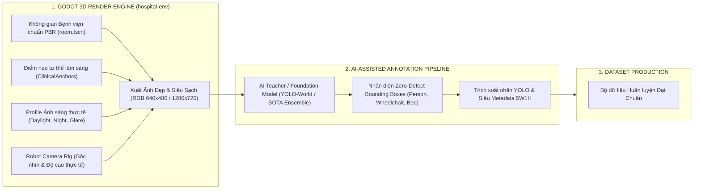

# 🏥 KẾ HOẠCH THIẾT LẬP MÔI TRƯỜNG BỆNH VIỆN 3D (`HOSPITAL-ENV`) SẴN SÀNG CHO GÁN NHÃN TỰ ĐỘNG BẰNG AI (AI-ASSISTED AUTO-ANNOTATION)

> **Mã tài liệu**: `PLAN-ENV-DATA-READY-02`  
> **Trạng thái**: Đã phê duyệt cập nhật (Streamlined & Cleaned)  
> **Định hướng chiến lược**: Loại bỏ hoàn toàn cơ chế Raycast Occlusion vật lý phức tạp; quy hoạch `hospital-env` thành **Render Engine 3D chân thực** và sử dụng **AI Teacher/Foundation Model** để tự động gán nhãn Ground Truth chuẩn xác.

---

## 💡 I. ĐỊNH HƯỚNG MỚI: VÌ SAO LOẠI BỎ RAYCAST OCCLUSION?

### 1. Hạn chế của cơ chế Raycast Occlusion cũ
- **Quá phức tạp và dễ lỗi**: Phải bắn 128 tia raycast từ camera tới từng đốt xương (Head, Chest, Knees, Feet); chỉ cần mesh đạo cụ y tế (như chăn giường hay nệm ghế) lệch 1 vài milimet là tia raycast bị cản nhầm.
- **Không phản ánh thị giác con người**: Mắt người (và mạng nơ-ron tích chập) nhận diện đối tượng dựa trên đặc trưng thị giác (Visual Features, Context, Edge) chứ không phải các đường đạn vật lý thẳng hàng.
- **Tốn tài nguyên tính toán**: Thuật toán Raycast đa điểm trong Physics Engine làm chậm tốc độ sinh dữ liệu của Godot.

### 2. Mô hình Gán nhãn Tự động Hiện đại (AI-Assisted Auto-Annotation)
Thay vì dùng thuật toán vật lý raycast để đoán nhãn, quy trình mới được tinh gọn thành 2 phân đoạn độc lập:



---

## 🧹 II. CÁC HẠNG MỤC CŨ ĐÃ DỌN DẸP SẠCH SẼ

Toàn bộ các tệp thử nghiệm và logic Raycast cũ đã được loại bỏ triệt để khỏi repository:
- ❌ **Xóa 4 script kiểm thử Raycast**: `test_raycast_check.gd`, `test_raycast_occlusion.gd`, `test_raycast_isolation.gd`, `test_raycast_bbox.gd`.
- ❌ **Xóa 2 Scene & Script bench cũ**: `hospital_vision_bench.tscn`, `hospital_vision_bench_extended.tscn`, `scene_dataset_generator.gd`, `extended_dataset_generator.gd`.
- ❌ **Loại bỏ yêu cầu Collision Layer phức tạp**: Không cần tạo các lớp va chạm đa tầng cho từng đốt xương của NPC.

---

## 🏛️ III. 4 TRỤ CỘT THIẾT LẬP CẦN THỰC HIỆN TRONG `HOSPITAL-ENV`

Với định hướng mới, nhiệm vụ của `hospital-env` trở nên **tinh gọn, trực quan và tập trung hoàn toàn vào chất lượng hình ảnh mô phỏng**:

### 1. Hệ Thống Điểm Neo Lâm Sàng (`ClinicalAnchors`)
Trong `room.tscn`, chỉ cần cắm các `Marker3D` để xác định vị trí tương tác chuẩn của con người trong môi trường bệnh viện:

| Điểm neo (Anchor) | Phòng / Khu vực | Tọa độ chuẩn $(X, Y, Z)$ | Góc xoay | Mô tả kịch bản |
| :--- | :--- | :---: | :---: | :--- |
| `Anchor_Bed_Emergency` | Phòng 101 (Cấp cứu) | $(-8.0, 0.08, -5.2)$ | $0^\circ$ | Giường cấp cứu: Bệnh nhân nằm ngay ngắn, đầu gối $-87^\circ$. Hỗ trợ camera chụp đủ mọi góc $360^\circ$. |
| `Anchor_Waiting_Bench_1..4` | Sảnh chính | $(-3.5, 0.06, 3.5)$ | $0^\circ$ | Hàng ghế băng dài: Chân chạm sàn tự nhiên ($Y=0.06\text{m}$), tạo kịch bản ngồi chờ, ho gập người, ngồi dính chùm. |
| `Anchor_Reception_Counter` | Quầy lễ tân | $(0.0, 0.0, 5.5)$ | $180^\circ$ | Bác sĩ/Nhân viên ngồi sau quầy kính $1.1\text{m}$. |
| `Anchor_Queue_Kiosk` | Sảnh chính | $(2.5, 0.0, 4.0)$ | $180^\circ$ | Bệnh nhân đứng thao tác máy bấm số tự phục vụ. |
| `Anchor_Wheelchair_Lane` | Hành lang | $(0.0, 0.0, 0.0)$ | $90^\circ$ | Làn di chuyển cho bệnh nhân ngồi xe lăn và người nhà đẩy xe lăn. |

---

### 2. Cụm Cảm Biến Camera Robot Chuẩn Công Nghiệp (`RobotCameraRig`)
Gắn vào `sim_vision/godot/scenes/robot.tscn`:
* **Thông số cảm biến**:
  - Tỷ lệ khung hình: $640 \times 480$ (RGB tiêu chuẩn).
  - Góc nhìn FOV: $75.0^\circ$ (khớp cảm biến camera Robot thực tế).
* **3 Nấc độ cao cảm biến linh hoạt**:
  - `Chest_0.85m`: Ngang tầm ngực robot (góc quan sát xe lăn và trẻ em cực tốt).
  - `Standard_1.15m`: Độ cao tiêu chuẩn của Robot trợ lý tự hành.
  - `EyeLevel_1.40m`: Tầm mắt người lớn quan sát toàn cảnh sảnh chờ.
* **Góc quét liếc (Pan/Tilt)**: Hỗ trợ quay ngang $\pm 30^\circ$ và gập góc $-15^\circ \to +10^\circ$.

---

### 3. Bộ Điều Khiển Ánh Sáng PBR Đa Profile (`HospitalLightingController`)
Tích hợp vào `room.gd` để đổi bối cảnh chụp ảnh nhanh chóng:
* `DAYLIGHT_STANDARD`: Đèn huỳnh quang âm trần $450\text{ lux}$, màu trắng sáng $5500\text{K}$.
* `NIGHT_SHIFT`: Đèn hành lang mờ tối trực đêm $35\text{ lux}$, ánh sáng vàng ấm $3000\text{K}$.
* `SPECULAR_GLARE`: Đèn cửa kính chiếu xiên tạo bóng phản chiếu lộn ngược trên sàn gạch men bóng.
* `CAMOUFLAGE`: Giảm bóng đổ khối để thử thách trường hợp áo blouse trắng tiệp màu tường kem.

---

### 4. API Xuất Ảnh Tự Động Thuần Túy (`ImageExportBridge`)
Trong `room.gd`, chỉ cần một hàm API xuất ảnh sạch duy nhất:
```gdscript
## Chụp ảnh RGB chất lượng cao từ Camera Robot tại vị trí hiện tại
func capture_rgb_frame() -> Image:
    var vp: Viewport = get_viewport()
    var img: Image = vp.get_texture().get_image()
    return img
```
Toàn bộ khâu nhận diện và gán nhãn bounding box sẽ do **AI Model phía Python** đảm nhiệm thông qua bộ lọc thông minh (Teacher Model + Confidence Thresholding).

---

## 🚀 IV. BƯỚC TIẾP THEO

1. **Checkout sang nhánh `feat/hospital-env`**.
2. **Triển khai 5 Marker3D `ClinicalAnchors`** vào `sim_vision/godot/scenes/room.tscn`.
3. **Thêm `RobotCameraRig`** vào `sim_vision/godot/scenes/robot.tscn`.
4. **Viết hàm `set_lighting_profile()`** trong `sim_vision/godot/scripts/room.gd`.
5. Môi trường sẽ sẵn sàng $100\%$ để kết nối với Model gán nhãn tự động phía Python!
