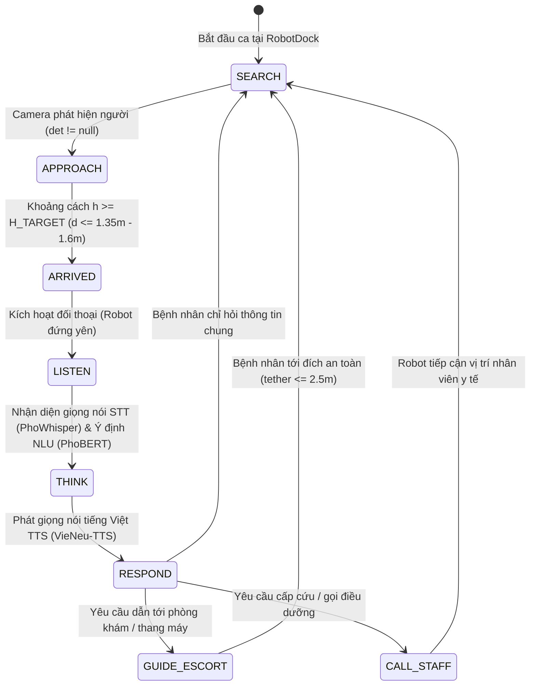
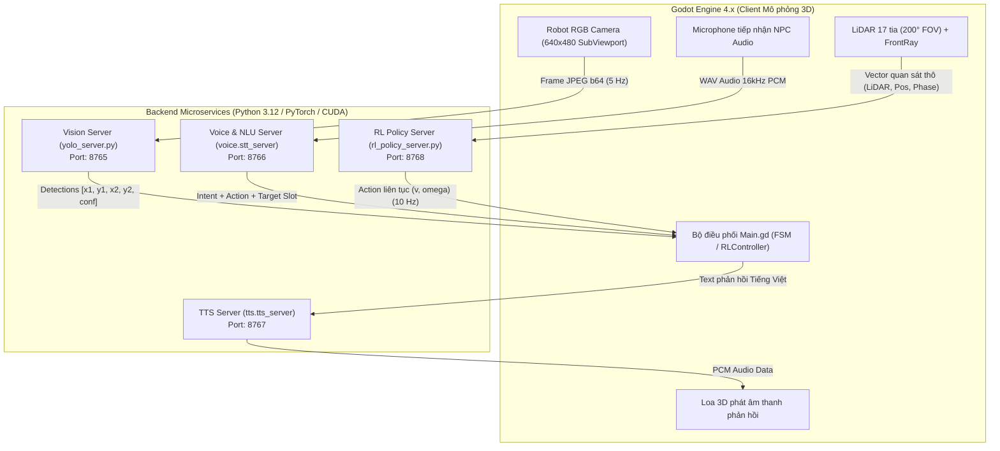
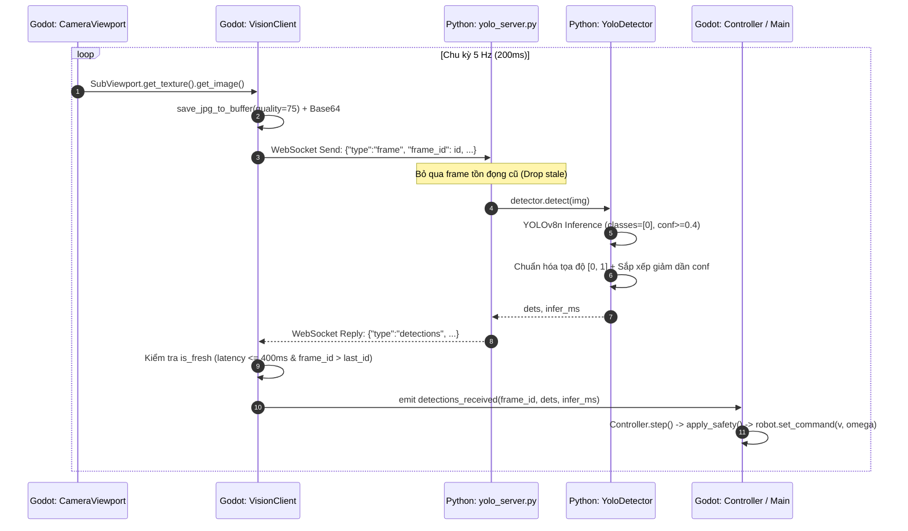
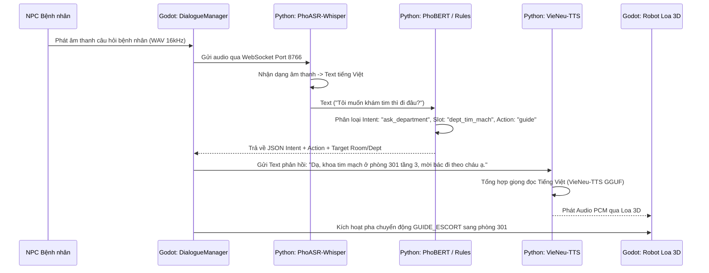
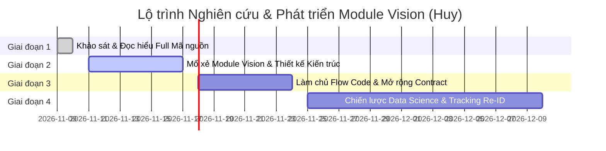

# Báo cáo Giai đoạn 1: Khảo sát & Đọc hiểu Toàn bộ Mã nguồn Dự án (Vision Module Onboarding Audit)

- **Motivation/Background**: Khi tiếp nhận vai trò kỹ sư phụ trách Module Thị giác (Vision & Perception) cho đồ án "Robot trợ lý dẫn đường bệnh viện", việc đọc hiểu toàn bộ mã nguồn của hệ sinh thái đa tầng (Godot 3D, WebSocket servers, RL Policy, Voice STT/NLU/TTS) là điều kiện tiên quyết để hiểu rõ hợp đồng giao tiếp, ranh giới trách nhiệm và tránh gây gãy vỡ hệ thống khi nâng cấp.
- **Purpose**: Thiết lập tài liệu khảo sát toàn diện và chuẩn mực kỹ thuật (Giai đoạn 1) về kiến trúc, luồng dữ liệu, hợp đồng dịch vụ và hiện trạng mã nguồn của toàn bộ kho lưu trữ `Data-Science-Major-Project`, từ đó xác định chính xác các khoảng trống kỹ thuật cần giải quyết cho module Vision.
- **Overview Pipeline**: Khảo sát tĩnh và động toàn bộ cấu trúc mã nguồn thông qua việc rà soát từng module trong `sim_vision/`, `src/`, `configs/`, `models/`, `docs/`, `agents/` và `tests/`; kiểm chứng giao thức WebSocket nội bộ và sự đồng bộ giữa mô phỏng Godot 3D và thuật toán RL PPO.
- **Detailed Plan**:
  - §1. Tổng quan & Bản sắc Đồ án (Core Mission & Operational Workflow)
  - §2. Bản đồ Cấu trúc Thư mục Toàn diện (Repository Directory Breakdown)
  - §3. Kiến trúc Hệ thống Đa tầng & Hợp đồng Microservices qua WebSocket
  - §4. Khảo sát Chuyên sâu Module Thị giác Hiện tại (Vision Subsystem Audit)
  - §5. Mối quan hệ Liên tầng: Module Vision & Bộ não Học tăng cường RL (PPO)
  - §6. Khảo sát Hệ thống Giọng nói & Tương tác Bệnh nhân (STT / NLU / TTS)
  - §7. Hệ thống Kiểm thử & Cơ chế Giám sát Đo kiểm (Verification & Tooling)
  - §8. Bảng Tổng kết Khoảng trống Kỹ thuật & Kế hoạch Hành động của Huy (Gap Analysis & Action Plan)
- **References**: [docs/AI-Human-logs/Huy.md](../../../AI-Human-logs/Huy.md), [docs/Đề cương đồ án Robot trợ lý dẫn đường bệnh viện.md](../../../%C4%90%E1%BB%81%20c%C6%B0%C6%A1ng%20%C4%91%E1%BB%93%20%C3%A1n%20Robot%20tr%E1%BB%A3%20l%C3%BD%20d%E1%BA%ABn%20%C4%91%C6%B0%E1%BB%9Dng%20b%E1%BB%87nh%20vi%E1%BB%87n.md), [agents/rules/MD_CONVENTION.md](../../../../agents/rules/MD_CONVENTION.md), [agents/rules/CODEBASE_AUDIT.md](../../../../agents/rules/CODEBASE_AUDIT.md).
- **Created**: 2026-11-10T15:58:00+07:00
- **Last Updated**: 2026-11-10T15:58:00+07:00

---

## 1. Tổng quan & Bản sắc Đồ án (Core Mission & Operational Workflow)

### 1.1. Bối cảnh thực tế & Bài toán giải quyết
Dự án **Robot trợ lý dẫn đường bệnh viện** (*Hospital Helper Robot*) hướng tới giải quyết bài toán quá tải tại các quầy tiếp đón bệnh viện trong giờ cao điểm, đặc biệt đối với nhóm bệnh nhân yếu thế:
- **Người cao tuổi:** Di chuyển chậm, mắt kém, khó đọc biển chỉ dẫn hoặc thao tác trên màn hình cảm ứng tự động.
- **Người đi xe lăn, người dùng nạng:** Tốc độ di chuyển không đều, dễ bị khuất tầm nhìn trong dòng người đông đúc.
- **Người khiếm thị hoặc ít tiếp xúc công nghệ:** Cần giao tiếp trực tiếp bằng giọng nói tự nhiên tiếng Việt.

### 1.2. Phạm vi triển khai & Nguyên tắc kỹ thuật
- **Môi trường thực thi:** Đồ án được xây dựng và kiểm chứng **100% trong môi trường mô phỏng 3D thời gian thực (Godot Engine 4.x)** kết hợp các backend trí tuệ nhân tạo (Python). Dự án **không chế tạo robot vật lý**.
- **Tính khả thi và Sim-to-Real:** Dù chạy trên mô phỏng, toàn bộ thông số vật lý (tốc độ quay, tốc độ tiến, trường nhìn camera FOV, tầm quét LiDAR, kích thước hành lang, khoảng cách giữ nhịp bệnh nhân) đều được lấy từ số liệu khảo sát thực tế bệnh viện Việt Nam.

### 1.3. Chu trình Nghiệp vụ Ca trực 180s (Shift Lifecycle)
Mỗi ca làm việc của Robot trong mô phỏng kéo dài 180 giây, trải qua một State Machine tuần tự khép kín:


---

## 2. Bản đồ Cấu trúc Thư mục Toàn diện (Repository Directory Breakdown)

Cấu trúc mã nguồn của `Data-Science-Major-Project` tuân thủ nguyên tắc **Separation of Concerns (SoC)** phân định rạch ròi giữa code mô phỏng 3D, microservices AI và pipeline huấn luyện học máy:

```text
Data-Science-Major-Project/
├── agents/                           # HIẾN PHÁP DỰ ÁN (Bất biến, không chứa code chạy)
│   ├── rules/                        # Quy chuẩn git commit, mã hóa md, kiến trúc thư mục
│   └── templates/                    # Mẫu chuẩn cho audit, status log, decision log
├── configs/                          # File cấu hình YAML cho môi trường và model
├── data/                             # Dữ liệu âm thanh thực nghiệm (3,668 file STT) [CHƯA CÓ DATA VISION]
├── docs/                             # Tài liệu kỹ thuật, đề cương đồ án, nhật ký quyết định
│   ├── AI-Human-logs/                # Nhật ký của các kỹ sư: Vuong.md, Manh.md, Tuan.md, Huy.md
│   ├── progress/                     # Theo dõi tiến độ từng nhánh phát triển
│   │   └── huy/khao_sat_vision/      # Báo cáo tiến độ Module Vision của Huy
│   └── Đề cương đồ án...             # Đề cương chính thức đã được phê duyệt
├── models/                           # Trọng số pre-trained offline (>100MB git-ignored)
│   ├── yolov8n/                      # Trọng số YOLOv8n gốc
│   ├── PhoASR-whisper-small/         # Trọng số nhận diện tiếng Việt STT
│   ├── PhoBert-base-v2/              # Trọng số phân loại ý định NLU
│   └── Vie-neu-v3-turbo/             # Trọng số tổng hợp tiếng nói TTS
├── experiments/                      # Checkpoints và kết quả huấn luyện RL
│   └── checkpoints/                  # Chứa PPOHospital-full_strongest.pt (chính sách mạnh nhất)
├── notebooks/                        # Dành riêng cho trực quan hóa dữ liệu và phân tích (không dùng để train)
├── scripts/                          # Script tiện ích: convert audio, tải model, kiểm thử offline
├── sim_vision/                       # TRỌNG TÂM THỰC THI (Mô phỏng 3D + Microservices)
│   ├── godot/                        # Dự án Godot Engine 4 (GDScript)
│   │   ├── scenes/                   # Scene 3D: main.tscn, robot.tscn, room.tscn, human.tscn
│   │   ├── scripts/                  # GDScript: robot.gd, vision_client.gd, controller.gd, rl_env_bridge.gd
│   │   └── tests/                    # 157 GUT tests tự động hóa cho Godot
│   └── python/                       # Backend Microservices Python
│       ├── yolo_server.py            # WebSocket Server nhận diện thị giác (Port 8765)
│       ├── detector.py               # Adapter YOLOv8n chuẩn hóa bounding box
│       ├── protocol.py               # Định nghĩa giao thức JSON message cho Vision
│       ├── rl_policy_server.py       # WebSocket Server suy luận RL PPO (Port 8768)
│       ├── voice/                    # Backend STT + NLU Server (Port 8766)
│       ├── tts/                      # Backend TTS Server (Port 8767)
│       └── tests/                    # Pytest kiểm thử unit & integration cho python backends
├── src/                              # THƯ VIỆN THUẬT TOÁN HỌC MÁY LÕI (RL & Modeling)
│   ├── models/                       # Kiến trúc mạng neural PyTorch (ppo_agent.py: 31-D Actor-Critic)
│   ├── training/                     # Môi trường giả lập surrogate 2D (hospital_env.py) & scripts train PPO
│   └── ui/                           # Web Dashboard Gradio giám sát huấn luyện (rl_dashboard.py)
├── tests/                            # Pytest tích hợp toàn hệ thống (smoke tests, layout verification)
├── run_simulation.py                 # Unified Launcher điều phối khởi động toàn bộ hệ thống
└── run_dashboard.py                  # Launcher chạy Gradio Training Dashboard
```

---

## 3. Kiến trúc Hệ thống Đa tầng & Hợp đồng Microservices qua WebSocket

Hệ thống hoạt động theo mô hình vi dịch vụ phân tán trên máy cục bộ (`localhost`), liên kết môi trường mô phỏng đồ họa Godot 3D với 4 backend AI độc lập qua giao thức WebSocket:



### Chi tiết các hợp đồng dữ liệu (API Contracts)

#### 1. Dịch vụ Thị giác — Vision Service (Port `8765`)
- **Tần số lấy mẫu:** 5 Hz (`Config.CAPTURE_HZ = 5.0`).
- **Client:** `sim_vision/godot/scripts/vision_client.gd`.
- **Server:** `sim_vision/python/yolo_server.py`.
- **Payload In (Godot $\to$ Python):**
  ```json
  {
    "type": "frame",
    "frame_id": 142,
    "width": 640,
    "height": 480,
    "jpeg_b64": "/9j/4AAQSkZJRgABAQAAAQ..."
  }
  ```
- **Payload Out (Python $\to$ Godot):**
  ```json
  {
    "type": "detections",
    "frame_id": 142,
    "infer_ms": 18.4,
    "detections": [
      {"x1": 0.3852, "y1": 0.1524, "x2": 0.6120, "y2": 0.8941, "conf": 0.8752}
    ]
  }
  ```
- **Cơ chế chống nghẽn (Drop Stale Policy):**
  - Phía Server: `yolo_server.py` duy trì hàng đợi kích thước tối đa 1 phần tử (`latest = [msg]`). Nếu server đang bận suy luận một frame trước đó, tất cả các frame gửi đến trong thời gian này sẽ bị loại bỏ và chỉ giữ lại frame mới nhất.
  - Phía Client: `vision_client.gd` kiểm tra điều kiện tươi mới: nếu `frame_id <= last_id` hoặc thời gian trễ vượt quá `Config.STALE_MS` (400 ms), kết quả bị hủy bỏ ngay lập tức để tránh điều khiển robot bằng hình ảnh quá khứ.

#### 2. Dịch vụ Giọng nói & Hiểu ý định — STT + NLU Service (Port `8766`)
- **Client:** `sim_vision/godot/scripts/stt_client.gd`.
- **Server:** `sim_vision/python/voice/stt_server.py`.
- **Chức năng:** Nhận dạng âm thanh câu hỏi của NPC bệnh nhân bằng `PhoASR-whisper-small` (16kHz Mono WAV), sau đó đưa qua `PhoBERT` hoặc Rule matcher để trích xuất ý định (`intent`), hành động (`action`) và phòng khám mục tiêu (`target_slot`).

#### 3. Dịch vụ Tổng hợp Giọng nói — TTS Service (Port `8767`)
- **Client:** `sim_vision/godot/scripts/tts_client.gd`.
- **Server:** `sim_vision/python/tts/tts_server.py`.
- **Model:** `VieNeu-TTS v3 Turbo` (chạy qua ONNX/GGUF runtime).
- **Cơ chế chịu lỗi (Graceful Fallback):** Nếu không khởi động được server TTS (hoặc máy không đủ VRAM/RAM), hệ thống tự động chuyển sang chế độ hiển thị phụ đề (`Subtitle Fallback`) mà không làm crash mô phỏng.

#### 4. Dịch vụ Chính sách Điều khiển Học tăng cường — RL Policy Service (Port `8768`)
- **Tần số:** 10 Hz.
- **Client:** `sim_vision/godot/scripts/rl_policy_client.gd`.
- **Server:** `sim_vision/python/rl_policy_server.py`.
- **Payload In:** Trạng thái vật lý robot, mảng 17 khoảng cách LiDAR, vị trí bệnh nhân, pha nhiệm vụ và đích đến.
- **Payload Out:** Cặp hành động liên tục $(a_v, a_\omega) \in [-1, 1]^2$, giải mã thành vận tốc thực tế $v \in [0, 0.8]\text{ m/s}$ và tốc độ góc $\omega \in [-1.2, 1.2]\text{ rad/s}$.

---

## 4. Khảo sát Chuyên sâu Module Thị giác Hiện tại (Vision Subsystem Audit)

### 4.1. Luồng dữ liệu chi tiết của Module Vision


### 4.2. Mổ xẻ mã nguồn các thành phần Vision

#### 1. Bộ chuẩn hóa tọa độ và lọc đối tượng (`sim_vision/python/detector.py`)
- Lớp mục tiêu duy nhất: `PERSON_CLASS_ID = 0` (lớp `person` trong tập COCO 80 lớp).
- Ngưỡng tin cậy cơ sở: `YOLO_CONF = 0.4`.
- Hàm `normalize_boxes()` kẹp tọa độ pixel về khoảng đơn vị $[0, 1]$, làm tròn 4 chữ số thập phân:
  $$x_{norm} = \min(\max(x / W, 0.0), 1.0)$$
- Loại bỏ các box suy biến sau khi kẹp ($x_1 \ge x_2$ hoặc $y_1 \ge y_2$).
- **Điểm yếu kỹ thuật:** Hoàn toàn bỏ qua các lớp phương tiện y tế quan trọng khác trong bệnh viện (như xe lăn `wheelchair`, nạng `cane`, giường đẩy `stretcher`).

#### 2. Chiến lược bám mục tiêu của Bộ điều khiển FSM (`sim_vision/godot/scripts/controller.gd`)
Khi nhận danh sách bounding box từ YOLO, hàm `Controller.pick_target(dets)` chọn đối tượng bệnh nhân mục tiêu theo thuật toán:
```gdscript
static func pick_target(dets: Array) -> Dictionary:
    var best: Dictionary = dets[0]
    for i: int in range(1, dets.size()):
        var d: Dictionary = dets[i]
        if float(d["conf"]) > float(best["conf"]) \
           or (float(d["conf"]) == float(best["conf"]) and _height(d) > _height(best)):
            best = d
    return best
```
- **Hệ quả nghiêm trọng:** 
  - Robot chỉ đơn thuần chọn box có **confidence cao nhất** trong từng frame đơn lẻ.
  - Hoàn toàn **không có khái niệm danh tính (Identity)**: Nếu một bác sĩ, điều dưỡng hoặc người nhà bệnh nhân đi ngang qua với độ tin cậy $0.95$, trong khi bệnh nhân đang được dẫn đi khuất một phần (conf giảm xuống $0.7$), robot sẽ **ngay lập tức bám nhầm sang người lạ**!
  - Hiện tượng này dẫn tới **Target Switching / ID Swapping** liên tục trong môi trường đông đúc.

#### 3. Điều khiển tỷ lệ tiếp cận (Proportional Control)
- Sai số lệch tâm ngang: $e = c_x - 0.5$ (với $c_x = (x_1 + x_2) / 2$).
- Chiều cao bounding box: $h = y_2 - y_1$.
- Công thức điều khiển vận tốc:
  $$\omega = \text{clamp}(-K_{ang} \cdot e, -\Omega_{max}, \Omega_{max})$$
  $$v = \begin{cases} 0 & \text{nếu } |e| > \text{ALIGN\_TOL} \\ \text{clamp}(K_{lin} \cdot (H_{target} - h), 0, V_{max}) & \text{ngược lại} \end{cases}$$
- Khi $h \ge H_{target} = 0.65$, robot coi như đã tiếp cận bệnh nhân thành công (`ARRIVED`) và kích hoạt hội thoại.

---

## 5. Mối quan hệ Liên tầng: Module Vision & Bộ não Học tăng cường RL (PPO)

### 5.1. Cấu trúc Vector Quan sát 31 Chiều (`OBS_DIM = 31`)
Chính sách PPO điều khiển robot (`src/models/ppo_agent.py`) nhận đầu vào là vector 31 chiều được chuẩn hóa trong $[-1, 1]$:

| Index | Chiều | Tên thành phần | Ý nghĩa & Vai trò |
| :---: | :---: | :--- | :--- |
| **0..16** | 17 | `lidar_readings[17]` | Mảng 17 tia LiDAR 2D quét $200^\circ$ ngang, tầm xa $6.0\text{ m}$, phát hiện tường và vật cản |
| **17..20** | **4** | **`yolo_features[4]`** | **Đặc trưng thị giác:** `[has_det, cx - 0.5, h, conf]` từ module Vision |
| **21..24** | 4 | `task_phase_onehot[4]` | Trạng thái nhiệm vụ: `SEARCH` (21), `APPROACH` (22), `GUIDE_ESCORT` (23), `CALL_STAFF` (24) |
| **25..27** | 3 | `goal_polar[3]` | Tọa độ cực tương đối tới điểm đích: `[d_goal / 25.0, sin(theta), cos(theta)]` |
| **28..30** | 3 | `tether_and_velocity[3]` | Khoảng cách nhịp bước bệnh nhân `d_tether / 5.0` và vận tốc hiện tại `[v / V_max, omega / Omega_max]` |

### 5.2. Phát hiện Then chốt (Critical Finding) về Module Vision trong RL
Khi khảo sát file `sim_vision/python/rl_policy_server.py` và `src/training/hospital_env.py`, chúng ta phát hiện một sự thật quan trọng:

> **Thực trạng:** Trong quá trình huấn luyện PPO và cả khi chạy `rl_policy_server.py`, 4 chiều đặc trưng thị giác `obs[17..20]` **KHÔNG ĐƯỢC LẤY TỪ CAMERA REAL-TIME CỦA GODOT**, mà được tính toán bằng hàm hình học giả lập trong môi trường 2D (`_compute_yolo_det()` trong `hospital_env.py`):

```python
def _compute_yolo_det(self) -> tuple[float, float, float, float]:
    # Giả lập hoàn hảo: tính khoảng cách và góc hình học thuần túy
    dx = self.patient_x - self.robot_x
    dz = self.patient_z - self.robot_z
    dist = math.hypot(dx, dz)
    # Kiểm tra line-of-sight với tường 2D
    hit = cast_rays(...)
    if hit[0] < dist - 0.1:
        return 0.0, 0.0, 0.0, 0.0  # Bị tường che
    cx_offset = float(np.clip(-angle / (2.0 * half_cam_fov), -0.5, 0.5))
    h = float(np.clip(0.85 / max(dist, 0.75), 0.05, 1.0))
    conf = float(np.clip(0.95 - 0.03 * dist, 0.45, 0.98))
    return 1.0, cx_offset, h, conf
```

### 5.3. Tại sao các kỹ sư trước phải làm như vậy? (The Technical Dilemma)
1. **Chưa có Object Tracking (MOT) và Re-ID:** Do `yolo_server.py` chỉ trả về bounding box thô mà không giữ danh tính (Track ID), nếu truyền trực tiếp detection từ Godot sang RL, robot sẽ liên tục đổi mục tiêu sang người đi đường khi có người cắt ngang camera.
2. **Khoảng cách Sim-to-Real lớn (Sim-to-Real Gap):** Hàm `_compute_yolo_det()` là một mô hình lý tưởng: không có nhiễu (noise), không mất dấu ngẫu nhiên (occlusion miss), không có false positive. Do đó, khi đưa robot vào môi trường thực tế hoặc mô phỏng phức tạp, policy RL sẽ bị bối rối khi camera gặp sự cố mất dấu.

👉 **Đây chính là sứ mệnh cốt lõi của Huy:** Cần xây dựng thuật toán Tracking & Re-ID, đồng thời đo đạc hồ sơ nhiễu thực tế (Noise Profile: tỷ lệ mất dấu, tỷ lệ đổi ID, sai số bounding box) để đưa ngược lại vào `hospital_env.py`, giúp PPO policy học được khả năng tự phục hồi khi mất dấu bệnh nhân!

---

## 6. Khảo sát Hệ thống Giọng nói & Tương tác Bệnh nhân (STT / NLU / TTS)

Hệ thống hội thoại bệnh viện đảm nhiệm giao tiếp tự nhiên với bệnh nhân bằng tiếng Việt:



- **Quy tắc an toàn trong hội thoại:** Khi robot ở các trạng thái hội thoại (`LISTEN`, `THINK`, `RESPOND`), hàm `Main.is_dialogue_state(state)` cưỡng bức vận tốc $v = 0$ và $\omega = 0$. Robot tuyệt đối không di chuyển khi đang nói chuyện với bệnh nhân.

---

## 7. Hệ thống Kiểm thử & Cơ chế Giám sát Đo kiểm (Verification & Tooling)

### 7.1. Bộ kiểm thử Python Pytest
Dự án sở hữu hệ thống kiểm thử tự động toàn diện:
- `tests/test_smoke.py`: Kiểm thử cấu trúc repo, importability của toàn bộ các package trong `src/`, và tính bất biến của thư mục hiến pháp `agents/`.
- `tests/test_nav_layout.py`: Đảm bảo đồng bộ bản đồ giữa Godot và lưới tọa độ 2D của Python env.
- `sim_vision/python/tests/test_detector.py`: Kiểm tra chuẩn hóa bounding box, loại bỏ box suy biến và đảm bảo tính độc lập không load ultralytics bừa bãi.
- `sim_vision/python/tests/test_server.py`: Kiểm thử WebSocket server, khả năng chống lỗi json hỏng và cơ chế loại bỏ frame cũ dồn ứ (drop backlog).
- `sim_vision/python/tests/voice/`: Đánh giá độ chính xác của STT (WER) và NLU intent accuracy.

### 7.2. Bộ kiểm thử Godot GUT (157 Unit Tests)
Nằm trong `sim_vision/godot/tests/`, chạy tự động bằng Godot Engine headless:
- `test_vision_client.gd`: Kiểm thử kết nối WebSocket, phân giải JSON detection và bộ lọc dữ liệu trễ (`is_fresh`, `_drop_expired`).
- `test_controller.gd`: Kiểm thử luật điều khiển FSM, chọn mục tiêu và ngưỡng an toàn.
- `test_robot.gd`: Kiểm thử động học vi sai, quét 17 tia LiDAR.
- `test_rl_env.gd`: Kiểm thử cấu trúc vector 31 chiều và hàm tính thưởng $R_{team}$.

### 7.3. Dashboard Giám sát Thực nghiệm Gradio (`run_dashboard.py`)
Cung cấp giao diện web trực quan tại `http://localhost:7860` giúp giám sát quá trình train RL:
- Theo dõi thời gian thực phần thưởng ca trực ($R_{team}$), tỷ lệ va chạm, số bệnh nhân hỗ trợ thành công.
- Kiểm tra trực tiếp các file log JSONL trong `experiments/runs/`.

---

## 8. Bảng Tổng kết Khoảng trống Kỹ thuật & Kế hoạch Hành động của Huy (Gap Analysis & Action Plan)

### 8.1. Ma trận So sánh: Hiện trạng vs Yêu cầu Nghiệp vụ
Dựa trên kết quả khảo sát toàn bộ mã nguồn, các khoảng trống kỹ thuật của Module Thị giác được tổng hợp như sau:

| Tiêu chí | Hiện trạng do nhóm để lại | Yêu cầu Đề cương Đồ án | Khoảng trống Kỹ thuật (Gap) |
| :--- | :--- | :--- | :--- |
| **Pipeline kết nối** | Đã có WebSocket 5 Hz (Godot $\leftrightarrow$ Python) | Hoạt động mượt mà, latency $< 100\text{ ms}$ | ✅ Hoàn thiện, chỉ cần mở rộng schema JSON |
| **Model thị giác** | `yolov8n.pt` pretrained COCO, chỉ lọc class 0 (`person`) | Nhận diện người, xe lăn, nạng, góc quay camera tầm thấp | ❌ Thiếu model tối ưu cho bệnh viện và xe lăn |
| **Đa đối tượng & Tracking (MOT)** | Chưa có. Frame-by-frame độc lập, chọn box có max confidence | Bám theo đúng bệnh nhân qua các khung hình liên tục | ❌ **Khoảng trống lớn nhất**: Chưa có ByteTrack/DeepSORT |
| **Tái định danh (Re-ID)** | Chưa có. Dễ bám nhầm người lạ khi đi vào đám đông | Không mất dấu hoặc bám nhầm người khi bị che khuất | ❌ **Khoảng trống cốt lõi**: Chưa có trích xuất vector Re-ID |
| **Dataset thị giác** | Chưa có bất kỳ dataset hình ảnh nào trong repo | Tập dữ liệu bệnh viện có gán nhãn, chia ca Dễ vs Khó | ❌ Chưa có thư mục `data/vision` chuẩn |
| **Mô hình hóa Nhiễu (Noise Profile)** | Chưa có. RL surrogate env dùng công thức hình học lý tưởng | Đo đạc MOTA, IDF1, tỷ lệ đổi ID thực tế để đưa vào RL | ❌ RL chưa được huấn luyện với nhiễu thị giác thực tế |

### 8.2. Lộ trình Hành động của Huy (Action Plan 4 Giai đoạn)



1. **Giai đoạn 1: Đọc & Khảo sát Full Dự án (HOÀN THÀNH)**
   - Đã đọc và nắm vững toàn bộ kiến trúc 4 tầng: Godot 3D, WebSocket servers, RL PPO Policy, Voice STT/NLU/TTS.
   - Lập báo cáo chi tiết nghiệm thu tại `docs/progress/huy/khao_sat_vision/0001.md`.
2. **Giai đoạn 2: Mổ xẻ Chuyên sâu Module Vision**
   - Phân tích chi tiết `yolo_server.py`, `detector.py`, `vision_client.gd`.
   - Đánh giá benchmark tốc độ suy luận (FPS, infer_ms) của YOLO trên CPU vs GPU.
   - Lên phương án tích hợp thuật toán MOT (**ByteTrack** / **BoT-SORT**).
3. **Giai đoạn 3: Nắm vững Flow Code & Hợp đồng Giao tiếp Mở rộng**
   - Mở rộng payload giao thức: bổ sung `track_id`, `class_name` (`wheelchair`, `cane`, `patient`), `reid_features`.
   - Nâng cấp `vision_client.gd` để tiếp nhận `track_id` phục vụ điều hướng FSM & RL.
4. **Giai đoạn 4: Chiến lược Data Science Bệnh viện, Tracking & Re-ID**
   - Thu thập / tổng hợp bộ dữ liệu thị giác bệnh viện: góc nhìn camera thấp ($0.35\text{ m} - 0.7\text{ m}$), người già đi chậm, xe lăn, nạng.
   - Phân loại rõ ràng các kịch bản thực nghiệm: Ca Dễ (ít người, không che khuất) vs Ca Khó (đám đông, ngược sáng, che khuất dài).
   - Đo đạc các chỉ số học thuật tiêu chuẩn: **MOTA, IDF1, ID Switches, Fragmentation**.
   - Cung cấp bảng thông số nhiễu (Noise Profile) cho nhánh RL để tăng cường độ bền vững sim-to-real.

---

### 👉 Kết luận Nghiệm thu Giai đoạn 1:
- Toàn bộ mã nguồn và cấu trúc của dự án `Data-Science-Major-Project` đã được khảo sát kỹ lưỡng, ghi nhận đầy đủ hiện trạng hoạt động và các mối ràng buộc liên module.
- Các khoảng trống kỹ thuật và ranh giới trách nhiệm của Huy đối với nhánh Thị giác đã được định hình rõ ràng, tạo cơ sở vững chắc để tự tin bước sang **Giai đoạn 2: Mổ xẻ module Vision**.
