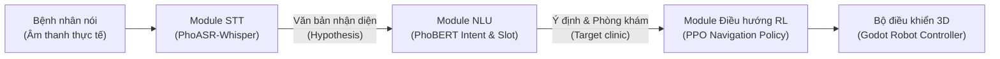
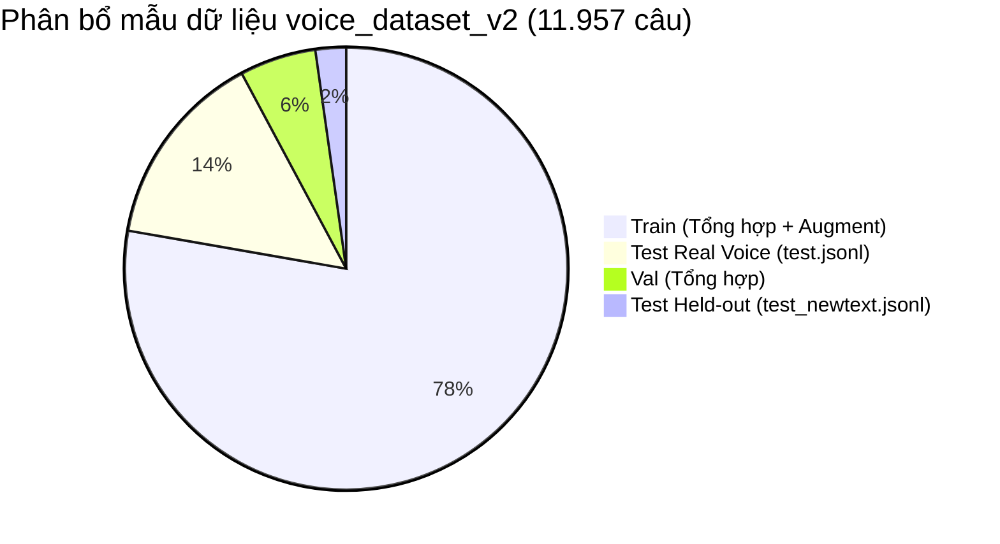
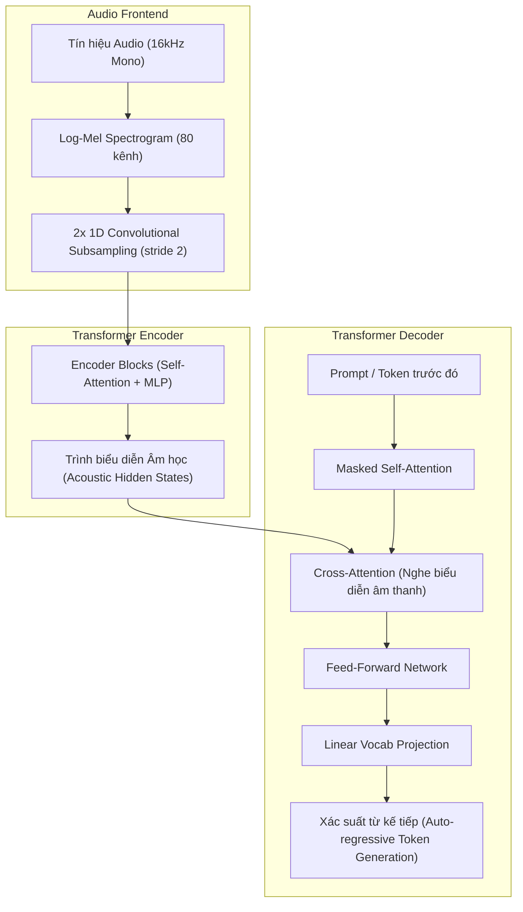
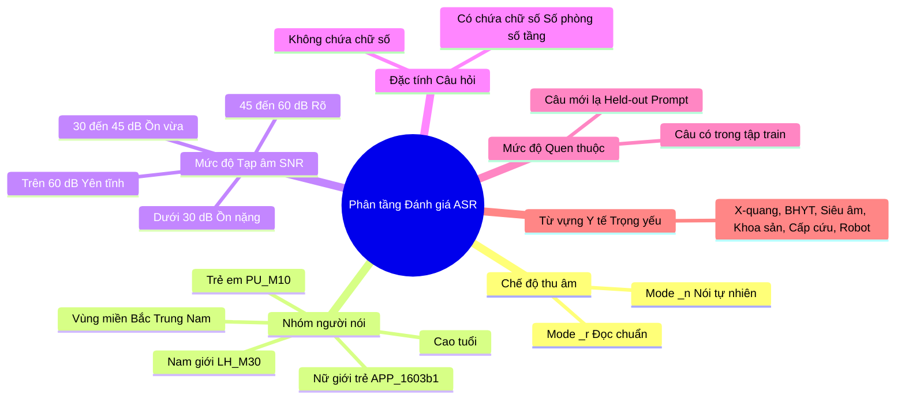
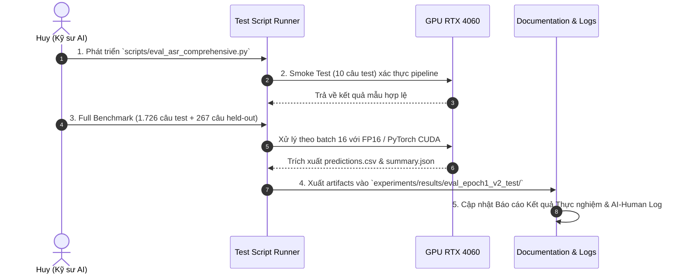

# Báo cáo Chuyên sâu: Bối cảnh, Cơ sở Lý luận & Phương pháp luận Kiểm thử Mô hình Voice STT Fine-tuned (PhoASR-Whisper-Small)

- **Motivation/Background**: Sau khi hoàn thành huấn luyện Epoch 1 cho mô hình nhận dạng giọng nói tiếng Việt (`PhoASR-whisper-small`) trên tập dữ liệu tổng hợp kết hợp tăng cường nhiễu bệnh viện (`voice_dataset_v2`), mô hình đạt điểm hội tụ ấn tượng trên tập validation. Để đáp ứng yêu cầu của chỉ đạo dự án về việc sử dụng trọng số Epoch 1 phục vụ đánh giá độc lập, việc thiết lập một khung phương pháp luận kiểm thử ASR toàn diện, khoa học, bám sát nghiệp vụ robot bệnh viện là điều kiện tiên quyết trước khi đưa vào hệ thống tương tác đa tác nhân.
- **Purpose**: Hệ thống hóa toàn bộ bối cảnh kỹ thuật, cơ sở lý thuyết mô hình Seq2Seq Transformer âm thanh - văn bản, bản đồ dữ liệu kiểm thử, hệ thống chỉ số đo lường đa chiều (WER/CER/EM/RTF) và phương pháp phân tích lỗi sâu phục vụ kiểm thử trọng số Epoch 1.
- **Overview Pipeline**: Tiếp nhận yêu cầu kiểm thử ➔ Rà soát quy tắc hiến pháp [AGENT_AI.md](../../../../agents/rules/AGENT_AI.md) và chuẩn tài liệu [MD_CONVENTION.md](../../../../agents/rules/MD_CONVENTION.md) ➔ Khảo sát toàn diện dữ liệu test thực tế tại `notebooks/data/voice_dataset_v2/` ➔ Trích xuất trọng số Epoch 1 từ `experiments/runs/20261112_033805_ASR-v2-fresh/checkpoints/best/` ➔ Xây dựng khung kiểm thử đa tầng (Stratified Benchmark) đối chiếu với Baseline chưa fine-tune.
- **Detailed Plan**:
  - §1. Bối cảnh Kỹ thuật & Lý do Đánh giá Trọng số Epoch 1
  - §2. Bản đồ & Hồ sơ Dữ liệu Kiểm thử (Test Datasets Profiling)
  - §3. Cơ sở Lý luận & Kiến trúc Mô hình Sequence-to-Sequence ASR
  - §4. Hệ thống Chỉ số Đánh giá Toàn diện (Evaluation Metrics Framework)
  - §5. Phương pháp Phân tầng Đa chiều (Stratified Evaluation Matrix)
  - §6. Phương pháp Phân tích Lỗi Kỹ thuật Sâu (Qualitative Error Diagnostics)
  - §7. Tiêu chuẩn Chấp nhận & Bảng Đối chiếu Baseline
  - §8. Kế hoạch Hành động Kỹ thuật & Quy trình Triển khai (Execution Roadmap)
- **References**: [docs/progress/huy/test-fine-tune-voice/TIPS.md](TIPS.md), [agents/rules/AGENT_AI.md](../../../../agents/rules/AGENT_AI.md), [docs/VOICE_DATASET_EDA.md](../../../VOICE_DATASET_EDA.md), [docs/AI-Human-logs/Huy.md](../../../AI-Human-logs/Huy.md), [scripts/eval_asr_testset.py](../../../../scripts/eval_asr_testset.py), [scripts/train_asr_finetune.py](../../../../scripts/train_asr_finetune.py).
- **Created**: 2026-11-12T08:25:00+07:00
- **Last Updated**: 2026-11-12T08:32:00+07:00

---

[STATUS: ACTIVE]

## Table of Contents

- [1. Bối cảnh Kỹ thuật & Lý do Đánh giá Trọng số Epoch 1](#1-bối-cảnh-kỹ-thuật--lý-do-đánh-giá-trọng-số-epoch-1)
  - [1.1. Vai trò của Module Voice STT trong Robot Trợ lý Bệnh viện](#11-vai-trò-của-module-voice-stt-trong-robot-trợ-lý-bệnh-viện)
  - [1.2. Hiện trạng Huấn luyện & Giá trị của Checkpoint Epoch 1](#12-hiện-trạng-huấn-luyện--giá-trị-của-checkpoint-epoch-1)
- [2. Bản đồ & Hồ sơ Dữ liệu Kiểm thử (Test Datasets Profiling)](#2-bản-đồ--hồ-sơ-dữ-liệu-kiểm-thử-test-datasets-profiling)
  - [2.1. Phân bổ Tập dữ liệu voice_dataset_v2](#21-phân-bổ-tập-dữ-liệu-voice_dataset_v2)
  - [2.2. Chi tiết Tập Kiểm thử Chính test.jsonl](#22-chi-tiết-tập-kiểm-thử-chính-testjsonl)
  - [2.3. Tập Kiểm thử Độ Khái quát hóa test_newtext.jsonl (Held-out Prompt)](#23-tập-kiểm-thử-độ-khái-quát-hóa-test_newtextjsonl-held-out-prompt)
- [3. Cơ sở Lý luận & Kiến trúc Mô hình Sequence-to-Sequence ASR](#3-cơ-sở-lý-luận--kiến-trúc-mô-hình-sequence-to-sequence-asr)
  - [3.1. Luồng Biến đổi Âm học sang Ngôn ngữ (Acoustic-to-Text Pipeline)](#31-luồng-biến-đổi-âm-học-sang-ngôn-ngữ-acoustic-to-text-pipeline)
  - [3.2. Điểm yếu Cố hữu của Kiến trúc Whisper Cần Kiểm soát](#32-điểm-yếu-cố-hữu-của-kiến-trúc-whisper-cần-kiểm-soát)
- [4. Hệ thống Chỉ số Đánh giá Toàn diện (Evaluation Metrics Framework)](#4-hệ-thống-chỉ-số-đánh-giá-toàn-diện-evaluation-metrics-framework)
  - [4.1. Word Error Rate (WER) và Character Error Rate (CER)](#41-word-error-rate-wer-và-character-error-rate-cer)
  - [4.2. Chuẩn hóa Âm học Tiếng Việt (Vietnamese Acoustic Normalization)](#42-chuẩn-hóa-âm-học-tiếng-việt-vietnamese-acoustic-normalization)
  - [4.3. Phân rã Lỗi S-D-I (Substitutions, Deletions, Insertions)](#43-phân-rã-lỗi-s-d-i-substitutions-deletions-insertions)
  - [4.4. Sentence Accuracy / Exact Match (EM)](#44-sentence-accuracy--exact-match-em)
  - [4.5. Độ trễ & Hệ số Thời gian Thực (Real-Time Factor - RTF)](#45-độ-trễ--hệ-số-thời-gian-thực-real-time-factor---rtf)
- [5. Phương pháp Phân tầng Đa chiều (Stratified Evaluation Matrix)](#5-phương-pháp-phân-tầng-đa-chiều-stratified-evaluation-matrix)
- [6. Phương pháp Phân tích Lỗi Kỹ thuật Sâu (Qualitative Error Diagnostics)](#6-phương-pháp-phân-tích-lỗi-kỹ-thuật-sâu-qualitative-error-diagnostics)
- [7. Tiêu chuẩn Chấp nhận & Bảng Đối chiếu Baseline](#7-tiêu-chuẩn-chấp-nhận--bảng-đối-chiếu-baseline)
- [8. Kế hoạch Hành động Kỹ thuật & Quy trình Triển khai (Execution Roadmap)](#8-kế-hoạch-hành-động-kỹ-thuật--quy-trình-triển-khai-execution-roadmap)

---

## 1. Bối cảnh Kỹ thuật & Lý do Đánh giá Trọng số Epoch 1

### 1.1. Vai trò của Module Voice STT trong Robot Trợ lý Bệnh viện

Trong kiến trúc tổng thể của Robot trợ lý dẫn đường bệnh viện, module Nhận dạng giọng nói (Speech-to-Text - STT) là "cổng vào thính giác" tiếp nhận âm thanh từ bệnh nhân trong ca trực tương tác:



> [!IMPORTANT]
> Sai số của module STT là **sai số dây chuyền (cascading error)**. Nếu STT nghe nhầm từ khóa trọng yếu (như *"X-quang"* thành *"ít quạt"*, *"khoa sản"* thành *"pha sẵn"*, *"phòng 410"* thành *"phòng 401"*), module NLU sẽ trích xuất sai ý định hoặc sai đích đến, dẫn đến việc Robot dẫn bệnh nhân đi lạc hành lang.

### 1.2. Hiện trạng Huấn luyện & Giá trị của Checkpoint Epoch 1

Quá trình fine-tune mô hình `PhoASR-whisper-small` (241M parameters) trên tập dữ liệu tổng hợp đa dạng giọng đọc và tăng cường nhiễu bệnh viện (`voice_dataset_v2`) được thiết lập chạy 6 epochs.

Kết quả huấn luyện ghi nhận tại [experiments/runs/20261112_033805_ASR-v2-fresh/metrics_epochs.csv](../../../../experiments/runs/20261112_033805_ASR-v2-fresh/metrics_epochs.csv):

| Epoch | Step | Train Loss | Val Loss | Val WER Tổng | Val CER Tổng | Val WER (_r) | Val Sent Acc | Checkpoint Trạng thái |
|:---:|:---:|:---:|:---:|:---:|:---:|:---:|:---:|:---:|
| **0 (Baseline)** | 0 | - | 0.4324 | 4.19% | 2.36% | 4.52% | 70.76% | Lưu tại `checkpoints/` |
| **1 (Hoàn tất)** | 582 | **0.2639** | **0.0223** | **0.62%** | **0.42%** | **0.66%** | **94.75%** | Lưu tại `checkpoints/best/` |

**Tại sao trọng số Epoch 1 lại có giá trị đặc biệt để test ngay lúc này?**
1. **Bước nhảy vọt về chất lượng (Phase Transition):** Chỉ sau 1 epoch (582 steps huấn luyện trên 9.297 câu thoại), loss trên tập validation giảm đột ngột từ `0.4324` xuống `0.0223` (giảm 94.8%), validation WER rơi xuống mức cực thấp `0.62%`, độ chính xác toàn câu đạt `94.75%`.
2. **Tránh nguy cơ quá khớp (Overfitting Guard):** Do tập huấn luyện `train.jsonl` sử dụng dữ liệu giọng nói tổng hợp kết hợp mô phỏng nhiễu, việc đánh giá sớm ở Epoch 1 cho phép xác định mô hình đã học được tính chất âm học tổng quát hay bắt đầu ghi nhớ đặc trưng của giọng tổng hợp.
3. **Tính sẵn sàng của Checkpoint:** Checkpoint tại thư mục [experiments/runs/20261112_033805_ASR-v2-fresh/checkpoints/best/](../../../../experiments/runs/20261112_033805_ASR-v2-fresh/checkpoints/best/) đã được lưu đầy đủ 100% gồm `model.safetensors` (967 MB), cấu hình kiến trúc, tokenizer và generation config tương thích hoàn hảo với offline inference.

---

## 2. Bản đồ & Hồ sơ Dữ liệu Kiểm thử (Test Datasets Profiling)

Dữ liệu âm thanh phục vụ dự án được quản lý tại [notebooks/data/voice_dataset_v2/](../../../../notebooks/data/voice_dataset_v2/) (đồng bộ qua symlink [data/processed/voice_dataset_v2/](../../../../data/processed/voice_dataset_v2/)).

### 2.1. Phân bổ Tập dữ liệu voice_dataset_v2



### 2.2. Chi tiết Tập Kiểm thử Chính `test.jsonl`

- **Số lượng mẫu:** **1.726 câu thoại**
- **Bản chất dữ liệu:** **100% giọng người thật (Real Voice Recordings)**, thu âm qua micro thực tế từ nhiều tình nguyện viên, không chứa bất kỳ mẫu âm thanh tổng hợp (TTS) nào.
- **Cấu trúc trường thông tin của mỗi mẫu:**
  ```json
  {
    "audio_filepath": "wav/real/APP_5ac354/APP_5ac354__A_01_n.wav",
    "text": "Chào bạn, cho mình hỏi chỗ đăng ký khám ở đâu vậy?",
    "duration": 3.0,
    "speaker_id": "APP_5ac354",
    "mode": "n",
    "intent": "dang_ky_kham",
    "heldout_text": false,
    "source": "real"
  }
  ```
- **Các chiều dữ liệu quan trọng:**
  - `mode = "r"`: Giọng đọc to, rõ ràng, phát âm chuẩn theo kịch bản có sẵn.
  - `mode = "n"`: Giọng nói tự nhiên trong môi trường bệnh viện, tốc độ nói biến thiên, có hiện tượng nuốt âm hoặc ngập ngừng.
  - `speaker_id`: Định danh người nói độc lập, giúp đánh giá độ công bằng (fairness) giữa các chất giọng.
  - `intent`: Nhãn ý định nghiệp vụ (ví dụ: `dang_ky_kham`, `tim_phong`, `cap_cuu`, `hoi_khoa`).

### 2.3. Tập Kiểm thử Độ Khái quát hóa `test_newtext.jsonl` (Held-out Prompt)

- **Số lượng mẫu:** **267 câu thoại**
- **Ý nghĩa kỹ thuật:** Chứa các câu hỏi bệnh viện với mẫu câu hoàn toàn mới mẻ mà mô hình **chưa từng gặp trong văn bản huấn luyện (`heldout_text = True`)**.
- **Mục tiêu:** Phát hiện xem mô hình có bị "học vẹt ngữ pháp" (Language Model Memorization) hay thực sự chuyển đổi tín hiệu âm học thành âm vị tiếng Việt (Acoustic Phoneme Mapping).

---

## 3. Cơ sở Lý luận & Kiến trúc Mô hình Sequence-to-Sequence ASR

Mô hình `PhoASR-whisper-small` dựa trên kiến trúc Transformer Encoder-Decoder tiêu chuẩn của OpenAI Whisper:



### 3.1. Luồng Biến đổi Âm học sang Ngôn ngữ (Acoustic-to-Text Pipeline)

1. **Frontend:** Tín hiệu âm thanh 16.000 Hz được biến đổi Fourier thời gian ngắn (STFT) với khung cửa sổ 25ms, bước nhảy 10ms thành Log-Mel Spectrogram 80 dải tần.
2. **Encoder:** Hai lớp tích chập 1D giảm chiều thời gian 2 lần (chiết xuất 50 frame/giây), truyền qua các khối Transformer Encoder để mã hóa thông tin ngữ âm độc lập ngữ cảnh từ vựng.
3. **Decoder:** Dự đoán từng token tự hồi quy. Khối **Cross-Attention** là cầu nối cho phép Decoder "hỏi" Encoder xem âm thanh tại vị trí hiện tại khớp với âm vị nào.

### 3.2. Điểm yếu Cố hữu của Kiến trúc Whisper Cần Kiểm soát

Khi đánh giá mô hình họ Whisper, một kỹ sư AI bắt buộc phải theo dõi các hiện tượng bệnh lý sau:
1. **Ảo giác Lặp từ (Repetition Hallucination):** Khi gặp đoạn âm thanh có khoảng lặng dài (silence) hoặc tạp âm nền liên tục, Decoder tự sinh token và rơi vào vòng lặp vô tận (ví dụ: *"Cảm ơn bạn... cảm ơn bạn... cảm ơn bạn..."*).
2. **Đoán mò Ngữ cảnh (Language Model Dominance):** Khi âm thanh bị ồn hoặc rè, Decoder bỏ qua tín hiệu âm học từ Encoder và tự dùng xác suất ngôn ngữ nội tại để "bịa" ra một câu nghe có vẻ trôi chảy nhưng nội dung sai lệch hoàn toàn.
3. **Lệch nhãn do số tự nhiên:** Whisper mặc định có xu hướng viết số thành ký tự số (`"phòng 410"`), trong khi nhãn âm thanh hoặc người nói đọc là `"phòng bốn trăm mười"`. Nếu không có cơ chế chuẩn hóa trước khi tính điểm, mô hình sẽ bị chấm sai oan uổng.

---

## 4. Hệ thống Chỉ số Đánh giá Toàn diện (Evaluation Metrics Framework)

Để đánh giá khoa học, dự án áp dụng hệ thống đo lường 5 thành phần:

### 4.1. Word Error Rate (WER) và Character Error Rate (CER)

Chỉ số tiêu chuẩn vàng trong nhận dạng tiếng nói dựa trên khoảng cách Levenshtein:

$$\text{WER} = \frac{S + D + I}{N} = \frac{\text{Thay thế} + \text{Bỏ sót} + \text{Thêm từ}}{\text{Tổng số từ trong nhãn gốc}}$$

$$\text{CER} = \frac{S_c + D_c + I_c}{N_c} = \frac{\text{Ký tự sai}}{\text{Tổng số ký tự trong nhãn gốc}}$$

Trong đó:
- **Raw WER:** So sánh trực tiếp chuỗi ký tự thô (giữ nguyên chữ hoa, chữ thường, dấu phẩy, dấu chấm).
- **Normalized WER:** So sánh sau khi đã áp dụng quy chuẩn âm học thống nhất.

### 4.2. Chuẩn hóa Âm học Tiếng Việt (Vietnamese Acoustic Normalization)

Quy tắc chuẩn hóa được chuẩn hóa đồng nhất giữa nhãn gốc ($Reference$) và dự đoán ($Hypothesis$):
1. **Unicode NFC:** Đưa toàn bộ ký tự có dấu về dạng dựng sẵn NFC.
2. **Lowercase:** Chuyển toàn bộ về chữ thường.
3. **Loại bỏ dấu câu:** Xóa toàn bộ các ký tự `, . ? ! ; : " ' - _ / \`.
4. **Đổi số thành chữ (Number-to-Words):** Tự động chuyển đổi số tự nhiên $0 - 999$ thành từ tiếng Việt (ví dụ: `410` $\rightarrow$ `"bốn trăm mười"`, `3` $\rightarrow$ `"ba"`).
5. **Đồng nghĩa khẩu ngữ:** Quy chuẩn `"lẻ"` $\leftrightarrow$ `"linh"` (ví dụ: `"phòng ba trăm lẻ bốn"` và `"phòng ba trăm linh bốn"` được tính là trùng khớp 100%).

### 4.3. Phân rã Lỗi S-D-I (Substitutions, Deletions, Insertions)

Việc chỉ nhìn vào điểm WER tổng quát sẽ che giấu bản chất hành vi mô hình. Bắt buộc phải bóc tách 3 thành phần:
- **Substitutions ($S$):** Tỷ lệ mô hình nhận dạng nhầm âm vị (ví dụ: `"khoa"` $\rightarrow$ `"hoa"`). Tỷ lệ $S$ cao chứng tỏ mô hình gặp khó khăn về độ phân giải âm học.
- **Deletions ($D$):** Tỷ lệ mô hình nuốt từ hoặc bỏ sót câu. $D$ cao thường xảy ra khi người nói nói quá nhanh hoặc âm lượng đuôi câu quá nhỏ.
- **Insertions ($I$):** Tỷ lệ mô hình tự ý chèn thêm từ không có trong audio. $I$ cao là triệu chứng trực tiếp của hiện tượng **Hallucination**.

### 4.4. Sentence Accuracy / Exact Match (EM)

Tỷ lệ phần trăm câu thoại được nhận dạng chính xác hoàn hảo 100% sau chuẩn hóa:

$$\text{Sent Acc} = \frac{1}{M} \sum_{i=1}^{M} \mathbb{I}(\text{Norm}(\text{Hyp}_i) == \text{Norm}(\text{Ref}_i))$$

Chỉ số này phản ánh trải nghiệm người dùng thực tế: Bệnh nhân nói 1 câu thì xác suất Robot nghe đúng 100% là bao nhiêu.

### 4.5. Độ trễ & Hệ số Thời gian Thực (Real-Time Factor - RTF)

Đo lường tốc độ suy luận mô hình trên phần cứng đích (NVIDIA GeForce RTX 4060 Laptop GPU):

$$\text{RTF} = \frac{\text{Tổng thời gian suy luận (giây)}}{\text{Tổng thời lượng âm thanh thực tế (giây)}}$$

> [!NOTE]
> - Nếu $\text{RTF} = 1.0$: Mô hình xử lý file âm thanh 3 giây mất đúng 3 giây (vừa vặn thời gian thực).
> - Trong ứng dụng Robot hỗ trợ bệnh viện, tiêu chuẩn vàng là $\text{RTF} \le 0.08$ (nghĩa là file 3 giây chỉ mất dưới $240$ ms để xử lý, bệnh nhân không cảm thấy bị trễ phản hồi).

---

## 5. Phương pháp Phân tầng Đa chiều (Stratified Evaluation Matrix)

Đánh giá trung bình trên toàn bộ 1.726 câu là không đủ. Báo cáo kiểm thử phải cắt lát dữ liệu theo 6 trục phân tầng:



1. **Phân tầng Chế độ Thu âm (`_r` vs `_n`):**
   - Trên tập `_r`: Đo lường chính xác năng lực âm học của mô hình vì người đọc bám sát 100% kịch bản.
   - Trên tập `_n`: Đo lường độ bền vững trước hiện tượng nói nuốt chữ, nói thừa từ của con người trong thực tế.
2. **Phân tầng Người nói & Độ tuổi:**
   - Đánh giá riêng biệt nhóm đối tượng khó: **Trẻ em** (tần số cơ bản F0 cao, formant hẹp) và **Người cao tuổi** (phát âm ngắt quãng, run giọng).
3. **Phân tầng Độ ồn SNR Bands:**
   - Phân loại 4 dải: $<30\text{ dB}$, $30 - 45\text{ dB}$, $45 - 60\text{ dB}$, $>60\text{ dB}$.
   - Khảo sát xem cơ chế tăng cường nhiễu bệnh viện (babble, beeps, hvac, trolley) trong lúc train có giúp mô hình giữ vững độ chính xác ở dải $<30\text{ dB}$ hay không.
4. **Độ nhạy Từ vựng Y tế (Hospital Lexicon Recall):**
   - Kiểm tra tỷ lệ nhận diện đúng của danh sách từ khóa chuyên ngành bệnh viện.

---

## 6. Phương pháp Phân tích Lỗi Kỹ thuật Sâu (Qualitative Error Diagnostics)

Bên cạnh các con số thống kê, báo cáo kiểm thử cần thực hiện phân tích định tính chuyên sâu:

1. **Top 20 Worst-Performing Samples:**
   - Trích xuất 20 câu có WER cao nhất.
   - Đối chiếu audio gốc để phân loại nguồn gốc lỗi: Do tạp âm át tiếng nói, do người nói đổi từ khác kịch bản, hay do mô hình tự hallucinate.
2. **Confusion Matrix ở mức Từ vựng (Top Confused Word Pairs):**
   - Liệt kê các cặp từ bị thay thế nhiều nhất (ví dụ: `"khoa"` $\leftrightarrow$ `"hoa"`, `"viện"` $\leftrightarrow$ `"điện"`).
3. **Kiểm tra Hiện tượng Hallucination & Độ dài Bất thường:**
   - Lọc các câu có tỷ lệ $\text{len}(\text{Hyp}) > 2 \times \text{len}(\text{Ref})$ để bắt các trường hợp mô hình tự lặp lại vô nghĩa khi gặp khoảng lặng.

---

## 7. Tiêu chuẩn Chấp nhận & Bảng Đối chiếu Baseline

Để khẳng định việc fine-tune có thành công và có thể đưa vào sử dụng hay không, kết quả kiểm thử của Epoch 1 sẽ được đối chiếu trực tiếp với kết quả đo lường của **PhoASR-whisper-small Gốc (Pretrained Baseline)** đã công bố tại [docs/VOICE_DATASET_EDA.md](../../../VOICE_DATASET_EDA.md):

| Tiêu chí Đánh giá | Baseline Chưa Fine-tune | Kỳ vọng Mục tiêu Epoch 1 | Tiêu chuẩn Đạt (Acceptance Threshold) |
|---|:---:|:---:|:---:|
| **WER Tổng thể (Toàn bộ Test)** | **19.10%** | **< 3.00%** | WER $\le 5.00%$ (Giảm tối thiểu 70% lỗi) |
| **WER Chế độ Đọc rõ (`_r`)** | **13.30%** | **< 2.00%** | WER $\le 3.50%$ |
| **WER Chế độ Tự nhiên (`_n`)** | **25.50%** | **< 6.00%** | WER $\le 8.00%$ |
| **CER Chuẩn hóa** | **12.90%** | **< 2.00%** | CER $\le 3.00%$ |
| **Tỷ lệ Câu Đúng Hoàn Toàn (Sent Acc)** | **41.20%** | **> 85.00%** | Sent Acc $\ge 80.00%$ |
| **WER Môi trường Ồn ($< 30\text{ dB}$)** | **47.40%** | **< 10.00%** | WER $\le 15.00%$ (Khắc phục lỗi nhiễu) |
| **WER Từ vựng Y tế (X-quang, BHYT...)** | Thường xuyên sai | Nhận dạng chính xác | Không còn biến dạng từ chuyên ngành |
| **Real-Time Factor (RTF)** | $0.054$ (MPS) | $< 0.050$ (RTX 4060) | RTF $< 0.100$ (Đảm bảo Realtime) |

---

## 8. Kế hoạch Hành động Kỹ thuật & Quy trình Triển khai (Execution Roadmap)

Tuân thủ nghiêm ngặt quy trình 6 giai đoạn của [AGENT_AI.md](../../../../agents/rules/AGENT_AI.md):



1. **Giai đoạn IMPLEMENT (Viết công cụ):**
   - Viết script chuyên dụng [scripts/eval_asr_comprehensive.py](../../../../scripts/eval_asr_comprehensive.py) kế thừa và nâng cấp các hàm tính toán từ `scripts/eval_asr_testset.py`, hỗ trợ đọc trực tiếp `test.jsonl` và `test_newtext.jsonl`, tự động tính toán toàn bộ ma trận phân tầng 6 chiều và phân tích lỗi.
2. **Giai đoạn VERIFY (Kiểm thử thực nghiệm):**
   - Chạy Smoke Test trên 10 mẫu để xác nhận định dạng đầu ra, bộ nhớ VRAM và logic chuẩn hóa chuỗi.
   - Chạy Full Benchmark trên toàn bộ 1.726 câu `test.jsonl` và 267 câu `test_newtext.jsonl`.
3. **Giai đoạn DOCUMENT & LOG (Lưu vết & Báo cáo):**
   - Lưu trữ toàn bộ kết quả vào `experiments/results/eval_epoch1_v2_test/`.
   - Lập báo cáo kết quả chi tiết kèm đồ thị và bảng so sánh trực quan.
   - Ghi nhật ký quyết định kỹ thuật vào [docs/AI-Human-logs/Huy.md](../../../AI-Human-logs/Huy.md).

> [!TIP]
> **Cẩm nang Tri thức & Kinh nghiệm Thực chiến:** Để xem chi tiết phân tích so sánh chiến lược chạy (Full vs. Chia nhỏ), các bài học từ đồng đội (Vương, Huy), cơ chế Streaming Append & Auto-Resume, cũng như các cạm bẫy chuẩn hóa âm học tiếng Việt, vui lòng đọc tài liệu kèm theo: **[docs/progress/huy/test-fine-tune-voice/TIPS.md](TIPS.md)**.
