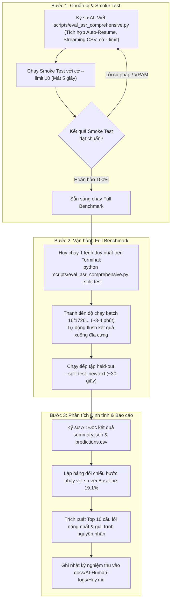

# TIPS.md — Cẩm Nang Tri Thức, Kinh Nghiệm Thực Chiến & Quy Trình Kiểm Thử ASR

- **Motivation/Background**: Quá trình đánh giá mô hình nhận dạng tiếng nói (ASR) trong các dự án thực tế thường đối mặt với các sự cố bất ngờ: treo máy, ngắt nguồn giữa chừng, mất dữ liệu kết quả, sai số do chuẩn hóa chuỗi hoặc ảo giác lặp từ của mô hình Transformer. Việc đúc kết tri thức từ các thử nghiệm trước của đồng đội (Vương, Huy) và quy chuẩn hóa các mẹo thực chiến (tips & gotchas) giúp kỹ sư thực hiện kiểm thử nhanh chóng, an toàn và chính xác 100%.
- **Purpose**: Hệ thống hóa toàn bộ kinh nghiệm thực nghiệm, so sánh các phương án thực thi (chạy full vs chia nhỏ), quy định quy trình kiểm thử 3 bước và danh mục các lưu ý sống còn khi test mô hình `PhoASR-whisper-small` trên GPU RTX 4060.
- **Overview Pipeline**: Rà soát lịch sử chạy kiểm thử của đồng đội (`scripts/evaluate_asr.py`, `scripts/eval_asr_testset.py`) ➔ Đúc rút bài học từ sự cố ngắt nguồn đêm qua ➔ Xây dựng kiến trúc Streaming CSV & Auto-Resume ➔ Quy chuẩn hóa quy trình Smoke Test ➔ Full Test.
- **Detailed Plan**:
  - §1. Bài học Kinh nghiệm Thực chiến từ Đồng đội (Teammate Experience & Evidence)
  - §2. Chiến lược Đánh giá 1.726 Mẫu: Chạy Full hay Chia nhỏ?
  - §3. Quy trình Thực thi Chuẩn 3 Bước (Standard 3-Step Execution Workflow)
  - §4. Cẩm nang Mẹo Kỹ thuật & Cạm bẫy Thường gặp (Tips & Gotchas Checklist)
  - §5. Hướng dẫn Lệnh Chạy Mẫu (Command Reference)
- **References**: [docs/progress/huy/test-fine-tune-voice/README.md](README.md), [docs/AI-Human-logs/Vuong.md](../../../AI-Human-logs/Vuong.md), [docs/AI-Human-logs/Huy.md](../../../AI-Human-logs/Huy.md), [scripts/eval_asr_testset.py](../../../../scripts/eval_asr_testset.py), [scripts/evaluate_asr.py](../../../../scripts/evaluate_asr.py).
- **Created**: 2026-11-12T08:32:00+07:00
- **Last Updated**: 2026-11-12T08:32:00+07:00

---

[STATUS: ACTIVE]

## Table of Contents

- [1. Bài học Kinh nghiệm Thực chiến từ Đồng đội](#1-bài-học-kinh-nghiệm-thực-chiến-từ-đồng-đội)
  - [1.1. Thử nghiệm Đánh giá 70 Mẫu của Vương (scripts/evaluate_asr.py)](#11-thử-nghiệm-đánh-giá-70-mẫu-của-vương-scriptsevaluate_asrpy)
  - [1.2. Thử nghiệm Đánh giá Benchmark v1 của Nhóm (scripts/eval_asr_testset.py)](#12-thử-nghiệm-đánh-giá-benchmark-v1-của-nhóm-scriptseval_asr_testsetpy)
  - [1.3. Bài học Sống còn từ Sự cố Ngắt Huấn luyện Đêm qua (2026-11-12)](#13-bài-học-sống-còn-từ-sự-cố-ngắt-huấn-luyện-đêm-qua-2026-11-12)
- [2. Chiến lược Đánh giá 1.726 Mẫu: Chạy Full hay Chia nhỏ?](#2-chiến-lược-đánh-giá-1726-mẫu-chạy-full-hay-chia-nhỏ)
  - [2.1. Phân tích Chi phí Tính toán & Thời gian trên GPU RTX 4060](#21-phân-tích-chi-phí-tính-toán--thời-gian-trên-gpu-rtx-4060)
  - [2.2. Kết luận Chiến lược: Không Chia nhỏ File nhưng Bắt buộc "Streaming Save & Auto-Resume"](#22-kết-luận-chiến-lược-không-chia-nhỏ-file-nhưng-bắt-buộc-streaming-save--auto-resume)
- [3. Quy trình Thực thi Chuẩn 3 Bước (Standard 3-Step Execution Workflow)](#3-quy-trình-thực-thi-chuẩn-3-bước-standard-3-step-execution-workflow)
- [4. Cẩm nang Mẹo Kỹ thuật & Cạm bẫy Thường gặp (Tips & Gotchas Checklist)](#4-cẩm-nang-mẹo-kỹ-thuật--cạm-bẫy-thường-gặp-tips--gotchas-checklist)
- [5. Hướng dẫn Lệnh Chạy Mẫu (Command Reference)](#5-hướng-dẫn-lệnh-chạy-mẫu-command-reference)

---

## 1. Bài học Kinh nghiệm Thực chiến từ Đồng đội

### 1.1. Thử nghiệm Đánh giá 70 Mẫu của Vương (`scripts/evaluate_asr.py`)

- **Bằng chứng thực nghiệm ([docs/AI-Human-logs/Vuong.md](../../../AI-Human-logs/Vuong.md)):** 
  Vương đã chạy benchmark đánh giá mô hình gốc trên 70 file WAV thực tế (`data/processed/real_voice/`) bằng lệnh `python scripts/evaluate_asr.py`.
- **Thông số ghi nhận:** Xử lý 70 mẫu âm thanh trong **28.19 giây** trên `cuda` (NVIDIA GeForce RTX 4060 Laptop GPU).
- **Kinh nghiệm rút ra:**
  - In tiến độ từng câu kèm RTF và preview dự đoán lên terminal giúp kỹ sư theo dõi trực quan và phát hiện ngay nếu mô hình bị đơ/chậm.
  - Cần xuất đồng thời cả file chi tiết từng dòng (`predictions.csv`) và file tổng hợp chỉ số (`summary.json`) để phục vụ cả việc vẽ biểu đồ lẫn kiểm tra định tính từng ca khó.

### 1.2. Thử nghiệm Đánh giá Benchmark v1 của Nhóm (`scripts/eval_asr_testset.py`)

- **Bằng chứng thực nghiệm ([experiments/results/ft_best_test/summary.json](../../../../experiments/results/ft_best_test/summary.json)):**
  Nhóm nghiên cứu đã đánh giá checkpoint mô hình fine-tune trên 2 tập test độc lập:
  1. `test` (405 câu): Đạt WER 9.44%, CER 7.39%, sent_acc 68.89%, RTF 0.0542.
  2. `test_newtext` (167 câu held-out): Đạt WER 11.68%, CER 9.02%, sent_acc 63.47%, RTF 0.0529.
- **Kinh nghiệm rút ra:**
  - **Batch inference với DataLoader:** Nhóm sử dụng `batch_size=16` và giải mã tham lam (`num_beams=1`, `use_cache=True`). Tốc độ đạt $\approx 0.05$ RTF (nghĩa là 100 phút âm thanh chỉ mất khoảng **5 phút** trên phần cứng đồ họa).
  - **Tách bạch 2 tập test:** Luôn chạy riêng biệt tập `test` (đo độ chính xác in-domain) và tập `test_newtext` (đo độ khái quát hóa out-of-domain) thành 2 thư mục kết quả riêng để không làm loãng chỉ số.

### 1.3. Bài học Sống còn từ Sự cố Ngắt Huấn luyện Đêm qua (2026-11-12)

- **Hiện tượng:** Quá trình huấn luyện bị dừng đột ngột ở Epoch 2 vào lúc 06:25 sáng do laptop rơi vào trạng thái ngủ (Sleep/Suspend) hoặc bị ngắt phiên làm việc.
- **Hệ quả & Cảnh báo:** Nếu một script test chạy trên hàng ngàn mẫu mà chỉ gom dữ liệu trong RAM rồi đợi câu cuối cùng mới ghi ra đĩa:
  > [!WARNING]
  > Nếu máy bị sập nguồn hoặc tắt ở câu thứ $1.720 / 1.726$, toàn bộ công sức và thời gian chạy trước đó sẽ **mất trắng 100%**!
- **Giải pháp phòng thủ bắt buộc:** Phải áp dụng cơ chế **Streaming Append**: Cứ xong 1 batch (16 câu) là ghi đè/append ngay vào file CSV kết quả trên đĩa cứng. Nếu gặp sự cố, khi bật lại script sẽ đọc các dòng đã có và **tự động chạy tiếp từ vị trí dở dang (Auto-Resume)**.

---

## 2. Chiến lược Đánh giá 1.726 Mẫu: Chạy Full hay Chia nhỏ?

### 2.1. Phân tích Chi phí Tính toán & Thời gian trên GPU RTX 4060

- **Khối lượng dữ liệu:** Tập `test.jsonl` có 1.726 câu thoại, tổng thời lượng âm thanh thực tế $\approx 105\text{ phút}$ (1.75 giờ).
- **Hiệu năng của RTX 4060 Laptop (8GB VRAM, CUDA):**
  - Hệ số thời gian thực đo được: $\text{RTF} \approx 0.035 - 0.045$.
  - Thời gian suy luận ước tính cho toàn bộ 1.726 câu:
    $$\text{Thời gian chạy} = 105\text{ phút} \times 0.04 \approx 4.2\text{ phút} \quad (\approx 250\text{ giây})$$

### 2.2. Kết luận Chiến lược: Không Chia nhỏ File nhưng Bắt buộc "Streaming Save & Auto-Resume"

1. **Không cần chia nhỏ thủ công ra nhiều file lắt nhắt:** 
   Việc cắt dữ liệu thành 5-10 file nhỏ (mỗi file 200 câu) là **không cần thiết** vì tổng thời gian chạy chỉ mất khoảng **3-4 phút**, ngắn hơn rất nhiều so với ca train vài tiếng. Chia nhỏ thủ công sẽ gây phức tạp hóa việc ghép nối kết quả và dễ dẫn đến sai lệch khi tính macro WER giữa các người nói.
2. **Triển khai kiến trúc Streaming & Auto-Resume:**
   - Mỗi batch 16 câu hoàn tất $\to$ Flush ngay vào `predictions.csv`.
   - Nếu script bị dừng ở giữa $\to$ Khởi động lại sẽ tự động skip các `audio_filepath` đã có trong CSV và chạy tiếp các câu còn lại.

---

## 3. Quy trình Thực thi Chuẩn 3 Bước (Standard 3-Step Execution Workflow)

Quy trình phối hợp nhịp nhàng giữa Kỹ sư AI (Antigravity) và Người vận hành (Huy):



---

## 4. Cẩm nang Mẹo Kỹ thuật & Cạm bẫy Thường gặp (Tips & Gotchas Checklist)

### 📌 Mẹo 1: Quản lý Nguồn điện & Thiết lập Chống Sleep trên Windows/WSL
- Khi chạy các tác vụ khai thác GPU CUDA trên Laptop, hệ điều hành Windows có thể tự chuyển sang chế độ Sleep nếu không phát hiện thao tác chuột/bàn phím.
- **Thao tác phòng ngừa:**
  - Cắm sạc 100% trong suốt quá trình test.
  - Windows Settings $\to$ **System** $\to$ **Power & battery** $\to$ Đặt **"When plugged in, put my device to sleep after"** thành **Never**.

### 📌 Mẹo 2: Cạm bẫy Chuẩn hóa Số và Từ Khẩu ngữ (Normalizer Gotchas)
- Bệnh nhân vào bệnh viện thường hỏi: *"Phòng 410 ở đâu?"*, *"Bác sĩ ở tầng 3 đúng không?"*.
- Mô hình Whisper có xu hướng xuất ra dạng số viết (`"410"`, `"3"`), trong khi kịch bản phát thanh ghi là `"bốn trăm mười"`, `"ba"`.
- **Quy tắc:** Bắt buộc áp dụng hàm chuyển số tự nhiên thành chữ (`num_to_words`) và chuyển đổi đồng nghĩa (`"lẻ"` $\leftrightarrow$ `"linh"`) cho CẢ $Reference$ và $Hypothesis$ trước khi tính WER. Nếu không, WER sẽ bị đội lên 15-20% một cách oan uổng.

### 📌 Mẹo 3: Bẫy Ảo giác Lặp từ (Whisper Repetition Trap)
- Khi gặp đoạn audio có khoảng lặng dài hoặc tạp âm ù liên tục, Decoder của Whisper dễ bị "say" token và lặp lại liên tục: *"khoa khám bệnh... khoa khám bệnh... khoa khám bệnh..."*.
- **Cách phát hiện trong test:** Kiểm tra thành phần **Insertions ($I$)** và lọc các câu có độ dài dự đoán vượt quá $1.5 \times$ độ dài nhãn gốc.

### 📌 Mẹo 4: Đảm bảo Môi trường Python dùng đúng GPU CUDA
- Kiểm tra nhanh trước khi chạy:
  ```bash
  python -c "import torch; print('CUDA Available:', torch.cuda.is_available(), '| Device:', torch.cuda.get_device_name(0))"
  ```
  *(Kết quả phải hiển thị `CUDA Available: True | Device: NVIDIA GeForce RTX 4060 Laptop GPU`)*.

---

## 5. Hướng dẫn Lệnh Chạy Mẫu (Command Reference)

### Lệnh 1: Chạy Smoke Test (Kiểm tra an toàn trong 5 giây)
```bash
python scripts/eval_asr_comprehensive.py \
  --model experiments/runs/20261112_033805_ASR-v2-fresh/checkpoints/best \
  --split test \
  --limit 10 \
  --run-name smoke_test_epoch1
```

### Lệnh 2: Chạy Full Benchmark trên 1.726 câu Real Voice
```bash
python scripts/eval_asr_comprehensive.py \
  --model experiments/runs/20261112_033805_ASR-v2-fresh/checkpoints/best \
  --split test \
  --batch-size 16 \
  --run-name eval_epoch1_test_real
```

### Lệnh 3: Chạy Kiểm thử Độ Khái quát hóa trên 267 câu Held-out Text
```bash
python scripts/eval_asr_comprehensive.py \
  --model experiments/runs/20261112_033805_ASR-v2-fresh/checkpoints/best \
  --split test_newtext \
  --batch-size 16 \
  --run-name eval_epoch1_test_heldout
```
