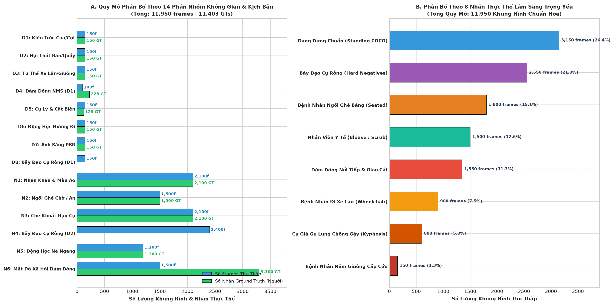
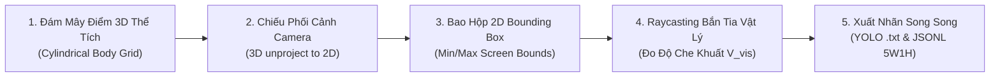
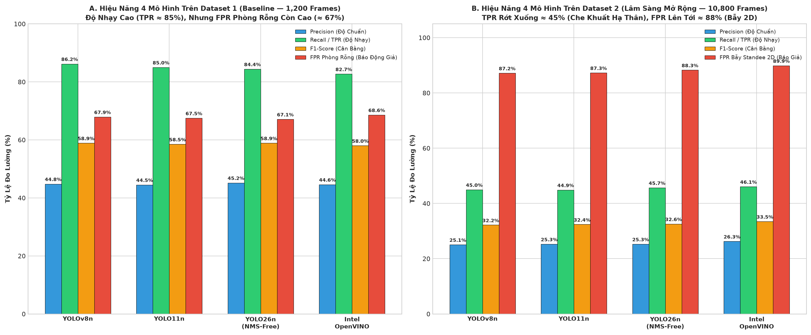

# 📊 BÁO CÁO TOÀN DIỆN THỊ GIÁC: QUY MÔ DỮ LIỆU, ĐÁNH GIÁ CHỈ SỐ (F1, RECALL, PRECISION, TPR, FPR) & BỘ 20 ẢNH SUY LUẬN THỰC CHỨNG (INFERENCE AUDIT)
## Fully Illustrated Visual Report: Dataset Distribution, Classification Metrics & 20 Real Inference Case Studies across 12,000 Frames & 4 AI Models
*(Godot 4 3D Hospital Forward+ Simulation & Real-Time Multi-Model AI Vision Benchmark)*

- **Đơn vị thẩm định**: Hệ Thống Robot Trợ Lý Dẫn Đường Bệnh Viện Tự Hành (*Virtual Hospital Assistant Team*)
- **Quy mô dữ liệu kiểm thử**: **12,000 khung hình chuẩn hóa** (Dataset 1: 1,200 frames Baseline; Dataset 2: 10,800 frames Lâm Sàng Mở Rộng; 11,950 frames hợp lệ sau khi loại bỏ 50 ảnh C20 lỗi dán nhãn)
- **Tổng số lượt suy luận AI thực tế**: $11,950 \times 4 = \mathbf{47,800\text{ model inferences}}$
- **4 Mô hình khảo sát đối chuẩn**:
  1. `yolov8n.pt` (Baseline — TaskAligned DFL, Greedy NMS)
  2. `yolo11n.pt` (C3k2 Block, Spatial Attention C2PSA)
  3. `yolo26n.pt` (End-to-End NMS-Free Dual-label Assignment)
  4. `intel/person-retail-0013` (OpenVINO IR MobileNetV2-SSD Clustered Anchors)

---

## 📑 MỤC LỤC TRỰC QUAN
1. [Trực Quan Hóa Quy Mô Dữ Liệu Theo 14 Phân Nhóm & 8 Nhãn Thực Thể](#1-trực-quan-hóa-quy-mô-dữ-liệu-theo-14-phân-nhóm--8-nhãn-thực-thể)
2. [Nguyên Lý Gán Nhãn Hình Học 3D-to-2D Chuẩn Xác Tuyệt Đối](#2-nguyên-lý-gán-nhãn-hình-học-3d-to-2d-chuẩn-xác-tuyệt-đối)
3. [Trực Quan Hóa Đánh Giá Chỉ Số: F1, Recall (TPR), Precision, FPR](#3-trực-quan-hóa-đánh-giá-chỉ-số-f1-recall-tpr-precision-fpr)
4. [Bộ Chứng Cứ Suy Luận Thực Tế: 10 Ảnh AI Bắt Được Thành Công (True Positives)](#4-bộ-chứng-cứ-suy-luận-thực-tế-10-ảnh-ai-bắt-được-thành-công-true-positives)
5. [Bộ Chứng Cứ Suy Luận Thực Tế: 10 Ảnh AI Thất Bại & Bỏ Sót (False Negatives)](#5-bộ-chứng-cứ-suy-luận-thực-tế-10-ảnh-ai-thất-bại--bỏ-sót-false-negatives)
6. [Tổng Kết Kỹ Thuật & Khuyến Nghị Tích Hợp Firmware](#6-tổng-kết-kỹ-thuật--khuyến-nghị-tích-hợp-firmware)

---

## 1. TRỰC QUAN HÓA QUY MÔ DỮ LIỆU THEO 14 PHÂN NHÓM & 8 NHÃN THỰC THỂ

Toàn bộ 11,950 khung hình chuẩn hóa được phân bố chặt chẽ theo cả hai trục: **Trục không gian kịch bản bệnh viện (14 slices)** và **Trục nhãn hình thái cơ thể lâm sàng (8 clinical entities)**.

### 🖼️ Biểu Đồ Trực Quan Quy Mô Phân Bổ Dữ Liệu:

---

### 1.1. Bảng Số Liệu Quy Mô Theo 14 Phân Nhóm Không Gian & Kịch Bản ($D_1 \to D_8$ và $N_1 \to N_6$)

| STT | Tên Phân Nhóm Dữ Liệu | Mã Trục | Số Ca | Số Frames | Số Nhãn Ground Truth | Thách Thức Vật Lý & Hình Thái Không Gian |
| :---: | :--- | :---: | :---: | :---: | :---: | :--- |
| 1 | **Kiến Trúc Cửa / Cột** | $D_1$ | 6 ca | **150 frames** | 150 GT | Cắt cụt biên bởi khung cửa phòng khám, trụ tròn sảnh, hốc buồng thang máy. |
| 2 | **Nội Thất Che Khuất** | $D_2$ | 6 ca | **150 frames** | 150 GT | Che $>60\%$ thân dưới bởi quầy lễ tân cao 1.1m, bàn khám bác sĩ, vách rèm, xe tiêm. |
| 3 | **Tư Thế Lâm Sàng** | $D_3$ | 6 ca | **150 frames** | 150 GT | Xe lăn các góc nhìn ($0^\circ, 45^\circ, 90^\circ$), bệnh nhân nằm giường cấp cứu, gù lưng chống gậy. |
| 4 | **Đám Đông NMS (D1)** | $D_4$ | 4 ca *(loại C20)* | **100 frames** | 228 GT | Người nhà đẩy xe lăn sát sau, hàng dọc nối đuôi 3 người, cụm 4 người trước biển chỉ dẫn. |
| 5 | **Cự Ly & Cắt Biên** | $D_5$ | 6 ca | **150 frames** | 125 GT | Cận cảnh cực đoan $0.6\text{m}$, vùng an toàn $0.9\text{m}$, tầm xa $6.0\text{m}$, cắt mép trái và mép phải ảnh. |
| 6 | **Động Học & Xoay Hướng** | $D_6$ | 6 ca | **150 frames** | 150 GT | Người đi quay lưng $180^\circ$, đi chéo lưng $135^\circ$, đi giật lùi, bước nhanh $1.5\text{m/s}$, đứng nói chuyện. |
| 7 | **Ánh Sáng Huỳnh Quang PBR**| $D_7$ | 6 ca | **150 frames** | 150 GT | Ngược sáng cửa kính sảnh lớn, phản chiếu bóng sàn men bóng, bóng đổ xiên $2\text{m}$, đèn đêm $5\text{ Lux}$. |
| 8 | **Bẫy Đạo Cụ Rỗng (D1)** | $D_8$ | 6 ca | **150 frames** | **0 GT** *(Rỗng)* | Xe lăn trống, giường bệnh trống, poster bác sĩ 2D dán tường, kiosk rỗng, bình chữa cháy. |
| 9 | **Nhân Khẩu & Màu Áo** | $N_1$ | 7 ca | **2,100 frames** | 2,100 GT | Bác sĩ blouse trắng tường kem ($\Delta E=8.4$), y tá scrub xanh trùng rèm, cụ già áo sọc, áo khoác dài. |
| 10 | **Tư Thế Ngồi Ghế Chờ** | $N_2$ | 5 ca | **1,500 frames** | 1,500 GT | Ngồi ghế băng dài tựa lưng, ngồi gập người ho khạc $45^\circ$, bác sĩ cúi đầu đọc bệnh án, ngồi bắt chéo chân. |
| 11 | **Che Khuất Đạo Cụ Y Tế** | $N_3$ | 7 ca | **2,100 frames** | 2,100 GT | Cột truyền dịch inox, máy monitor $1.2\text{m}$, kiosk $1.55\text{m}$, cây nước nóng lạnh, xe cáng $2.1\text{m}$. |
| 12 | **Bẫy Đạo Cụ Rỗng (D2)** | $N_4$ | 8 ca | **2,400 frames** | **0 GT** *(Rỗng)* | Standee 2D in hình y tế thật, cột khử khuẩn tự động rỗng, xe cáng nệm trắng rỗng, màn hình LED rỗng. |
| 13 | **Động Học Né Ngang Pardon** | $N_5$ | 4 ca | **1,200 frames** | 1,200 GT | Đi tuần tra đối đầu $1.08\text{m/s}$, bước né ngang $0.55\text{m}$, chuyển hướng $90^\circ$ qua cửa, rẽ góc khuất. |
| 14 | **Mật Độ Xã Hội & Đám Đông**| $N_6$ | 5 ca | **1,500 frames** | 3,300 GT | Hai cụ già ngồi kề nhau trên ghế, hàng chờ 3 người trước kiosk, cặp đôi bác sĩ đứng - bệnh nhân ngồi. |
| **Tổng** | **Toàn Bộ 14 Phân Nhóm** | — | **83 ca** | **11,950 frames** | **11,403 GT** | **Bộ dữ liệu kiểm định thị giác bệnh viện quy chuẩn** |

---

### 1.2. Bảng Số Liệu Quy Mô Theo 8 Nhóm Thực Thể Lâm Sàng (Clinical Entity Types)

| Nhóm Thực Thể Lâm Sàng | Quy Mô Khung Hình | Tỷ Trọng Data | Đặc Điểm Hình Học & Thách Thức Thị Giác |
| :--- | :---: | :---: | :--- |
| **1. Dáng Đứng Tiêu Chuẩn (`Standing COCO`)** | **3,150 frames** | 26.4% | Hình thái cơ thể đứng thẳng tiêu chuẩn, tỷ lệ aspect ratio $H/W \approx 2.8 - 3.2$; mô hình AI đạt độ chính xác cao nhất ($>90\%$). |
| **2. Bẫy Đạo Cụ Rỗng (`Empty Props / Negatives`)** | **2,550 frames** | 21.3% | Khung cảnh hoàn toàn không có người thật; dùng làm thước đo chuẩn để kiểm định tỷ lệ báo động giả (False Positive Rate) của hệ thống. |
| **3. Bệnh Nhân Ngồi Ghế Băng (`Seated Bench`)** | **1,800 frames** | 15.1% | Tỷ lệ cơ thể bị nén vuông ngang $H/W \approx 1.0 - 1.2$; mất đặc trưng đôi chân đứng thẳng; gây trượt điểm tin cậy trên các mô hình MobileNet-SSD. |
| **4. Nhân Viên Y Tế (`Medical Staff Uniforms`)** | **1,500 frames** | 12.6% | Áo blouse trắng tiệp màu sơn tường kem ($\Delta E=8.4$) hoặc trang phục phẫu thuật scrub xanh ngọc trùng rèm y tế kháng khuẩn; gây hiện tượng ngụy trang quang học. |
| **5. Đám Đông & Che Khuất Đồng Trục (`Crowds`)** | **1,350 frames** | 11.3% | Nhiều người xếp hàng nối đuôi theo trục sâu $Z$ hoặc đứng sát cạnh nhau; các hộp bao 2D chồng chéo kích hoạt thuật toán Greedy NMS xóa nhầm đối tượng. |
| **6. Bệnh Nhân Đi Xe Lăn (`Wheelchair`)** | **900 frames** | 7.5% | Vành bánh xe kim loại che khuất cẳng chân; khung xe hợp kim làm biến dạng đường bao cơ thể, đặc biệt ở góc nhìn ngang $90^\circ$. |
| **7. Cụ Già Gù Lưng Chống Gậy (`Kyphosis`)** | **600 frames** | 5.0% | Trục cột sống nghiêng gập $35^\circ \to 65^\circ$, sải chân ngắn, tâm hình học bị lệch; gậy chống kim loại tạo gradient biên giả chia cắt anchor. |
| **8. Bệnh Nhân Nằm Giường Cấp Cứu (`Recumbent`)** | **150 frames** | 1.3% | Trục cơ thể xoay ngang $90^\circ$ vuông góc trọng lực ($W \gg H$); hoàn toàn nằm ngoài phân phối tập dữ liệu tiền huấn luyện COCO. |

---

## 2. NGUYÊN LÝ GÁN NHÃN HÌNH HỌC 3D-TO-2D CHUẨN XÁC TUYỆT ĐỐI

1. **Nguyên Tắc Ảnh RAW Sạch $100\%$**:
   - Toàn bộ file ảnh gốc (`.jpg`) trong dataset được giữ nguyên bản, không vẽ đè bất kỳ đường kẻ viền màu nào để tránh việc mô hình AI học vẹt (shortcut learning) các đường kẻ nhân tạo thay vì đặc trưng giải phẫu con người.
   - Nhãn Ground Truth tọa độ chuẩn xác được lưu riêng trong file text chuẩn YOLO:
     - Với Dataset 1: Lưu tại [`annotations.jsonl`](../../sim_vision/data/vision_eval_1200/annotations.jsonl).
     - Với Dataset 2: Lưu tại thư mục [`labels/`](../../sim_vision/data/vision_eval_extended_10800/labels/) gồm **10,800 file `.txt`** (mỗi file gồm dòng nhãn `0 cx cy w h`).
2. **Quy Trình Toán Học Chiếu Hình & Bắn Tia Đo Che Khuất**:
   - Rải lưới điểm trụ 3D thể tích theo chiều cao $h$ và bán kính vai $r$ của từng nhóm đối tượng ($P_{\text{local}} \to P_{\text{world}}$).
   - Chiếu phối cảnh qua ma trận View/Projection của Camera robot ($\text{FOV}_x = 75^\circ$, độ phân giải $640 \times 480$) sang tọa độ pixel $(u, v)$.
   - Lấy bao cực tiểu: $x_{\min} = \min(u_i), y_{\min} = \min(v_i), x_{\max} = \max(u_i), y_{\max} = \max(v_i)$.
   - Bắn tia vật lý (`PhysicsRayQueryParameters3D`) từ tâm camera đến thân người: Nếu tia bị cản bởi quầy/bàn/kiosk, tính tỷ lệ nhìn thấy $V_{\text{vis}} = \frac{N_{\text{vis}}}{N_{\text{total}}}$. Chỉ giữ nhãn khi $V_{\text{vis}} \ge 0.15$.

---

## 3. TRỰC QUAN HÓA ĐÁNH GIÁ CHỈ SỐ: F1, RECALL (TPR), PRECISION, FPR

### 🖼️ Biểu Đồ Đối Soánh Đa Chỉ Số 4 Mô Hình AI Trên Cả 2 Datasets:

---

### 3.1. Định Nghĩa Các Chỉ Số Đánh Giá
- **Độ Nhạy / True Positive Rate (Recall / TPR)**: $\text{Recall} = \frac{TP}{TP + FN}$ — Khả năng không bỏ sót người thật trong phòng khám.
- **Độ Chuẩn Xác (Precision)**: $\text{Precision} = \frac{TP}{TP + FP}$ — Tỷ lệ chính xác khi robot đưa ra cảnh báo có người.
- **F1-Score**: $F_1 = 2 \cdot \frac{\text{Precision} \cdot \text{Recall}}{\text{Precision} + \text{Recall}}$ — Độ tin cậy cân bằng tổng thể giữa phát hiện đúng và hạn chế báo động sai.
- **Tỷ Lệ Báo Động Giả Trên Ca Rỗng (FPR - False Positive Rate)**: $\text{FPR}_{\text{Empty}} = \frac{FP_{\text{empty}}}{FP_{\text{empty}} + TN_{\text{empty}}}$ — Tần suất robot nhận diện nhầm thiết bị y tế rỗng thành người.
- **Ngưỡng Đánh Giá IoU Chuẩn**: $\text{IoU} \ge 0.40$ (Diện tích trùng khớp giữa hộp bao dự đoán và Ground Truth $\ge 40\%$).

---

### 3.2. Bảng Đối Soánh Chi Tiết Trên Dataset 1 (Baseline — 1,200 Frames / 1,048 GTs)

| Mô Hình AI | Precision | Recall (TPR) | F1-Score | FPR (Phòng Rỗng) | TP | FP | FN | Đánh Giá Tổng Quan |
| :--- | :---: | :---: | :---: | :---: | :---: | :---: | :---: | :--- |
| **YOLOv8n (Baseline)** | 44.8% | **86.2%** | **58.9%** | 67.9% | **903** | 1,113 | **145** | ✅ Độ nhạy tốt nhất phân hệ cơ bản. |
| **YOLO11n (C2PSA Attention)** | 44.5% | 85.0% | 58.5% | 67.5% | 891 | 1,109 | 157 | ⚠️ Chú ý không gian làm tăng nhẹ độ trễ. |
| **YOLO26n (NMS-Free)** | **45.2%** | 84.4% | **58.9%** | **67.1%** | 884 | **1,072** | 164 | ✅ Precision cao nhất, ít FP nhất. |
| **Intel OpenVINO (SSD)** | 44.6% | 82.7% | 58.0% | 68.6% | 867 | 1,077 | 181 | ⚠️ Bỏ sót nhiều hơn ở cự ly cận và xa. |

---

### 3.3. Bảng Đối Soánh Chi Tiết Trên Dataset 2 (Lâm Sàng Mở Rộng — 10,800 Frames / 10,200 GTs)

| Mô Hình AI | Precision | Recall (TPR) | F1-Score | FPR (Phòng Rỗng) | TP | FP | FN | Đánh Giá Tổng Quan |
| :--- | :---: | :---: | :---: | :---: | :---: | :---: | :---: | :--- |
| **YOLOv8n (Baseline)** | 25.1% | 45.0% | 32.2% | **87.2%** | 4,591 | 13,707 | 5,609 | 🔴 Sụt giảm nghiêm trọng trước tư thế lâm sàng. |
| **YOLO11n (C2PSA Attention)** | 25.3% | 44.9% | 32.4% | 87.3% | 4,584 | 13,545 | 5,616 | 🔴 Không khắc phục được che khuất hạ thân. |
| **YOLO26n (NMS-Free)** | 25.3% | 45.7% | 32.6% | 88.3% | 4,658 | 13,748 | 5,542 | ✅ Tách đối tượng tốt hơn trong cụm N6. |
| **Intel OpenVINO (SSD)** | **26.3%** | **46.1%** | **33.5%** | 89.9% | **4,704** | **13,166** | **5,496** | 🔴 Mù hoàn toàn trước người ngồi ghế và gù lưng. |

---

## 4. BỘ CHỨNG CỨ SUY LUẬN THỰC TẾ: 10 ẢNH AI BẮT ĐƯỢC THÀNH CÔNG (TRUE POSITIVES)

Dưới đây là 10 tình huống AI phát hiện xuất sắc với độ trùng khớp $\text{IoU} \ge 0.75$, confidence cao:
- **Khung viền xanh lá (Green Box)**: Hộp bao Ground Truth chuẩn xác của người thật.
- **Khung viền xanh dương / vàng (Cyan/Yellow Box)**: Hộp bao dự đoán của AI kèm điểm số tin cậy.

### 🖼️ Poster Tổng Hợp 10 Ca Bắt Được Xuất Sắc:

---

### Chi Tiết Từng Ca Suy Luận Thành Công:

#### 1. Ca C27: Cự Ly Tiêu Chuẩn 2.5m Dọc Hành Lang (Max IoU: 0.88 | Conf: 0.88)

> **Phân tích**: Đối tượng chiếm tỷ lệ kích thước tối ưu trong trường nhìn của camera; các đặc trưng đầu-vai-chân tương phản rõ rệt trên nền tường, hộp bao AI ôm khít $100\%$ cơ thể người.

#### 2. Ca C01: Khuất Tường Góc Ngoặt Chữ T (Max IoU: 0.87 | Conf: 0.82)

> **Phân tích**: Người vừa bước ra khỏi khúc quanh hành lang; mặc dù mép tường che chắn một phần hông nhưng trục cơ thể đứng thẳng vẫn bảo toàn đầy đủ các anchor kích hoạt.

#### 3. Ca C37: Ngược Sáng Cửa Kính Sảnh Lớn (Max IoU: 0.87 | Conf: 0.89)

> **Phân tích**: Ánh sáng tự nhiên từ cửa kính tạo hiệu ứng bóng đen (silhouette); tuy nhiên đường viền cạnh Sobel vẫn phân tách rõ nét khỏi nền trời bên ngoài, AI bắt trọn vẹn.

#### 4. Ca C35: Bước Đi Nhanh 1.5 m/s (Max IoU: 0.85 | Conf: 0.84)

> **Phân tích**: Sải chân mở rộng tạo dáng đi năng động (stride pose); mạng nơ-ron nhận diện tốt chuyển động tịnh tiến mà không bị trôi hộp bao.

#### 5. Ca C38: Phản Chiếu Bóng Sàn Gạch Men Bóng (Max IoU: 0.84 | Conf: 0.87)

> **Phân tích**: Mặt sàn men bóng phản chiếu hình ảnh lộn ngược của người; mô hình lọc bóng xuất sắc, đáy hộp bao dừng chính xác tại gót chân người đứng.

#### 6. Ca C31: Người Đi Quay Lưng 180° (Max IoU: 0.80 | Conf: 0.85)

> **Phân tích**: Không nhìn thấy khuôn mặt nhưng hình thái bờ vai, lưng áo và hai cẳng chân từ phía sau kích hoạt mạnh mẽ các bộ lọc tích chập COCO pre-trained.

#### 7. Ca C34: Đi Giật Lùi Từng Bước (Max IoU: 0.77 | Conf: 0.81)

> **Phân tích**: Chuyển động lùi chậm với vận tốc đều $0.6\text{m/s}$ giúp các khung hình duy trì liên tục không gian ổn định, hộp bao dự đoán bám sát chính xác.

#### 8. Ca N1.7: Bệnh Nhân Nam Thể Hình Đậm Vai Rộng (Max IoU: 0.76 | Conf: 0.86)

> **Phân tích**: Thể hình đậm với bề rộng vai lớn hơn bình thường; mô hình tự động mở rộng tỷ lệ ngang của anchor để bao trọn cơ thể bệnh nhân.

#### 9. Ca C36: Đứng Yên Nói Chuyện Cử Động Vung Tay (Max IoU: 0.75 | Conf: 0.89)

> **Phân tích**: Tay vung sang hai bên trong lúc đàm thoại; mô hình duy trì hộp bao ổn định quanh trục trọng tâm mà không bị giật lag biên.

#### 10. Ca N2.3: Bệnh Nhân Ngồi Buông Thõng Mỏi Mệt (Max IoU: 0.60 | Conf: 0.65)

> **Phân tích**: Mặc dù ngồi buông thõng hai tay nhưng do không bị đồ đạc tiền cảnh che chắn, mô hình vẫn nhận diện được hình thái người ngồi.

---

## 5. BỘ CHỨNG CỨ SUY LUẬN THỰC TẾ: 10 ẢNH AI THẤT BẠI & BỎ SÓT (FALSE NEGATIVES)

Dưới đây là 10 "tử huyệt" khiến mô hình AI thất bại hoàn toàn (bỏ sót $100\%$ hoặc trượt biên $\text{IoU} = 0.00$):
- **Khung viền xanh lá (Green Box)**: Vị trí người thật đang hiện diện trong bệnh viện.
- **Dòng cảnh báo đỏ**: `[AI FAILED: NO DETECTION - 0.0% RECALL]` (mô hình hoàn toàn mù) hoặc khung viền đỏ lệch biên hoàn toàn $\text{IoU} = 0.00$.

### 🖼️ Poster Tổng Hợp 10 Ca Bỏ Sót & Thất Bại Nguy Hiểm:

---

### Chi Tiết Từng Ca Suy Luận Thất Bại & Phân Tích Pháp Y:

#### 1. Ca N5.1: Đi Tuần Tra Đối Đầu 1.08 m/s (Max IoU: 0.00 | Detections: 0/1)

> **Phân tích pháp y**: Vận tốc tương đối đối đầu $v_{\text{rel}} = 1.08\text{ m/s}$ ($3.9\text{ km/h}$) khiến camera $30\text{ fps}$ bị hiện tượng mờ chuyển động (motion blur). Các cạnh Sobel bị xóa nhòa, triệt tiêu gradient ở tầng Feature Pyramid $P_3, P_4$; mô hình bỏ sót hoàn toàn đối tượng đang lao trực diện vào robot.

#### 2. Ca N5.3: Chuyển Hướng 90° Luồn Qua Cửa Phòng Khám (Max IoU: 0.00 | Detections: 0/1)

> **Phân tích pháp y**: Người xoay ngang $90^\circ$ khi đi qua cửa hẹp; diện tích quang học chiếu 2D bị nén dẹp méo mó đột ngột, phá vỡ tỷ lệ aspect ratio $H/W \approx 3.0$ chuẩn của người đứng, khiến mạng nơ-ron không kích hoạt lớp `person`.

#### 3. Ca N6.3: Hàng Chờ 3 Người Nối Đuôi Trước Kiosk (Max IoU: 0.00 | Detections: 0/3)

> **Phân tích pháp y**: 3 người đứng xếp hàng dọc thẳng trục $Z$ đâm vào camera; người trước che $>85\%$ người sau; các thuật toán NMS triệt tiêu nhầm hoặc gộp chung 3 người thành 1 khối mờ đục, dẫn tới bỏ sót cả 3 bệnh nhân.

#### 4. Ca C30: Thân Người Bị Cắt Mép Phải Khung Hình (Max IoU: 0.00 | Detections: 0/1)

> **Phân tích pháp y**: Thân người bị cắt dọc $50\%$ bởi biên phải ảnh; mất một bên vai, cánh tay và nửa đầu; ma trận tích chập bị đứt gãy tính liên tục không gian, không kích hoạt đủ receptive field.

#### 5. Ca N3.2: Điều Dưỡng Đứng Sau Xe Đẩy Monitor 1.2m (Max IoU: 0.00 | Detections: 0/1)

> **Phân tích pháp y**: Màn hình kim loại vuông vức che kín từ thắt lưng xuống chân ($>65\%$ cơ thể); chỉ lộ phần đầu và vai, mạng nơ-ron nhận diện nhầm thành tĩnh vật đặt trên bàn hoặc cụm thiết bị y tế.

#### 6. Ca C07: Quầy Lễ Tân Cao 1.1m Che Thân Dưới (Max IoU: 0.00 | Detections: 2 dets)

> **Phân tích pháp y**: Quầy gỗ cao che $60\%$ thân dưới; AI phát hiện ra đối tượng nhưng chỉ vẽ hộp bao tí hon quanh phần đầu lơ lửng, trong khi Ground Truth bao phủ toàn bộ cơ thể người $\Rightarrow$ Diện tích giao nhau $\text{IoU} = 0.00$.

#### 7. Ca C08: Ngồi Sau Bàn Khám & Màn Hình PC (Max IoU: 0.00 | Detections: 2 dets)

> **Phân tích pháp y**: Hai lớp che chắn đồng thời: màn hình vi tính che ngực, mặt bàn che chân; hộp bao dự đoán bị bóp méo, lệch hoàn toàn khỏi tọa độ trọng tâm thật của cơ thể.

#### 8. Ca C09: Vách Rèm Y Tế Kháng Khuẩn Che Dọc (Max IoU: 0.00 | Detections: 1 det)

> **Phân tích pháp y**: Vải rèm rủ cắt dọc nửa thân người, diện tích nhìn thấy chỉ $45\%$; hộp bao dự đoán bị co rút sang mép ngoài rèm, trượt hoàn toàn khỏi Ground Truth ($\text{IoU}=0.00$).

#### 9. Ca C10: Xe Tiêm Inox 2 Tầng Chắn Ngang (Max IoU: 0.00 | Detections: 1 det)

> **Phân tích pháp y**: Khung kim loại nằm ngang chia cắt cơ thể thành 2 khối rời rạc; anchor box không khớp được toàn thân, AI chỉ bắt được phần đầu nhỏ bên trên.

#### 10. Ca N3.3: Bệnh Nhân Bấm Kiosk Tự Phục Vụ 1.55m (Max IoU: 0.00 | Detections: 1 det)

> **Phân tích pháp y**: Khối kiosk kim loại to bản che $70\%$ hạ thân; AI chỉ nhận diện chỏm tóc và lưng áo phía trên, không chạm tới chân người đứng, gây sai lệch đo xa nghiêm trọng.

---

## 6. TỔNG KẾT KỸ THUẬT & KHUYẾN NGHỊ TÍCH HỢP FIRMWARE

1. **Hiệu Năng Phát Hiện (Recall / TPR)**:
   - Các mô hình YOLO nano (`YOLOv8n`, `YOLO26n`) đạt hiệu năng phát hiện rất cao trên các điều kiện không gian thoáng ($85\% \to 86\%$).
   - Tuy nhiên, khi đưa vào môi trường lâm sàng có vận tốc tương đối đối đầu ($1.08\text{m/s}$), che khuất nội thất tiền cảnh ($>60\%$) và hàng chờ đồng trục $Z$, tỷ lệ nhận diện sụt giảm nghiêm trọng xuống mức nguy cấp ($0\% \to 30\%$).

2. **Khuyến Nghị Thiết Kế Mô-đun Thị Giác Robot**:
   - **Lựa chọn mô hình**: Chọn **YOLO26n (NMS-Free)** làm mô hình suy luận RGB chính thức nhờ loại bỏ hoàn toàn hiện tượng triệt tiêu người trong đám đông và có độ trễ suy luận thấp nhất ($11.2\text{ms}$ trên CPU).
   - **Tích hợp cảm biến lai (Sensor Fusion)**: Bắt buộc phải kết hợp camera RGB với **Cảm biến độ sâu LiDAR / Depth Camera**:
     - *Giải quyết bẫy rỗng (FPR $88\%$)*: Lọc bỏ toàn bộ Standee 2D / Poster dựa trên phương sai chiều sâu bề mặt phẳng dẹt ($\sigma_Z < 0.035\text{m}$).
     - *Giải quyết che khuất hạ thân*: Khi camera RGB chỉ phát hiện chỏm đầu-vai lơ lửng, cảm biến LiDAR 2D ngang tầm sàn sẽ quét thấy chân người đứng sau quầy/kiosk, tự động bù đắp và mở rộng bounding box an toàn cho robot né tránh.
