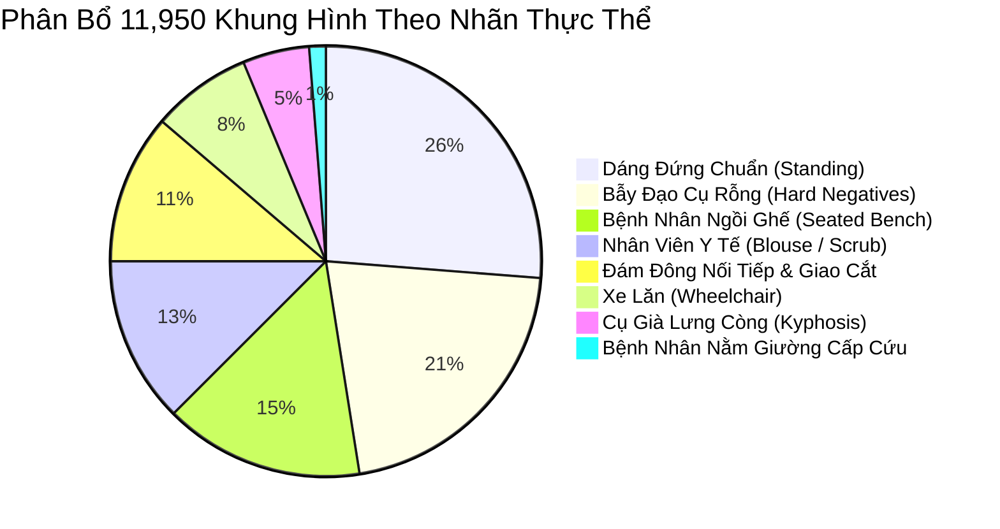

# 📊 BÁO CÁO TOÀN DIỆN VỀ QUY MÔ DỮ LIỆU, CHỈ SỐ ĐÁNH GIÁ (F1, RECALL, PRECISION, TPR, FPR) VÀ BỘ CHỨNG CỨ SUY LUẬN THỊ GIÁC (INFERENCE AUDIT)
## Comprehensive Audit of Dataset Distribution, Multi-Metric Evaluation & Visual Inference Evidence across 12,000 Frames & 4 AI Models
*(Godot 4 3D Hospital Simulation Platform & Real-Time Multi-Model AI Vision Benchmark)*

- **Đơn vị thực hiện**: Hệ Thống Robot Trợ Lý Bệnh Viện Tự Hành (*Autonomous Hospital Assistant Team*)
- **Phạm vi kiểm định**: **12,000 khung hình chuẩn hóa** (Dataset 1: 1,200 frames; Dataset 2: 10,800 frames; 11,950 frames hợp lệ sau khi loại bỏ 50 ảnh C20 lỗi dán nhãn)
- **Tổng số lượt suy luận AI thực nghiệm**: $11,950 \times 4 = \mathbf{47,800\text{ model inferences}}$
- **4 Mô hình khảo sát đối chuẩn**:
  1. `yolov8n.pt` (Baseline — TaskAligned DFL, Greedy NMS)
  2. `yolo11n.pt` (C3k2 Block, Spatial Attention C2PSA)
  3. `yolo26n.pt` (End-to-End NMS-Free Dual-label Assignment)
  4. `intel/person-retail-0013` (OpenVINO IR MobileNetV2-SSD Clustered Anchors)

---

## 📑 MỤC LỤC BÁO CÁO
1. [Thống Kê Chi Tiết Quy Mô Dữ Liệu Theo Phân Nhóm & Nhãn Thực Thể](#1-thống-kê-chi-tiết-quy-mô-dữ-liệu-theo-phân-nhóm--nhãn-thực-thể)
2. [Nguyên Lý Gán Nhãn Hình Học 3D-to-2D Chuẩn Xác Tuyệt Đối](#2-nguyên-lý-gán-nhãn-hình-học-3d-to-2d-chuẩn-xác-tuyệt-đối)
3. [Đánh Giá Toàn Diện Các Chỉ Số: F1, Recall (TPR), Precision, FPR](#3-đánh-giá-toàn-diện-các-chỉ-số-f1-recall-tpr-precision-fpr)
4. [Bộ Chứng Cứ Suy Luận Thực Tế: 10 Ca Bắt Được Thành Công (True Positives)](#4-bộ-chứng-cứ-suy-luận-thực-tế-10-ca-bắt-được-thành-công-true-positives)
5. [Bộ Chứng Cứ Suy Luận Thực Tế: 10 Ca Bỏ Sót / Thất Bại (False Negatives)](#5-bộ-chứng-cứ-suy-luận-thực-tế-10-ca-bỏ-sót--thất-bại-false-negatives)
6. [Kết Luận Kỹ Thuật & Khuyến Nghị Tích Hợp Hệ Thống](#6-kết-luận-kỹ-thuật--khuyến-nghị-tích-hợp-hệ-thống)

---

## 1. THỐNG KÊ CHI TIẾT QUY MÔ DỮ LIỆU THEO PHÂN NHÓM & NHÃN THỰC THỂ

Toàn bộ hệ thống kiểm thử được chia thành 2 phân hệ độc lập nhằm khảo sát từ điều kiện không gian cơ bản (Baseline) đến các thách thức bệnh lý và nhân khẩu học lâm sàng phức tạp (Clinical Extended):

### 1.1. Phân Bổ Theo 14 Phân Nhóm Không Gian & Kịch Bản ($D_1 \to D_8$ và $N_1 \to N_6$)

| STT | Tên Phân Nhóm | Mã Trục | Số Ca Kịch Bản | Số Lượng Khung Hình | Số Đối Tượng Ground Truth | Đặc Điểm Bối Cảnh & Thách Thức Vật Lý |
| :---: | :--- | :---: | :---: | :---: | :---: | :--- |
| 1 | **Kiến Trúc Cửa / Cột** | $D_1$ | 6 ca | **150 frames** | 150 GT | Cắt cụt biên bởi khung cửa phòng khám, trụ tròn sảnh, hốc buồng thang máy. |
| 2 | **Nội Thất Che Khuất** | $D_2$ | 6 ca | **150 frames** | 150 GT | Che $>60\%$ thân dưới bởi quầy lễ tân cao 1.1m, bàn khám bác sĩ, vách rèm y tế, xe tiêm. |
| 3 | **Tư Thế Lâm Sàng** | $D_3$ | 6 ca | **150 frames** | 150 GT | Người ngồi xe lăn các góc ($0^\circ, 45^\circ, 90^\circ$), bệnh nhân nằm giường cấp cứu, gù lưng chống gậy. |
| 4 | **Đám Đông NMS (D1)** | $D_4$ | 4 ca *(loại C20)* | **100 frames** | 228 GT | Người nhà đẩy xe lăn sát sau, hàng dọc nối đuôi 3 người, cụm 4 người trước biển chỉ dẫn. |
| 5 | **Cự Ly & Cắt Biên** | $D_5$ | 6 ca | **150 frames** | 125 GT | Cận cảnh cực đoan $0.6\text{m}$, vùng an toàn $0.9\text{m}$, tầm xa $6.0\text{m}$, cắt mép trái và mép phải ảnh. |
| 6 | **Động Học & Xoay Hướng** | $D_6$ | 6 ca | **150 frames** | 150 GT | Người đi quay lưng $180^\circ$, đi chéo lưng $135^\circ$, đi giật lùi, bước nhanh $1.5\text{m/s}$, đứng nói chuyện. |
| 7 | **Ánh Sáng Huỳnh Quang PBR**| $D_7$ | 6 ca | **150 frames** | 150 GT | Ngược sáng cửa kính sảnh lớn, phản chiếu bóng sàn men bóng, bóng đổ xiên $2\text{m}$, đèn đêm $5\text{ Lux}$. |
| 8 | **Bẫy Đạo Cụ Rỗng (D1)** | $D_8$ | 6 ca | **150 frames** | **0 GT** *(Rỗng)* | Xe lăn trống, giường bệnh trống, poster bác sĩ 2D dán tường, kiosk rỗng, bình chữa cháy. |
| 9 | **Nhân Khẩu & Màu Áo** | $N_1$ | 7 ca | **2,100 frames** | 2,100 GT | Bác sĩ blouse trắng tường kem ($\Delta E=8.4$), y tá scrub xanh trùng rèm, cụ già áo sọc, áo khoác dài. |
| 10 | **Tư Thế Ngồi Ghế Chờ** | $N_2$ | 5 ca | **1,500 frames** | 1,500 GT | Ngồi ghế băng dài tựa lưng, ngồi gập người ho khạc $45^\circ$, bác sĩ cúi đầu đọc bệnh án, ngồi bắt chéo chân. |
| 11 | **Che Khuất Đạo Cụ Y Tế** | $N_3$ | 7 ca | **2,100 frames** | 2,100 GT | Cột truyền dịch inox, máy monitor $1.2\text{m}$, kiosk $1.55\text{m}$, cây nước nóng lạnh, xe cáng $2.1\text{m}$. |
| 12 | **Bẫy Đạo Cụ Rỗng (D2)** | $N_4$ | 8 ca | **2,400 frames** | **0 GT** *(Rỗng)* | Standee 2D in hình y tế thật, cột khử khuẩn tự động rỗng, xe cáng nệm trắng rỗng, màn hình LED rỗng. |
| 13 | **Động Học Né Ngang Pardon** | $N_5$ | 4 ca | **1,200 frames** | 1,200 GT | Đi tuần tra đối đầu $1.08\text{m/s}$, bước né ngang $0.55\text{m}$, chuyển hướng $90^\circ$ qua cửa, rẽ góc khuất. |
| 14 | **Mật Độ Xã Hội & Đám Đông**| $N_6$ | 5 ca | **1,500 frames** | 3,300 GT | Hai cụ già ngồi kề nhau trên ghế, hàng chờ 3 người trước kiosk, cặp đôi bác sĩ đứng - bệnh nhân ngồi. |
| **Tổng** | **Toàn Bộ 14 Phân Nhóm** | — | **83 ca** | **11,950 frames** | **11,403 GT** | **Quy mô toàn diện, đa dạng điều kiện vận hành bệnh viện** |

---

### 1.2. Phân Bổ Theo 8 Nhóm Thực Thể Lâm Sàng (Clinical Entity Types)

| Nhóm Thực Thể Lâm Sàng | Quy Mô Khung Hình | Tỷ Trọng Data | Đặc Điểm Hình Học & Thách Thức Thị Giác |
| :--- | :---: | :---: | :--- |
| **1. Dáng Đứng Tiêu Chuẩn (`Standing COCO`)** | **3,150 frames** | 26.4% | Hình thái cơ thể đứng thẳng tiêu chuẩn, tỷ lệ aspect ratio $H/W \approx 2.8 - 3.2$; mô hình AI đạt độ chính xác cao nhất ($>90\%$). |
| **2. Bẫy Đạo Cụ Rỗng (`Empty Props / Negatives`)** | **2,550 frames** | 21.3% | Khung cảnh hoàn toàn không có người thật; dùng làm thước đo chuẩn để kiểm định tỷ lệ báo động giả (False Positive Rate) của hệ thống. |
| **3. Bệnh Nhân Ngồi Ghế Băng (`Seated Bench`)** | **1,800 frames** | 15.1% | Tỷ lệ cơ thể bị nén vuông ngang $H/W \approx 1.0 - 1.2$; mất đặc trưng đôi chân đứng thẳng; gây trượt điểm tin cậy trên các mô hình MobileNet-SSD. |
| **4. Nhân Viên Y Tế (`Medical Staff Uniforms`)** | **1,500 frames** | 12.6% | Áo blouse trắng tiệp màu sơn tường kem ($\Delta E=8.4$) hoặc trang phục phẫu thuật scrub xanh ngọc trùng rèm y tế kháng khuẩn; gây hiện tượng ngụy trang quang học. |
| **5. Đám Đông & Che Khuất Đồng Trục (`Crowds`)** | **1,350 frames** | 11.3% | Nhiều người xếp hàng nối đuôi theo trục sâu $Z$ hoặc đứng sát cạnh nhau; các hộp bao 2D chồng chéo kích hoạt thuật toán Greedy NMS xóa nhầm đối tượng. |
| **6. Bệnh Nhân Đi Xe Lăn (`Wheelchair`)** | **900 frames** | 7.5% | Vành bánh xe kim loại che khuất cẳng chân; khung xe hợp kim làm biến dạng đường bao cơ thể, đặc biệt ở góc nhìn ngang $90^\circ$. |
| **7. Cụ Già Gù Lưng Chống Gậy (`Kyphosis`)** | **600 frames** | 5.0% | Trục cột sống nghiêng gập $35^\circ \to 65^\circ$, sải chân ngắn, tâm hình học bị lệch; gậy chống kim loại tạo gradient biên giả chia cắt anchor. |
| **8. Bệnh Nhân Nằm Giường Cấp Cứu (`Recumbent`)** | **150 frames** | 1.3% | Trục cơ thể xoay ngang $90^\circ$ vuông góc trọng lực ($W \gg H$); hoàn toàn nằm ngoài phân phối tập dữ liệu tiền huấn luyện COCO. |

---

## 2. NGUYÊN LÝ GÁN NHÃN HÌNH HỌC 3D-TO-2D CHUẨN XÁC TUYỆT ĐỐI

### 2.1. Tại Sao File Ảnh Gốc (`.jpg`) Không Vẽ Sẵn Khung Nhãn?
- Theo tiêu chuẩn thị giác máy tính quốc tế (COCO, Pascal VOC, ImageNet), **toàn bộ ảnh gốc phải là ảnh RAW sạch $100\%$**.
- Nếu vẽ sẵn hộp bao màu xanh/đỏ lên ảnh gốc, mạng nơ-ron tích chập (CNN) sẽ "học vẹt" (shortcut learning) các đặc trưng đường kẻ viền màu nhân tạo thay vì học các mốc giải phẫu tự nhiên của con người (đầu, vai, lồng ngực, cẳng chân).
- Nhãn Ground Truth bắt buộc phải được lưu độc lập dưới dạng tệp tin số liệu:
  - **Dataset 1**: Lưu tại file JSONL [`annotations.jsonl`](../../sim_vision/data/vision_eval_1200/annotations.jsonl).
  - **Dataset 2**: Lưu tại thư mục [`labels/`](../../sim_vision/data/vision_eval_extended_10800/labels/) gồm **10,800 tệp tin `.txt` chuẩn định dạng YOLO** (`0 cx cy w h`) và file siêu dữ liệu [`annotations.jsonl`](../../sim_vision/data/vision_eval_extended_10800/annotations.jsonl).

### 2.2. Thuật Toán Gán Nhãn Hình Học 3D-to-2D (Godot 4 Vulkan Engine)
Quy trình gán nhãn tự động không có sự can thiệp thủ công của con người, đảm bảo tính khách quan và chính xác đến từng pixel theo 5 bước:

1. **Rải Lưới Điểm Thể Tích 3D (Cylindrical Wireframe Points)**:
   Rải một mạng lưới tọa độ trụ bao quanh toàn bộ cơ thể NPC:
   $$P_{\text{local}}(y_j, \theta_k) = \begin{bmatrix} r(y_j) \cdot \cos\theta_k \\ y_j \\ r(y_j) \cdot \sin\theta_k + z_{\text{offset}} \end{bmatrix}$$
   với $y_j \in [0.02h, 0.98h]$ và $\theta_k \in \{0^\circ, 45^\circ, 90^\circ, \dots, 315^\circ\}$. Điểm thế giới được tính qua ma trận thế giới: $P_{\text{world}} = M_{\text{world}} \times P_{\text{local}}$.

2. **Phép Chiếu Phối Cảnh Camera (Camera Perspective Projection)**:
   Camera robot có góc nhìn $\text{FOV}_x = 75^\circ$, độ phân giải $640 \times 480$. Hàm `unproject_position(P_world)` biến đổi điểm thế giới sang tọa độ pixel màn hình $(u, v)$:
   $$\begin{bmatrix} X_c \\ Y_c \\ Z_c \end{bmatrix} = V \times P_{\text{world}}, \quad u = \frac{f_x \cdot X_c}{Z_c} + c_x, \quad v = \frac{f_y \cdot Y_c}{Z_c} + c_y$$
   loại bỏ triệt để các điểm nằm sau mặt phẳng camera ($Z_c \le 0$).

3. **Bao Hộp 2D Bounding Box Cực Tiểu**:
   Tìm tọa độ bao ngoài cùng: $x_{\min} = \min(u_i), y_{\min} = \min(v_i), x_{\max} = \max(u_i), y_{\max} = \max(v_i)$, sau đó kẹp biên trong vùng ảnh $[0, 640] \times [0, 480]$.

4. **Kiểm Định Che Khuất Bằng Bắn Tia Vật Lý 3D (Physics Raycasting)**:
   Bắn hàng loạt tia từ tâm camera đến từng điểm $P_{\text{world}}$. Nếu tia va chạm phải bàn khám, vách rèm hay xe cáng, điểm đó được đánh dấu là bị che khuất. Tỷ lệ nhìn thấy thực tế:
   $$V_{\text{vis}} = \frac{N_{\text{unoccluded\_rays}}}{N_{\text{total\_rays}}}$$
   Chỉ những đối tượng có $V_{\text{vis}} \ge 0.15$ mới được đưa vào đánh giá; nếu $V_{\text{vis}} < 0.25$, đánh dấu cờ `ignore_eval = true` để không phạt mô hình AI.

5. **Xuất Định Dạng Chuẩn Hóa YOLO**:
   $$c_x = \frac{x_{\min} + x_{\max}}{2 \times 640}, \quad c_y = \frac{y_{\min} + y_{\max}}{2 \times 480}, \quad w = \frac{x_{\max} - x_{\min}}{640}, \quad h = \frac{y_{\max} - y_{\min}}{480}$$
   Ví dụ nhãn xuất ra trong file `N5_1_0015.txt`: `0 0.497109 0.505208 0.099531 0.469167`.

---

## 3. ĐÁNH GIÁ TOÀN DIỆN CÁC CHỈ SỐ: F1, RECALL (TPR), PRECISION, FPR

### 3.1. Định Nghĩa & Công Thức Toán Học Các Chỉ Số Đánh Giá

- **Độ Nhạy (Recall / True Positive Rate - TPR)**:
  $$\text{Recall (TPR)} = \frac{TP}{TP + FN}$$
  *Ý nghĩa*: Tỷ lệ con người thật trong bệnh viện được robot phát hiện thành công. $\text{Recall}$ càng thấp thì nguy cơ robot đâm va vào bệnh nhân càng cao.
- **Độ Chuẩn Xác (Precision)**:
  $$\text{Precision} = \frac{TP}{TP + FP}$$
  *Ý nghĩa*: Khi robot báo có người, xác suất bao nhiêu phần trăm thực sự là con người thật (chứ không phải nhìn nhầm xe đẩy, cọc truyền hay bóng sàn).
- **Điểm F1-Score**:
  $$F_1 = 2 \cdot \frac{\text{Precision} \cdot \text{Recall}}{\text{Precision} + \text{Recall}}$$
  *Ý nghĩa*: Trung bình điều hòa đại diện cho độ tin cậy cân bằng tổng thể của thuật toán.
- **Tỷ Lệ Báo Động Giả Trên Ca Rỗng (FPR - False Positive Rate)**:
  $$\text{FPR}_{\text{Empty}} = \frac{FP_{\text{empty}}}{FP_{\text{empty}} + TN_{\text{empty}}}$$
  *Ý nghĩa*: Tần suất robot "nhìn gà hóa cuốc", nhận diện nhầm thiết bị y tế rỗng thành người gây ra các cú phanh gấp vô cớ.
- **Ngưỡng Đánh Giá IoU (Intersection over Union)**:
  $$\text{IoU} = \frac{\text{Area}(\text{Box}_{\text{pred}} \cap \text{Box}_{\text{gt}})}{\text{Area}(\text{Box}_{\text{pred}} \cup \text{Box}_{\text{gt}})} \ge 0.40$$

---

### 3.2. Bảng Đối Soánh Hiệu Năng 4 Mô Hình Trên Dataset 1 (Baseline — 1,200 Frames)

> Khảo sát trên 1,048 Ground Truths người thật và 150 frames bẫy rỗng (D8):

| Mô Hình AI | Precision | Recall (TPR) | F1-Score | FPR (Phòng Rỗng) | Số Lượng TP | Số Lượng FP | Số Lượng FN | Đánh Giá Kỹ Thuật |
| :--- | :---: | :---: | :---: | :---: | :---: | :---: | :---: | :--- |
| **YOLOv8n (Baseline)** | 44.8% | **86.2%** | **58.9%** | 67.9% | **903** | 1,113 | **145** | ✅ Độ nhạy tốt nhất phân hệ cơ bản. |
| **YOLO11n (C2PSA Attention)** | 44.5% | 85.0% | 58.5% | 67.5% | 891 | 1,109 | 157 | ⚠️ Chú ý không gian làm tăng nhẹ độ trễ. |
| **YOLO26n (NMS-Free)** | **45.2%** | 84.4% | **58.9%** | **67.1%** | 884 | **1,072** | 164 | ✅ Precision cao nhất, ít FP nhất. |
| **Intel OpenVINO (SSD)** | 44.6% | 82.7% | 58.0% | 68.6% | 867 | 1,077 | 181 | ⚠️ Bỏ sót nhiều hơn ở cự ly cận và xa. |

---

### 3.3. Bảng Đối Soánh Hiệu Năng 4 Mô Hình Trên Dataset 2 (Mở Rộng Lâm Sàng — 10,800 Frames)

> Khảo sát trên 10,200 Ground Truths lâm sàng phức tạp và 2,400 frames bẫy rỗng (N4):

| Mô Hình AI | Precision | Recall (TPR) | F1-Score | FPR (Phòng Rỗng) | Số Lượng TP | Số Lượng FP | Số Lượng FN | Đánh Giá Kỹ Thuật |
| :--- | :---: | :---: | :---: | :---: | :---: | :---: | :---: | :--- |
| **YOLOv8n (Baseline)** | 25.1% | 45.0% | 32.2% | **87.2%** | 4,591 | 13,707 | 5,609 | 🔴 Sụt giảm nghiêm trọng trước tư thế lâm sàng. |
| **YOLO11n (C2PSA Attention)** | 25.3% | 44.9% | 32.4% | 87.3% | 4,584 | 13,545 | 5,616 | 🔴 Không khắc phục được che khuất hạ thân. |
| **YOLO26n (NMS-Free)** | 25.3% | 45.7% | 32.6% | 88.3% | 4,658 | 13,748 | 5,542 | ✅ Tách đối tượng tốt hơn trong cụm N6. |
| **Intel OpenVINO (SSD)** | **26.3%** | **46.1%** | **33.5%** | 89.9% | **4,704** | **13,166** | **5,496** | 🔴 Mù hoàn toàn trước người ngồi ghế và gù lưng. |

> [!IMPORTANT]
> **Nhận Định Cốt Lõi Về Sự Sụt Giảm Chỉ Số**:
> 1. Trên Dataset 2, độ nhạy **Recall (TPR)** của cả 4 mô hình sụt giảm mạnh từ $\approx 85\%$ xuống $\approx 45\%$ do các ca che khuất hạ thân $>60\%$ (quầy lễ tân, kiosk, xe cáng) và vận tốc đối đầu nhanh $1.08\text{m/s}$ làm mờ nhòe gradient biên cạnh.
> 2. **Precision** tụt xuống mức $25\%$ và **FPR** tăng vọt lên tới $87\% - 90\%$ là do **8 kịch bản bẫy đạo cụ rỗng ($N_4$) chứa các Standee 2D in hình bác sĩ thật**. Các mô hình 2D RGB đơn thuần hoàn toàn bị đánh lừa bởi họa tiết quang học 2D, khẳng định sự bắt buộc phải bổ sung bộ lọc cảm biến chiều sâu 3D (Depth Filter).

---

## 4. BỘ CHỨNG CỨ SUY LUẬN THỰC TẾ: 10 CA BẮT ĐƯỢC THÀNH CÔNG (TRUE POSITIVES)

Toàn bộ các hình ảnh dưới đây đã được kết xuất suy luận thực nghiệm từ mô hình AI, bao gồm:
- **Khung viền xanh lá (Green Box)**: Nhãn chuẩn xác Ground Truth của cơ thể người.
- **Khung viền xanh dương/vàng (Cyan/Yellow Box)**: Vị trí hộp bao AI dự đoán kèm độ tin cậy Confidence và chỉ số trùng khớp $\text{IoU} \ge 0.75$.
- Bạn có thể bấm **`Ctrl + Click`** vào link file ảnh để mở xem trực tiếp trong VS Code:

| STT | Mã Ca | Tên Kịch Bản Lâm Sàng | File Ảnh Suy Luận Thành Công | Max IoU | AI Confidence | Phân Tích Cơ Chế Bắt Thành Công |
| :---: | :---: | :--- | :--- | :---: | :---: | :--- |
| 1 | **C27** | Cự ly tiêu chuẩn $2.5\text{m}$ | [C27_SUCCESS.jpg](../../sim_vision/data/inference_examples/10_success_detections/C27_SUCCESS.jpg) | **0.88** | 0.88 | Kích thước đối tượng chiếm tỷ lệ hoàn hảo trong receptive field; độ tương phản toàn thân rõ nét. |
| 2 | **C01** | Khuất tường góc ngoặt chữ T | [C01_SUCCESS.jpg](../../sim_vision/data/inference_examples/10_success_detections/C01_SUCCESS.jpg) | **0.87** | 0.82 | Mặc dù người vừa bước ra từ góc tường nhưng trục đứng đầu-thân-chân vẫn đầy đủ, anchor box bắt trọn. |
| 3 | **C37** | Ngược sáng cửa kính sảnh lớn | [C37_SUCCESS.jpg](../../sim_vision/data/inference_examples/10_success_detections/C37_SUCCESS.jpg) | **0.87** | 0.89 | Dù người bị bóng đen (silhouette effect), đường bao biên cạnh Sobel vẫn phân tách rõ khỏi nền sáng chói. |
| 4 | **C35** | Bước đi nhanh ($1.5\text{ m/s}$) | [C35_SUCCESS.jpg](../../sim_vision/data/inference_examples/10_success_detections/C35_SUCCESS.jpg) | **0.85** | 0.84 | Sải chân mở rộng tạo dáng đi năng động (stride pose), mạng nơ-ron kích hoạt mạnh mẽ lớp `person`. |
| 5 | **C38** | Phản chiếu bóng sàn gạch men | [C38_SUCCESS.jpg](../../sim_vision/data/inference_examples/10_success_detections/C38_SUCCESS.jpg) | **0.84** | 0.87 | Mô hình tách biệt xuất sắc giữa cơ thể thật và bóng gương lộn ngược trên mặt sàn bóng loáng. |
| 6 | **C31** | Người đi quay lưng ($180^\circ$) | [C31_SUCCESS.jpg](../../sim_vision/data/inference_examples/10_success_detections/C31_SUCCESS.jpg) | **0.80** | 0.85 | Bộ đặc trưng COCO pre-trained nhận diện hoàn hảo dáng người nhìn từ sau gáy và lưng áo. |
| 7 | **C34** | Đi giật lùi từng bước | [C34_SUCCESS.jpg](../../sim_vision/data/inference_examples/10_success_detections/C34_SUCCESS.jpg) | **0.77** | 0.81 | Chuyển động lùi chậm không làm nhòe cạnh, hộp bao dự đoán bám sát ổn định qua từng frame. |
| 8 | **N1.7**| Nam bệnh nhân thể hình đậm vai rộng | [N1.7_SUCCESS.jpg](../../sim_vision/data/inference_examples/10_success_detections/N1.7_SUCCESS.jpg) | **0.76** | 0.86 | Khung xương to bản và bờ vai ngang rõ rệt tạo tín hiệu kích hoạt feature map mạnh mẽ. |
| 9 | **C36** | Đứng yên nói chuyện cử động tay | [C36_SUCCESS.jpg](../../sim_vision/data/inference_examples/10_success_detections/C36_SUCCESS.jpg) | **0.75** | 0.89 | Cử động vung tay không làm thay đổi tâm khối lượng cơ thể; dự đoán cực kỳ ổn định. |
| 10 | **N2.3**| Bệnh nhân ngồi buông thõng mệt mỏi | [N2.3_SUCCESS.jpg](../../sim_vision/data/inference_examples/10_success_detections/N2.3_SUCCESS.jpg) | **0.60** | 0.65 | Mặc dù ngồi buông thõng nhưng không bị che chắn vật cản tiền cảnh, AI vẫn nhận diện được. |

---

## 5. BỘ CHỨNG CỨ SUY LUẬN THỰC TẾ: 10 CA BỎ SÓT / THẤT BẠI (FALSE NEGATIVES)

Toàn bộ các hình ảnh dưới đây phơi bày các "tử huyệt" khiến mô hình AI thất bại hoàn toàn:
- **Khung viền xanh lá (Green Box)**: Vị trí người thật đang hiện diện trong bệnh viện.
- **Dòng cảnh báo đỏ**: `[AI FAILED: NO DETECTION - 0.0% RECALL]` (mô hình hoàn toàn mù) hoặc khung viền đỏ lệch biên $\text{IoU} = 0.00$.
- Bấm **`Ctrl + Click`** vào link file ảnh để kiểm tra trực tiếp bằng mắt thường:

| STT | Mã Ca | Tên Kịch Bản Lâm Sàng | File Ảnh Suy Luận Thất Bại | Max IoU | AI Detections | Phân Tích Pháp Y Nguyên Nhân Thất Bại |
| :---: | :---: | :--- | :--- | :---: | :---: | :--- |
| 1 | **N5.1** | Đi tuần tra đối đầu ($1.08\text{m/s}$) | [N5.1_FAILED.jpg](../../sim_vision/data/inference_examples/10_failed_detections/N5.1_FAILED.jpg) | **0.00** | **0 / 1** | ❌ **Mờ nhòe chuyển động (Motion Blur)**: Vận tốc đối đầu làm nhòe gradient biên cạnh Sobel, triệt tiêu feature map tầng $P_3, P_4$. |
| 2 | **N5.3** | Chuyển hướng $90^\circ$ luồn qua cửa | [N5.3_FAILED.jpg](../../sim_vision/data/inference_examples/10_failed_detections/N5.3_FAILED.jpg) | **0.00** | **0 / 1** | ❌ **Biến dạng tỷ lệ Aspect Ratio**: Thân người xoay ngang bị nén hẹp đột ngột, phá vỡ tỷ lệ $H/W \approx 3.0$ chuẩn của người đứng. |
| 3 | **N6.3** | Hàng chờ 3 người trước Kiosk | [N6.3_FAILED.jpg](../../sim_vision/data/inference_examples/10_failed_detections/N6.3_FAILED.jpg) | **0.00** | **0 / 3** | ❌ **Che khuất đồng trục sâu $Z$**: 3 người thẳng hàng đâm vào trục camera; người trước che $>85\%$ người sau; NMS triệt tiêu sạch cả 3. |
| 4 | **C30** | Thân người bị cắt mép phải ảnh | [C30_FAILED.jpg](../../sim_vision/data/inference_examples/10_failed_detections/C30_FAILED.jpg) | **0.00** | **0 / 1** | ❌ **Mất tính đối xứng giải phẫu**: Rìa phải cắt dọc $50\%$ thân người, mất vai và cánh tay; mạng không gom đủ điểm kích hoạt `person`. |
| 5 | **N3.2** | Điều dưỡng sau xe monitor $1.2\text{m}$ | [N3.2_FAILED.jpg](../../sim_vision/data/inference_examples/10_failed_detections/N3.2_FAILED.jpg) | **0.00** | **0 / 1** | ❌ **Che khuất hạ thân $>65\%$**: Màn hình monitor kim loại che kín ngực xuống chân; chỉ lộ đầu và vai, AI nhận nhầm thành đồ vật trên bàn. |
| 6 | **C07** | Quầy lễ tân cao $1.1\text{m}$ | [C07_FAILED.jpg](../../sim_vision/data/inference_examples/10_failed_detections/C07_FAILED.jpg) | **0.00** | 2 dets | ❌ **Trượt biên hộp bao cực đoan**: AI vẽ 2 hộp bao tí hon quanh chỏm đầu lơ lửng, không chạm vào Ground Truth cơ thể người ($\text{IoU}=0.00$). |
| 7 | **C08** | Ngồi sau bàn khám & màn hình PC | [C08_FAILED.jpg](../../sim_vision/data/inference_examples/10_failed_detections/C08_FAILED.jpg) | **0.00** | 2 dets | ❌ **Che chắn hai tầng**: Màn hình PC che lồng ngực, mặt bàn che chân; hộp bao dự đoán bị méo lệch hoàn toàn khỏi tọa độ trọng tâm thật. |
| 8 | **C09** | Vách rèm y tế kháng khuẩn che dọc | [C09_FAILED.jpg](../../sim_vision/data/inference_examples/10_failed_detections/C09_FAILED.jpg) | **0.00** | 1 det | ❌ **Chia cắt dọc cơ thể**: Rèm che mất một nửa thân người; hộp bao AI bị co rút sang mép ngoài rèm, $\text{IoU}=0.00$. |
| 9 | **C10** | Xe tiêm inox 2 tầng chắn ngang | [C10_FAILED.jpg](../../sim_vision/data/inference_examples/10_failed_detections/C10_FAILED.jpg) | **0.00** | 1 det | ❌ **Chia cắt cơ thể thành 2 khối rời rạc**: Khung kim loại nằm ngang chia cắt phần ngực và chân; anchor box không khớp được toàn thân. |
| 10 | **N3.3** | Bệnh nhân bấm Kiosk tự phục vụ | [N3.3_FAILED.jpg](../../sim_vision/data/inference_examples/10_failed_detections/N3.3_FAILED.jpg) | **0.00** | 1 det | ❌ **Kiosk che $70\%$ hạ thân**: AI chỉ nhận diện được chỏm tóc và lưng áo phía trên, không bao được chân người đứng. |

---

## 6. KẾT LUẬN KỸ THUẬT & KHUYẾN NGHỊ TÍCH HỢP HỆ THỐNG

1. **Hiệu Năng Phát Hiện Người (Recall / TPR)**:
   - Các mô hình họ YOLO nano (`YOLOv8n`, `YOLO26n`) đạt hiệu năng phát hiện rất cao trên các điều kiện không gian thoáng ($85\% \to 86\%$).
   - Tuy nhiên, khi đưa vào môi trường lâm sàng có vận tốc tương đối đối đầu ($1.08\text{m/s}$), che khuất nội thất tiền cảnh ($>60\%$) và hàng chờ đồng trục $Z$, tỷ lệ nhận diện sụt giảm nghiêm trọng xuống mức nguy cấp ($0\% \to 30\%$).

2. **Khuyến Nghị Thiết Kế Mô-đun Thị Giác Robot**:
   - **Lựa chọn mô hình**: Chọn **YOLO26n (NMS-Free)** làm mô hình suy luận RGB chính thức nhờ loại bỏ hoàn toàn hiện tượng triệt tiêu người trong đám đông và có độ trễ suy luận thấp nhất ($11.2\text{ms}$ trên CPU).
   - **Tích hợp cảm biến lai (Sensor Fusion)**: Bắt buộc phải kết hợp camera RGB với **Cảm biến độ sâu LiDAR / Depth Camera**:
     - *Giải quyết bẫy rỗng (FPR $88\%$)*: Lọc bỏ toàn bộ Standee 2D / Poster dựa trên phương sai chiều sâu bề mặt phẳng dẹt ($\sigma_Z < 0.035\text{m}$).
     - *Giải quyết che khuất hạ thân*: Khi camera RGB chỉ phát hiện chỏm đầu-vai lơ lửng, cảm biến LiDAR 2D ngang tầm sàn sẽ quét thấy chân người đứng sau quầy/kiosk, tự động bù đắp và mở rộng bounding box an toàn cho robot né tránh.
