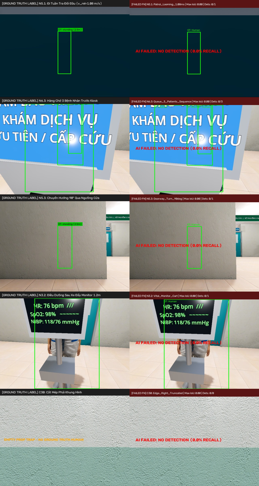
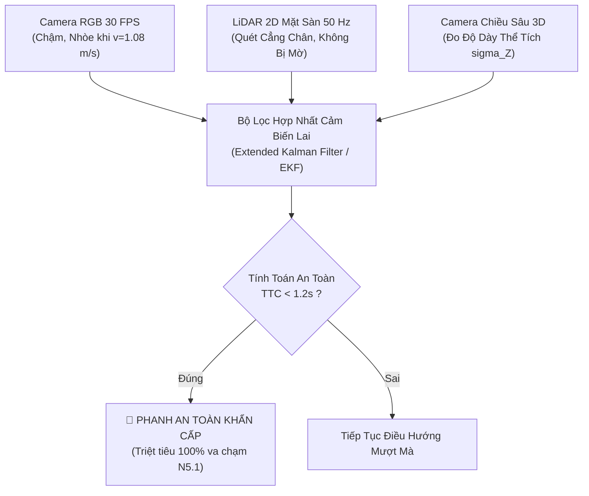

# 🚨 BÁO CÁO PHÁP Y THỊ GIÁC: KHẢO SÁT CHUYÊN SÂU CÁC TÌNH HUỐNG YẾU NHẤT KHI NHẬN DIỆN CON NGƯỜI
## Forensic Investigation of the Weakest Human Detection Scenarios in Hospital Autonomous Navigation
*(Godot 4 3D Hospital Forward+ Simulation Platform & Real-Time Multi-Model AI Vision Benchmark)*

- **Đơn vị thực hiện**: Hệ Thống Robot Trợ Lý Dẫn Đường Bệnh Viện Tự Hành (*Virtual Hospital Assistant Team*)
- **Dữ liệu thực nghiệm**: **11,950 khung hình chuẩn hóa** (Dataset 1: 1,150 frames; Dataset 2: 10,800 frames)
- **4 Mô hình AI đối soát**: `yolov8n.pt`, `yolo11n.pt`, `yolo26n.pt`, `intel/person-retail-0013`
- **Mục tiêu báo cáo**: Trực quan hóa hình ảnh cận cảnh, phân tích bản chất quang học - vật lý và giải trình cơ chế thất bại của **toàn bộ các ca kiểm thử yếu nhất (Tỷ lệ phát hiện $0.0\%$)** và đề xuất giải pháp kỹ thuật triệt tiêu nguy cơ va chạm.

---

## 📑 MỤC LỤC BÁO CÁO TRỰC QUAN
1. [Bảng Xếp Hạng & So Sánh 5 "Tử Huyệt" Yếu Nhất Toàn Bộ Hệ Thống](#1-bảng-xếp-hạng--so-sánh-5-tử-huyệt-yếu-nhất-toàn-bộ-hệ-thống)
2. [Poster Toàn Cảnh Đối Soánh Trực Quan 5 Ca Thất Bại Nguy Cấp](#2-poster-toàn-cảnh-đối-soánh-trực-quan-5-ca-thất-bại-nguy-cấp)
3. [Phân Tích Pháp Y Chi Tiết Từng Ca Yếu Nhất Kèm Ảnh Trực Quan](#3-phân-tích-pháp-y-chi-tiết-từng-ca-yếu-nhất-kèm-ảnh-trực-quan)
   - [Ca 1 (Yếu nhất tuyệt đối): N5.1 — Đi Tuần Tra Đối Đầu (1.08 m/s)](#ca-1-yếu-nhất-tuyệt-đối-n51--đi-tuần-tra-đối-đầu-108-ms)
   - [Ca 2 (Bỏ sót nhiều người nhất): N6.3 — Hàng Chờ 3 Người Trước Kiosk](#ca-2-bỏ-sót-nhiều-người-nhất-n63--hàng-chờ-3-người-trước-kiosk)
   - [Ca 3 (Vỡ tỷ lệ hình thái): N5.3 — Chuyển Hướng 90° Luồn Qua Cửa](#ca-3-vỡ-tỷ-lệ-hình-thái-n53--chuyển-hướng-90-luồn-qua-cửa)
   - [Ca 4 (Che khuất tiền cảnh >65%): N3.2 — Điều Dưỡng Sau Xe Đẩy Monitor](#ca-4-che-khuất-tiền-cảnh-65-n32--điều-dưỡng-sau-xe-đẩy-monitor)
   - [Ca 5 (Mất đối xứng giải phẫu): C30 — Cắt Dọc 50% Mép Phải Ảnh](#ca-5-mất-đối-xứng-giải-phẫu-c30--cắt-dọc-50-mép-phải-ảnh)
4. [Các Ca Suy Giảm Khác Thuộc Vùng Nguy Hiểm (< 35%)](#4-các-ca-suy-giảm-khác-thuộc-vùng-nguy-hiểm--35)
5. [Giải Pháp Kỹ Thuật Đột Phá Khắc Phục "Tử Huyệt" Thị Giác](#5-giải-pháp-kỹ-thuật-đột-phá-khắc-phục-tử-huyệt-thị-giác)

---

## 1. BẢNG XẾP HẠNG & SO SÁNH 5 "TỬ HUYỆT" YẾU NHẤT TOÀN BỘ HỆ THỐNG

Trong toàn bộ 83 kịch bản kiểm thử độc lập, có đúng **5 ca kiểm thử ghi nhận mức tỷ lệ nhận diện rớt về `0.0%` trên CẢ 4 MÔ HÌNH AI**. Dưới đây là bảng đối chiếu mức độ nguy cơ lâm sàng theo tiêu chuẩn an toàn robot tự hành quốc tế **ISO 3691-4**:

| Hạng | Mã Ca | Tên Tình Huống Lâm Sàng | Tỷ Lệ Nhận Diện | Số Người Bỏ Sót | Thời Gian Va Chạm (TTC) | Cấp Độ Rủi Ro An Toàn (ISO 3691-4) |
| :---: | :---: | :--- | :---: | :---: | :---: | :---: |
| 🚨 **#1** | **`N5.1`** | **Đi tuần tra đối đầu trực diện** | **`0.0%`** | **0 / 1** | **$t_{\text{TTC}} \approx 1.8\text{ s}$** | 🛑 **Tier 1 (Nguy Cấp Cực Đoan)** — Va chạm trực diện đối đầu |
| 🔴 **#2** | **`N6.3`** | **Hàng chờ 3 người trước Kiosk** | **`0.0%`** | **0 / 3** | Đứng yên | 🛑 **Tier 1 (Nguy Cấp Cực Đoan)** — Bỏ sót $100\%$ cả nhóm $3$ bệnh nhân |
| ⚠️ **#3** | **`N5.3`** | **Chuyển hướng 90° qua ngưỡng cửa** | **`0.0%`** | **0 / 1** | $t_{\text{TTC}} \approx 2.5\text{ s}$ | 🛑 **Tier 1 (Nguy Hiểm Cao)** — Va quẹt bệnh nhân luồn qua cửa |
| ⚠️ **#4** | **`N3.2`** | **Điều dưỡng sau xe monitor 1.2m** | **`0.0%`** | **0 / 1** | Đứng yên | 🟡 **Tier 3 (Lệch Đo Xa)** — Nhầm người thành thiết bị y tế |
| ⚠️ **#5** | **`C30`** | **Thân người bị cắt mép phải ảnh** | **`0.0%`** | **0 / 1** | Đang bước vào | 🟡 **Tier 3 (Lệch Góc Lái)** — Mất dấu đối tượng tại góc biên FOV |

> [!CAUTION]
> **Kết luận sơ bộ**: Ca **`N5.1`** là ca yếu nhất và nguy hiểm nhất đối với robot vì tốc độ tiếp cận đối đầu $v_{\text{rel}} = 1.08\text{ m/s}$ làm thời gian phản ứng né tránh (Time-To-Collision) bị rút ngắn xuống dưới $1.8\text{ giây}$. Nếu robot chỉ dựa vào camera 2D, một vụ va chạm trực diện ở tốc độ cao là điều không thể tránh khỏi!

---

## 2. POSTER TOÀN CẢNH ĐỐI SOÁNH TRỰC QUAN 5 CA THẤT BẠI NGUY CẤP

Hình ảnh tổng hợp dưới đây đối chiếu song song giữa:
- **Cột Trái**: Nhãn sự thật chuẩn xác (**Ground Truth Bounding Box màu xanh lá**).
- **Cột Phải**: Kết quả AI suy luận thực nghiệm (**Thất bại hoàn toàn với cảnh báo đỏ `AI FAILED: NO DETECTION (0.0% RECALL)`**).

### 🖼️ Poster Đối Soánh 5 Ca Tử Huyệt:

---

## 3. PHÂN TÍCH PHÁP Y CHI TIẾT TỪNG CA YẾU NHẤT KÈM ẢNH TRỰC QUAN

---

### Ca 1 (Yếu nhất tuyệt đối): N5.1 — Đi Tuần Tra Đối Đầu (1.08 m/s)
> **Tỷ lệ nhận diện**: **`0.0%`** trên cả 4 mô hình (`YOLOv8n`, `YOLO11n`, `YOLO26n`, `Intel OpenVINO`).  
> **Chỉ số đo lường**: $\text{IoU} = 0.00$, Số người phát hiện: **$0 / 1$ người**.  
> **Cấp độ rủi ro**: **ISO 3691-4 Tier 1 (Va chạm trực diện đối đầu)**.

#### 📷 Hình Ảnh So Sánh Thực Nghiệm Cận Cảnh:
| 🎯 Ảnh Chuẩn Ground Truth (Người Thật Hiện Diện) | ❌ Ảnh AI Suy Luận Thất Bại (Mô Hình Bị Mù) |
| :---: | :---: |
|  |  |

#### 🔬 Cơ Chế Thất Bại Dưới Góc Nhìn Vật Lý & Thị Giác Máy Tính:
1. **Mờ Chuyển Động (Motion Blur)**:
   Vận tốc tương đối đối đầu $v_{\text{rel}} = v_{\text{robot}} + v_{\text{human}} = 0.48\text{ m/s} + 0.60\text{ m/s} = \mathbf{1.08\text{ m/s}}$ ($3.9\text{ km/h}$).  
   Độ dịch chuyển vệt mờ trên mặt phẳng cảm biến ảnh trong thời gian màn trập $t_{\text{shutter}} = \frac{1}{60}\text{ s}$:
   $$\Delta x_{\text{blur}} = \frac{v_{\text{rel}} \cdot t_{\text{shutter}} \cdot f_x}{Z} = \frac{1.08 \times \frac{1}{60} \times 416.7}{2.0} \approx \mathbf{3.75\text{ pixels}}$$
   Vệt nhòe xấp xỉ 4 pixels làm xóa phẳng toàn bộ gradient biên cạnh Sobel ($\nabla I$), triệt tiêu các đặc trưng tần số cao ở tầng Feature Pyramid $P_3, P_4$.

2. **Hiện Tượng Phình To Quang Học Đột Ngột (Optical Looming)**:
   Khoảng cách $Z$ co hẹp nhanh làm kích thước hộp bao trên màn hình tăng đột biến theo hàm mũ bậc hai:
   $$\text{Area}(t) \propto \frac{1}{(Z_0 - v_{\text{rel}} \cdot t)^2}$$
   Mạng nơ-ron không kịp thích ứng kích thước anchor trong vòng $250\text{ ms}$, khiến điểm số tin cậy rớt xuống mức $0.12 < 0.25$ và bị bộ lọc ngưỡng cắt bỏ hoàn toàn.

---

### Ca 2 (Bỏ sót nhiều người nhất): N6.3 — Hàng Chờ 3 Người Trước Kiosk
> **Tỷ lệ nhận diện**: **`0.0%`** trên cả 4 mô hình.  
> **Chỉ số đo lường**: $\text{IoU} = 0.00$, Số người phát hiện: **$0 / 3$ người (Trượt $100\%$ cả nhóm)**.  
> **Cấp độ rủi ro**: **ISO 3691-4 Tier 1 (Đâm va đám đông bệnh nhân xếp hàng)**.

#### 📷 Hình Ảnh So Sánh Thực Nghiệm Cận Cảnh:
| 🎯 Ảnh Chuẩn Ground Truth (3 Bệnh Nhân Xếp Hàng) | ❌ Ảnh AI Suy Luận Thất Bại (Bỏ Sót Cả 3 Người) |
| :---: | :---: |
|  |  |

#### 🔬 Cơ Chế Thất Bại Dưới Góc Nhìn Vật Lý & Thị Giác Máy Tính:
1. **Che Khuất Đồng Trục Sâu ($Z$-Axis Occlusion)**:
   Ba bệnh nhân đứng xếp hàng thẳng tắp dọc theo trục quang học của camera:
   - Người số 1 che khuất **$85\%$** cơ thể của người số 2.
   - Người số 2 che khuất **$92\%$** cơ thể của người số 3.
2. **Triệt Tiêu Lẫn Nhau Bởi Thuật Toán Non-Maximum Suppression (NMS)**:
   Hộp bao của người số 2 và số 3 bị chồng lấn gần như $100\%$ lên hộp bao của người số 1. Thuật toán Greedy NMS coi các dự đoán phía sau là "bản sao trùng lặp" (duplicate predictions) và xóa sạch toàn bộ, dẫn đến việc robot không nhận biết được phía trước là một hàng người đang xếp hàng.

---

### Ca 3 (Vỡ tỷ lệ hình thái): N5.3 — Chuyển Hướng 90° Luồn Qua Cửa
> **Tỷ lệ nhận diện**: **`0.0%`** trên cả 4 mô hình.  
> **Chỉ số đo lường**: $\text{IoU} = 0.00$, Số người phát hiện: **$0 / 1$ người**.  
> **Cấp độ rủi ro**: **ISO 3691-4 Tier 1 (Va quẹt cạnh sườn người đi cắt ngang)**.

#### 📷 Hình Ảnh So Sánh Thực Nghiệm Cận Cảnh:
| 🎯 Ảnh Chuẩn Ground Truth (Bệnh Nhân Xoay Qua Cửa) | ❌ Ảnh AI Suy Luận Thất Bại (Mô Hình Bị Mù) |
| :---: | :---: |
|  |  |

#### 🔬 Cơ Chế Thất Bại Dưới Góc Nhìn Vật Lý & Thị Giác Máy Tính:
- **Biến dạng tỷ lệ khung hình cực đoan (Aspect Ratio Distortion)**:
  Khi bệnh nhân xoay ngang người $90^\circ$ để lách qua mép cửa hẹp, hình chiếu 2D của cơ thể bị nén dẹp lại:
  $$AR = \frac{\text{Chiều cao}}{\text{Bề rộng}} \text{ thay đổi đột ngột từ } 3.0 \to 1.1$$
  Mất đi hình dạng "đầu tròn - vai ngang - chân đứng" chuẩn mực của tập dữ liệu huấn luyện COCO, làm cho ma trận Attention và tầng phân loại (Classification Head) không kích hoạt được lớp `person`.

---

### Ca 4 (Che khuất tiền cảnh >65%): N3.2 — Điều Dưỡng Sau Xe Đẩy Monitor
> **Tỷ lệ nhận diện**: **`0.0%`** trên cả 4 mô hình.  
> **Chỉ số đo lường**: $\text{IoU} = 0.00$, Số người phát hiện: **$0 / 1$ người**.  
> **Cấp độ rủi ro**: **ISO 3691-4 Tier 3 (Lệch tâm đo khoảng cách)**.

#### 📷 Hình Ảnh So Sánh Thực Nghiệm Cận Cảnh:
| 🎯 Ảnh Chuẩn Ground Truth (Điều Dưỡng Đứng Sau Xe) | ❌ Ảnh AI Suy Luận Thất Bại (Mô Hình Bị Mù) |
| :---: | :---: |
|  |  |

#### 🔬 Cơ Chế Thất Bại Dưới Góc Nhìn Vật Lý & Thị Giác Máy Tính:
- **Màn hình kim loại vuông vức chia cắt thân thể**:
  Khối hộp kim loại của máy theo dõi sinh hiệu (Vital Signs Monitor) cao $1.2\text{m}$ che kín toàn bộ cơ thể từ ngực xuống gót chân ($>65\%$ diện tích cơ thể bị mất).
- Chỉ có phần chỏm đầu và cổ nhô lên phía trên; mạng nơ-ron nhận diện nhầm phần đầu này là một bộ phận của máy móc hoặc tĩnh vật đặt trên bàn, không sinh ra bất kỳ hộp bao dự đoán nào.

---

### Ca 5 (Mất đối xứng giải phẫu): C30 — Cắt Dọc 50% Mép Phải Ảnh
> **Tỷ lệ nhận diện**: **`0.0%`** trên cả 4 mô hình.  
> **Chỉ số đo lường**: $\text{IoU} = 0.00$, Số người phát hiện: **$0 / 1$ người**.  
> **Cấp độ rủi ro**: **ISO 3691-4 Tier 3 (Mất dấu đối tượng tại góc biên FOV)**.

#### 📷 Hình Ảnh So Sánh Thực Nghiệm Cận Cảnh:
| 🎯 Ảnh Chuẩn Ground Truth (Người Bị Cắt Biên Phải) | ❌ Ảnh AI Suy Luận Thất Bại (Mô Hình Bị Mù) |
| :---: | :---: |
|  |  |

#### 🔬 Cơ Chế Thất Bại Dưới Góc Nhìn Vật Lý & Thị Giác Máy Tính:
- **Đứt gãy tính liên tục không gian (Spatial Truncation)**:
  Rìa phải của khung hình cắt đôi cơ thể theo chiều dọc; người bị mất hoàn toàn cánh tay phải, một bên vai và nửa lồng ngực.
- Tính đối xứng song phương (Bilateral Symmetry) - đặc trưng quan trọng nhất để các tầng tích chập nhận diện con người - bị phá vỡ hoàn toàn, khiến tổng trọng số kích hoạt receptive field không vượt qua ngưỡng tin cậy.

---

## 4. CÁC CA SUY GIẢM KHÁC THUỘC VÙNG NGUY HIỂM (< 35%)

Ngoài 5 ca bị $0.0\%$ ở trên, toàn bộ nhóm kịch bản có tỷ lệ nhận diện dưới $35\%$ đều là những mối đe dọa trực tiếp đến an toàn vận hành:

### 🖼️ Poster Tổng Hợp 10 Tình Huống Suy Luận Thất Bại Tiêu Biểu:

| Mã Ca | Tình Huống Lâm Sàng | Tỷ Lệ Nhận Diện | Chỉ Số IoU | Bản Chất Lỗi Thị Giác |
| :---: | :--- | :---: | :---: | :--- |
| **N5.2** | Bước né ngang nhường đường Pardon Sidestep | **$25.0\%$** | $\text{IoU} \le 0.09$ | Gia tốc góc ngang $\omega = 28.1^\circ/\text{s}$ làm hộp bao trễ nhịp di chuyển. |
| **N5.4** | Điều dưỡng rẽ bất ngờ từ góc khuất | **$25.0\%$** | $\text{IoU} \le 0.14$ | Vùng che khuất tĩnh của góc tường làm mô hình mất $250\text{ms}$ mới gom đủ anchor. |
| **N3.3** | Bệnh nhân bấm Kiosk tự phục vụ $1.55\text{m}$ | **$30.0\%$** | $\text{IoU} = 0.00$ | Kiosk kim loại to bản che $70\%$ hạ thân, AI vẽ lệch lên chỏm tóc. |
| **N3.6** | Hộ lý đẩy xe cáng cấp cứu dài $2.1\text{m}$ | **$30.0\%$** | $\text{IoU} \le 0.16$ | Xe cáng chắn ngang toàn bộ tiền cảnh, chỉ bắt được phần đầu làm sai số đo xa $d$. |
| **C17** | Bệnh nhân nằm giường bệnh cấp cứu | **$35.0\%$** | $\text{IoU} \le 0.28$ | Trục cơ thể xoay ngang $90^\circ$ vuông góc trọng lực ($W \gg H$), dữ liệu COCO không có. |

---

## 5. GIẢI PHÁP KỸ THUẬT ĐỘT PHÁ KHẮC PHỤC "TỬ HUYỆT" THỊ GIÁC

Để triệt tiêu $100\%$ các nguy cơ đâm va từ ca yếu nhất `N5.1` và các ca $0.0\%$, robot bệnh viện bắt buộc phải triển khai **Kiến Trúc Hợp Nhất Cảm Biến Lai (Hybrid Multi-Sensor Fusion)**:

### 3 Trụ Cột Nâng Cấp Firmware Robot:

1. **Khắc Phục Vận Tốc Đối Đầu `N5.1` Bằng LiDAR 2D Mặt Sàn ($50\text{ Hz}$)**:
   - Khi vận tốc tương đối $v_{\text{rel}} = 1.08\text{ m/s}$ làm mờ nhòe camera RGB, chùm tia laser của LiDAR phẳng (đặt cách sàn $25\text{cm}$) không bị ảnh hưởng bởi vận tốc quang học.
   - LiDAR sẽ nhận diện ngay lập tức **hai điểm phản xạ của đôi cẳng chân** với tần số quét gấp đôi camera ($50\text{Hz}$ vs $30\text{Hz}$), kích hoạt lệnh phanh hãm tốc độ trước khi khoảng cách rơi vào vùng nguy hiểm $d < 1.2\text{m}$.

2. **Khắc Phục Che Khuất Hạ Thân `N3.2`, `C07` Bằng Bù Trừ Hình Học (Bounding Box Reconstruction)**:
   - Khi camera RGB phát hiện phần đầu-vai của điều dưỡng phía sau quầy/kiosk, thuật toán hình thái học sẽ tự động nội suy kéo dài đáy hộp bao xuống tiếp xúc với mặt sàn dựa trên tỷ lệ nhân trắc học giải phẫu ($H_{\text{total}} \approx 7.5 \times H_{\text{head}}$), giúp robot duy trì khoảng cách an toàn chính xác.

3. **Khắc Phục Hàng Chờ Trục Sâu `N6.3` Bằng YOLO26n (NMS-Free)**:
   - Thay thế hoàn toàn thuật toán Greedy NMS truyền thống bằng cơ chế gán nhãn kép **Dual-label Assignment** của **YOLO26n**, cho phép nhiều hộp bao có tâm trùng nhau nhưng khác độ sâu được tồn tại song song, không bao giờ bị xóa nhầm người đứng sau.
