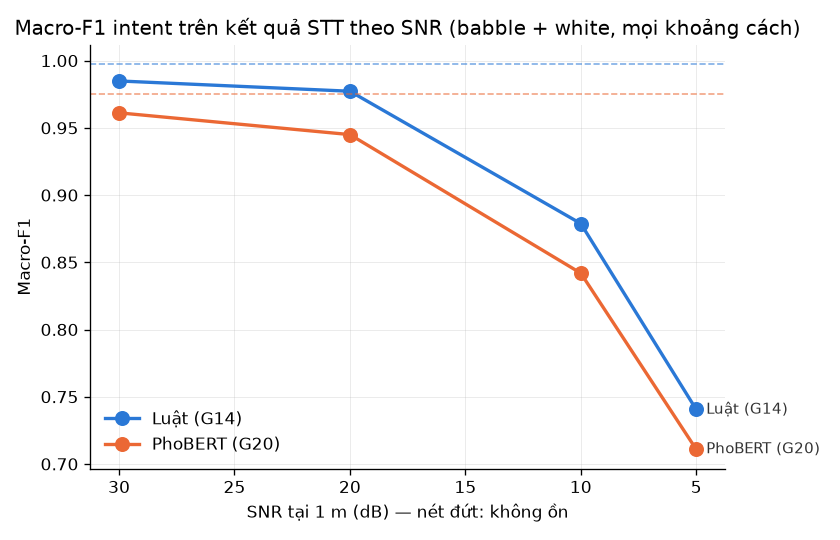

# So sánh NLU: luật (G14) và PhoBERT (G20) (G23)

Ngưỡng tin cậy: luật 0.6, PhoBERT 0.6 (chọn trên val ở G19). Cả hai cách chạy luật khẩn cấp (cap_cuu của G14) trước. Bootstrap theo câu 1000 lần; McNemar exact khi b + c < 25.

> **Hạn chế:** tập test chỉ có giọng A (1 người nói nam, 20 tuổi; giọng B chưa thu); câu train là câu sinh ra từ mẫu, không phải hội thoại bệnh viện thật; luật G14 được viết dựa trên chính câu kịch bản nên điểm của luật trên `test_ref` cao hơn thực tế. Ba intent `dieu_chinh_am_luong`, `nhac_lai`, `unknown` chưa có câu test.

## Tổng hợp

| Tập | Cách | n | Accuracy | Macro-F1 [KTC 95%] | Recall cap_cuu (n) | Tỉ lệ clarify | NLU ms TB | p95 NLU ms |
| :-- | :-- | --: | --: | :-- | :-- | --: | --: | --: |
| test_ref | Luật (G14) | 40 | 100.0% | 1.000 [1.000, 1.000] | 100.0% (2) | 0.0% | 0.8 | 1.0 |
| test_ref | PhoBERT (G20) | 40 | 92.5% | 0.964 [0.907, 1.000] | 100.0% (2) | 2.5% | 36.6 | 145.4 |
| test_stt | Luật (G14) | 1440 | 86.3% | 0.917 [0.902, 0.929] | 76.4% (72) | 12.1% | 0.8 | 1.1 |
| test_stt | PhoBERT (G20) | 1440 | 83.8% | 0.880 [0.864, 0.894] | 77.8% (72) | 4.5% | 10.6 | 13.8 |

## McNemar (cùng tập câu)

b = luật đúng, PhoBERT sai; c = luật sai, PhoBERT đúng.

| Tập | n (luật = PhoBERT) | b | c | p |
| :-- | --: | --: | --: | --: |
| test_ref | 40 | 3 | 0 | 0.25 |
| test_stt | 1440 | 78 | 42 | 0.0014 |

## test_stt theo điều kiện

### Theo SNR

| SNR | n | Acc luật | Acc PhoBERT | F1 luật | F1 PhoBERT | Recall cap_cuu luật | Recall cap_cuu PhoBERT | McNemar b/c, p |
| :-- | --: | --: | --: | --: | --: | --: | --: | --: |
| 10 dB | 320 | 82.5% | 80.9% | 0.879 | 0.842 | 75.0% | 81.2% | 19/14, 0.486 |
| 20 dB | 320 | 94.7% | 90.0% | 0.977 | 0.945 | 81.2% | 81.2% | 17/2, 0.000729 |
| 30 dB | 320 | 97.8% | 93.1% | 0.985 | 0.961 | 75.0% | 75.0% | 17/2, 0.000729 |
| 5 dB | 320 | 63.7% | 65.6% | 0.741 | 0.711 | 62.5% | 62.5% | 17/23, 0.429 |
| sạch | 160 | 99.4% | 95.0% | 0.997 | 0.975 | 100.0% | 100.0% | 8/1, 0.0391 |

### Theo khoảng cách

| khoảng cách | n | Acc luật | Acc PhoBERT | F1 luật | F1 PhoBERT | Recall cap_cuu luật | Recall cap_cuu PhoBERT | McNemar b/c, p |
| :-- | --: | --: | --: | --: | --: | --: | --: | --: |
| 0.5 m | 360 | 97.2% | 91.7% | 0.987 | 0.954 | 88.9% | 88.9% | 22/2, 3.59e-05 |
| 1 m | 360 | 94.2% | 90.0% | 0.968 | 0.943 | 94.4% | 94.4% | 21/6, 0.00705 |
| 2 m | 360 | 81.4% | 81.7% | 0.874 | 0.866 | 66.7% | 66.7% | 17/18, 1 |
| 3 m | 360 | 72.5% | 71.9% | 0.821 | 0.755 | 55.6% | 61.1% | 18/16, 0.864 |

### Theo loại ồn

| loại ồn | n | Acc luật | Acc PhoBERT | F1 luật | F1 PhoBERT | Recall cap_cuu luật | Recall cap_cuu PhoBERT | McNemar b/c, p |
| :-- | --: | --: | --: | --: | --: | --: | --: | --: |
| babble | 640 | 82.0% | 80.3% | 0.886 | 0.851 | 68.8% | 71.9% | 36/25, 0.2 |
| none | 160 | 99.4% | 95.0% | 0.997 | 0.975 | 100.0% | 100.0% | 8/1, 0.0391 |
| white | 640 | 87.3% | 84.5% | 0.925 | 0.885 | 78.1% | 78.1% | 34/16, 0.0162 |

## F1 từng lớp: test_ref

| intent | n | F1 luật | F1 PhoBERT |
| :-- | --: | --: | --: |
| bao_hiem | 2 | 1.000 | 1.000 |
| cam_on | 2 | 1.000 | 1.000 |
| cap_cuu | 2 | 1.000 | 1.000 |
| dan_duong | 2 | 1.000 | 1.000 |
| dang_ky_kham | 2 | 1.000 | 1.000 |
| dieu_chinh_toc_do | 2 | 1.000 | 1.000 |
| dung_lai | 1 | 1.000 | 1.000 |
| gap_nhan_vien | 2 | 1.000 | 1.000 |
| ho_tro_di_chuyen | 1 | 1.000 | 1.000 |
| hoi_khoa | 5 | 1.000 | 0.909 |
| hoi_phong | 7 | 1.000 | 0.727 |
| khong_ho_tro | 1 | 1.000 | 1.000 |
| nha_thuoc | 2 | 1.000 | 1.000 |
| thanh_toan | 3 | 1.000 | 1.000 |
| thoi_gian_cho | 2 | 1.000 | 1.000 |
| tien_ich | 3 | 1.000 | 0.750 |
| tiep_tuc | 1 | 1.000 | 1.000 |

## F1 từng lớp: test_stt

| intent | n | F1 luật | F1 PhoBERT |
| :-- | --: | --: | --: |
| bao_hiem | 72 | 0.964 | 0.964 |
| cam_on | 72 | 0.979 | 0.932 |
| cap_cuu | 72 | 0.866 | 0.862 |
| dan_duong | 72 | 0.929 | 0.914 |
| dang_ky_kham | 72 | 0.986 | 0.986 |
| dieu_chinh_toc_do | 72 | 0.943 | 0.944 |
| dung_lai | 36 | 0.912 | 0.899 |
| gap_nhan_vien | 72 | 0.866 | 0.879 |
| ho_tro_di_chuyen | 36 | 0.909 | 0.849 |
| hoi_khoa | 180 | 0.852 | 0.842 |
| hoi_phong | 252 | 0.955 | 0.729 |
| khong_ho_tro | 36 | 0.839 | 0.784 |
| nha_thuoc | 72 | 0.965 | 0.964 |
| thanh_toan | 108 | 0.817 | 0.821 |
| thoi_gian_cho | 72 | 0.971 | 0.979 |
| tien_ich | 108 | 0.915 | 0.696 |
| tiep_tuc | 36 | 0.925 | 0.919 |

## Câu cap_cuu bị bỏ sót

**test_ref, Luật (G14)**: 0/2 bỏ sót.

**test_ref, PhoBERT (G20)**: 0/2 bỏ sót.

**test_stt, Luật (G14)**: 17/72 bỏ sót.
- `A_26_r` (white, 30 dB, 0.5 m): "Khoa Cấp cũ ở đầu" ➔ hoi_khoa (0.60)
- `A_26_r` (white, 30 dB, 3 m): "khoa cấp cũ ở đầu" ➔ hoi_khoa (0.60)
- `A_26_r` (white, 20 dB, 2 m): "quà cấp cũ ở đầu" ➔ unknown (0.00)
- `A_26_r` (white, 10 dB, 0.5 m): "Quà cấp cũ ở đầu" ➔ unknown (0.00)
- `A_26_r` (white, 10 dB, 1 m): "Khoa cấp cũ ở đâu?" ➔ hoi_khoa (0.60)
- `A_25_r` (white, 5 dB, 2 m): "Bởi vì xem phó thẩu quá của bác sĩ đứa cùng với." ➔ unknown (0.00)
- `A_25_r` (white, 5 dB, 3 m): "Đối mặt gây khó thảm của bác sĩ giúp ranh giới" ➔ unknown (0.00)
- `A_26_r` (babble, 30 dB, 2 m): "Khoa Cấp cũ ở đầu" ➔ hoi_khoa (0.60)
- `A_26_r` (babble, 30 dB, 3 m): "n khoa cấp cũ ở đầu" ➔ hoi_khoa (0.60)
- `A_26_r` (babble, 20 dB, 2 m): "Khoa Cấp cũ ở đầu" ➔ hoi_khoa (0.60)
- `A_26_r` (babble, 20 dB, 3 m): "Khoa cấp cũ ở đâu?" ➔ hoi_khoa (0.60)
- `A_25_r` (babble, 10 dB, 3 m): "Chúng mình đang hơi thở quá bác sĩ cũng rất là vui." ➔ unknown (0.00)
- `A_26_r` (babble, 10 dB, 3 m): "Qua cây cối ở đầu." ➔ unknown (0.00)
- `A_25_r` (babble, 5 dB, 2 m): "Số mà bạn đang sáng tạo quá thì bạn đã sẽ chấp nhận cái số." ➔ unknown (0.00)
- `A_26_r` (babble, 5 dB, 2 m): "Qua cách hàng hóa đầu." ➔ unknown (0.00)
- `A_25_r` (babble, 5 dB, 3 m): "Những người nói dở quá phòng khai sinh sôi vì." ➔ hoi_phong (1.00)
- `A_26_r` (babble, 5 dB, 3 m): "Các bạn có thể." ➔ unknown (0.00)

**test_stt, PhoBERT (G20)**: 16/72 bỏ sót.
- `A_26_r` (white, 30 dB, 0.5 m): "Khoa Cấp cũ ở đầu" ➔ hoi_phong (0.55)
- `A_26_r` (white, 30 dB, 3 m): "khoa cấp cũ ở đầu" ➔ hoi_phong (0.55)
- `A_26_r` (white, 20 dB, 2 m): "quà cấp cũ ở đầu" ➔ hoi_phong (0.98)
- `A_26_r` (white, 10 dB, 0.5 m): "Quà cấp cũ ở đầu" ➔ hoi_phong (0.98)
- `A_26_r` (white, 10 dB, 1 m): "Khoa cấp cũ ở đâu?" ➔ hoi_phong (0.59)
- `A_25_r` (white, 5 dB, 2 m): "Bởi vì xem phó thẩu quá của bác sĩ đứa cùng với." ➔ dan_duong (0.92)
- `A_25_r` (white, 5 dB, 3 m): "Đối mặt gây khó thảm của bác sĩ giúp ranh giới" ➔ dan_duong (0.94)
- `A_26_r` (babble, 30 dB, 2 m): "Khoa Cấp cũ ở đầu" ➔ hoi_phong (0.55)
- `A_26_r` (babble, 30 dB, 3 m): "n khoa cấp cũ ở đầu" ➔ hoi_khoa (0.95)
- `A_26_r` (babble, 20 dB, 2 m): "Khoa Cấp cũ ở đầu" ➔ hoi_phong (0.55)
- `A_26_r` (babble, 20 dB, 3 m): "Khoa cấp cũ ở đâu?" ➔ hoi_phong (0.59)
- `A_26_r` (babble, 10 dB, 3 m): "Qua cây cối ở đầu." ➔ tien_ich (0.77)
- `A_25_r` (babble, 5 dB, 2 m): "Số mà bạn đang sáng tạo quá thì bạn đã sẽ chấp nhận cái số." ➔ nhac_lai (0.54)
- `A_26_r` (babble, 5 dB, 2 m): "Qua cách hàng hóa đầu." ➔ nhac_lai (0.81)
- `A_25_r` (babble, 5 dB, 3 m): "Những người nói dở quá phòng khai sinh sôi vì." ➔ nhac_lai (0.42)
- `A_26_r` (babble, 5 dB, 3 m): "Các bạn có thể." ➔ unknown (0.40)

