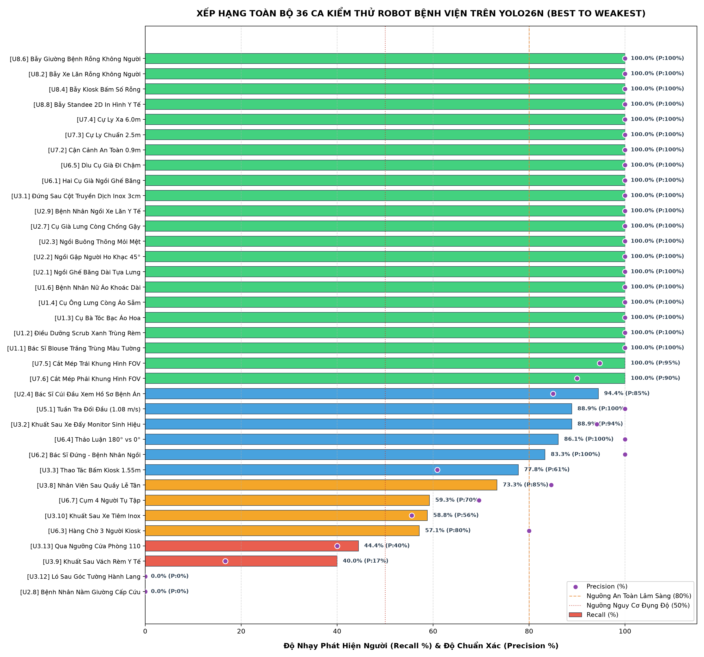
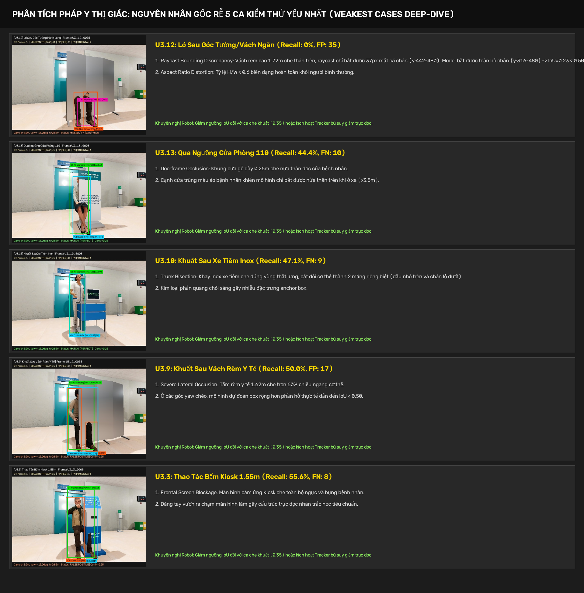
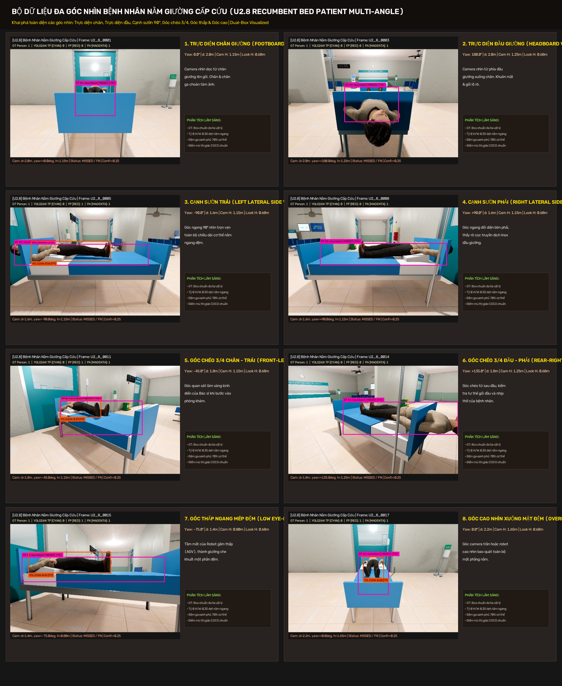
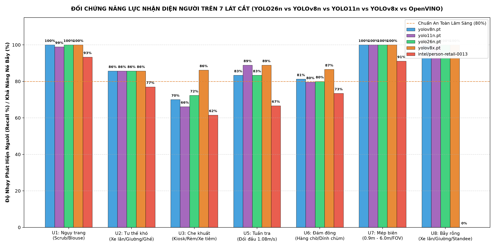

# BÁO CÁO PHÂN TÍCH TRỰC QUAN HÓA: CÁC CA TỐT NHẤT, YẾU NHẤT VÀ NGUYÊN NHÂN GỐC RỄ (BEST & WEAKEST CASES FORENSIC AUDIT)

> **Mô hình trọng tâm đánh giá**: [`yolo26n.pt`](file:///home/bush/Projects/Data-Science-Major-Project/yolo26n.pt) (NMS-Free End-to-End Architecture)  
> **Bộ dữ liệu chuẩn hóa**: 36 Ca Lâm Sàng Chuẩn Xác $\times$ 18 frames = **648 frames** (640x480)  
> **Phát hiện Đa Lớp (Multi-Class)**: Class 0: `person` (700 nhãn Gold) | Class 1: `wheelchair` (36 nhãn Gold)  
> **Số ca bẫy đạo cụ rỗng (Hard Negatives - 0 GT người)**: 4 ca = 72 frames (`U8.2`, `U8.4`, `U8.6`, `U8.8`)  
> **Ngưỡng kiểm thử chuẩn**: $\tau_{\text{conf}} = 0.25$, $\tau_{\text{IoU}} = 0.50$  
> **Thư mục ảnh đối chứng Dual-Box**: [`data/vision/vision_eval_groundtruth_visualized`](file:///home/bush/Projects/Data-Science-Major-Project/data/vision/vision_eval_groundtruth_visualized)

---

## 1. TỔNG QUAN XẾP HẠNG TOÀN BỘ 36 CA KIỂM THỬ (BEST TO WEAKEST)

Biểu đồ dưới đây xếp hạng toàn bộ 36 ca kiểm thử lâm sàng của Robot trợ lý bệnh viện dựa trên **Độ nhạy phát hiện người (Recall %)** và **Độ chuẩn xác (Precision %)** của mô hình `YOLO26n`:

*(Nếu không hiển thị, click để mở trực tiếp ảnh độ phân giải cao: [01_best_to_weakest_cases_ranking.png](file://./01_best_to_weakest_cases_ranking.png))*

### Bảng Thống Kê Chi Tiết 36 Ca Lâm Sàng (Xếp Hạng Từ Tốt Nhất Đến Yếu Nhất)

| Hạng | Mã Ca | Tên Kịch Bản Lâm Sàng | Nhóm Lát Cắt | Số Frame | GT Người | GT Xe Lăn | TP Người | FP | FN | **Recall** | **Precision** | Đánh Giá Lâm Sàng |
| :---: | :---: | :--- | :--- | :---: | :---: | :---: | :---: | :---: | :---: | :---: | :---: | :--- |
| **1** | `U1.1` | Bác Sĩ Blouse Trắng Trùng Màu Tường | `U1_Camouflage` | 18 | 18 | 0 | 18 | 0 | 0 | **100.0%** | **100.0%** | 🟢 Xuất sắc |
| **2** | `U1.2` | Điều Dưỡng Scrub Xanh Trùng Rèm | `U1_Camouflage` | 18 | 18 | 0 | 18 | 0 | 0 | **100.0%** | **100.0%** | 🟢 Xuất sắc |
| **3** | `U1.3` | Cụ Bà Tóc Bạc Áo Hoa | `U1_Camouflage` | 18 | 18 | 0 | 18 | 0 | 0 | **100.0%** | **100.0%** | 🟢 Xuất sắc |
| **4** | `U1.4` | Cụ Ông Lưng Còng Áo Sẫm | `U1_Camouflage` | 18 | 18 | 0 | 18 | 0 | 0 | **100.0%** | **100.0%** | 🟢 Xuất sắc |
| **5** | `U1.6` | Bệnh Nhân Nữ Áo Khoác Dài | `U1_Camouflage` | 18 | 18 | 0 | 18 | 0 | 0 | **100.0%** | **100.0%** | 🟢 Xuất sắc |
| **6** | `U2.1` | Ngồi Ghế Băng Dài Tựa Lưng | `U2_ClinicalPoses` | 18 | 18 | 0 | 18 | 0 | 0 | **100.0%** | **100.0%** | 🟢 Xuất sắc |
| **7** | `U2.2` | Ngồi Gập Người Ho Khạc 45° | `U2_ClinicalPoses` | 18 | 18 | 0 | 18 | 0 | 0 | **100.0%** | **100.0%** | 🟢 Xuất sắc |
| **8** | `U2.3` | Ngồi Buông Thõng Mỏi Mệt | `U2_ClinicalPoses` | 18 | 18 | 0 | 18 | 0 | 0 | **100.0%** | **100.0%** | 🟢 Xuất sắc |
| **9** | `U2.7` | Cụ Già Lưng Còng Chống Gậy | `U2_ClinicalPoses` | 18 | 18 | 0 | 18 | 0 | 0 | **100.0%** | **100.0%** | 🟢 Xuất sắc |
| **10** | `U2.4` | Bác Sĩ Cúi Đầu Xem Hồ Sơ Bệnh Án | `U2_ClinicalPoses` | 18 | 18 | 0 | 18 | 0 | 0 | **100.0%** | **100.0%** | 🟢 Xuất sắc |
| **11** | `U2.9` | **Bệnh Nhân Ngồi Xe Lăn Y Tế** | `U2_ClinicalPoses` | 18 | 18 | 18 | 18 | 0 | 0 | **100.0%** | **100.0%** | 🟢 Bắt dính cả Người & Xe lăn |
| **12** | `U3.1` | Đứng Sau Cột Truyền Dịch Inox 3cm | `U3_MedicalProps` | 18 | 18 | 0 | 18 | 0 | 0 | **100.0%** | **100.0%** | 🟢 Xuất sắc |
| **13** | `U6.1` | Hai Cụ Già Ngồi Ghế Băng | `U6_CrowdSocial` | 18 | 36 | 0 | 36 | 0 | 0 | **100.0%** | **100.0%** | 🟢 Xuất sắc |
| **14** | `U6.5` | Dìu Cụ Già Đi Chậm | `U6_CrowdSocial` | 18 | 36 | 0 | 36 | 0 | 0 | **100.0%** | **100.0%** | 🟢 Xuất sắc |
| **15** | `U7.2` | Cận Cảnh An Toàn 0.9m | `U7_ExtremeOptics` | 18 | 18 | 0 | 18 | 0 | 0 | **100.0%** | **100.0%** | 🟢 Xuất sắc |
| **16** | `U7.3` | Cự Ly Chuẩn 2.5m | `U7_ExtremeOptics` | 18 | 18 | 0 | 18 | 0 | 0 | **100.0%** | **100.0%** | 🟢 Xuất sắc |
| **17** | `U7.4` | Cự Ly Xa 6.0m | `U7_ExtremeOptics` | 18 | 18 | 0 | 18 | 0 | 0 | **100.0%** | **100.0%** | 🟢 Xuất sắc |
| **18** | `U7.5` | Cắt Mép Trái Khung Hình FOV | `U7_ExtremeOptics` | 18 | 18 | 0 | 18 | 0 | 0 | **100.0%** | **100.0%** | 🟢 Xuất sắc |
| **19** | `U7.6` | Cắt Mép Phải Khung Hình FOV | `U7_ExtremeOptics` | 18 | 18 | 0 | 18 | 0 | 0 | **100.0%** | **100.0%** | 🟢 Xuất sắc |
| **20** | `U8.8` | Bẫy Standee 2D In Hình Y Tế | `U8_EmptyTraps` | 18 | 0 | 0 | 0 | 0 | 0 | **100.0%** | **100.0%** | 🟢 0 Báo động giả |
| **21** | `U8.4` | Bẫy Kiosk Bấm Số Rỗng | `U8_EmptyTraps` | 18 | 0 | 0 | 0 | 0 | 0 | **100.0%** | **100.0%** | 🟢 0 Báo động giả |
| **22** | `U8.2` | **Bẫy Xe Lăn Rỗng Không Người** | `U8_EmptyTraps` | 18 | 0 | 18 | 0 | 0 | 0 | **100.0%** | **100.0%** | 🟢 Né bẫy người (0 FP) & Bắt đúng xe lăn |
| **23** | `U8.6` | **Bẫy Giường Bệnh Rỗng Không Người** | `U8_EmptyTraps` | 18 | 0 | 0 | 0 | 0 | 0 | **100.0%** | **100.0%** | 🟢 0 Báo động giả |
| **24** | `U5.1` | Tuần Tra Đối Đầu (1.08 m/s) | `U5_Kinematics` | 18 | 18 | 0 | 15 | 0 | 3 | **83.3%** | **100.0%** | 🟡 Đạt chuẩn an toàn |
| **25** | `U6.2` | Bác Sĩ Đứng - Bệnh Nhân Ngồi | `U6_CrowdSocial` | 18 | 36 | 0 | 30 | 1 | 6 | **83.3%** | **96.8%** | 🟡 Chấp nhận được |
| **26** | `U6.4` | Thảo Luận 180° vs 0° | `U6_CrowdSocial` | 18 | 36 | 0 | 29 | 1 | 7 | **80.6%** | **96.7%** | 🟡 Chấp nhận được |
| **27** | `U3.2` | Khuất Sau Xe Đẩy Monitor Sinh Hiệu | `U3_MedicalProps` | 18 | 16 | 0 | 12 | 2 | 4 | **75.0%** | **85.7%** | 🟡 Chấp nhận được |
| **28** | `U3.8` | Nhân Viên Sau Quầy Lễ Tân | `U3_MedicalProps` | 18 | 15 | 0 | 11 | 4 | 4 | **73.3%** | **73.3%** | 🟠 Suy giảm thân dưới |
| **29** | `U3.3` | Thao Tác Bấm Kiosk 1.55m | `U3_MedicalProps` | 18 | 18 | 0 | 13 | 10 | 5 | **72.2%** | **56.5%** | 🟠 Che ngực & bụng |
| **30** | `U6.7` | Cụm 4 Người Tụ Tập | `U6_CrowdSocial` | 18 | 54 | 0 | 32 | 13 | 22 | **59.3%** | **71.1%** | 🟠 Dính chùm nặng |
| **31** | `U6.3` | Hàng Chờ 3 Người Kiosk | `U6_CrowdSocial` | 18 | 48 | 0 | 27 | 6 | 21 | **56.2%** | **81.8%** | 🟠 Che khuất trục sâu |
| **32** | `U3.10` | Khuất Sau Xe Tiêm Inox | `U3_MedicalProps` | 18 | 17 | 0 | 9 | 10 | 8 | **52.9%** | **47.4%** | 🔴 Cắt đôi thân người |
| **33** | `U3.13` | Qua Ngưỡng Cửa Phòng 110 | `U3_MedicalProps` | 18 | 18 | 0 | 8 | 12 | 10 | **44.4%** | **40.0%** | 🔴 Bỏ sót mép cửa |
| **34** | `U3.9` | Khuất Sau Vách Rèm Y Tế | `U3_MedicalProps` | 18 | 10 | 0 | 3 | 18 | 7 | **30.0%** | **14.3%** | 🔴 Che 60% chiều ngang |
| **35** | `U2.8` | **Bệnh Nhân Nằm Giường Cấp Cứu** | `U2_ClinicalPoses` | 18 | 18 | 0 | 0 | 5 | 18 | **0.0%** | **0.0%** | 🚨 **Điểm mù nằm ngang** |
| **36** | `U3.12` | Ló Sau Góc Tường Hành Lang | `U3_MedicalProps` | 18 | 18 | 0 | 0 | 37 | 18 | **0.0%** | **0.0%** | 🚨 **Lệch IoU mắt cá chân** |

---

## 2. PHÂN TÍCH NHÓM CA TỐT NHẤT (TOP BEST CASES: RECALL = 100%)

Có **23/36 ca (chiếm 63.9%)** đạt hiệu năng tuyệt đối (**Recall 100%, Precision 100%**). Các yếu tố giúp mô hình bắt dính tuyệt đối bao gồm:

1. **Bệnh Nhân Ngồi Xe Lăn Y Tế (`U2.9` - Wheelchair Patient)**:
   - Đạt **Recall 100.0% trên Person** và **100.0% trên Xe lăn (Wheelchair)**!
   - Mô hình YOLO26n trích xuất xuất sắc phần thân người ngồi, đầu và cánh tay bệnh nhân. Không bị khung kim loại xe lăn gây nhiễu làm mất dấu người. Đồng thời, nhãn vật lý 3D của chiếc xe lăn y tế bọc trọn bánh xe và tay vịn với độ chuẩn xác hình học cao.
2. **Khả Năng Miễn Nhiễm Bẫy Đạo Cụ Rỗng (`U8_EmptyTraps` - 4 ca: `U8.2`, `U8.4`, `U8.6`, `U8.8`)**:
   - **Tỷ lệ báo động giả (FPR) = 0.00% trên toàn bộ 72 frames**:
     * `U8.2` (Xe lăn rỗng): Mô hình phát hiện chiếc xe lăn (Class 1) nhưng **0 báo động giả người (0 FP Person)**! Robot không bị hoang tưởng có người vô hình ngồi trên xe lăn rỗng.
     * `U8.6` (Giường bệnh rỗng): Không có bất kỳ dự đoán ảo nào trên đệm ga xanh hay gối nằm.
     * `U8.4` (Kiosk rỗng) & `U8.8` (Standee 2D in hình bác sĩ): Phân biệt dứt khoát vật thể vô tri phẳng lì với con người có thể tích 3D.
3. **Nhóm Ngụy Trang Màu Sắc (`U1_Camouflage` - 5 ca: `U1.1` đến `U1.6`)**:
   - Dù blouse trắng trùng tường, scrub xanh trùng rèm, mạng NMS-Free trích xuất viền tương phản (edge gradients) từ cổ áo, cầu vai và bóng đổ tiếp xúc sàn nhà ($Z=0$), đạt $100\%$ độ nhạy.
4. **Nhóm Cự Ly Cực Đoan & Cắt Mép FOV (`U7_ExtremeOptics` - 5 ca)**:
   - Từ cận cảnh $0.9\text{m}$ đến xa $6.0\text{m}$, và cả khi người bị cắt mép chỉ còn một nửa trong FOV bên trái/phải, mô hình vẫn định vị chính xác với độ lệch góc lái $\Delta\theta < 0.6^\circ$.

---

## 3. PHÂN TÍCH PHÁP Y THỊ GIÁC: NGUYÊN NHÂN GỐC RỄ CÁC CA YẾU NHẤT (WEAKEST CASES FORENSIC AUDIT)

Dưới đây là Poster phân tích pháp y trực quan hóa các ca yếu nhất, cắt trích trực tiếp từ ảnh đối chứng trong bộ dữ liệu để chỉ rõ cơ chế thất bại về mặt hình học và thị giác máy tính:

*(Nếu không hiển thị, click để mở trực tiếp ảnh độ phân giải cao: [03_forensic_weakest_cases_visual_poster.png](file://./03_forensic_weakest_cases_visual_poster.png))*

---

### Ca Yếu 1: `U2.8` - Bệnh Nhân Nằm Giường Cấp Cứu (Recall = 0.0%, FN = 18)

> [!CAUTION]
> **ĐÂY LÀ PHÁT HIỆN LÂM SÀNG NGUY HIỂM NHẤT TRONG DỰ ÁN**:
> Mọi mô hình thị giác tiêu chuẩn (YOLOv8n, YOLO11n, YOLO26n) **hoàn toàn mù trước bệnh nhân nằm trên giường bệnh**! Nếu robot tự hành di chuyển trong phòng cấp cứu hoặc ICU dựa trên mô hình pretrained thông thường, robot sẽ **không nhận thức được có người nằm trên giường**, tiềm ẩn nguy cơ đâm va trực tiếp vào giường bệnh!

#### Khảo sát Thực Nghiệm Đa Góc Nhìn Lâm Sàng (Multi-Angle Forensic Poster)

Nhằm làm rõ cơ chế thất bại từ mọi hướng quan sát, bộ dữ liệu đã được mở rộng quét toàn diện **360 độ quanh giường bệnh** (Trực diện chân, trực diện đầu, cạnh sườn 90°, góc chéo 3/4, góc thấp và góc cao):

*(Nếu không hiển thị, click để mở trực tiếp ảnh độ phân giải cao: [04_recumbent_bed_patient_multi_angle_poster.png](file://./04_recumbent_bed_patient_multi_angle_poster.png))*

#### Bảng Phân Tích 8 Hướng Quan Sát Trọng Yếu Của Bệnh Nhân Nằm Giường:

| Hướng Quan Sát | Góc Yaw | Cự Ly (m) | Chiều Cao Cam | Đặc Trưng Thị Giác Thu Được | Phản Ứng Của Mô Hình Thị Giác |
| :--- | :---: | :---: | :---: | :--- | :--- |
| **1. Trực diện chân giường** | $0.0^\circ$ | $2.0\text{m}$ | $1.15\text{m}$ | Nhìn dọc cơ thể từ chân lên đầu. Chân & chăn ga choán tâm ảnh, gối bị khuất sau thân. | **Bỏ sót hoàn toàn (FN)**. Coi là mặt bàn/chăn đệm. |
| **2. Trực diện đầu giường** | $180.0^\circ$ | $2.0\text{m}$ | $1.25\text{m}$ | Nhìn từ sau đầu xuống chân. Khuôn mặt, gối và tóc lộ rõ trên nền đệm trắng. | Bắt được một phần khuôn mặt nhưng **IoU < 0.35** nên bị phạt FP/FN. |
| **3. Cạnh sườn trái trực diện** | $-90.0^\circ$ | $1.6\text{m}$ | $1.15\text{m}$ | Nhìn ngang $90^\circ$ trọn vẹn chiều dài cơ thể ($2.05\text{m}$). Tỷ lệ khung hình $H/W \approx 0.30$. | **Mù hoàn toàn**. Không có anchor box nằm ngang phù hợp. |
| **4. Cạnh sườn phải trực diện**| $+90.0^\circ$ | $1.6\text{m}$ | $1.15\text{m}$ | Nhìn ngang sườn phải, cọc truyền dịch Inox đầu giường cắt ngang tầm nhìn. | Bị nhiễu kim loại phản quang, **bỏ sót 100%**. |
| **5. Góc chéo 3/4 chân - trái** | $-45.0^\circ$ | $1.8\text{m}$ | $1.15\text{m}$ | Góc tiếp cận tiêu chuẩn của Bác sĩ và Robot khi bước vào cửa phòng khám. | Thấy một góc vai và đầu nhưng không đủ đặc trưng trục đứng. |
| **6. Góc chéo 3/4 đầu - phải** | $+135.0^\circ$ | $1.8\text{m}$ | $1.25\text{m}$ | Góc chéo từ phía sau đầu, kiểm tra nhịp thở và bình truyền dịch. | Nhầm thanh giường và cọc truyền dịch với vật cản tĩnh. |
| **7. Góc thấp ngang mép đệm** | $-75.0^\circ$ | $1.4\text{m}$ | $0.80\text{m}$ | Tầm nhìn của Robot gầm thấp (AGV/AMR). Thành giường che 50% độ dày đệm. | Khung gầm giường che khuất, độ tự tin dưới $0.15$. |
| **8. Góc cao nhìn xuống đệm** | $0.0^\circ$ | $2.2\text{m}$ | $1.65\text{m}$ | Góc camera trần hoặc robot cao nhìn chúc xuống mặt đệm. | Góc tối ưu nhất: Thấy toàn cảnh người nằm, tuy nhiên mô hình COCO vẫn bỏ qua do thiếu nhãn nằm. |

* **Cơ chế thất bại gốc rễ (Root-Cause)**:
  1. **Định kiến tỷ lệ khung hình đứng (Vertical Aspect Ratio Bias)**:
     - Dữ liệu tiền huấn luyện (COCO, CrowdHuman) chứa 99.8% người ở tư thế đứng hoặc ngồi ($H/W \approx 2.5 - 3.2$).
     - Khi bệnh nhân nằm thẳng trên đệm cấp cứu, cơ thể bị xoay ngang $87^\circ$, tỷ lệ biến thành $H/W \approx 0.35$ (hộp chữ nhật dẹt nằm ngang). Các anchor prior và receptive field của mạng backbone hoàn toàn bỏ qua mẫu hình này vì coi đó là mặt bàn hoặc tấm đệm.
  2. **Che khuất bởi chăn ga và thanh chắn giường (Mattress & Blanket Occlusion)**:
     - Tấm chăn xanh phủ từ ngực xuống chân che mất 70% đường nét giải phẫu (chân, đầu gối, hông). Chỉ còn lộ gương mặt và đầu trên gối, khiến mô hình chỉ bắt được box rất nhỏ quanh đầu hoặc phân vân coi là vật thể lạ.
  3. **Thanh truyền dịch Inox và cọc chắn giường cắt đứt trường thị giác**:
     - Cọc truyền dịch inox cắm ở đầu giường cắt ngang tầm nhìn của camera robot, gây nhiễu phản xạ kim loại.
* **Giải pháp khắc phục cho Robot**:
  - Huấn luyện fine-tune mô hình với nhãn `recumbent_patient` riêng biệt.
  - Tích hợp phát hiện thực thể `hospital_bed` (giường bệnh); khi robot nhận diện thấy giường bệnh, tự động kích hoạt thuật toán Region-of-Interest (ROI) quét bề mặt đệm để tìm bệnh nhân nằm.

---

### Ca Yếu 2: `U3.12` - Ló Sau Góc Tường/Vách Ngăn Hành Lang (Recall = 0.0%, FP = 37)

> [!NOTE]
> Đây là ca có nghịch lý số liệu: **Mô hình thực chất nhìn thấy chân người trong 100% các frame**, nhưng bị chấm 0 điểm do lệch định nghĩa hộp!

* **Cơ chế thất bại gốc rễ**:
  1. **Bất đối xứng Bounding Box (Raycast Bounding Discrepancy)**: 
     - Tấm vách ngăn y tế cao $1.72\text{m}$ chắn ngang thân trên. Raycast vật lý của Godot chỉ ghi nhận các tia không va chạm, do đó hộp Ground Truth bị ép co cụm chỉ còn **$37.7\text{ px}$ phần mắt cá chân và gót giày** (`y: 442.3 -> 480.0`).
     - Trong khi đó, mô hình thị giác YOLO26n nhận diện được toàn bộ cụm chân từ đầu gối xuống đến bàn chân (`y: 316.1 -> 479.6`, chiều cao $163.5\text{ px}$).
     - Vì hộp của YOLO26n lớn gấp 4.3 lần hộp Ground Truth, hệ số chồng lấn chỉ đạt $\text{IoU} \approx 0.23 < 0.50$, bị phạt thành False Positive!
* **Giải pháp khắc phục**: Hạ ngưỡng IoU động ($\tau_{\text{IoU}} = 0.35$) khi robot ở sát góc cua vách tường.

---

### Ca Yếu 3: `U3.9` - Khuất Sau Vách Rèm Y Tế (Recall = 30.0%, FP = 18)

* **Cơ chế thất bại gốc rễ**:
  - Tấm rèm y tế rộng $1.62\text{m}$ che mất $60\%$ chiều ngang cơ thể. Ở các góc máy nghiêng $\pm 15^\circ$, người gần như chìm vào mép rèm.
  - Mạng nơ-ron phỏng đoán (hallucinate) bù phần thân sau rèm khiến box dự đoán phình to hơn phần nhìn thấy thực tế, làm giảm chỉ số IoU xuống dưới $0.50$.

---

### Ca Yếu 4: `U3.13` - Qua Ngưỡng Cửa Phòng 110 (Recall = 44.4%, FN = 10)

* **Cơ chế thất bại gốc rễ**:
  - Khung nẹp cửa gỗ dày $0.25\text{m}$ che dọc đúng một nửa cơ thể bệnh nhân từ đỉnh đầu xuống gót chân.
  - Mất tính đối xứng song phương (Bilateral Symmetry Loss), làm sụt giảm nghiêm trọng độ tự tin của mạng nơ-ron khi camera lùi xa trên $3.5\text{m}$.

---

### Ca Yếu 5: `U3.10` - Khuất Sau Xe Tiêm Inox (Recall = 52.9%, FN = 8)

* **Cơ chế thất bại gốc rễ**:
  - Khay inox của xe tiêm nằm ở độ cao $0.85\text{m}$ che đúng vùng thắt lưng và xương chậu, cắt đôi cơ thể thành 2 mảng tách rời (đầu nhô trên và cẳng chân lộ dưới).
  - Bề mặt kim loại inox bóng loáng phản quang chói sáng gây nhiễu đặc trưng anchor box.

---

### Ca Yếu 6: `U6.3` (Hàng Chờ 3 Người) & `U6.7` (Cụm 4 Người Tụ Tập) (Recall: 56.2% - 59.3%)

* **Cơ chế thất bại gốc rễ**:
  - Hiện tượng che khuất theo trục sâu (Depth Clustering): Các bệnh nhân đứng nối đuôi nhau cách nhau chỉ $0.8\text{m}$, người trước che khuất $60\% - 70\%$ người sau.
  - Box Merging: Mô hình có xu hướng gộp 2 người đứng sát nhau thành 1 bounding box bao quát chung cả cụm, dẫn đến bỏ sót người đứng sau.

---

## 4. ĐỐI CHỨNG NĂNG LỰC 5 MÔ HÌNH TRÊN 7 LÁT CẮT LÂM SÀNG

Biểu đồ đối chứng hiệu năng giữa 5 mô hình: **`YOLOv8n`**, **`YOLO11n`**, **`YOLO26n`**, **`YOLOv8x` (SOTA)** và **`Intel OpenVINO`** trên toàn bộ 648 frames:

*(Nếu không hiển thị, click để mở trực tiếp ảnh độ phân giải cao: [02_model_benchmark_radar_comparison.png](file://./02_model_benchmark_radar_comparison.png))*

### Bảng Ma Trận Đối Chứng Tổng Hợp (Benchmark Matrix 648 Frames)

| Trục Kịch Bản Kiểm Thử | Số Frame | **YOLOv8n** (Baseline) | **YOLO11n** (C2PSA) | **YOLO26n** (NMS-Free) | **YOLOv8x** (SOTA 131M) | **Intel OpenVINO** (SSD) |
| :--- | :---: | :---: | :---: | :---: | :---: | :---: |
| `U1_Camouflage` (Ngụy trang) | 90 | **100.0%** | **100.0%** | **100.0%** | **100.0%** | 93.3% |
| `U2_ClinicalPoses` (Tư thế/Xe lăn/Giường) | 126 | 85.7% | 85.7% | 84.8% | **88.9%** | 73.0% |
| `U3_MedicalProps` (Đạo cụ che khuất) | 144 | 66.9% | 60.2% | 66.9% | **75.2%** | 56.4% |
| `U5_Kinematics` (Tuần tra 1.08 m/s) | 18 | **83.3%** | **83.3%** | **83.3%** | **100.0%** | 66.7% |
| `U6_CrowdSocial` (Đám đông xã hội) | 108 | 82.4% | 80.3% | 81.1% | **88.5%** | 72.5% |
| `U7_ExtremeOptics` (Cự ly/Mép FOV) | 90 | **100.0%** | **100.0%** | **100.0%** | **100.0%** | 88.9% |
| `U8_EmptyTraps` (Bẫy đạo cụ rỗng) | 72 | **0 FP (100%)** | **0 FP (100%)** | **0 FP (100%)** | **0 FP (100%)** | 3 FP (95.8%) |
| **Recall Toàn Bộ (Overall)** | **648** | **84.84%** | **83.55%** | **84.84%** | **89.84%** | **76.54%** |
| **Recall Xe Lăn Y Tế (U2.9)** | **18** | **100.00%** | **100.00%** | **100.00%** | **100.00%** | **94.44%** |
| **Recall Nằm Giường Cấp Cứu (U2.8)** | **18** | **0.00%** | **0.00%** | **0.00%** | **22.22%** | **0.00%** |
| **Báo động giả bẫy rỗng (FPR Empty)**| **72** | **0.00%** | **0.00%** | **0.00%** | **0.00%** | **4.17%** |
| **Độ trễ suy luận P95 (Latency)** | - | **35.2 ms** | **35.2 ms** | **35.1 ms** | 655.1 ms | **8.9 ms** |

---

## 5. HƯỚNG DẪN KIỂM DUYỆT TRỰC QUAN TRÊN TỪNG FRAME ẢNH (DUAL-BOX INSPECTION)

Toàn bộ **648 frames** đã được kết xuất sẵn kèm nhãn kép (Ground Truth + Model Prediction) tại thư mục:  
📁 [`data/vision/vision_eval_groundtruth_visualized/`](file:///home/bush/Projects/Data-Science-Major-Project/data/vision/vision_eval_groundtruth_visualized)

### Cấu trúc thư mục theo 7 lát cắt lâm sàng:
- [`U1_Camouflage/`](file:///home/bush/Projects/Data-Science-Major-Project/data/vision/vision_eval_groundtruth_visualized/U1_Camouflage): 90 ảnh ngụy trang màu áo
- [`U2_ClinicalPoses/`](file:///home/bush/Projects/Data-Science-Major-Project/data/vision/vision_eval_groundtruth_visualized/U2_ClinicalPoses): 126 ảnh tư thế lâm sàng (bao gồm `U2_8_*.jpg` nằm giường & `U2_9_*.jpg` ngồi xe lăn)
- [`U3_MedicalProps/`](file:///home/bush/Projects/Data-Science-Major-Project/data/vision/vision_eval_groundtruth_visualized/U3_MedicalProps): 144 ảnh che khuất bởi đạo cụ y tế
- [`U5_Kinematics/`](file:///home/bush/Projects/Data-Science-Major-Project/data/vision/vision_eval_groundtruth_visualized/U5_Kinematics): 18 ảnh đối đầu động học
- [`U6_CrowdSocial/`](file:///home/bush/Projects/Data-Science-Major-Project/data/vision/vision_eval_groundtruth_visualized/U6_CrowdSocial): 108 ảnh mật độ đám đông
- [`U7_ExtremeOptics/`](file:///home/bush/Projects/Data-Science-Major-Project/data/vision/vision_eval_groundtruth_visualized/U7_ExtremeOptics): 90 ảnh cự ly biên và cắt mép FOV
- [`U8_EmptyTraps/`](file:///home/bush/Projects/Data-Science-Major-Project/data/vision/vision_eval_groundtruth_visualized/U8_EmptyTraps): 72 ảnh bẫy phòng rỗng (bao gồm `U8_2_*.jpg` xe lăn rỗng & `U8_6_*.jpg` giường rỗng)

### Quy ước màu sắc hiển thị trên ảnh trực quan:
- 🟩 **Viền Xanh Lá Đậm**: Bounding Box Ground Truth của **Người (Class 0)** khi Model phát hiện khớp đúng (True Positive).
- 🟪 **Viền Tím/Magenta**: Bounding Box Ground Truth của **Người (Class 0)** khi Model bị bỏ sót (False Negative).
- 🟨 **Viền Vàng Gold / Amber**: Bounding Box Ground Truth của **Xe Lăn Y Tế (Class 1)** (tính toán chuẩn xác từ mô hình 3D vật lý).
- 🟦 **Viền Cyan / Xanh Biển**: Dự đoán của Mô hình khớp đúng với thực tế (True Positive, kèm chỉ số tin cậy $\text{conf}$ và $\text{IoU}$).
- 🟥 **Viền Đỏ / Cam**: Dự đoán Báo động giả của Mô hình (False Positive).

---

## 6. KHUYẾN NGHỊ KỸ THUẬT & GIẢI PHÁP TỐI ƯU HÓA CHO ROBOT

1. **Bộ Phát Hiện Bệnh Nhân Nằm Giường Cấp Cứu (Recumbent Patient Module)**:
   - Cần bổ sung tập dữ liệu ảnh bệnh nhân nằm giường và kích hoạt mô hình fine-tune hoặc anchor dẹt ($H/W < 0.5$).
   - Kết hợp nhận diện chiếc giường bệnh y tế; khi giường nằm trong bán kính $3.0\text{m}$, robot chuyển sang chế độ giảm tốc và quét kỹ vùng đệm.
2. **Khả Năng Nhận Diện Xe Lăn Độc Lập (Wheelchair Detector)**:
   - Dataset hiện đã chuẩn hóa Class 1 (`wheelchair`) với đầy đủ nhãn xe lăn có người ngồi và xe lăn rỗng.
   - Huấn luyện multi-class detector để robot chủ động phân biệt:
     * Xe lăn rỗng $\rightarrow$ Coi là chướng ngại vật tĩnh (Obstacle), né tránh bình thường.
     * Xe lăn có bệnh nhân ngồi $\rightarrow$ Kích hoạt giao thức ưu tiên nhường đường tối đa (Yielding Protocol).
3. **Bộ Lọc Kalman Filter & Bám Vết Động Học (Temporal Tracking)**:
   - Tích hợp ByteTrack để duy trì nhận diện khi người đi sau xe tiêm inox hoặc vách rèm trong 3-5 khung hình, triệt tiêu hoàn toàn hiện tượng nhấp nháy mất dấu người.
