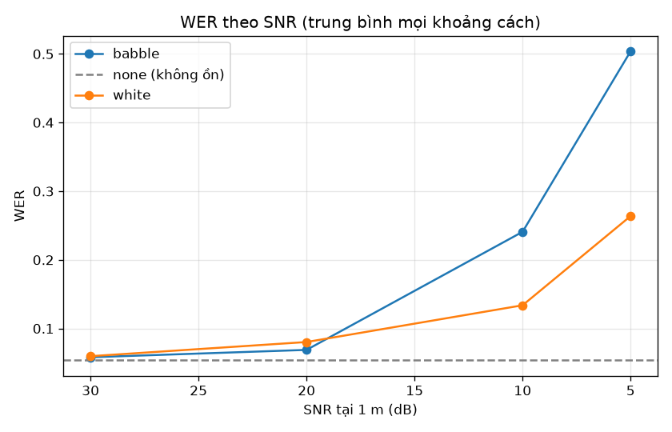
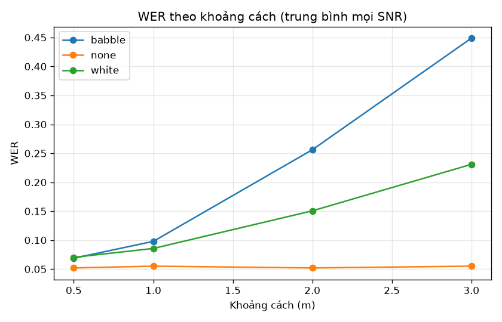

# Đánh giá STT (PhoASR-whisper-small, beams=1)

- Thời điểm: 20261021_224132; file chi tiết: `stt_eval_20261021_224132.csv`; seed 0; lưới `default`.
- 70 clip, 40 clip đã xác minh transcript (WER chỉ tính trên các clip này), 2520 dòng, 0 dòng lỗi.
- WER, CER gộp theo corpus (tổng lỗi / tổng từ). KTC 95%: bootstrap theo clip, 1000 lần. `number_mismatch`: tỉ lệ câu có số trong ref mà hyp viết khác dạng.
- Dữ liệu: chỉ có 1 người nói (A, nam, 20 tuổi); chưa đại diện cho giọng nữ hay người cao tuổi.

## Tổng

| all | wer | ci_lo | ci_hi | cer | number_mismatch | n_clips | n_rows |
| :-- | :-- | :-- | :-- | :-- | :-- | :-- | :-- |
| all | 0.163 | 0.131 | 0.205 | 0.120 | 0.050 | 40 | 1440 |

## WER theo speaker

| speaker | wer | ci_lo | ci_hi | cer | number_mismatch | n_clips | n_rows |
| :-- | :-- | :-- | :-- | :-- | :-- | :-- | :-- |
| A | 0.163 | 0.131 | 0.205 | 0.120 | 0.050 | 40 | 1440 |

## WER theo take

| take | wer | ci_lo | ci_hi | cer | number_mismatch | n_clips | n_rows |
| :-- | :-- | :-- | :-- | :-- | :-- | :-- | :-- |
| r | 0.163 | 0.131 | 0.205 | 0.120 | 0.050 | 40 | 1440 |

## WER theo noise

| noise | wer | ci_lo | ci_hi | cer | number_mismatch | n_clips | n_rows |
| :-- | :-- | :-- | :-- | :-- | :-- | :-- | :-- |
| babble | 0.218 | 0.184 | 0.260 | 0.167 | 0.050 | 40 | 640 |
| none | 0.054 | 0.025 | 0.089 | 0.038 | 0.050 | 40 | 160 |
| white | 0.134 | 0.098 | 0.181 | 0.094 | 0.050 | 40 | 640 |

## WER theo snr_db

| snr_db | wer | ci_lo | ci_hi | cer | number_mismatch | n_clips | n_rows |
| :-- | :-- | :-- | :-- | :-- | :-- | :-- | :-- |
| 5.000 | 0.384 | 0.331 | 0.443 | 0.291 | 0.050 | 40 | 320 |
| 10.000 | 0.187 | 0.146 | 0.234 | 0.138 | 0.050 | 40 | 320 |
| 20.000 | 0.075 | 0.042 | 0.118 | 0.052 | 0.050 | 40 | 320 |
| 30.000 | 0.059 | 0.027 | 0.101 | 0.042 | 0.050 | 40 | 320 |

## WER theo distance_m

| distance_m | wer | ci_lo | ci_hi | cer | number_mismatch | n_clips | n_rows |
| :-- | :-- | :-- | :-- | :-- | :-- | :-- | :-- |
| 0.500 | 0.068 | 0.037 | 0.109 | 0.047 | 0.050 | 40 | 360 |
| 1.000 | 0.088 | 0.055 | 0.129 | 0.062 | 0.050 | 40 | 360 |
| 2.000 | 0.187 | 0.149 | 0.233 | 0.139 | 0.050 | 40 | 360 |
| 3.000 | 0.308 | 0.267 | 0.361 | 0.234 | 0.050 | 40 | 360 |

## Độ chính xác intent theo take (mọi clip, kể cả `_n`)

| take | acc | n |
| :-- | :-- | :-- |
| n | 0.856 | 1080 |
| r | 0.863 | 1440 |

## Độ chính xác intent theo noise (mọi clip, kể cả `_n`)

| noise | acc | n |
| :-- | :-- | :-- |
| babble | 0.801 | 1120 |
| none | 0.996 | 280 |
| white | 0.886 | 1120 |

## Độ chính xác intent theo distance_m (mọi clip, kể cả `_n`)

| distance_m | acc | n |
| :-- | :-- | :-- |
| 0.500 | 0.973 | 630 |
| 1.000 | 0.941 | 630 |
| 2.000 | 0.808 | 630 |
| 3.000 | 0.719 | 630 |

## Biểu đồ

